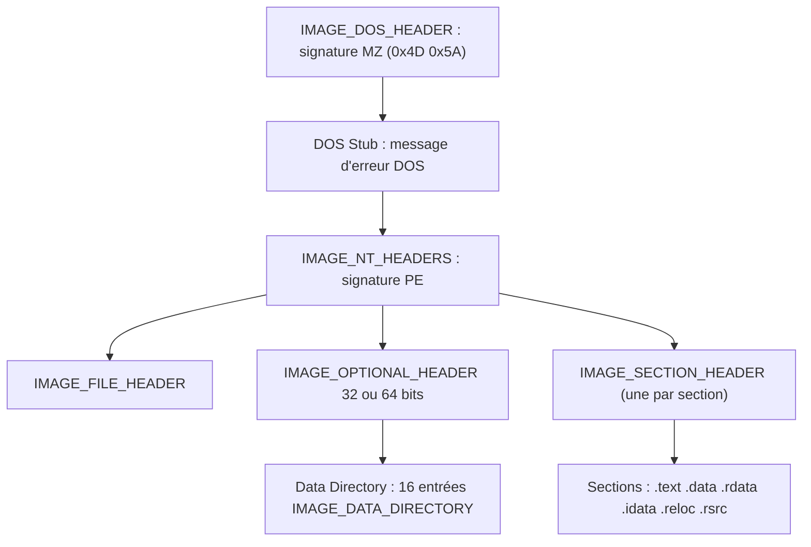

# Format PE

Le Portable Executable (PE) est le format de fichier des exécutables Windows : `.exe`, `.dll`, `.sys`, `.scr`. Dans le reste du corpus, un exécutable est souvent appelé « image ». Maîtriser la structure du PE est indispensable pour analyser un binaire, comprendre comment il est chargé en mémoire et manipuler ses en-têtes par code.

## Vue d'ensemble



Chaque en-tête est une structure C qui décrit une partie du fichier, et `IMAGE_DOS_HEADER.e_lfanew` donne l'offset exact du début de l'en-tête NT.

## En-tête DOS (IMAGE_DOS_HEADER)

C'est le tout premier bloc du fichier. Ses deux premiers octets sont `0x4D` et `0x5A`, soit `MZ`, la signature qui permet de reconnaître un PE valide.

```c
typedef struct _IMAGE_DOS_HEADER {
    WORD   e_magic;      // Magic number : 0x5A4D, soit "MZ"
    WORD   e_cblp;
    WORD   e_cp;
    WORD   e_crlc;
    WORD   e_cparhdr;
    WORD   e_minalloc;
    WORD   e_maxalloc;
    WORD   e_ss;
    WORD   e_sp;
    WORD   e_csum;
    WORD   e_ip;
    WORD   e_cs;
    WORD   e_lfarlc;
    WORD   e_ovno;
    WORD   e_res[4];
    WORD   e_oemid;
    WORD   e_oeminfo;
    WORD   e_res2[10];
    LONG   e_lfanew;     // Offset vers l'en-tête NT
} IMAGE_DOS_HEADER, *PIMAGE_DOS_HEADER;
```

Seuls deux membres comptent réellement :

| Membre | Rôle |
|---|---|
| `e_magic` | 2 octets valant `0x5A4D` (`MZ`) : validation du fichier |
| `e_lfanew` | Entier 4 octets contenant l'offset de l'en-tête NT, toujours situé à l'offset `0x3C` du fichier |

## DOS Stub

Entre l'en-tête DOS et l'en-tête NT se trouve le DOS Stub : un court programme qui affiche « This program cannot be run in DOS mode » si le fichier est lancé en mode DOS. Ce n'est pas un en-tête PE, mais le message est modifiable à la compilation, ce qui en fait une zone de stockage discrète.

## En-tête NT (IMAGE_NT_HEADERS)

L'en-tête NT regroupe deux sous-en-têtes essentiels, `FileHeader` et `OptionalHeader`. Comme l'en-tête DOS, il commence par une signature : les octets `0x50` et `0x45`, soit « PE ». Le champ étant un `DWORD`, la valeur lue est `0x50450000`, « PE » complété de deux octets nuls.

La structure diffère selon l'architecture :

```c
// Version 32 bits
typedef struct _IMAGE_NT_HEADERS {
  DWORD                   Signature;
  IMAGE_FILE_HEADER       FileHeader;
  IMAGE_OPTIONAL_HEADER32 OptionalHeader;
} IMAGE_NT_HEADERS32, *PIMAGE_NT_HEADERS32;

// Version 64 bits
typedef struct _IMAGE_NT_HEADERS64 {
  DWORD                   Signature;
  IMAGE_FILE_HEADER       FileHeader;
  IMAGE_OPTIONAL_HEADER64 OptionalHeader;
} IMAGE_NT_HEADERS64, *PIMAGE_NT_HEADERS64;
```

La seule différence entre les deux versions est le type de l'`OptionalHeader`.

## En-tête de fichier (IMAGE_FILE_HEADER)

```c
typedef struct _IMAGE_FILE_HEADER {
  WORD  Machine;
  WORD  NumberOfSections;
  DWORD TimeDateStamp;
  DWORD PointerToSymbolTable;
  DWORD NumberOfSymbols;
  WORD  SizeOfOptionalHeader;
  WORD  Characteristics;
} IMAGE_FILE_HEADER, *PIMAGE_FILE_HEADER;
```

| Membre | Rôle |
|---|---|
| `NumberOfSections` | Nombre de sections présentes dans le fichier |
| `Characteristics` | Drapeaux décrivant le binaire : DLL ou application console, exécutable ou non |
| `SizeOfOptionalHeader` | Taille de l'en-tête optionnel qui suit |

## En-tête optionnel (IMAGE_OPTIONAL_HEADER)

Malgré son nom, il est obligatoire à l'exécution ; il est dit « optionnel » parce que certains types de fichiers n'en possèdent pas. Il existe en version 32 et 64 bits, avec des membres quasi identiques : les tailles passent de `DWORD` à `ULONGLONG`, et la version 32 bits possède des membres en plus, comme `BaseOfData`.

```c
typedef struct _IMAGE_OPTIONAL_HEADER64 {
  WORD                 Magic;
  BYTE                 MajorLinkerVersion;
  BYTE                 MinorLinkerVersion;
  DWORD                SizeOfCode;
  DWORD                SizeOfInitializedData;
  DWORD                SizeOfUninitializedData;
  DWORD                AddressOfEntryPoint;
  DWORD                BaseOfCode;
  ULONGLONG            ImageBase;
  DWORD                SectionAlignment;
  DWORD                FileAlignment;
  WORD                 MajorOperatingSystemVersion;
  WORD                 MinorOperatingSystemVersion;
  WORD                 MajorImageVersion;
  WORD                 MinorImageVersion;
  WORD                 MajorSubsystemVersion;
  WORD                 MinorSubsystemVersion;
  DWORD                Win32VersionValue;
  DWORD                SizeOfImage;
  DWORD                SizeOfHeaders;
  DWORD                CheckSum;
  WORD                 Subsystem;
  WORD                 DllCharacteristics;
  ULONGLONG            SizeOfStackReserve;
  ULONGLONG            SizeOfStackCommit;
  ULONGLONG            SizeOfHeapReserve;
  ULONGLONG            SizeOfHeapCommit;
  DWORD                LoaderFlags;
  DWORD                NumberOfRvaAndSizes;
  IMAGE_DATA_DIRECTORY DataDirectory[IMAGE_NUMBEROF_DIRECTORY_ENTRIES];
} IMAGE_OPTIONAL_HEADER64, *PIMAGE_OPTIONAL_HEADER64;
```

Membres les plus utilisés :

| Membre | Signification |
|---|---|
| `Magic` | Nature de l'image : 32 ou 64 bits |
| `MajorOperatingSystemVersion` / `MinorOperatingSystemVersion` | Version minimale d'OS requise |
| `SizeOfCode` | Taille de la section `.text` |
| `AddressOfEntryPoint` | Offset du point d'entrée du fichier, en pratique la fonction `main` |
| `BaseOfCode` | Offset du début de `.text` |
| `SizeOfImage` | Taille de l'image en octets |
| `ImageBase` | Adresse préférée de chargement en mémoire |
| `DataDirectory` | Tableau des 16 répertoires de données |

`ImageBase` mérite une attention particulière : à cause d'ASLR, l'image est rarement chargée à l'adresse préférée. Le chargeur PE la place ailleurs et corrige les adresses concernées par le mécanisme de **PE relocation**, en s'appuyant sur la table `.reloc`. Toute adresse considérée comme constante dans le code devient donc fausse, ce qui casse les techniques reposant sur des offsets codés en dur.

## Répertoire de données (Data Directory)

C'est le dernier membre de l'en-tête optionnel : un tableau de 16 éléments `IMAGE_DATA_DIRECTORY`, chacun pointant vers une table ou une section particulière.

```c
typedef struct _IMAGE_DATA_DIRECTORY {
    DWORD   VirtualAddress;
    DWORD   Size;
} IMAGE_DATA_DIRECTORY, *PIMAGE_DATA_DIRECTORY;
```

```c
#define IMAGE_DIRECTORY_ENTRY_EXPORT          0   // Export Directory
#define IMAGE_DIRECTORY_ENTRY_IMPORT          1   // Import Directory
#define IMAGE_DIRECTORY_ENTRY_RESOURCE        2   // Resource Directory
#define IMAGE_DIRECTORY_ENTRY_EXCEPTION       3   // Exception Directory
#define IMAGE_DIRECTORY_ENTRY_SECURITY        4   // Security Directory
#define IMAGE_DIRECTORY_ENTRY_BASERELOC       5   // Base Relocation Table
#define IMAGE_DIRECTORY_ENTRY_DEBUG           6   // Debug Directory
#define IMAGE_DIRECTORY_ENTRY_ARCHITECTURE    7   // Architecture Specific Data
#define IMAGE_DIRECTORY_ENTRY_GLOBALPTR       8   // RVA of GP
#define IMAGE_DIRECTORY_ENTRY_TLS             9   // TLS Directory
#define IMAGE_DIRECTORY_ENTRY_LOAD_CONFIG    10   // Load Configuration Directory
#define IMAGE_DIRECTORY_ENTRY_BOUND_IMPORT   11   // Bound Import Directory
#define IMAGE_DIRECTORY_ENTRY_IAT            12   // Import Address Table
#define IMAGE_DIRECTORY_ENTRY_DELAY_IMPORT   13   // Delay Load Import Descriptors
#define IMAGE_DIRECTORY_ENTRY_COM_DESCRIPTOR 14   // COM Runtime descriptor
```

Deux entrées structurent tout le fonctionnement d'un binaire Windows :

| Entrée | Contenu |
|---|---|
| Export Directory (0) | Fonctions et variables exportées par l'image, avec leurs adresses. Présente surtout dans les DLL : `kernel32.dll` exporte ainsi `CreateFileA` |
| Import Address Table (12) | Adresses des fonctions importées depuis d'autres images. C'est la table que le chargeur remplit avant de démarrer le programme |

Ces deux tables sont la cible privilégiée des techniques de dissimulation : voir [[Dissimulation de l'IAT]] et [[Dynamic-Link Library]].

## Sections PE

Une section contient du code, des données ou des ressources. Leur nombre n'est pas fixe : le compilateur peut en ajouter, en retirer ou en fusionner, et un analyste peut en insérer à la main. C'est `IMAGE_FILE_HEADER.NumberOfSections` qui donne le nombre réel.

| Section | Contenu |
|---|---|
| `.text` | Code exécutable, c'est-à-dire le programme écrit |
| `.data` | Données initialisées, variables définies dans le code |
| `.rdata` | Données en lecture seule, variables préfixées par `const` |
| `.idata` | Tables d'import : quelles DLL charger et quelles fonctions y prendre |
| `.reloc` | Informations de correction d'adresses pour un chargement arbitraire en mémoire |
| `.rsrc` | Ressources : icônes, bitmaps, manifestes |

`.idata` est ce que le chargeur PE consulte pour déterminer quelles DLL charger dans le processus et pour chacune, quelles fonctions sont utilisées.

### En-tête de section (IMAGE_SECTION_HEADER)

Chaque section possède sa propre structure, stockée à la suite des en-têtes NT, les unes après les autres.

```c
typedef struct _IMAGE_SECTION_HEADER {
  BYTE  Name[IMAGE_SIZEOF_SHORT_NAME];
  union {
    DWORD PhysicalAddress;
    DWORD VirtualSize;
  } Misc;
  DWORD VirtualAddress;
  DWORD SizeOfRawData;
  DWORD PointerToRawData;
  DWORD PointerToRelocations;
  DWORD PointerToLinenumbers;
  WORD  NumberOfRelocations;
  WORD  NumberOfLinenumbers;
  DWORD Characteristics;
} IMAGE_SECTION_HEADER, *PIMAGE_SECTION_HEADER;
```

| Membre | Signification |
|---|---|
| `Name` | Nom de la section : `.text`, `.data`, `.rdata` |
| `PhysicalAddress` ou `VirtualSize` | Taille de la section une fois chargée en mémoire |
| `VirtualAddress` | Offset du début de la section en mémoire, exprimé en RVA (Relative Virtual Address) |
| `Characteristics` | Attributs : lecture, écriture, exécution |

## Pourquoi cette connaissance est opérationnelle

Un binaire malveillant doit être valide pour être chargé : chaque en-tête peut donc être vérifié et comparé à celui d'un binaire légitime. Les écarts — section inscriptible et exécutable, point d'entrée hors `.text`, imports résolus à la main, entropie élevée dans `.data` — sont exactement ce que relèvent PE-Bear et les moteurs d'analyse.

Côté offensif, la connaissance du format permet de :

- lire les en-têtes par code pour écrire du code indépendant de la position (voir [[Parsing des en-têtes PE]]) ;
- modifier les métadonnées pour brouiller l'analyse, ce que couvre [[Signature des binaires malware]] ;
- réduire ou neutraliser les écarts statistiques repérables, comme dans [[Réduction de l'entropie binaire]] ;
- stocker des données dans des zones rarement inspectées, avec l'appui des [[Structures non documentées]].
