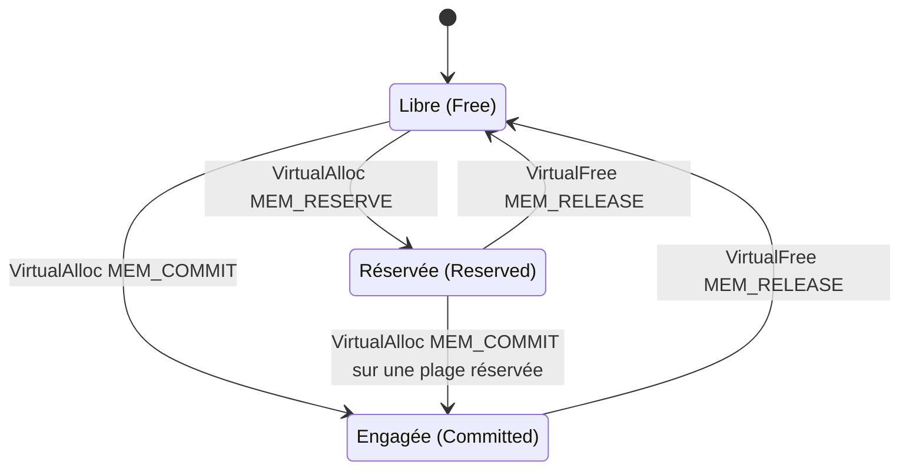

# Gestion de la mémoire Windows

Presque toutes les techniques offensives Windows — placement de payload, injection, déchiffrement en mémoire — se résument à une manipulation de mémoire. Maîtriser les états des pages, les options de protection et les mécanismes de défense du système est donc un prérequis direct.

## Mémoire virtuelle et pagination

La mémoire n'est pas adressée directement en RAM. Les processus manipulent des **adresses virtuelles**, traduites par le système en adresses physiques. Les objectifs :

- Économiser la mémoire physique : une page virtuelle peut vivre sur le disque plutôt qu'en RAM.
- Permettre le partage : plusieurs processus peuvent référencer la même page physique via des adresses virtuelles distinctes.
- Isoler les processus les uns des autres.

La traduction repose sur la **pagination** (memory paging), qui découpe l'espace d'adressage en blocs de 4 Ko appelés pages.

## États d'une page

Chaque page de l'espace d'adressage d'un processus se trouve dans l'un de trois états.



| État | Accessible | Stockage physique | Usage |
|---|---|---|---|
| Free | Non | Aucun | Disponible pour réservation ou engagement ; un accès lève une access violation |
| Reserved | Non | Aucun | Plage bloquée pour un usage futur, non utilisable par une autre allocation ; peut être engagée |
| Committed | Oui | RAM et fichier d'échange facturés | Contenu chargé en mémoire physique seulement au premier accès ; libéré à la fin du processus |

## Options de protection des pages

Une fois une page engagée, sa protection doit être définie. Les constantes déterminent ce que le processus peut y faire, et surtout ce que le système autorise au code qui s'y trouve.

| Constante | Effet | Intérêt offensif ou défensif |
|---|---|---|
| `PAGE_NOACCESS` | Aucun accès ; lecture, écriture ou exécution provoquent une access violation | Zone volontairement inaccessible |
| `PAGE_READONLY` | Lecture seule ; toute écriture lève une access violation | Valeur par défaut de nombreuses données |
| `PAGE_EXECUTE_READ` | Lecture et exécution | Protection habituelle de `.text` |
| `PAGE_EXECUTE_READWRITE` | Lecture, écriture et exécution | Déconseillé ; une région à la fois inscriptible et exécutable est rare en code légitime, c'est un IoC classique |
| `PAGE_READWRITE` | Lecture et écriture, sans exécution | Régions de données dynamiques |

## Protections mémoire du système

| Mécanisme | Principe | Conséquence pour le développement de malware |
|---|---|---|
| Data Execution Prevention (DEP) | Présent depuis Windows XP / Server 2003 : une page marquée `PAGE_READONLY` ne peut pas être exécutée | Écrire un shellcode dans une région de données puis y sauter échoue ; il faut modifier la protection avant exécution |
| Address Space Layout Randomization (ASLR) | Randomise l'emplacement de base de l'exécutable, de la pile, du tas et des bibliothèques | Les adresses considérées comme constantes changent à chaque exécution, ce qui casse les techniques reposant sur des offsets figés |

Ces deux mécanismes reviennent en permanence lors du débogage : un shellcode qui « ne s'exécute pas » est souvent victime de DEP, et une adresse codée en dur est souvent invalide à cause d'ASLR.

## Espace d'adressage x86 contre x64

| Architecture | Espace d'adressage | Adresse maximale |
|---|---|---|
| x86 | 4 Go | `0xFFFFFFFF` |
| x64 | 128 To | `0xFFFFFFFFFFFFFFFF` |

Cette différence conditionne la taille des pointeurs, l'encodage des adresses dans un grand nombre de structures et le choix du binaire cible lors des tests.

## Allouer de la mémoire

Allouer, c'est réserver une plage dans le processus courant. Plusieurs fonctions existent selon le niveau d'abstraction.

```c
// Méthodes classiques : allocation dans le tas du processus
PVOID pAddress = malloc(100);                              // CRT, libérée par free()
PVOID pAddress = HeapAlloc(GetProcessHeap(), 0, 100);      // API du tas, libérée par HeapFree()
PVOID pAddress = LocalAlloc(LPTR, 100);                    // API locale, libérée par LocalFree()

// Méthode utilisée en maldev : allocation de pages avec contrôle de la protection
PVOID pAddress = VirtualAlloc(NULL, 100, MEM_COMMIT | MEM_RESERVE, PAGE_READWRITE);
```

Les fonctions d'allocation renvoient l'**adresse de base**, c'est-à-dire un pointeur vers le premier octet du bloc. Ce pointeur sert ensuite à lire, écrire ou exécuter, selon la protection attribuée à la région.

Une région fraîchement allouée peut contenir des données aléatoires ; certains appels permettent de la mettre à zéro dès l'allocation. Le flag `HEAP_ZERO_MEMORY` de `HeapAlloc` remplit ce rôle.

## Écrire dans la mémoire

Après l'allocation vient l'écriture du contenu utile — chaîne, structure, shellcode.

```c
PVOID  pAddress = HeapAlloc(GetProcessHeap(), HEAP_ZERO_MEMORY, 100);
CHAR*  cString  = "MalDev Academy Is The Best";

memcpy(pAddress, cString, strlen(cString));   // copie de strlen(cString) octets
```

## Libérer la mémoire

Toute allocation doit être libérée sous peine de fuite mémoire. Chaque fonction d'allocation possède sa fonction de libération.

| Allocation | Libération |
|---|---|
| `malloc` | `free` |
| `HeapAlloc` | `HeapFree` |
| `LocalAlloc` | `LocalFree` |
| `VirtualAlloc` | `VirtualFree` |

Une fois `HeapFree` appelé, l'adresse n'est pas effacée : elle existe toujours dans le processus, mais son contenu peut déjà avoir été réécrit par une allocation ultérieure du système. Autrement dit, libérer ne signifie pas effacer, ce qui a des conséquences directes sur la recherche de traces en mémoire.

## Ce qu'il faut retenir côté détection

- Une région `PAGE_EXECUTE_READWRITE` est anormale et très surveillée : les chaînes d'allocation classiques passent par `PAGE_READWRITE` puis une transition contrôlée vers l'exécution.
- Une écriture suivie d'une exécution dans la même région est un motif comportemental exploité par les EDR.
- La mémoire est souvent la seule preuve disponible d'un payload : voir [[Placement du payload]], [[Chiffrement du payload]] et [[Obfuscation du payload]] pour limiter ce que l'analyse révèle, ainsi que [[Injection de shellcode]] pour l'usage opérationnel de ces primitives.
