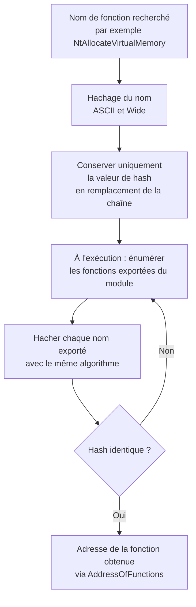

# Hachage de chaînes

Un **hash** est une représentation de taille fixe d'une donnée quelconque, produite par une fonction à sens unique : il est computationnellement irréaliste de remonter à l'entrée à partir de la sortie. Comme le code est court et que la comparaison de deux hashs est bien plus rapide que celle de deux longues chaînes, le hachage est d'abord un outil d'efficacité.

En développement de malware, il devient un outil de **dissimulation**. Les chaînes lisibles sont des signatures idéales pour un éditeur de sécurité : un binaire qui contient `VirtualAllocEx` et `WriteProcessMemory` en clair se dénonce lui-même. En ne conservant que les hashs des noms, le binaire n'expose plus aucune correspondance directe, tout en gardant la capacité de retrouver les fonctions à l'exécution.

## Principe appliqué à la résolution d'API



Reste alors à savoir **où** trouver la liste des noms exportés : c'est le rôle du parsing de la table d'export ([[Parsing des en-têtes PE]]). Le hachage supprime la chaîne, le parsing fournit la source des noms à hacher.

Deux propriétés conditionnent l'efficacité :

- **Distribution** — un bon algorithme répartit les valeurs de sortie de façon homogène et minimise les collisions, c'est-à-dire deux chaînes différentes produisant le même hash.
- **Coût** — le calcul doit rester trivial, car il s'exécute potentiellement sur des centaines de noms exportés.

## Vue comparée des algorithmes

| Algorithme | Principe | Sortie | Distribution |
|---|---|---|---|
| **Djb2** | `hash = ((hash << 5) + hash) + c` | 32 bits | Bonne, faibles collisions |
| **JenkinsOneAtATime32Bit** | Ajout du caractère, mélange par décalages et XOR, finalisation | 32 bits | Bonne, faibles collisions |
| **LoseLose** | Somme des valeurs ASCII, puis multiplication pour randomiser | Entier | Faible, collisions probables |
| **Rotr32** | Somme des caractères avec rotation à droite du hash courant | 32 bits | Bonne, faibles collisions |

Le résultat est systématiquement exprimé en **hexadécimal** : plus compact et plus lisible qu'une valeur décimale. Les implémentations ci-dessous sont issues du dépôt VX-API, qui en propose un grand nombre d'autres.

## Djb2

Particulièrement simple et rapide, Djb2 met à jour un hash courant caractère par caractère.

```text
hash = ((hash << 5) + hash) + c
```

`hash` est la valeur courante, `c` le caractère courant, `<<` le décalage binaire à gauche.

```c
#define INITIAL_HASH	3731  // ajouté pour randomiser le hash
#define INITIAL_SEED	7

// Djb2 à partir d'une chaîne ASCII
DWORD HashStringDjb2A(_In_ PCHAR String)
{
	ULONG Hash = INITIAL_HASH;
	INT c;

	while (c = *String++)
		Hash = ((Hash << INITIAL_SEED) + Hash) + c;

	return Hash;
}

// Djb2 à partir d'une chaîne de caractères larges
DWORD HashStringDjb2W(_In_ PWCHAR String)
{
	ULONG Hash = INITIAL_HASH;
	INT c;

	while (c = *String++)
		Hash = ((Hash << INITIAL_SEED) + Hash) + c;

	return Hash;
}
```

## JenkinsOneAtATime32Bit

L'algorithme parcourt la chaîne en incrémentant le hash selon la valeur de chaque caractère, puis applique une phase de finalisation qui brasse davantage les bits.

```text
hash += c;
hash += (hash << 10);
hash ^= (hash >> 6);
```

```c
#define INITIAL_SEED	7

UINT32 HashStringJenkinsOneAtATime32BitA(_In_ PCHAR String)
{
	SIZE_T Index = 0;
	UINT32 Hash = 0;
	SIZE_T Length = lstrlenA(String);

	while (Index != Length)
	{
		Hash += String[Index++];
		Hash += Hash << INITIAL_SEED;
		Hash ^= Hash >> 6;
	}

	// Finalisation : améliore la dispersion des bits
	Hash += Hash << 3;
	Hash ^= Hash >> 11;
	Hash += Hash << 15;

	return Hash;
}

UINT32 HashStringJenkinsOneAtATime32BitW(_In_ PWCHAR String)
{
	SIZE_T Index = 0;
	UINT32 Hash = 0;
	SIZE_T Length = lstrlenW(String);

	while (Index != Length)
	{
		Hash += String[Index++];
		Hash += Hash << INITIAL_SEED;
		Hash ^= Hash >> 6;
	}

	Hash += Hash << 3;
	Hash ^= Hash >> 11;
	Hash += Hash << 15;

	return Hash;
}
```

## LoseLose

Version minimale : le hash est la somme des valeurs ASCII des caractères.

```text
hash = 0;
hash += c;        // pour chaque caractère c de la chaîne
```

La dispersion est médiocre, ce qui rend les collisions fréquentes. L'implémentation courante corrige partiellement le tir par une multiplication.

```text
hash = 0;
hash += c;         // pour chaque caractère c
hash *= c + 2;     // davantage de randomisation
```

Cela améliore la situation sans transformer LoseLose en bon algorithme.

```c
#define INITIAL_SEED	2

DWORD HashStringLoseLoseA(_In_ PCHAR String)
{
	ULONG Hash = 0;
	INT c;

	while (c = *String++) {
		Hash += c;
		Hash *= c + INITIAL_SEED;	// mise à jour
	}
	return Hash;
}

DWORD HashStringLoseLoseW(_In_ PWCHAR String)
{
	ULONG Hash = 0;
	INT c;

	while (c = *String++) {
		Hash += c;
		Hash *= c + INITIAL_SEED;	// mise à jour
	}

	return Hash;
}
```

## Rotr32

Rotr32 additionne les valeurs ASCII des caractères puis applique une **rotation binaire à droite** du hash courant. La rotation combine un décalage à droite du hash avec un OU logique sur le hash décalé à gauche par le complément du compteur, ce qui garantit que les bits sortis d'un côté rentrent de l'autre.

```c
#define INITIAL_SEED	5

// Fonction utilitaire appliquant la rotation binaire
UINT32 HashStringRotr32Sub(UINT32 Value, UINT Count)
{
	DWORD Mask = (CHAR_BIT * sizeof(Value) - 1);
	Count &= Mask;
#pragma warning( push )
#pragma warning( disable : 4146)
	return (Value >> Count) | (Value << ((-Count) & Mask));
#pragma warning( pop )
}

INT HashStringRotr32A(_In_ PCHAR String)
{
	INT Value = 0;

	for (INT Index = 0; Index < lstrlenA(String); Index++)
		Value = String[Index] + HashStringRotr32Sub(Value, INITIAL_SEED);

	return Value;
}

INT HashStringRotr32W(_In_ PWCHAR String)
{
	INT Value = 0;

	for (INT Index = 0; Index < lstrlenW(String); Index++)
		Value = String[Index] + HashStringRotr32Sub(Value, INITIAL_SEED);

	return Value;
}
```

## ASCII contre Wide

Chaque algorithme existe en deux variantes : `A` pour les chaînes ASCII (`PCHAR`) et `W` pour les chaînes de caractères larges (`PWCHAR`, UTF-16). Ce n'est pas une commodité : Windows expose beaucoup d'API en double version, et la table d'export d'une DLL ne contient pas toujours la même chose selon la variante.

Conséquence pratique à ne jamais perdre de vue : **la même chaîne n'a pas le même hash en ASCII et en Wide**, puisque les valeurs des caractères diffèrent. Il faut donc hacher la forme réellement rencontrée. Selon l'algorithme et la chaîne, les deux formes peuvent parfois coïncider, mais ce n'est en aucun cas une garantie.

## Stack strings

Une chaîne peut aussi être représentée en C/C++ comme un **tableau de caractères** individuellement listés, ce qui rompt la continuité des octets dans le fichier.

```c
char string[] = { 'h', 'e', 'l', 'l', 'o', ' ', 'w', 'o', 'r', 'l', 'd', '\0' };
```

Une recherche de la chaîne `hello world` avec l'éditeur binaire HxD ne retournera rien, puisque les caractères ne sont plus contigus. La technique est simple et efficace contre les signatures de type « recherche de chaîne ».

Sa limite est nette : les debuggers et outils de rétro-ingénierie disposent de plugins capables de reconstituer les stack strings à l'exécution, quand la chaîne est enfin assemblée en mémoire. Les stack strings protègent donc au repos, pas pendant l'exécution.

## Contournement et contre-mesures

| Aspect | Effet côté attaquant | Effet côté défense |
|---|---|---|
| Chaînes absentes du binaire | Les signatures textuelles ne matchent plus | Analyse dynamique : la chaîne réapparaît en mémoire |
| Hashs en hexadécimal | Valeurs banales, difficiles à attribuer à une API | YARA peut cibler des hashs connus |
| Stack strings | Aucune chaîne contiguë à rechercher sur disque | Plugins de debugger reconstituant les chaînes |
| Résolution dynamique d'API | IAT quasi vide, inexploitable | Surveillance des régions mémoire et de la table d'export en lecture |

Le hachage s'inscrit dans une démarche globale de réduction de la surface statique : chaînes hachées, imports résolus à la volée ([[Dissimulation de l'IAT]]), code obfusqué ([[Obfuscation du payload]]) et charge chiffrée ([[Chiffrement du payload]]). Sa limite structurelle est la même que celle de toute évasion statique : elle ne résiste pas à l'exécution. Dès que le binaire tourne, les noms de fonctions sont reconstruits, les chaînes apparaissent en clair et les appels d'API redeviennent visibles pour un EDR ([[Mécanismes de détection]]).

## Test de cohérence

La chaîne `MaldevAcademy` est le cas de test classique : elle est hachée dans les deux formats, ASCII et Wide, avec chaque algorithme. Comme indiqué plus haut, les valeurs obtenues ne sont pas nécessairement identiques entre les deux formats, et elles dépendent aussi de la **graine initiale** (`INITIAL_HASH` ou `INITIAL_SEED`). Toute graine personnalisée modifie l'ensemble des hashs : la valeur attendue côté malware doit donc être générée avec exactement le même code et les mêmes constantes que celles utilisées pour la résolution.
