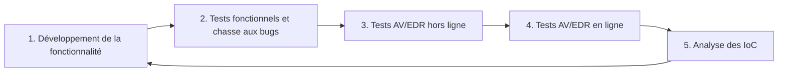

# Introduction au développement de malware

Cette note pose les fondations de la discipline : ce qu'est un malware, pourquoi et avec quels langages on en développe, comment on structure le travail, quel outillage installer, et quelles bases du langage C sont indispensables avant d'aborder les techniques offensives.

## Qu'est-ce qu'un malware

Un malware est un logiciel conçu pour accomplir des actions malveillantes : obtenir un accès non autorisé à une machine, exfiltrer des données sensibles, perturber un service. Le terme est souvent associé à la criminalité, mais il couvre aussi un usage légitime : les testeurs d'intrusion et les red teams l'emploient dans le cadre d'une évaluation de sécurité autorisée.

> [!warning] Cadre légal
> Toute utilisation hors d'un mandat signé et d'un périmètre explicitement autorisé relève du code pénal. La compétence technique ne dispense jamais de l'autorisation écrite du propriétaire du système.

## Pourquoi apprendre le développement de malware

Lors d'un engagement offensif, une équipe a trois façons de se procurer ses outils :

| Approche | Détection | Fiabilité | Coût |
|---|---|---|---|
| Outils open source | Signés par les éditeurs de sécurité, détectés dans toute organisation mature | Faible | Nul |
| Outils achetés | Fermés, donc non analysés publiquement | Bonne | Élevé |
| Outils développés sur mesure | Jamais vus par les moteurs de détection avant l'engagement | Élevée tant que l'outil reste privé | Temps de développement |

C'est la troisième voie qui justifie l'apprentissage du développement de malware : un binaire inédit n'a aucune signature connue, ce qui constitue un avantage offensif direct.

## Choix du langage de programmation

N'importe quel langage peut produire du code malveillant (Python, PowerShell, C#, C, C++, Go, Rust). Trois critères départagent les candidats :

| Critère | Conséquence |
|---|---|
| Résistance à l'ingénierie inverse | Le défenseur doit comprendre le moins possible le fonctionnement du binaire |
| Prérequis sur la cible | Un script Python exige un interpréteur présent sur la machine, un binaire C natif n'en a aucun |
| Taille du fichier généré | Un interpréteur embarqué ou un runtime produisent des binaires volumineux et repérables |

C est le langage de référence du développement de malware Windows : aucun runtime, accès direct à l'OS, compilation en binaire natif, et un vaste écosystème d'API documentées à appeler directement.

### Haut niveau contre bas niveau

- **Haut niveau** (Python, C#) : abstrait du système, peu efficace en mémoire, faible contrôle car les appels système sont masqués par des couches intermédiaires.
- **Bas niveau** (C, assembleur) : interaction intime avec l'OS et l'architecture, contrôle total de la mémoire et des appels natifs.

Le bas niveau est privilégié dès qu'il faut manipuler la mémoire, les en-têtes PE ou les syscalls, ce qui correspond à la quasi-totalité des techniques évasives.

## Spécificités du malware Windows

Le paysage a changé : il ne suffit plus d'exécuter des commandes suspectes ou d'accomplir des actions visiblement malveillantes. Un binaire qui appelle `cmd.exe`, `WinExec` ou ouvre un socket en clair est détecté presque immédiatement. L'objectif moderne est l'évasion des solutions hôtes, antivirus (AV) et EDR : minimiser les traces, masquer les appels, contrôler les artefacts laissés en mémoire. Chaque technique gagne donc à être évaluée sous l'angle « qu'est-ce que le défenseur voit ici ? », ce que détaillent les [[Mécanismes de détection]] et l'[[Introduction aux EDR]].

## Cycle de développement du malware

Le développement logiciel classique suit un SDLC ; un malware complexe suit une version adaptée, le **Malware Development Life Cycle (MDLC)**, qui est un cycle et non une ligne droite.



| Étape | Objectif | Point d'attention |
|---|---|---|
| Développement | Écrire ou faire évoluer une fonctionnalité | Ne jamais coder une technique sans comprendre son empreinte |
| Tests | Détecter les bugs avant de juger la détection | Un comportement inhabituel se confond avec un bug |
| Tests hors ligne | Confronter le binaire à un maximum de produits | Couper la télémétrie et la soumission automatique d'échantillons, sinon le binaire part chez l'éditeur |
| Tests en ligne | Évaluer les moteurs cloud | Accepter le risque d'envoyer l'échantillon dans le cloud de l'éditeur |
| Analyse des IoC | Se mettre dans la peau du threat hunter | Extraire ce qui permettrait de signer le malware, puis repartir à l'étape 1 |

## Environnement de travail

| Outil | Usage |
|---|---|
| Visual Studio | IDE de développement et de compilation, avec le runtime C/C++ |
| x64dbg | Débogueur user-mode et kernel-mode, inspection mémoire et assembleur |
| PE-Bear | Analyse statique des fichiers PE, visualisation des en-têtes, imports, exports |
| Process Hacker 2 | Observation des processus vivants : DLL chargées, régions mémoire, threads |
| Msfvenom | Générateur de payloads en ligne de commande |

L'ingénierie inverse fait partie intégrante de la démarche : seul le désassemblage permet de vérifier ce qu'un analyste verra réellement en ouvrant le binaire, et donc de valider une technique. PE-Bear s'articule directement avec la note [[Format PE]].

Dans x64dbg, l'onglet « CPU » se découpe en quatre vues :

| Vue | Position | Contenu |
|---|---|---|
| Disassembly | Haut gauche | Instructions assembleur exécutées |
| Dump | Bas gauche | Contenu mémoire aux adresses courantes |
| Registers | Haut droite | Valeurs des registres du CPU |
| Stack | Bas droite | Contenu de la pile |

## Bases de C indispensables

### Structures

Une structure (`struct`) regroupe des données de types différents dans une seule unité. Deux usages reviennent en permanence avec l'API Windows : certaines fonctions exigent une structure préalablement remplie en entrée, d'autres reçoivent un pointeur et remplissent la structure elles-mêmes (paramètre `OUT`).

```c
typedef struct tagTHREADENTRY32 {
  DWORD dwSize;                 // Taille de la structure, à renseigner avant l'appel
  DWORD cntUsage;
  DWORD th32ThreadID;
  DWORD th32OwnerProcessID;
  LONG  tpBasePri;
  LONG  tpDeltaPri;
  DWORD dwFlags;
} THREADENTRY32;
```

Le patron de déclaration utilisé partout dans le domaine définit deux alias d'un coup :

```c
typedef struct _STRUCTURE_NAME {
  // membres
} STRUCTURE_NAME, *PSTRUCTURE_NAME;
```

`STRUCTURE_NAME` désigne la structure, `PSTRUCTURE_NAME` un pointeur vers celle-ci. Par convention Microsoft, le préfixe `P` signale un pointeur.

```c
STRUCTURE_NAME  s1 = { 0 };        // tous les membres à zéro
_STRUCTURE_NAME s2 = { 0 };        // équivalent, sans l'alias
PSTRUCTURE_NAME p  = NULL;         // pointeur, initialisé à NULL
```

Accès aux membres : par le point sur une valeur, par la flèche sur un pointeur.

```c
STRUCTURE_NAME  s  = { .ID = 1470, .Age = 34 };  // initialisation désignée
PSTRUCTURE_NAME p  = &s;

s.ID  = 1470;        // accès direct
p->ID = 8765;        // équivaut à (*p).ID
```

### Passage par valeur et par référence

| Mode | Ce qui est transmis | Effet |
|---|---|---|
| Par valeur | Une copie de la valeur | La fonction modifie sa copie, l'original est intact |
| Par référence | L'adresse de l'objet (pointeur) | La fonction modifie l'objet original |

```c
// Par valeur : x et y restent inchangés dans main
int add(int a, int b) {
    return a + b;
}

// Par référence : result est modifié à travers son adresse
void add(int *a, int *b, int *result) {
    *result = *a + *b;
}

int main(void) {
    int x = 5, y = 10, sum = 0;
    add(&x, &y, &sum);   // sum vaut 15
    return 0;
}
```

Comprendre cette distinction est indispensable pour lire les prototypes de l'API Windows, où les paramètres de sortie sont presque toujours passés par pointeur : ce point est développé dans [[Windows API]].
