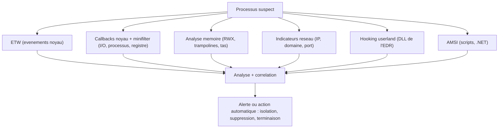

# Introduction aux EDR

Un EDR (*Endpoint Detection and Response*) est une solution de sécurité qui détecte et traite les menaces — rançongiciels, malwares, intrusion — sur les postes et serveurs. Là où un antivirus classique se limite à des signatures, l'EDR observe le comportement en continu, corrèle des événements et peut réagir de lui-même. Pour un développeur de malware, comprendre cette mécanique est indispensable : chaque technique d'évasion répond à un capteur précis (voir [[Contournement des antivirus]]).

## Ce que fait un EDR

L'agent collecte des données en permanence sur le point de terminaison : journaux système, trafic réseau, communications inter-processus (IPC), appels RPC, tentatives d'authentification, activité utilisateur. Ces données sont analysées et mises en relation pour repérer une menace. En cas de détection, les réponses possibles vont de la simple alerte à des actions automatiques : isoler la machine du réseau, supprimer un fichier malveillant, tuer un processus suspect.

Les EDR ne travaillent jamais seuls : ils s'intègrent à une stratégie plus large avec pare-feu, IDS/IPS et SIEM. Les équipes défensives exploitent leurs journaux pour le *threat hunting*, à la recherche d'indicateurs de compromission (IoC) passés inaperçus.

## Architecture de l'agent

L'agent comporte deux composants complémentaires :

| Composant | Mode | Rôle |
|---|---|---|
| Application utilisateur | User mode | Collecte et analyse, interface, alertes |
| Pilote | Kernel mode | Données non falsifiables, callbacks, interception I/O |

Les informations remontées sont confrontées à des signatures connues et à des modèles de comportement. Les réglages sont très paramétrables : selon la configuration, l'EDR agit seul ou se contente d'alerter.

## Détection par signature

Un EDR intègre les fonctions d'un antivirus : il reconnaît les malwares connus par leur signature. Les défenseurs peuvent en outre écrire des règles personnalisées pour élargir la couverture. C'est le niveau le plus simple à contourner (voir [[Signature des binaires malware]], [[Obfuscation du payload]], [[Chiffrement du payload]]).

## Détection comportementale

C'est le cœur de l'EDR. Plusieurs capteurs coexistent :

### Hooking userland

L'EDR injecte sa DLL dans les processus surveillés et détourne les fonctions sensibles pour observer leurs arguments et leurs retours — y compris un payload après son déchiffrement. C'est exactement la cible des techniques de contournement vues dans [[API hooking]], [[Introduction aux syscalls]], [[SysWhispers et Hell's Gate]] et [[Unhooking de NTDLL]].

### Event Tracing for Windows (ETW)

ETW est un mécanisme noyau intégré à Windows qui journalise les événements déclenchés par les pilotes et les applications user mode : création et fin de processus, chargement et déchargement de pilotes, accès fichiers et registre, saisie utilisateur, connexions réseau et authentifications. Les EDR l'exploitent comme source d'information, tout comme Sysmon et Procmon. C'est une voie que le hooking userland ne couvre pas.

### Antimalware Scan Interface (AMSI)

Présent depuis Windows 10, AMSI permet à un logiciel tiers de soumettre du contenu à l'analyse. Il vise les scripts et assembly .NET exécutés ou injectés dynamiquement : JavaScript, VBScript, PowerShell, C#, VB.NET. Le cœur d'AMSI est `amsi.dll`, complété par les sous-systèmes de sécurité de l'OS et par les DLL des éditeurs tiers qui s'y raccrochent.

### Détection en mémoire

Après exécution du payload, des indicateurs apparaissent en mémoire : allocations du tas, trampolines d'hooking, piles de threads, sections mémoire `RWX`. Le contournement de ces détections se fait *après* le démarrage du payload, en modifiant son organisation en mémoire. C'est une approche avancée et l'un des moyens les plus efficaces de détecter du code malveillant ; elle est notamment visée par [[Injection par mapping]] et [[Function stomping]].

### Callbacks noyau et pilotes minifilter

Les callbacks noyau permettent à du code kernel d'enregistrer une fonction appelée par l'OS à certains moments. Un pilote de sécurité peut ainsi être notifié d'événements précis : création de fichier, modification de clé de registre, chargement de DLL.

| Callback | Déclenchement |
|---|---|
| `PspCreateProcessNotifyRoutine` | Création ou suppression d'un processus |
| `PspLoadImageNotifyRoutine` | Chargement ou mappage d'une image (DLL, EXE) |
| `CmRegisterCallbackEx` | Opération d'un thread sur le registre |

Microsoft recommande aux éditeurs de sécurité de passer par des *minifilter drivers* pour intercepter, examiner et éventuellement bloquer les requêtes d'E/S entre les applications et le système de fichiers. Ces pilotes s'intercalent entre le système de fichiers et le pilote gérant l'I/O physique, et peuvent enregistrer un callback par opération.

L'avantage décisif est l'origine des données : un callback noyau livre l'information brute du noyau, non falsifiable, là où les sources user mode peuvent être altérées. Un scénario classique consiste à utiliser `PspCreateProcessNotifyRoutine` pour charger la DLL user mode de l'EDR dans chaque processus créé (où elle installe son hooking système), puis le minifilter pour surveiller les accès fichiers du processus.

### Indicateurs réseau

Un processus qui ouvre une connexion est plus suspect, surtout s'il ne le fait habituellement pas : un `notepad.exe` injecté (voir [[Injection de shellcode]]) qui contacte Internet déclenche une alerte. L'EDR examine l'IP cible, le nom de domaine, le port et le contenu du trafic.

## Contourner un EDR

La difficulté vient du nombre de capteurs : aucune technique unique ne suffit. Le désassemblage d'une DLL ne désactive pas les événements ETW ; une évasion ETW ne résout pas le hooking userland. Il faut souvent cumuler plusieurs implémentations pour un même problème — les variantes d'unhooking de `ntdll.dll` en sont l'illustration.

Une distinction importante s'impose entre le loader et le payload de commande :

- Le loader peut échapper à la détection alors que le C2 reste détecté, par exemple parce que le réseau du C2 est signature.
- Le loader peut utiliser syscalls directs ou indirects et passer, tandis que le payload C2 continue d'appeler des fonctions hookées.
- Le payload peut exécuter une commande bruyante, volontairement ou non : ouvrir `cmd.exe` pour lancer `whoami` attire l'attention.
- Le C2 peut nommer ses IPC de façon reconnaissable (tuyaux, événements, mutex, sémaphores). Une commande du type « charger PowerShell » via Meterpreter produit des noms caractéristiques.

Il en résulte des cas fréquents où l'obtention de la session aboutit mais où la moindre commande déclenche la détection. Le choix du framework C2 est donc une décision d'évasion à part entière : mieux vaut un C2 malléable et flexible qu'un C2 limité et signature.

Les modules suivants déclinent les stratégies : [[Unhooking de NTDLL]] pour l'hooking userland, [[Politique de blocage des DLL]] pour empêcher l'injection des DLL de sécurité, [[NtCreateUserProcess]] pour créer des processus sans passer par les fonctions surveillées, et plus largement les principes posés dans [[Mécanismes de détection]].
