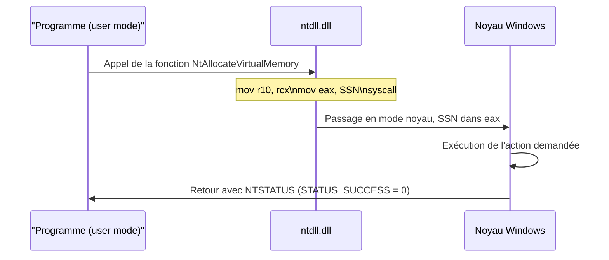
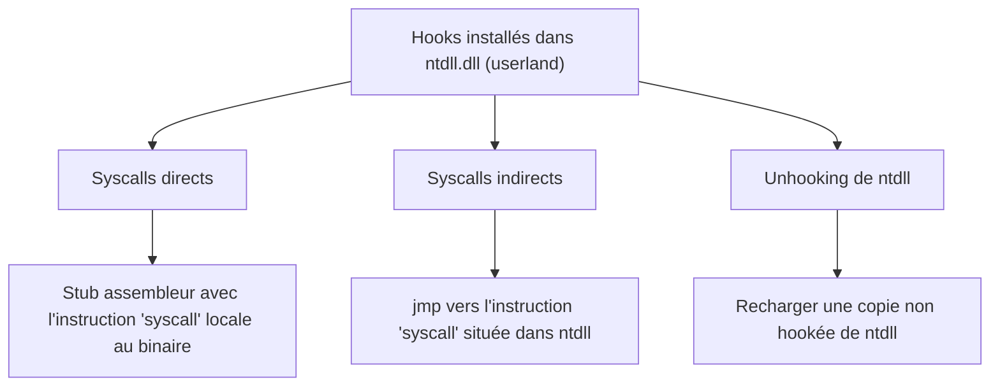

# Introduction aux syscalls

Les appels système Windows, ou syscalls, forment l'interface par laquelle un programme demande au noyau des services concrets : lire un fichier, créer un processus, allouer de la mémoire. Comprendre cette couche est indispensable pour le développement de malware, car c'est précisément là que la plupart des mécanismes de détection s'accrochent.

## Qu'est-ce qu'un syscall

Un syscall transporte vers le noyau les paramètres fournis par le programme, y fait exécuter l'action demandée, puis renvoie le résultat. Ainsi, l'appel de `VirtualAlloc` ou `VirtualAllocEx` déclenche en réalité le syscall `NtAllocateVirtualMemory`. Tous les syscalls renvoient une valeur `NTSTATUS` indiquant le code d'erreur, `STATUS_SUCCESS` (zéro) signalant le succès.

La majorité échappe à la documentation officielle de Microsoft et se documente via des sources alternatives : le site *NTinternals* et la référence *NTDLL* de ReactOS.



## NTDLL et syscalls

La quasi-totalité des syscalls sont exportés par la DLL `ntdll.dll`. C'est cette bibliothèque qui sert de frontière entre le code utilisateur et le noyau, ce qui explique qu'elle soit le point d'ancrage privilégié des solutions de sécurité.

## Pourquoi utiliser les syscalls

- Accéder à des fonctionnalités de bas niveau indisponibles ou complexes via les WinAPIs standard. `NtCreateUserProcess`, par exemple, offre des options de création de processus que `CreateProcess` n'expose pas.
- Contourner les mécanismes de sécurité hostiles (EDR, antivirus), car les syscalls permettent de court-circuiter les hooks installés dans l'espace utilisateur.

## Nt contre Zw

Deux familles de syscalls coexistent, préfixées `Nt` ou `Zw` :

| Préfixe | Mode | Usage principal |
|---|---|---|
| `Nt` | User mode | Interface première des programmes utilisateur |
| `Zw` | Kernel mode | Pilotes et code noyau accédant directement au système |

Dans les faits, les deux versions d'un même appel partagent souvent la même adresse et peuvent produire le même résultat depuis l'espace utilisateur. Le développement de malware s'en tient généralement aux syscalls `Nt`.

## Le numéro de service système (SSN)

Chaque syscall possède un numéro unique, le *System Service Number* ou SSN, qui permet au noyau de les distinguer. `NtAllocateVirtualMemory` peut valoir 24 tandis que `NtProtectVirtualMemory` vaut 80. Trois propriétés comptent :

- Les SSN **changent selon la version de Windows** (Windows 10 contre 11) et même au sein d'une version (Windows 11 21H2 contre 22H2). `NtAllocateVirtualMemory` peut valoir 24 sur une version et 34 sur une autre.
- En mémoire, les SSN se suivent : le SSN d'un syscall vaut celui du précédent plus un, et celui du suivant moins un.

Cette continuité des SSN, illustrée par les entrées consécutives `ZwAxxessCheck` (0), `NtWorkerFactoryWorkerReady` (1), etc., est directement exploitée pour retrouver un numéro par voisinage quand l'appel cible est hooké.

## Structure d'un syscall

Le squelette est presque toujours identique :

```asm
mov r10, rcx
mov eax, SSN
syscall
```

- La première ligne déplace le premier paramètre, normalement dans `RCX`, vers `R10`, comme l'exige la convention d'appel du noyau.
- La deuxième charge le SSN dans `EAX`.
- L'instruction `syscall` (ou `sysenter` en 32 bits) transfère le contrôle du user mode vers le kernel, qui exécute l'action puis rend la main.

Les instructions `test` et `jne` que l'on observe parfois servent à la compatibilité WoW64 : elles permettent à un processus 32 bits de fonctionner sur une machine 64 bits et n'affectent pas le flux d'un processus 64 bits.

## Tous les NtAPIs ne sont pas des syscalls

Certaines fonctions exportées renvoient bien un `NTSTATUS` mais ne sont pas des syscalls : elles n'ont ni SSN, ni le prologue `mov r10, rcx`. Ce sont des routines de plus bas niveau utilisées par les WinAPIs. Exemples :

- `LdrLoadDll` — utilisé par `LoadLibrary` pour charger une image dans le processus appelant.
- `SystemFunction032` et `SystemFunction033` — opérations de chiffrement et déchiffrement RC4.
- `RtlCreateProcessParametersEx` — utilisé par `CreateProcess` pour construire les arguments d'un processus.

## Le hooking userland des syscalls

Les solutions de sécurité placent fréquemment des hooks sur les syscalls pour analyser et surveiller les programmes au runtime. En hookant `NtProtectVirtualMemory`, un EDR détecte les appels de haut niveau comme `VirtualProtect`, **même quand ils sont absents de l'import address table** du binaire. Il peut aussi inspecter toute région mémoire rendue exécutable.

Ces hooks userland sont généralement installés juste avant l'instruction `syscall`, c'est-à-dire à la dernière étape du syscall en mode utilisateur.



Le hooking en mode noyau, lui, est rendu difficile par Patch Guard et les autres mitigations de Windows, qui empêchent les tiers de modifier la mémoire du noyau et menacent la stabilité du système. Il est donc rarement implémenté.

Une démonstration courante consiste à injecter une DLL (`MalDevEdr.dll`) qui hooke `NtProtectVirtualMemory` : dès qu'une région mémoire passe en `RWX`, la DLL en dumpe le contenu — révélant le shellcode — puis termine le processus. C'est ainsi qu'un EDR peut bloquer un payload que l'antivirus n'a pas vu.

## Contourner les hooks userland

Trois grandes approches permettent d'échapper au hooking des syscalls.

### Syscalls directs

On écrit une version du syscall en assembleur et on l'appelle directement depuis le binaire, sans passer par l'espace d'adressage de `ntdll.dll` où se trouvent les hooks. La difficulté est de fixer le SSN : il peut être codé en dur ou calculé au runtime.

```asm
NtAllocateVirtualMemory PROC
    mov r10, rcx
    mov eax, (ssn of NtAllocateVirtualMemory)
    syscall
    ret
NtAllocateVirtualMemory ENDP

NtProtectVirtualMemory PROC
    mov r10, rcx
    mov eax, (ssn of NtProtectVirtualMemory)
    syscall
    ret
NtProtectVirtualMemory ENDP
```

C'est l'approche des outils SysWhispers et Hell's Gate.

### Syscalls indirects

Identiques aux syscalls directs, à ceci près que l'instruction `syscall` n'appartient plus au stub : elle est atteinte par un `jmp` vers une instruction `syscall` située dans `ntdll.dll`.

```asm
NtAllocateVirtualMemory PROC
    mov r10, rcx
    mov eax, (ssn of NtAllocateVirtualMemory)
    jmp (address of a syscall instruction)
    ret
NtAllocateVirtualMemory ENDP
```

L'avantage est décisif : les solutions de sécurité considèrent comme suspect un `syscall` exécuté **hors** de l'espace d'adressage de `ntdll.dll`. Avec l'approche indirecte, l'instruction s'exécute depuis `ntdll`, comme un syscall légitime, ce qui la rend bien plus discrète.

### Unhooking

On remplace la bibliothèque `ntdll.dll` chargée en mémoire par une version non hookée, souvent rechargée depuis le disque. Les hooks qu'elle contenait disparaissent. Cette approche est couverte dans les notes avancées du corpus, notamment [[Unhooking de NTDLL]].

Les techniques ci-dessus sont développées dans [[SysWhispers et Hell's Gate]] puis réinvesties dans [[Réimplémentation des injections via syscalls]].
