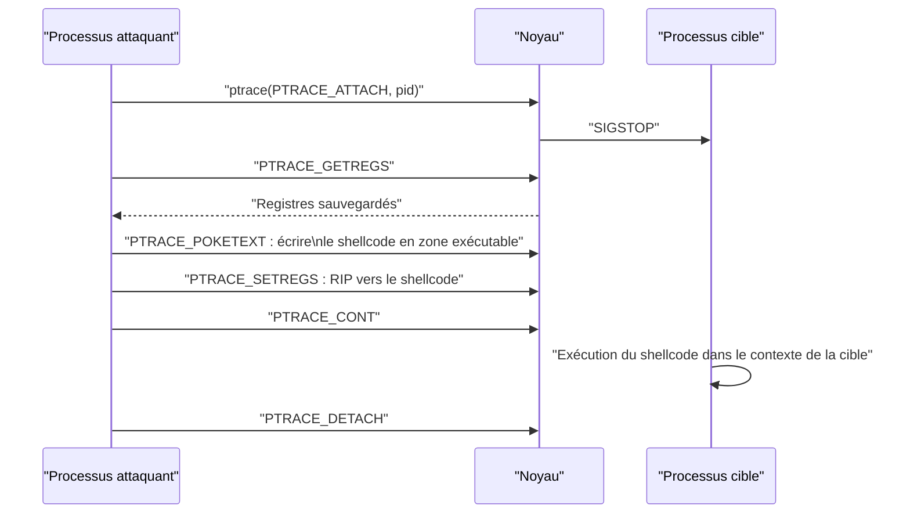

# Malware Linux

Linux est partout : serveurs, clouds, conteneurs, équipements réseau, objets connectés. Cette omniprésence en fait une cible de choix pour un code malveillant qui cherche à se fondre dans un environnement familier, à survivre aux redémarrages et à rester invisible aux outils de défense. Contrairement à Windows, l'écosystème Linux est fragmenté : distributions, versions de noyau, gestionnaires de services et bibliothèques diffèrent d'un système à l'autre, ce qui oblige le développeur à écrire du code portable ou à cibler une famille précise.

Le point d'ancrage technique est le format ELF et le chargeur dynamique. Presque toutes les techniques d'injection, de détournement et d'exécution sans fichier découlent de la façon dont le noyau charge un binaire et dont `ld.so` résout ses dépendances. Cette note décrit ces mécanismes, les techniques de persistance et de dissimulation, puis les moyens de les détecter. Les bases de l'analyse binaire sont dans [[Reverse Engineering]], et les chemins d'élévation de privilèges dans [[Linux Privilege Escalation]].

## Format ELF

Un fichier ELF est décrit par un en-tête, une table de segments (program headers) et une table de sections (section headers). Le noyau utilise les **segments** pour charger le programme en mémoire ; l'éditeur de liens et les outils d'analyse utilisent les **sections** pour organiser le code et les données.

| Program header | Rôle |
|---|---|
| `PT_LOAD` | Segment mappé en mémoire : code, données, données non initialisées |
| `PT_INTERP` | Chemin de l'interpréteur, `ld-linux-x86-64.so.2` |
| `PT_DYNAMIC` | Table dynamique : dépendances, relocations, symboles |
| `PT_GNU_STACK` | Indique si la pile est exécutable |
| `PT_GNU_RELRO` | Zone rendue en lecture seule après relocation |
| `PT_NOTE` | Métadonnées, identifiant de build, notes ABI |

Les sections les plus utiles à un analyste sont `.text` (code), `.data`, `.bss`, `.rodata`, `.plt` et `.got.plt` (résolution des appels), `.init_array` et `.fini_array` (constructeurs et destructeurs exécutés automatiquement), et `.dynamic`.

```bash
file binaire
readelf -h binaire      # en-tête ELF : type, machine, point d'entrée
readelf -l binaire      # segments
readelf -d binaire      # dépendances, RPATH/RUNPATH, symboles
readelf -S binaire      # sections
readelf -s binaire      # table des symboles
objdump -d binaire      # désassemblage
checksec --file=binaire # PIE, NX, RELRO, canary
```

Un exécutable **PIE** (position independent executable) se charge à une adresse aléatoire, ce qui complique la prédiction d'adresses mais pas l'injection : il suffit de lire la carte mémoire du processus vivant. Les binaires non-PIE sont chargés à une adresse fixe, ce qui facilite certaines attaques mais n'a plus grand-chose à voir avec les malwares modernes, qui préfèrent l'injection dans un processus existant.

> [!abstract] Définition — Segment
> Un segment est une région contiguë d'un ELF telle que le noyau doit la mapper, avec des droits précis (lecture, écriture, exécution). Il ne faut pas le confondre avec la section, qui est une subdivision destinée à l'éditeur de liens : plusieurs sections peuvent appartenir au même segment, et une section sans `PT_LOAD` associé n'est jamais chargée.

## Linkage dynamique

`ld.so` (ou `ld-linux-*.so`) est l'interpréteur déclaré par `PT_INTERP`. Il lit la table `PT_DYNAMIC`, résout les dépendances `DT_NEEDED`, applique les relocations et appelle les constructeurs avant `main`. Plusieurs variables d'environnement et fichiers de configuration influencent ce processus, et c'est là que se logent les techniques de détournement.

| Mécanisme | Effet | Remarque |
|---|---|---|
| `LD_PRELOAD` | Charge une bibliothèque avant les autres | Ignoré si `AT_SECURE` (binaire setuid) |
| `/etc/ld.so.preload` | Charge une liste de bibliothèques pour tout processus | Contourne partiellement la restriction précédente |
| `LD_LIBRARY_PATH` | Ajoute des répertoires de recherche | Ignoré en mode sécurisé |
| `DT_RPATH` | Répertoire de recherche prioritaire | Déprécié, prioritaire sur `LD_LIBRARY_PATH` |
| `DT_RUNPATH` | Répertoire de recherche après `LD_LIBRARY_PATH` | Remplace `RPATH`, supporte `$ORIGIN` |
| `LD_AUDIT` | Bibliothèque d'audit des résolutions | Puissant, rarement surveillé |
| `LD_DEBUG=libs` | Trace les recherches de bibliothèques | Utile en analyse |

La différence entre `RPATH` et `RUNPATH` est un point d'analyse important : un binaire qui utilise un `RUNPATH` relatif (`$ORIGIN/../lib`) cherche ses bibliothèques dans des répertoires voisins de son exécutable. Si ce répertoire est accessible en écriture, un attaquant y place une bibliothèque malveillante — c'est le point d'entrée de l'attaque dite de *dylib hijacking* appliquée à Linux.

```bash
# Inspecter les chemins de recherche et les dépendances
readelf -d /usr/bin/app | grep -E 'RPATH|RUNPATH|NEEDED'
ldd /usr/bin/app          # à éviter sur un binaire non fiable

# Détourner un appel par préchargement
LD_PRELOAD=/tmp/evil.so ./app

# Rendre le préchargement global
echo "/usr/local/lib/evil.so" >> /etc/ld.so.preload
ldconfig
```

```c
// Bibliothèque de détournement : intercepte open()
#define _GNU_SOURCE
#include <dlfcn.h>
#include <stdarg.h>
#include <fcntl.h>

static int (*real_open)(const char *, int, ...);

int open(const char *path, int flags, ...) {
    if (!real_open)
        real_open = dlsym(RTLD_NEXT, "open");
    // Journaliser ou modifier le comportement ici
    va_list ap; va_start(ap, flags);
    int mode = va_arg(ap, int); va_end(ap);
    return real_open(path, flags, mode);
}
```

`LD_PRELOAD` est ignoré pour les binaires setuid ou dotés de privilèges, parce que le noyau positionne `AT_SECURE` et que `ld.so` nettoie alors l'environnement. Mais `/etc/ld.so.preload` reste lu : en mode sécurisé, les chemins contenant un `/` sont ignorés et seules les bibliothèques des répertoires standards sont chargées, ce qui oblige l'attaquant à déposer son fichier dans `/lib` avec le bit setuid. C'est une technique de rootkit classique, et un fichier à surveiller en priorité.

## Injection dans un processus

`ptrace` est l'interface historique d'inspection et de contrôle d'un processus. Elle permet à un débogueur — ou à un malware — d'attacher un processus, de lire et d'écrire sa mémoire, de modifier ses registres et de reprendre son exécution. L'injection se fait en cinq temps : attacher, sauvegarder les registres, écrire du code dans une zone exécutable, détourner `RIP` vers ce code, puis restaurer l'état.



Sur les systèmes modernes, `/proc/sys/kernel/yama/ptrace_scope` restreint l'attachement aux processus descendants (`1` par défaut sur Ubuntu), aux processus disposant de `CAP_SYS_PTRACE`, ou l'interdit complètement (`3`). Le noyau vérifie ces règles à chaque `ptrace`, `process_vm_readv`, `process_vm_writev` et accès à `/proc/<pid>/mem`. Un malware doit donc soit disposer de privilèges, soit s'injecter dans un processus qu'il a lui-même lancé, soit exploiter une faille pour contourner Yama.

```c
#include <sys/ptrace.h>
#include <sys/user.h>
#include <sys/wait.h>

void inject(pid_t pid, const unsigned char *code, size_t len, unsigned long addr) {
    struct user_regs_struct regs;
    ptrace(PTRACE_ATTACH, pid, NULL, NULL);
    waitpid(pid, NULL, 0);
    ptrace(PTRACE_GETREGS, pid, NULL, &regs);

    for (size_t i = 0; i < len; i += sizeof(long)) {
        long word = 0;
        memcpy(&word, code + i, sizeof(long));
        ptrace(PTRACE_POKETEXT, pid, addr + i, word);
    }

    regs.rip = addr;
    ptrace(PTRACE_SETREGS, pid, NULL, &regs);
    ptrace(PTRACE_DETACH, pid, NULL, NULL);
}
```

Moins élégant mais plus simple, `/proc/<pid>/mem` se lit et s'écrit comme un fichier, une fois l'autorisation obtenue. `process_vm_writev` fait la même chose par appel système. Le véritable obstacle n'est pas l'écriture, mais l'obtention d'une zone **exécutable** : les segments d'un binaire PIE sont souvent en lecture seule, et les montages `noexec` bloquent les pages nouvellement créées si l'on utilise un fichier. La solution habituelle consiste à localiser une zone déjà exécutable du processus, ou à demander au processus d'appeler `mmap(PROT_EXEC)` par un détournement de registres.

> [!important] Idée clé
> L'injection Linux n'est pas fondamentalement différente de l'injection Windows : elle consiste à faire exécuter du code dans le contexte d'un autre processus. La différence tient aux contrôles : pas d'API `WriteProcessMemory` tracée par un EDR, mais des règles `ptrace` vérifiées par le noyau, un chargeur dynamique ouvert aux détournements, et des mécanismes comme `memfd` qui rendent l'exécution sans fichier triviale.

## Exécution sans fichier

`memfd_create` crée un fichier anonyme en mémoire, identifié par un descripteur. Le contenu peut être un ELF complet, exécuté directement par `fexecve` ou `execveat(AT_EMPTY_PATH)`, sans jamais toucher le disque. C'est la technique de référence de l'exécution sans fichier sur Linux : elle ne laisse ni inode persistant, ni entrée dans le journal des fichiers créés, et elle fonctionne même sur les répertoires montés `noexec`.

```c
#define _GNU_SOURCE
#include <sys/mman.h>
#include <fcntl.h>
#include <unistd.h>

int main(void) {
    int fd = memfd_create("payload", MFD_CLOEXEC);
    write(fd, elf_bytes, elf_len);
    fexecve(fd, argv, environ);
    return 0;
}
```

Le processus apparaît alors dans `/proc/<pid>/exe` et `/proc/<pid>/maps` sous la forme `/memfd:payload (deleted)` ou `memfd:payload`. Les alternatives existent : `O_TMPFILE` avec un lien symbolique via `/proc/self/fd`, `shm_open` suivi de `fexecve`, ou l'exécution directe depuis un descripteur hérité. Toutes produisent des artefacts similaires, et toutes exigent un ELF valide ou un interpréteur (`/bin/sh`) capable de lire le flux.

```bash
# Observer une exécution sans fichier sur le système vivant
ls -l /proc/*/exe 2>/dev/null | grep -i memfd
cat /proc/$(pidof payload)/maps | grep -i memfd
```

## Persistance

La persistance Linux consiste presque toujours à détourner un mécanisme d'exécution automatique déjà légitime. Le tableau suivant résume les emplacements les plus utilisés ; la note [[Persistence]] détaille les variantes Windows et les principes généraux.

| Mécanisme | Emplacement | Contexte | Discrétion |
|---|---|---|---|
| Unit systemd | `/etc/systemd/system/*.service` | root, boot | Moyenne |
| Unit utilisateur | `~/.config/systemd/user/` | utilisateur, login/boot si linger | Élevée |
| Timer systemd | `*.timer` + `OnCalendar` | planifié | Élevée |
| Cron | `/etc/cron.d/`, `crontab`, `@reboot` | root ou utilisateur | Moyenne |
| Init | `/etc/rc.local`, `/etc/init.d/` | root, boot | Faible |
| Profil shell | `~/.bashrc`, `~/.profile`, `/etc/profile.d/` | login shell | Élevée |
| `~/.zshenv` | Toujours sourcé, même non interactif | utilisateur | Élevée |
| SSH | `~/.ssh/authorized_keys`, `~/.ssh/rc` | accès distant | Élevée |
| PAM | `/etc/pam.d/common-*`, `pam_exec.so` | authentification | Très élevée |
| Préchargement | `/etc/ld.so.preload` | tout processus | Très élevée |
| XDG autostart | `~/.config/autostart/*.desktop` | session graphique | Moyenne |
| udev | `/etc/udev/rules.d/*.rules` (`RUN+=`) | événement matériel | Élevée |

Le service systemd est la forme la plus courante. Un fichier minimal suffit, et `Restart=always` assure la résurrection si le processus est tué.

```ini
[Unit]
Description=System Telemetry Helper
After=network-online.target

[Service]
Type=simple
ExecStart=/bin/sh -c '/usr/lib/telemetry/.helper --daemon'
Restart=always
RestartSec=30

[Install]
WantedBy=multi-user.target
```

```bash
systemctl daemon-reload
systemctl enable --now telemetry.service
# Pour un service utilisateur, sans login permanent :
loginctl enable-linger $USER
systemctl --user enable --now telemetry.service
```

Cron combine simplicité et compatibilité : une ligne dans `/etc/cron.d/telemetry` s'exécute avec l'utilisateur indiqué, `@reboot` relance au démarrage, et `run-parts` dans `/etc/cron.hourly/` offre un emplacement banal. Les scripts `rc.local` et `init.d` restent présents sur beaucoup de systèmes, notamment embarqués.

Le détournement des shells vise l'interactif : `~/.bashrc`, `~/.profile`, `/etc/profile.d/`, ou `BASH_ENV` pour les shells non interactifs. Sur zsh, `~/.zshenv` est lu dans presque tous les cas, y compris par des scripts automatisés. `PROMPT_COMMAND` exécute une commande avant chaque invite, ce qui rend la persistance quasi invisible à un `crontab -l`.

Le volet accès distant exploite `authorized_keys` avec des options `command=`, `no-pty`, `from=` ; `~/.ssh/rc` est exécuté par `sshd` après authentification. Côté authentification, `pam_exec.so` inséré dans `/etc/pam.d/common-auth` exécute un programme à chaque connexion avec des variables d'environnement comme `PAM_USER`, `PAM_RHOST` et `PAM_TYPE`. Un backdoor PAM permet de capturer les mots de passe ou d'accorder un accès inconditionnel (`pam_permit`). Ces modifications de `/etc/pam.d` sont plus discrètes qu'un fichier `authorized_keys` et résistent souvent mieux à la revue.

## Rootkits

Un rootkit vise à dissimuler la compromission. Trois familles dominent sur Linux.

Le **rootkit userland** utilise `LD_PRELOAD` ou `/etc/ld.so.preload` pour intercepter des appels de bibliothèque : `readdir` pour masquer des fichiers, `open` pour cacher un accès, `unlink` pour protéger un binaire, `getpwnam` pour créer un faux utilisateur. Il ne modifie pas le noyau et se détecte en comparant les résultats d'applications préchargées avec une source fiable.

Le **rootkit noyau** se charge comme module (`init_module`, `finit_module`) ou exploite une vulnérabilité pour écrire dans le noyau. Il peut détourner la table des appels système, remplacer des `file_operations` du VFS, intercepter `getdents64` pour filtrer les entrées de répertoire, ou se retirer lui-même de la liste des modules visible dans `/proc/modules`. Depuis que `kallsyms_lookup_name` n'est plus exporté (noyau 5.7), l'écriture d'un LKM à jour passe souvent par des `kprobes` pour localiser les symboles internes.

```c
#include <linux/module.h>
#include <linux/kprobes.h>
#include <linux/syscalls.h>

// Résolution d'un symbole non exporté par kprobe
static unsigned long lookup(const char *name) {
    struct kprobe kp = { .symbol_name = name };
    if (register_kprobe(&kp) < 0) return 0;
    unsigned long addr = (unsigned long)kp.addr;
    unregister_kprobe(&kp);
    return addr;
}
```

Le **rootkit eBPF** représente la génération suivante. Un programme eBPF attaché à un `kprobe` peut modifier le résultat d'un appel système (`bpf_override_return`), filtrer un tampon retourné à l'utilisateur (`bpf_probe_write_user`) ou surveiller des événements. Des projets comme ebpfkit ou TripleCross illustrent la dissimulation de processus, de fichiers et de connexions par ce moyen. La charge est en mémoire, attachée au noyau, et survit tant que le système ne redémarre pas. Elle exige toutefois des privilèges (`CAP_BPF`, `CAP_SYS_ADMIN`) ou une désactivation de `unprivileged_bpf_disabled`.

> [!abstract] Définition — Rootkit
> Un rootkit est un ensemble de techniques destinées à dissimuler la présence et l'activité d'un attaquant sur un système compromis. Il ne se contente pas d'obtenir des privilèges : il intercepte les mécanismes d'observation (lecture de répertoires, appels système, bibliothèques) pour que les outils locaux affichent une réalité filtrée.

## Limites et détection

La difficulté centrale est que les outils locaux peuvent mentir. Un rootkit noyau ou eBPF intercepte `ps`, `ls`, `ss` et `dmesg` à la source. La détection fiable repose donc sur une **vue croisée** et sur des sources hors de portée de la cible.

| Source fiable | Renvoie | Vue croisée |
|---|---|---|
| `ls /proc/*/` | Tous les PID réels | Comparer avec `ps aux` |
| `ss -tulpn` | Sockets vues par la bibliothèque | Comparer avec `/proc/net/tcp` |
| `lsmod` | Modules listés | Comparer avec `/sys/module/` |
| `journalctl` | Journaux systemd | Comparer avec un collecteur distant |
| Somme de contrôle | Binaires système | `rpm -Va`, `debsums -c`, AIDE |

Auditd reste la base de la télémétrie noyau. Quelques règles couvrent les techniques décrites ici :

```bash
auditctl -w /etc/ld.so.preload -p wa -k preload
auditctl -w /etc/pam.d/ -p wa -k pam
auditctl -w /etc/systemd/system/ -p wa -k systemd
auditctl -a always,exit -F arch=b64 -S execve -k exec
auditctl -a always,exit -F arch=b64 -S ptrace -k ptrace
auditctl -a always,exit -F arch=b64 -S init_module,finit_module -k module
auditctl -a always,exit -F arch=b64 -S bpf -k bpf
ausearch -k preload --start recent
```

Les outils eBPF modernes (Falco, Tetragon, Tracee, `bpftrace`) offrent une télémétrie plus riche et détectent `memfd_create`, `execveat`, les accès suspects à `/proc/*/mem` et les chargements de modules.

```bash
bpftrace -e 'tracepoint:syscalls:sys_enter_memfd_create { printf("%s %s\n", comm, str(args->name)); }'
bpftrace -e 'tracepoint:syscalls:sys_enter_execveat { printf("%s execveat\n", comm); }'
```

YARA analyse les ELF sur disque et en mémoire ; son module `elf` permet de filtrer par point d'entrée, nombre de sections ou imports. En forensique, l'ordre des opérations compte : **capturer la mémoire avant de redémarrer**, car un rootkit noyau ou eBPF disparaît avec la coupure d'alimentation et certaines charges ne vivent qu'en RAM. AVML et LiME acquièrent la mémoire vive ; Volatility 3 et l'analyse disque avec `dd` complètent le tableau (voir [[DFIR]] et [[Memory Analysis]]).

L'intégrité doit être vérifiée par des moyens externes. IMA et dm-verity garantissent qu'un binaire ou un système de fichiers n'a pas été modifié ; AIDE et les paquets de distribution (`rpm -Va`, `debsums`) détectent la substitution de binaires. Un journal expédié en continu vers un collecteur distant résiste à l'effacement local, et un démarrage sur média de confiance est nécessaire pour analyser un système potentiellement compromis.

Les limites sont réelles : un rootkit noyau peut aussi intercepter les règles auditd, masquer des traces dans `dmesg` et modifier les outils d'analyse. Un eBPF rootkit peut se retirer après usage possession. Face à un adversaire de ce niveau, seule une approche hors bande — démarrage sur média d'analyse, acquisition mémoire, comparaison avec des images de référence — permet de reconstruire les faits. La détection se joue donc autant sur la préparation (journalisation distante, intégrité, télémétrie noyau) que sur l'analyse en direct.

## Questions de révision

> [!quiz] Pourquoi `LD_PRELOAD` ne fonctionne-t-il pas sur un binaire setuid ?
> Parce que le noyau positionne `AT_SECURE`, ce qui fait que `ld.so` ignore les variables d'environnement dangereuses. `/etc/ld.so.preload` reste lu, mais avec des restrictions sur les chemins et les bibliothèques.

> [!quiz] Quel est l'intérêt de `memfd_create` pour un malware ?
> Il permet d'exécuter un ELF directement depuis la mémoire, sans écrire de fichier sur le disque, ce qui contourne les montages `noexec` et laisse moins d'artefacts persistants.

> [!quiz] Que restreint `ptrace_scope` ?
> L'attachement par `ptrace` et les accès à la mémoire d'un autre processus. La valeur `1`, courante sur Ubuntu, limite l'attachement aux descendants et aux processus disposant de `CAP_SYS_PTRACE`.

> [!quiz] Pourquoi un rootkit noyau rend-il `ps` et `ls` non fiables ?
> Parce qu'il intercepte les appels système et les fonctions du VFS qui renvoient la liste des processus ou des fichiers. Il filtre les résultats avant qu'ils n'atteignent l'utilisateur, ce qui impose une vue croisée avec `/proc` ou une source externe.

> [!quiz] Pourquoi faut-il acquérir la mémoire avant de redémarrer une machine suspecte ?
> Parce qu'un rootkit noyau ou eBPF, ainsi que les charges en clair, résident en mémoire et disparaissent au redémarrage. L'acquisition mémoire doit précéder toute coupure.
