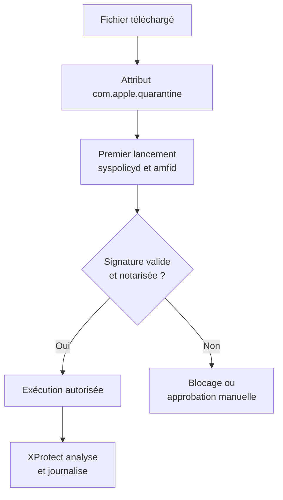
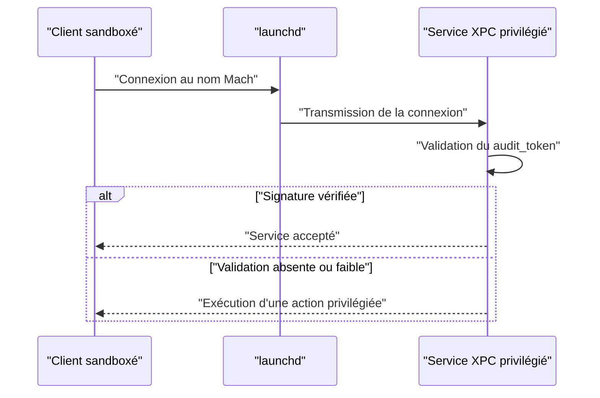

# Malware macOS

macOS combine un noyau Unix, un modèle applicatif signé et un ensemble de contrôles de confidentialité que l'utilisateur perçoit directement. Cette architecture complique la vie d'un code malveillant, mais elle crée aussi des dépendances exploitables : la confiance accordée à une application signée, la délégation de permissions à un utilitaire Apple, ou la possibilité pour un service non signé d'invoquer un composant privilégié. Le malware macOS moderne n'essaie pas de casser Gatekeeper ou TCC de front ; il cherche à faire exécuter sa charge par un composant déjà approuvé.

Le point d'entrée technique est le format Mach-O et la signature de code. Presque toutes les techniques d'injection, de persistance et d'évasion découlent de la façon dont `dyld` charge les bibliothèques, dont le noyau vérifie les pages signées et dont `launchd` arbitre les services. Cette note décrit ces mécanismes, puis la persistance, l'injection et la détection. Le panorama des protections système est dans [[macOS Security]] ; l'analyse binaire dans [[Reverse Engineering]].

## Mach-O et binaires universels

Un fichier Mach-O commence par un en-tête qui indique l'architecture, le type de fichier (`MH_EXECUTE`, `MH_DYLIB`, `MH_BUNDLE`, `MH_DYLINKER`) et le nombre de commandes de chargement. Celles-ci décrivent tout le reste : segments, point d'entrée, dépendances, signature, chiffrement.

| Load command | Rôle |
|---|---|
| `LC_SEGMENT_64` | Segment (`__TEXT`, `__DATA`, `__DATA_CONST`, `__LINKEDIT`) |
| `LC_MAIN` | Point d'entrée du programme |
| `LC_LOAD_DYLIB` | Dépendance d'une bibliothèque dynamique |
| `LC_LOAD_WEAK_DYLIB` | Dépendance optionnelle, chargée si présente |
| `LC_RPATH` | Répertoire de recherche des bibliothèques |
| `LC_CODE_SIGNATURE` | Emplacement et taille de la signature |
| `LC_DYLD_CHAINED_FIXUPS` | Format moderne de résolution des symboles |
| `LC_ENCRYPTION_INFO_64` | Métadonnées de chiffrement (applications App Store) |

```bash
file binaire
otool -h binaire          # en-tête Mach-O
otool -l binaire          # commandes de chargement
otool -L binaire          # dépendances
jtool2 -d binaire         # désassemblage
nm -m binaire             # symboles
```

Un binaire **universel** (fat) contient plusieurs tranches Mach-O, souvent `x86_64` et `arm64`. Le chargeur sélectionne la tranche correspondant à l'architecture courante ; chaque tranche possède sa propre signature. Un malware peut embarquer du code différent par architecture, ce qui impose à l'analyste d'examiner toutes les tranches.

```bash
lipo -info binaire
lipo -thin arm64 -output binaire-arm64 binaire
lipo -create binaire-x86_64 binaire-arm64 -output binaire-universel
```

> [!abstract] Définition — Binaire universel
> Un binaire universel, ou fat binary, est un conteneur regroupant plusieurs images Mach-O pour des architectures différentes. Le noyau choisit la tranche à charger au moment de l'exécution. Chaque tranche étant signée indépendamment, une vérification qui ne porte que sur l'architecture native peut manquer une variante malveillante.

## Signature de code, notarisation et Gatekeeper

La signature de code macOS ne se contente pas d'authentifier l'auteur : elle engage l'intégrité du binaire. La structure de signature contient un CodeDirectory qui liste le hash de chaque page, les entitlements, les exigences de validation et une signature CMS. Toute modification d'une page exécutable invalide la signature, et le noyau refuse de lancer une page non signée lorsque la validation est imposée.

```bash
codesign -dv --verbose=4 app.app
codesign -d --entitlements :- app.app
codesign --verify --deep --strict --verbose=2 app.app
spctl --assess --type execute -vv app.app
stapler validate app.app
```

| Élément | Ce qu'il établit |
|---|---|
| CodeDirectory | Hash des pages, version, identifiant |
| Entitlements | Capacités demandées (sandbox, debug, accès réseau) |
| Requirements | Conditions de validation (`identifier`, `anchor apple`) |
| CMS | Signature du certificateur (Apple ou Developer ID) |
| Ticket de notarisation | Preuve d'analyse par Apple, vérifiable hors ligne |

La **notarisation** ajoute un contrôle côté Apple : le développeur soumet le binaire, Apple l'analyse et délivre un ticket que l'application peut agrafer. **Gatekeeper** s'exécute au premier lancement d'un fichier portant l'attribut `com.apple.quarantine`, interroge `syspolicyd` et `amfid`, et décide d'autoriser, de bloquer ou de demander une approbation utilisateur.



Les contournements reposent souvent sur des fissures administratives plutôt que techniques : suppression de l'attribut de quarantaine (`xattr -d com.apple.quarantine`), exécution locale d'un binaire non quarantiné, ou binaire signé ad hoc qui ne demande aucune notarisation tant qu'il n'est pas distribué. Depuis macOS 15, le contournement par clic droit a été retiré : l'utilisateur doit passer par les Réglages Système pour autoriser une application bloquée, ce qui réduit les automatismes d'installation.

```bash
xattr -l app.app
xattr -d com.apple.quarantine app.app
```

## TCC

TCC (Transparency, Consent, and Control) est le registre des permissions accordées aux applications : accès aux fichiers, à la caméra, au microphone, à l'enregistrement d'écran, à l'accessibilité, au contrôle d'autres applications par événements Apple. Il existe une base par utilisateur et une base système, protégées par SIP.

```bash
sqlite3 "$HOME/Library/Application Support/com.apple.TCC/TCC.db" \
  "SELECT service, client, auth_value, csreq FROM access;"
tccutil reset All com.exemple.app
```

| Colonne | Signification |
|---|---|
| `service` | Permission visée (`kTCCServiceSystemPolicyAllFiles`, `kTCCServiceScreenCapture`, etc.) |
| `client` | Identifiant du bundle autorisé |
| `auth_value` | `0` refusé, `2` autorisé |
| `csreq` | Exigence de signature qui verrouille l'application autorisée |
| `indirect_object_identifier` | Cible pour les événements Apple |

Le champ `csreq` est central : une permission ne vaut pas pour « une application » en général, mais pour une identité de signature précise. Un attaquant qui remplace le binaire autorisé par un autre portant la même identité de bundle mais une signature différente se heurte à cette exigence. Les contournements passent donc par des applications réellement autorisées : commandes AppleScript exécutées par Finder ou Terminal (qui possèdent souvent l'accès complet au disque), automatisation d'une application privilégiée, ou session locale via `ssh` puisque `sshd` dispose d'un accès disque complet et transmet cette capacité au shell.

> [!abstract] Définition — Full Disk Access
> Full Disk Access est la permission TCC (`kTCCServiceSystemPolicyAllFiles`) qui autorise un processus à lire les données normalement protégées : courrier, messages, sauvegardes, bases de navigateurs et la base TCC elle-même. Comme elle est accordée à un identifiant de signature, elle constitue la cible de choix d'une attaque de délégation : il est plus simple de faire agir un outil déjà autorisé que de forcer TCC.

## Sandbox, entitlements et hardened runtime

Le sandbox d'application repose sur les entitlements du binaire. Une application sandboxée vit dans un conteneur (`~/Library/Containers/<bundle-id>/`) et n'accède qu'aux ressources explicitement autorisées. Les helpers lancés par une application sandboxée héritent généralement de la sandbox, sauf s'ils portent l'entitlement `com.apple.security.inherit` dans le bon sens, ce qui ouvre la voie à des communications XPC soigneusement validées.

| Entitlement | Effet | Intérêt offensif |
|---|---|---|
| `com.apple.security.app-sandbox` | Active la sandbox | Réduit la surface, mais définit le conteneur |
| `com.apple.security.cs.disable-library-validation` | Accepte des bibliothèques d'un autre éditeur | Ouvre l'injection de dylib |
| `com.apple.security.cs.allow-dyld-environment-variables` | Autorise `DYLD_*` | Rend `DYLD_INSERT_LIBRARIES` efficace |
| `com.apple.security.cs.allow-unsigned-executable-memory` | Autorise la mémoire exécutable non signée | Facilite l'exécution de shellcode |
| `com.apple.security.cs.allow-jit` | Autorise la compilation à la volée | Nécessaire aux moteurs JS, abusable |
| `com.apple.security.get-task-allow` | Autorise le débogage | Donne accès au port de tâche |
| `com.apple.security.debugger` | Droit de déboguer | Idem, pour un processus tiers |

Le **hardened runtime** (option `runtime` de `codesign`) active la validation de bibliothèques (`CS_REQUIRE_LV`), interdit l'écriture et l'exécution de mémoire non signée, et empêche l'injection d'environnement. Les exceptions sont précisément les entitlements de la table ci-dessus : un binaire signé avec `allow-dyld-environment-variables` redevient injectable par `DYLD_INSERT_LIBRARIES`, et un binaire avec `disable-library-validation` accepte une dylib non signée par la même équipe.

Sur Apple silicon, les extensions de noyau exigent un abaissement de la politique de sécurité ; les **system extensions** s'exécutent en espace utilisateur avec des entitlements dédiés, ce qui déplace la cible vers le processus plutôt que vers le noyau.

## Persistance

`launchd` est le gestionnaire de services central. Un fichier plist dans un répertoire de persistance suffit à faire exécuter un programme au démarrage ou à intervalles réguliers.

```xml
<?xml version="1.0" encoding="UTF-8"?>
<!DOCTYPE plist PUBLIC "-//Apple//DTD PLIST 1.0//EN" "http://www.apple.com/DTDs/PropertyList-1.0.dtd">
<plist version="1.0">
<dict>
  <key>Label</key><string>com.apple.systemhelper</string>
  <key>ProgramArguments</key>
  <array>
    <string>/usr/local/lib/helper</string>
    <string>--daemon</string>
  </array>
  <key>RunAtLoad</key><true/>
  <key>KeepAlive</key><true/>
  <key>ThrottleInterval</key><integer>30</integer>
</dict>
</plist>
```

```bash
launchctl bootstrap system /Library/LaunchDaemons/com.apple.systemhelper.plist
launchctl kickstart -k system/com.apple.systemhelper
launchctl print system/com.apple.systemhelper
```

| Emplacement | Contexte | Privilège requis |
|---|---|---|
| `/Library/LaunchDaemons/` | Boot, sans utilisateur connecté | root |
| `/Library/LaunchAgents/` | Login de chaque utilisateur | admin |
| `~/Library/LaunchAgents/` | Login de l'utilisateur courant | utilisateur |
| `/System/Library/LaunchDaemons/` | Services Apple | protégé par SIP |
| `~/Library/Application Support/com.apple.backgroundtaskmanagementagent/` | Base des login items | utilisateur |

Les clés utiles dépassent `RunAtLoad` : `KeepAlive` avec `SuccessfulExit`, `StartInterval`, `StartCalendarInterval`, `WatchPaths` et `QueueDirectories` déclenchent l'exécution sur un événement, `MachServices` enregistre un service XPC, et `ProcessType` influence la priorité. `LimitLoadToSessionType` restreint le contexte de chargement.

Les login items modernes passent par `SMAppService` (macOS 13+) ou par l'ancien mécanisme `osascript` avec `System Events`. La base Background Task Management enregistre ces éléments et macOS notifie l'utilisateur quand un nouvel item apparaît — une défense qui repose sur son attention.

```bash
osascript -e 'tell application "System Events" to make login item at end \
  with properties {path:"/tmp/helper.app", hidden:true}'
sfltool dumpbtm
```

Autres vecteurs : `cron` (déprécié mais fonctionnel, et soumis à TCC pour les répertoires protégés), `/etc/periodic/`, `emond` (`/etc/emond.d/rules/*.plist`), scripts de paquets `.pkg` exécutés en root, profiles de configuration `.mobileconfig` (certificat racine, proxy, permissions, PPPC), `~/.zshrc` et `~/.zshenv`, `~/.ssh/rc` et `authorized_keys`, `SMJobBless` pour installer un helper privilégié validé par signature. La note [[Persistence]] décrit les équivalents Windows et la logique commune.

## Injection

Le détournement de bibliothèque est la technique la plus accessible. `dyld` résout les dépendances via `LC_LOAD_DYLIB`, `LC_LOAD_WEAK_DYLIB` et `LC_RPATH`. Une dépendance faible absente, ou un `@rpath` pointant vers un répertoire accessible en écriture, permet de placer une dylib malveillante qui s'exécutera comme constructeur avant tout code applicatif.

```bash
otool -L app   # chemins des dépendances
```

```c
// Dylib malveillante : le constructeur s'exécute au chargement
__attribute__((constructor)) void init(void) {
    system("/usr/local/bin/helper --start");
}
```

`DYLD_INSERT_LIBRARIES` fonctionne si le binaire n'est ni protégé par SIP, ni restreint, ni doté d'un hardened runtime sans entitlement d'exception. `DYLD_LIBRARY_PATH` et `DYLD_FRAMEWORK_PATH` modifient les chemins de recherche, et `DYLD_PRINT_LIBRARIES=1` sert à l'analyse. Depuis macOS 11, la bibliothèque système partagée (dyld shared cache) empêche le remplacement des bibliothèques Apple sur disque.

L'injection dans un processus distant exige son port de tâche : `task_for_pid` n'est accessible qu'à root ou aux binaires dotés de `get-task-allow`, arbitré par `taskgated`. Une fois le port obtenu, `mach_vm_allocate`, `mach_vm_write` et `thread_create_running` reproduisent l'injection classique ; `mach_inject` et `mach_inject_bundle` automatisent l'opération. `posix_spawn` avec `POSIX_SPAWN_START_SUSPENDED` permet d'injecter dans un enfant avant sa première instruction.

**XPC** est le canal d'échange entre processus macOS. Un service déclaré dans `MachServices` écoute sur un nom Mach ; les clients s'y connectent par `NSXPCConnection`. La faiblesse classique est la validation du pair : vérifier le PID (réutilisable), vérifier un identifiant de bundle copiable, ou ne rien vérifier du tout. La bonne pratique — `audit_token` puis `SecCodeCheckValidity` sur le client, et `xpc_connection_set_peer_code_signing_requirement` à partir de macOS 12 — est fréquemment absente des helpers tiers. Un XPC mal validé peut donner accès à un service non sandboxé ou privilégié, ce qui constitue une échappée élégante.



## Limites et détection

Le framework **EndpointSecurity** est la source principale de télémétrie moderne. Un client souscrit à des événements (`AUTH_EXEC`, `NOTIFY_EXEC`, `AUTH_OPEN`, `AUTH_MMAP`, `AUTH_MOUNT`, `NOTIFY_XPC_CONNECT`) et peut autoriser ou refuser. Il exige l'entitlement `com.apple.developer.endpoint-security.client`, l'accès disque complet et un daemon lancé par `launchd`. Depuis macOS 13, `eslogger` expose ces événements en ligne de commande.

```bash
log stream --level debug --predicate 'process == "suspicious"'
log show --last 1h --predicate 'subsystem == "com.apple.TCC"' --info
eslogger exec open
codesign --verify --deep --strict app.app
launchctl print system | grep -A5 "com.apple.systemhelper"
sfltool dumpbtm
systemextensionsctl list
```

| Indice | Source | Ce qu'il révèle |
|---|---|---|
| Processus exécuté depuis un chemin inhabituel | EndpointSecurity, unified log | Chargement d'un binaire déposé |
| Signature absente ou ad hoc | `codesign`, `spctl` | Binaire non notarié |
| Entitlement `get-task-allow` ou `disable-library-validation` | `codesign -d --entitlements` | Cible d'injection |
| Nouveau plist dans un répertoire de persistance | FSEvents, unified log, contrôle d'intégrité | Persistance launchd |
| Nouvel item de login | Base BTM, notification système | Persistance login item |
| Accès à la base TCC ou aux données protégées | ES, journaux TCC | Élévation de privilèges |
| Connexion à un service XPC | `NOTIFY_XPC_CONNECT` | Abus d'un service privilégié |

XProtect complète le dispositif : signatures de malwares connus, et XProtect Remediator qui supprime les familles identifiées. Des outils open source (KnockKnock, BlockBlock, LuLu, Santa) instrumentent les mêmes sources que les produits commerciaux, mais ils ne voient que ce que le framework leur laisse voir.

Les limites sont structurelles. Un binaire signé ad hoc et non quarantiné s'exécute sans notarisation. Un script lancé par `osascript` hérite de la confiance de l'outil Apple qui l'exécute. Un malware qui se contente d'orchestrer des binaires Apple signés ne déclenche aucune alerte de signature. Les journaux unifiés, riches, tournent et ne sont pas centralisés par défaut ; sans EndpointSecurity ni collecte distante, l'investigation repose sur des traces partielles. Et comme sur tout système compromis, les outils qui s'exécutent dans le contexte de la victime peuvent être trompés : la vérification fiable passe par l'analyse hors ligne du disque et de la mémoire, décrite dans [[DFIR]] et [[Memory Analysis]], et par la comparaison des signatures avec une source externe.

## Questions de révision

> [!quiz] Pourquoi une signature de code valide ne suffit-elle pas à considérer un binaire comme sûr ?
> Parce qu'elle prouve l'intégrité et l'origine, pas l'intention. Un binaire signé ad hoc, un outil Apple détourné ou une application légitime vulnérable à l'injection peuvent exécuter du code malveillant avec une signature valide.

> [!quiz] À quoi sert le champ `csreq` dans la base TCC ?
> À lier une permission à une identité de signature précise. Remplacer le binaire autorisé par un autre de même identifiant mais d'une signature différente invalide la permission.

> [!quiz] Qu'est-ce que le hardened runtime empêche, et comment le contourner légitimement ?
> Il interdit l'injection de bibliothèques non validées, la mémoire exécutable non signée et l'usage des variables `DYLD_*`. Les exceptions passent par des entitlements explicites comme `disable-library-validation` ou `allow-dyld-environment-variables`.

> [!quiz] Pourquoi la validation d'un client XPC par PID ou identifiant de bundle est-elle insuffisante ?
> Le PID est réutilisable et l'identifiant de bundle peut être imité. Seule la validation du code signé via `audit_token` et `SecCodeCheckValidity` (ou `xpc_connection_set_peer_code_signing_requirement`) garantit l'identité réelle du pair.

> [!quiz] Pourquoi les journaux unifiés seuls ne suffisent-ils pas à la détection ?
> Ils tournent rapidement, ne sont pas centralisés par défaut et ne couvrent que ce que le système journalise. EndpointSecurity et une collecte distante sont nécessaires pour une détection fiable.
