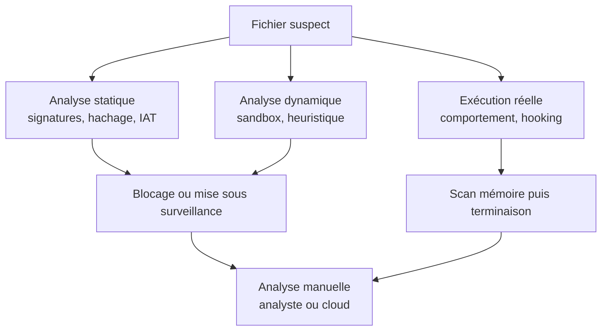
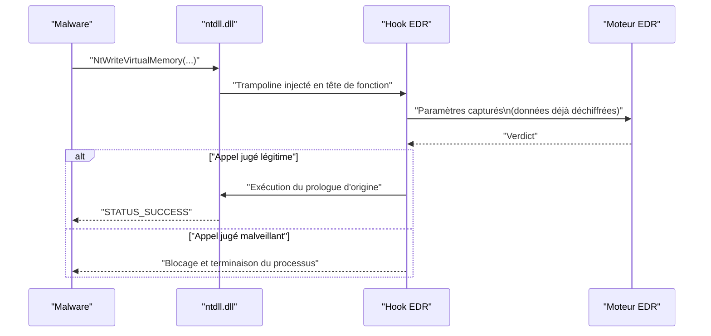

# Mécanismes de détection

Une solution de sécurité ne « voit » pas un malware : elle observe des **artefacts** — des octets sur disque, des chaînes, des imports, des appels d'API, une séquence de comportements — et décide si ces artefacts ressemblent à ceux qu'elle a appris à reconnaître. Comprendre ces mécanismes est un prérequis à toute évasion : on ne contourne bien que ce que l'on sait détecter. Cette note couvre d'abord le panorama des couches de détection, puis un cas pratique de contournement de l'analyse statique de Microsoft Defender.

## Panorama des couches



| Mécanisme | Ce qu'il observe | Moment | Contournement principal |
|---|---|---|---|
| Signature statique | Octets, chaînes, noms, imports | Sur disque / à l'écriture | Modifier ou chiffrer les artefacts |
| Hachage | Empreinte du fichier (MD5, SHA256) | Sur disque | Changer au moins 1 octet |
| Heuristique statique | Similitudes de code avec du malware connu | Sur disque | Déstructurer le code, obfusquer |
| Heuristique dynamique (sandbox) | Comportement en environnement émulé | À l'exécution | Techniques anti-sandbox |
| Comportement | Séquence d'actions d'un processus vivant | À l'exécution | Se comporter comme un programme légitime |
| API hooking | Arguments des API après déchiffrement | En temps réel | Unhooking, syscalls directs |
| Inspection de l'IAT | Fonctions importées déclarées | Sur disque | API hashing, résolution dynamique |
| Analyse manuelle | Tout, par un analyste humain | Hors ligne | Anti-debug, anti-VM, obfuscation |

## Détection statique par signature

Une **signature** est un ensemble d'octets ou de chaînes qui identifie de façon unique un malware. La règle peut inclure d'autres conditions : noms de variables, fonctions importées, présence d'une chaîne. La solution scanne le programme et le confronte à une liste de règles **préconstruites** et poussées par l'éditeur. YARA est l'outil de référence pour écrire ces règles.

Exemple : un shellcode contenant la séquence d'octets ci-dessous est identifié comme le payload `exec` x64 de Msfvenom.

```text
FC 48 83 E4 F0 E8 C0 00 00 00 41 51 41 50 52 51
```

```c
// Le même shellcode, tel qu'il apparaît dans un binaire brut
unsigned char payload[] =
	"\xfc\x48\x83\xe4\xf0\xe8\xc0\x00\x00\x00\x41\x51\x41\x50\x52\x51";
```

La détection par signature est **facile à contourner** mais **coûteuse à maintenir** : chaque nouvelle règle doit être produite puis distribuée. Côté attaquant, la règle d'or est de ne jamais coder en dur une valeur qui peut l'être dynamiquement — d'où la récupération calculée des API, le hachage des chaînes ([[Hachage de chaînes]]) et la construction de l'IAT à la volée ([[Dissimulation de l'IAT]]).

### Détection par hachage

Sous-ensemble de la détection statique, et la technique la plus rapide et la plus simple : la base de données contient les empreintes (MD5, SHA256) des malwares connus, et le hash du fichier analysé y est comparé.

Le contournement est trivial : modifier **un seul octet** change irrémédiablement le hash de tout algorithme. Mais cela ne suffit presque jamais, car les autres couches (heuristique, comportement) restent actives.

## Détection heuristique

L'heuristique vise les malwares **inconnus, nouveaux ou modifiés** qui échappent aux signatures. Deux variantes coexistent.

| Variante | Principe | Limite |
|---|---|---|
| Heuristique statique | Décompiler le programme et comparer des extraits de code à la base de malwares connus ; flag si un pourcentage de correspondance est dépassé | Sensible au code obfusqué ou réécrit |
| Heuristique dynamique | Exécuter le programme dans un environnement virtuel (sandbox) et analyser ses comportements | Sensible aux techniques anti-sandbox |

### Analyse heuristique dynamique (sandbox)

La sandbox exécute le fichier et guette les actions suspectes. Isolément, une action est rarement malveillante : **c'est la séquence qui fait le verdict**. Allouer de la mémoire est banal ; allouer de la mémoire, se connecter à Internet, y récupérer un shellcode, l'écrire en mémoire puis l'exécuter est un scénario d'injection classique.

Face à cela, le développeur de malware intègre des techniques **anti-sandbox** : si l'environnement d'exécution est reconnu comme artificiel, le binaire exécute un code anodin, sinon il exécute la charge malveillante (voir [[Anti-VM et évasion d'environnement]]).

## Détection comportementale

Une fois le malware en cours d'exécution, la solution surveille en continu les indicateurs suspects : chargement d'une DLL, appel à une API sensible, connexion réseau. Si un faisceau d'indices apparaît, un **scan mémoire** du processus est déclenché ; s'il est confirmé malveillant, le processus est terminé.

Certaines combinaisons entraînent une terminaison **immédiate**, sans même prendre le temps du scan mémoire : injecter dans `notepad.exe` puis se connecter à Internet est un signal trop fort pour laisser une chance au processus.

Deux lignes de défense côté attaquant :

- rendre le processus **aussi banal que possible** — ne pas lancer un `cmd.exe` enfant, ne pas ouvrir de port exotique ;
- survivre au scan mémoire par le **chiffrement de la charge en mémoire**, qui ne la laisse en clair qu'aux instants où elle est réellement nécessaire ([[Chiffrement du payload]]).

## API hooking

L'API hooking est la technique de surveillance temps réel privilégiée des EDR. Elle intercepte les API les plus abusées et analyse leurs **paramètres en direct**. Son intérêt décisif : voir le contenu passé à l'API **après** qu'il a été déchiffré ou désambiguïsé. C'est donc un mécanisme hybride, à la fois temps réel et comportemental.



Les contre-mesures sont l'unhooking des DLL (restaurer le prologue d'origine depuis la copie sur disque) et les appels système directs qui court-circuitent les DLL utilisateur. Voir [[Unhooking de NTDLL]], [[Introduction aux syscalls]] et [[SysWhispers et Hell's Gate]].

## Inspection de l'IAT

L'**Import Address Table** du PE contient les noms des fonctions utilisées à l'exécution et les DLL qui les exportent ([[Format PE]]). C'est une source d'information précieuse : la liste des WinAPI révèle l'intention du programme. Un rançongiciel doit chiffrer des fichiers, donc il importera typiquement :

```text
CreateFileA/W, SetFilePointer, ReadFile/WriteFile,
CryptCreateHash, CryptHashData, CryptGetHashParam
```

Face à une telle IAT, la solution **flagge** le programme ou lui applique une surveillance renforcée. L'outil `dumpbin.exe` permet d'inspecter cette table (`dumpbin /imports binaire.exe`).

La parade est l'**API hashing** : au lieu d'une chaîne lisible, l'import est absent du PE et la fonction est retrouvée à l'exécution en comparant des hashs ([[Hachage de chaînes]]).

## Analyse manuelle

Même si toutes les couches automatiques sont déjouées, il reste l'**analyste humain** : un reverse engineer expérimenté identifiera le code malveillant, et les solutions envoient fréquemment une copie du fichier suspect dans le cloud pour un examen approfondi. D'où les techniques d'anti-reversing : détection de debugger ([[Anti-debugging]]) et détection d'environnement virtualisé ([[Anti-VM et évasion d'environnement]]).

## Cas pratique : contourner l'analyse statique de Microsoft Defender

Ce scénario n'exécute pas la charge : le shellcode Msfvenom est simplement **imprimé en console**. L'objectif est donc uniquement la fuite devant le moteur statique, en comparant quatre variantes d'un même code.

| Échantillon | Transformation appliquée | Réaction de Defender |
|---|---|---|
| Raw shellcode | Aucune | Détecté |
| XOR | Chiffrement XOR de la charge | Contourne |
| AES | Chiffrement AES de la charge | Contourne |
| RC4 | Chiffrement RC4 de la charge | Contourne |

L'enseignement est double : d'une part la séquence d'octets brute est une signature suffisante à elle seule, d'autre part **n'importe quelle transformation cryptographique** détruit cette signature. Le chiffrement n'est pas seulement une protection de confidentialité, c'est d'abord un moyen de casser la correspondance statique.

```c
// Déchiffrement XOR en place : la signature n'apparaît jamais sur disque
void XorDecrypt(PBYTE payload, SIZE_T size, BYTE key) {
	for (SIZE_T i = 0; i < size; i++)
		payload[i] ^= key;
}
```

```powershell
# Génération d'un shellcode chiffré sous forme de tableau C
$bytes = [System.IO.File]::ReadAllBytes("shellcode.bin")
$key   = 0x2A
$enc   = $bytes | ForEach-Object { $_ -bxor $key }
($enc | ForEach-Object { "0x{0:X2}" -f $_ }) -join ", "
```

Deux précautions s'imposent néanmoins. Un tableau de données **haute entropie** peut devenir en lui-même un signal heuristique : la réduction d'entropie ([[Réduction de l'entropie binaire]]) et l'obfuscation ([[Obfuscation du payload]]) complètent utilement le chiffrement. Et l'évasion statique ne protège que contre cette couche : dès que la charge est réellement exécutée, le hooking et l'analyse comportementale reprennent la main. L'ensemble [[Chiffrement du payload]], [[Placement du payload]] et [[Contrôle de l'exécution du payload]] traite des couches suivantes.
