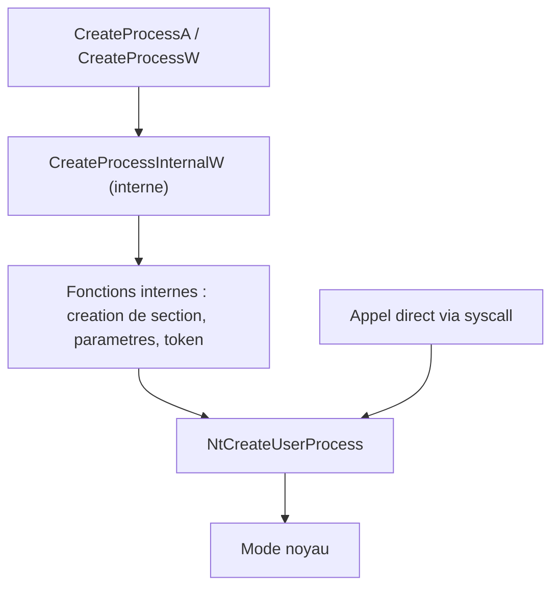
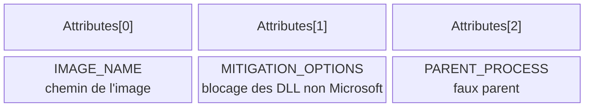

# NtCreateUserProcess

Jusqu'ici, tous les modules créaient des processus avec `CreateProcess`. Or cette WinAPI n'est qu'une façade : elle exécute successivement plusieurs fonctions internes avant d'atteindre `NtCreateUserProcess`, la dernière fonction accessible en mode utilisateur. Chacune de ces étapes intermédiaires peut être hookée par un éditeur de sécurité. Appeler `NtCreateUserProcess` directement — idéalement par syscall direct ou indirect — supprime toute cette surface d'observation.



`NtCreateUserProcess` concentre toute la logique de création : chaque étape que `CreateProcess` enchaîne en user mode devient ici un attribut passé en paramètre.

## Signature de la fonction

```c
NTSTATUS NTAPI NtCreateUserProcess(
    OUT         PHANDLE ProcessHandle,
    OUT         PHANDLE ThreadHandle,
    IN          ACCESS_MASK ProcessDesiredAccess,
    IN          ACCESS_MASK ThreadDesiredAccess,
    IN OPTIONAL POBJECT_ATTRIBUTES ProcessObjectAttributes,
    IN OPTIONAL POBJECT_ATTRIBUTES ThreadObjectAttributes,
    IN ULONG    ProcessFlags,
    IN ULONG    ThreadFlags,
    IN OPTIONAL PRTL_USER_PROCESS_PARAMETERS ProcessParameters,
    IN OUT      PPS_CREATE_INFO CreateInfo,
    IN          PPS_ATTRIBUTE_LIST AttributeList
);
```

| Paramètre | Rôle | Valeur typique |
|---|---|---|
| `ProcessHandle` | Handle du nouveau processus (sortie) | pointeur vers `HANDLE` |
| `ThreadHandle` | Handle du thread principal (sortie) | pointeur vers `HANDLE` |
| `ProcessDesiredAccess` | Droits demandés sur le processus | `PROCESS_ALL_ACCESS` |
| `ThreadDesiredAccess` | Droits demandés sur le thread | `THREAD_ALL_ACCESS` |
| `ProcessObjectAttributes` | Attributs de l'objet processus | `NULL` |
| `ThreadObjectAttributes` | Attributs de l'objet thread | `NULL` |
| `ProcessFlags` | État initial du processus (`PROCESS_CREATE_FLAGS_*`) | `NULL` (état normal) |
| `ThreadFlags` | État initial du thread (`THREAD_CREATE_FLAGS_*`) | `NULL` (état normal) |
| `ProcessParameters` | Arguments et chemin du processus | `RTL_USER_PROCESS_PARAMETERS` |
| `CreateInfo` | Informations retournées sur la création | `PS_CREATE_INFO` |
| `AttributeList` | Attributs du processus et du thread | `PS_ATTRIBUTE_LIST` |

Le nom du processus à créer n'est pas un paramètre dédié : il transite dans `AttributeList`.

## PS_ATTRIBUTE_LIST et PS_ATTRIBUTE

```c
typedef struct _PS_ATTRIBUTE_LIST {
    SIZE_T       TotalLength;
    PS_ATTRIBUTE Attributes[1];   // taille du tableau ajustee selon le nombre d'attributs
} PS_ATTRIBUTE_LIST, *PPS_ATTRIBUTE_LIST;

typedef struct _PS_ATTRIBUTE {
    ULONG_PTR Attribute;      // type d'attribut
    SIZE_T    Size;           // taille de la valeur
    union {
        ULONG_PTR Value;
        PVOID     ValuePtr;
    };
    PSIZE_T   ReturnLength;
} PS_ATTRIBUTE, *PPS_ATTRIBUTE;
```

`TotalLength` vaut toujours `sizeof(PS_ATTRIBUTE_LIST)`. Chaque attribut se renseigne comme dans `UpdateProcThreadAttribute` (voir [[Politique de blocage des DLL]]), à ceci près que `Attribute` doit prendre une valeur propre à `NtCreateUserProcess`.

| Attribut | Usage |
|---|---|
| `PS_ATTRIBUTE_IMAGE_NAME` | Nom de l'image à exécuter (obligatoire pour créer le processus) |
| `PS_ATTRIBUTE_PARENT_PROCESS` | Processus parent (spoofing de PPID) |
| `PS_ATTRIBUTE_MITIGATION_OPTIONS` | Politiques de mitigation (blocage des DLL non Microsoft) |
| `PS_ATTRIBUTE_DEBUG_PORT` | Port de débogage |
| `PS_ATTRIBUTE_TOKEN` | Jeton à assigner au nouveau processus |
| `PS_ATTRIBUTE_CLIENT_ID` | Identifiant client |
| `PS_ATTRIBUTE_TEB_ADDRESS` | Adresse du TEB |
| `PS_ATTRIBUTE_IMAGE_INFO` | Informations sur l'image |
| `PS_ATTRIBUTE_MEMORY_RESERVE` | Mémoire réservée |
| `PS_ATTRIBUTE_PRIORITY_CLASS` | Classe de priorité |
| `PS_ATTRIBUTE_ERROR_MODE` | Mode d'erreur |
| `PS_ATTRIBUTE_STD_HANDLE_INFO` | Informations sur les handles standard |
| `PS_ATTRIBUTE_HANDLE_LIST` | Liste de handles à hériter |
| `PS_ATTRIBUTE_GROUP_AFFINITY` | Affinité de groupe |
| `PS_ATTRIBUTE_PREFERRED_NODE` | Nœud NUMA préféré |
| `PS_ATTRIBUTE_IDEAL_PROCESSOR` | Processeur idéal |
| `PS_ATTRIBUTE_PROTECTION_LEVEL` | Niveau de protection |
| `PS_ATTRIBUTE_SECURE_PROCESS` | Processus sécurisé |
| `PS_ATTRIBUTE_CHILD_PROCESS_POLICY` | Politique des processus enfants |
| `PS_ATTRIBUTE_JOB_LIST` | Liste de tâches |

Les valeurs constantes sont produites par la macro `PsAttributeValue(PsAttributeXxx, ...)`, par exemple :

```c
#define PS_ATTRIBUTE_IMAGE_NAME      PsAttributeValue(PsAttributeImageName, FALSE, TRUE, FALSE)
#define PS_ATTRIBUTE_PARENT_PROCESS  PsAttributeValue(PsAttributeParentProcess, FALSE, TRUE, TRUE)
#define PS_ATTRIBUTE_MITIGATION_OPTIONS PsAttributeValue(PsAttributeMitigationOptions, FALSE, TRUE, FALSE)
```

Pour ajouter un attribut, il faut élargir le tableau : `PS_ATTRIBUTE Attributes[2]` pour deux attributs, `[3]` pour trois, et ainsi de suite. Le `TotalLength` suit automatiquement puisque `sizeof(PS_ATTRIBUTE_LIST)` change.

```c
PPS_ATTRIBUTE_LIST pAttributeList = (PPS_ATTRIBUTE_LIST)HeapAlloc(GetProcessHeap(),
                                                                  HEAP_ZERO_MEMORY,
                                                                  sizeof(PS_ATTRIBUTE_LIST));

pAttributeList->TotalLength             = sizeof(PS_ATTRIBUTE_LIST);
pAttributeList->Attributes[0].Attribute = PS_ATTRIBUTE_IMAGE_NAME;
pAttributeList->Attributes[0].Size      = dwProcessNameLength;
pAttributeList->Attributes[0].Value     = szProcessName;
```

## PS_CREATE_INFO

Bien que volumineuse, cette structure est presque entièrement remplie par `NtCreateUserProcess` en cas de succès. Seuls `Size` et `State` sont à initialiser :

```c
PS_CREATE_INFO CreateInfo = { 0 };
CreateInfo.Size  = sizeof(PS_CREATE_INFO);
CreateInfo.State = PsCreateInitialState;
```

`State` provient de l'énumération `PS_CREATE_STATE` ; dans la quasi-totalité des cas il vaut `PsCreateInitialState`. Les autres valeurs (`PsCreateFailOnFileOpen`, `PsCreateFailExeFormat`, `PsCreateSuccess`, etc.) servent à `NtCreateUserProcess` pour indiquer où la création a échoué.

## RTL_USER_PROCESS_PARAMETERS

Ce paramètre est marqué optionnel, mais le passer à `NULL` fait échouer l'appel avec `0xC0000005` (`STATUS_ACCESS_VIOLATION`). La structure étant très peu documentée par Microsoft, sa définition provient du dépôt Process Hacker ; elle décrit tout l'environnement du processus : répertoire courant, chemin de l'image, ligne de commande, handles standard, environnement, titre de fenêtre, etc.

Sa construction est déléguée à la fonction native `RtlCreateProcessParametersEx` :

```c
NTSTATUS RtlCreateProcessParametersEx(
    OUT PRTL_USER_PROCESS_PARAMETERS *pProcessParameters,
    IN  PUNICODE_STRING ImagePathName,
    IN OPTIONAL PUNICODE_STRING DllPath,           // NULL
    IN OPTIONAL PUNICODE_STRING CurrentDirectory,
    IN OPTIONAL PUNICODE_STRING CommandLine,
    IN OPTIONAL PVOID           Environment,       // NULL
    IN OPTIONAL PUNICODE_STRING WindowTitle,       // NULL
    IN OPTIONAL PUNICODE_STRING DesktopInfo,       // NULL
    IN OPTIONAL PUNICODE_STRING ShellInfo,         // NULL
    IN OPTIONAL PUNICODE_STRING RuntimeData,       // NULL
    IN ULONG                    Flags
);
```

Trois paramètres comptent réellement :

- `ImagePathName` : chemin complet de l'image, **au format de chemin NT**, c'est-à-dire préfixé par `\??\`. Pour lancer `C:\Windows\System32\cmd.exe`, il faut donc `\??\C:\Windows\System32\cmd.exe`.
- `CurrentDirectory` : répertoire courant du processus créé.
- `CommandLine` : arguments passés au processus.

`Flags` est fixé à `RTL_USER_PROC_PARAMS_NORMALIZED` (`0x00000001`), qui indique que les paramètres sont déjà sous forme normalisée. Les autres valeurs possibles couvrent le profilage (`RTL_USER_PROC_PROFILE_USER`, `_KERNEL`, `_SERVER`), la réservation d'espace (`RTL_USER_PROC_RESERVE_1MB`, `_16MB`), le mode sensible à la casse, la redirection DLL locale, la présence d'un manifeste, etc.

## Créer un processus : preuve de concept

Le minimum vital tient en un attribut `PS_ATTRIBUTE_IMAGE_NAME`. Les chemins passent par une version maison de `RtlInitUnicodeString` :

```c
VOID _RtlInitUnicodeString(OUT PUNICODE_STRING UsStruct, IN OPTIONAL PCWSTR Buffer) {
    if ((UsStruct->Buffer = (PWSTR)Buffer)) {
        unsigned int Length = wcslen(Buffer) * sizeof(WCHAR);
        if (Length > 0xfffc)
            Length = 0xfffc;                 // taille maximale d'un UNICODE_STRING
        UsStruct->Length        = Length;
        UsStruct->MaximumLength = UsStruct->Length + sizeof(WCHAR);
    }
    else UsStruct->Length = UsStruct->MaximumLength = 0;
}
```

L'enchaînement complet dans `NtCreateUserProcessMinimalPoC` :

```c
fnRtlCreateProcessParametersEx RtlCreateProcessParametersEx =
    (fnRtlCreateProcessParametersEx)GetProcAddress(GetModuleHandle(L"NTDLL"), "RtlCreateProcessParametersEx");
fnNtCreateUserProcess NtCreateUserProcess =
    (fnNtCreateUserProcess)GetProcAddress(GetModuleHandle(L"NTDLL"), "NtCreateUserProcess");

_RtlInitUnicodeString(&UsNtImagePath,      szTargetProcess);   // \??\C:\...\RuntimeBroker.exe
_RtlInitUnicodeString(&UsCommandLine,      szTargetProcessParameters);
_RtlInitUnicodeString(&UsCurrentDirectory, szTargetProcessPath);

RtlCreateProcessParametersEx(&UppProcessParameters, &UsNtImagePath, NULL,
                             &UsCurrentDirectory, &UsCommandLine, NULL, NULL,
                             NULL, NULL, NULL, RTL_USER_PROC_PARAMS_NORMALIZED);

pAttributeList->TotalLength             = sizeof(PS_ATTRIBUTE_LIST);
pAttributeList->Attributes[0].Attribute = PS_ATTRIBUTE_IMAGE_NAME;
pAttributeList->Attributes[0].Size      = UsNtImagePath.Length;
pAttributeList->Attributes[0].Value     = (ULONG_PTR)UsNtImagePath.Buffer;

PS_CREATE_INFO psCreateInfo = { .Size = sizeof(PS_CREATE_INFO), .State = PsCreateInitialState };

NtCreateUserProcess(hProcess, hThread, PROCESS_ALL_ACCESS, THREAD_ALL_ACCESS,
                    NULL, NULL, NULL, NULL, UppProcessParameters, &psCreateInfo, pAttributeList);
```

L'appelant fournit les trois chaînes attendues :

```c
#define TARGET_PROCESS   L"\\??\\C:\\Windows\\System32\\RuntimeBroker.exe"
#define PROCESS_PARMS    L"C:\\Windows\\System32\\RuntimeBroker.exe -Embedding"
#define PROCESS_PATH     L"C:\\Windows\\System32"
```

Le processus produit ressemble à un `RuntimeBroker` légitime, à une différence près : son processus parent.

## Spoofing de PPID

Avec deux attributs, on indique un parent arbitraire via `PS_ATTRIBUTE_PARENT_PROCESS`. Le handle du faux parent provient d'un `OpenProcess(PROCESS_ALL_ACCESS, FALSE, PARENT_PID)`.

```c
pAttributeList->Attributes[1].Attribute = PS_ATTRIBUTE_PARENT_PROCESS;
pAttributeList->Attributes[1].Size      = sizeof(HANDLE);
pAttributeList->Attributes[1].Value     = hParentProcess;   // ATTENTION : handle, pas d'adresse
```

La différence essentielle avec la version minimale est cet attribut supplémentaire ; le reste du code est identique. Le résultat est un processus dont le parent affiché n'est pas le vrai créateur — le principe même du spoofing décrit dans [[Spoofing de processus]].

## Politique de blocage des DLL

Deux attributs suffisent également pour activer la politique de blocage des DLL non signées par Microsoft, via `PS_ATTRIBUTE_MITIGATION_OPTIONS` (voir [[Politique de blocage des DLL]]).

```c
DWORD64 dwBlockDllPolicy = PROCESS_CREATION_MITIGATION_POLICY_BLOCK_NON_MICROSOFT_BINARIES_ALWAYS_ON;

pAttributeList->Attributes[1].Attribute = PS_ATTRIBUTE_MITIGATION_OPTIONS;
pAttributeList->Attributes[1].Size      = sizeof(DWORD64);
pAttributeList->Attributes[1].Value     = (ULONG_PTR)&dwBlockDllPolicy;   // ici, une adresse
```

Noter l'asymétrie : `PS_ATTRIBUTE_PARENT_PROCESS` attend une **valeur** (le handle), tandis que `PS_ATTRIBUTE_MITIGATION_OPTIONS` attend un **pointeur** vers la valeur. L'avantage par rapport à `CreateProcess` est l'absence d'appel à `InitializeProcThreadAttributeList` et `UpdateProcThreadAttribute`, donc moins de fonctions hookables.

## Combiner les deux

Trois attributs permettent de cumuler spoofing de PPID et politique de blocage dans un même appel (`NtCreateUserProcessForBoth`) :

| Indice | Attribut | Valeur |
|---|---|---|
| `Attributes[0]` | `PS_ATTRIBUTE_IMAGE_NAME` | `UsNtImagePath.Buffer` |
| `Attributes[1]` | `PS_ATTRIBUTE_MITIGATION_OPTIONS` | `&dwBlockDllPolicy` |
| `Attributes[2]` | `PS_ATTRIBUTE_PARENT_PROCESS` | `hParentProcess` |

L'unique autre modification est de déclarer `PS_ATTRIBUTE Attributes[3]` dans la structure locale.



## Limites et amélioration

- Le code d'exemple récupère les deux fonctions natives avec `GetProcAddress` et `GetModuleHandle`, ce qui laisse des traces dans l'IAT et suppose que `NtCreateUserProcess` n'est pas hooké. En conditions réelles, un syscall direct ou indirect s'impose (voir [[Introduction aux syscalls]], [[SysWhispers et Hell's Gate]]).
- Un appel direct à `NtCreateUserProcess` est lui-même un signal pour un EDR : peu de logiciels légitimes l'emploient hors du chargeur Windows et de quelques environnements spécialisés (voir [[Mécanismes de détection]]).
- Le format de chemin NT (`\??\`) est obligatoire pour `ImagePathName` : un chemin Win32 classique provoque un échec.
- Oublier `RTL_USER_PROCESS_PARAMETERS` produit systématiquement `STATUS_ACCESS_VIOLATION` malgré le caractère « optionnel » du paramètre.
- Le ppid spoofing et la politique de blocage des DLL ne protègent que le processus ainsi créé : le processus courant reste exposé aux hooks déjà installés.

L'appel direct offre en contrepartie une personnalisation fine : chaque comportement de `CreateProcess` (jeton, handles standard, politiques de mitigation, parent, niveau de protection) devient un attribut explicite, manipulable indépendamment.
