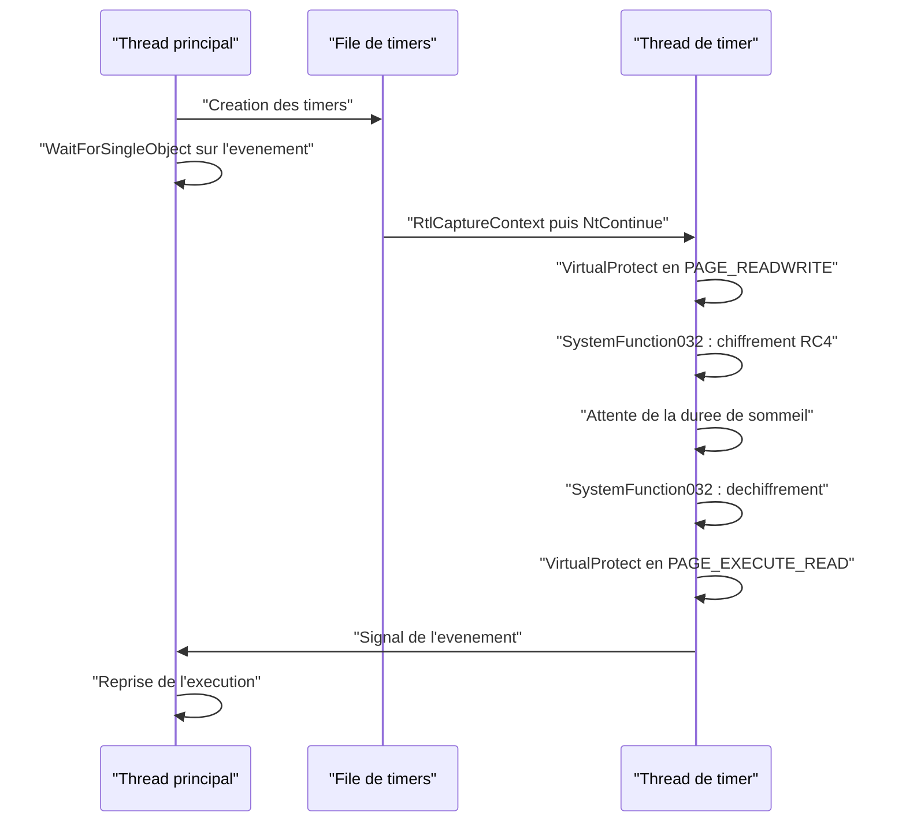

# Obscurcissement du sommeil

Un implant moderne passe l'essentiel de sa vie à attendre. Entre deux ordres du serveur de commande, il dort — plusieurs dizaines de secondes, parfois plusieurs heures, avec un jitter qui casse la périodicité. Or c'est précisément pendant cette attente que la mémoire du processus est la plus lisible : plus rien ne bouge, les pages exécutables sont stables, et un scanner peut les comparer à une base de signatures, à une image sur disque ou à un modèle d'entropie. Le payload n'a plus besoin d'être déchiffré pour être trouvé ; il suffit qu'il soit présent.

L'obscurcissement du sommeil (*sleep obfuscation*) consiste à changer l'état de la mémoire pendant l'attente, puis à le restaurer avant le réveil. Trois propriétés sont recherchées : le contenu devient chiffré, donc non signable ; les pages perdent leur droit d'exécution, donc ne sont plus exécutables par erreur ; la pile et les frames des threads peuvent être maquillées pour ressembler à celles d'un thread légitime. La difficulté n'est pas de chiffrer un buffer — c'est de le faire alors que le thread qui dort ne peut plus exécuter son propre code.

> [!abstract] Définition — Obscurcissement du sommeil
> Ensemble de techniques qui modifient temporairement la mémoire d'un processus endormi — chiffrement de l'image, changement de protection, masquage de la pile — et la restaurent juste avant la reprise, afin qu'un scan effectué pendant l'attente ne trouve ni code en clair ni région exécutable attribuable au payload.

## Le problème : un beacon qui dort est un beacon lisible

Les outils défensifs ont longtemps exploité cette fenêtre. Des scanners comme `pe-sieve`, `Moneta` ou `Hunt-Sleeping-Beacons` énumèrent les threads, repèrent ceux dont l'adresse de début sort des modules chargés, examinent les régions privées exécutables et comparent les pages d'image au fichier d'origine. Un beacon Cobalt Strike ou un implant artisanal qui appelle `Sleep(60000)` reste, pendant une minute, une cible immobile.

La réponse naïve — chiffrer le payload en continu et ne le déchiffrer que pour quelques instructions — se heurte à un problème d'architecture : le code qui déchiffre doit lui-même être exécutable, et il doit résider dans une zone que l'on ne vient pas de chiffrer. Il faut donc un **exécutant extérieur** au thread endormi : un thread de pool, une file de timers, un APC, ou un thread recréé après terminaison. Toute la famille des techniques se ramène à ce choix.

| Propriété visée | Ce qu'elle contrarie | Coût |
|---|---|---|
| Chiffrement de l'image | Signatures statiques, YARA mémoire, comparaison au disque | Clé en mémoire, fonctions de chiffrement identifiables |
| Protection en lecture-écriture | Scans des pages exécutables, exécution accidentelle | Fenêtre où le code ne peut plus tourner |
| Masquage de la pile | Analyse des call stacks, détection des frames hors module | Copie de pile, cohérence du déroulement |
| Thread absent ou recréé | Inspection d'un thread « endormi » | Bruit de création/terminaison de threads |

## La contrainte fondamentale : le code de réveil

Un thread ne peut pas chiffrer le code qu'il est en train d'exécuter, puis continuer à l'exécuter. Il peut chiffrer ses propres pages, mais l'instruction suivante doit se trouver dans une page restée valide. La solution universelle consiste à déléguer la chaîne de réveil à du code qui n'appartient pas à la région chiffrée : `ntdll.dll`, `kernel32.dll`, le pool de threads ou un thread auxiliaire. Ce code appelle ensuite `NtContinue` avec un `CONTEXT` préparé, ce qui remet le thread endormi sur les rails.

Le mécanisme central est donc **`NtContinue`**, exportée par `ntdll.dll`. Elle prend un `CONTEXT` et applique ses registres au thread courant, y compris `Rip` et `Rsp`. Un appelant qui contrôle ce contexte peut faire exécuter n'importe quelle fonction au thread, avec les quatre premiers arguments dans `Rcx`, `Rdx`, `R8` et `R9`, conformément à la convention x64. C'est un détournement de contexte, pas un saut arbitraire : le thread reprend simplement à l'adresse indiquée avec la pile indiquée.

```c
// Signature utile pour la suite : NtContinue applique un CONTEXT au thread courant.
NTSTATUS NtContinue(PCONTEXT ContextRecord, BOOLEAN TestAlert);
```

La conséquence pratique est double. D'une part, chaque étape de l'obscurcissement — passage en `PAGE_READWRITE`, chiffrement, attente, déchiffrement, retour en `PAGE_EXECUTE_READ` — devient un contexte séparé, chaîné au précédent par l'adresse de retour. D'autre part, le contexte doit être capturé dans un thread dont la pile est valide au moment du réveil, ce qui impose de le faire dans le thread qui exécutera la chaîne, pas dans le thread endormi.

## Ekko : file de timers et ROP par NtContinue

Ekko, publié par Cracked5pider en 2022, est la référence de la famille. Il repose sur une file de timers Windows (`CreateTimerQueueTimer`, ou `RtlCreateTimerQueue` et `RtlCreateTimer` côté ntdll) et sur des callbacks exécutés dans un thread de timer dédié, avec le drapeau `WT_EXECUTEINTIMERTHREAD`.

Le déroulement est le suivant :

1. Un timer capture un `CONTEXT` dans le thread du timer avec `RtlCaptureContext`. Ce contexte contient l'adresse de retour qui suit l'appel, ce qui fournit un point d'ancrage pour la chaîne.
2. Le contexte est dupliqué en autant d'étapes que nécessaire. Pour chacune, `Rip` est remplacé par l'adresse de la fonction à appeler, les arguments sont placés dans `Rcx`, `Rdx`, `R8`, `R9`, et `Rsp` est ajusté de `-8` pour retomber sur l'adresse de retour attendue par l'épilogue de la fonction.
3. Les callbacks sont empilés dans la file : `VirtualProtect` (image en `PAGE_READWRITE`), `SystemFunction032` (chiffrement RC4), `WaitForSingleObject` sur un événement (l'attente elle-même), `SystemFunction032` (déchiffrement), `VirtualProtect` (retour en `PAGE_EXECUTE_READ`), puis un dernier callback qui signale l'événement.
4. Le thread principal appelle `WaitForSingleObject(hEvent, INFINITE)` et dort. La file de timers travaille à sa place.



```c
// Version simplifiée : un contexte par étape, tous dérivés de la capture.
CONTEXT Ctx = { 0 };
Ctx.ContextFlags = CONTEXT_FULL;

// La capture doit être faite par le thread du timer, pas par le thread endormi.
CreateTimerQueueTimer(&hTimer, NULL, (WAITORTIMERCALLBACK)RtlCaptureContext,
                      &Ctx, 0, 0, WT_EXECUTEINTIMERTHREAD);
WaitForSingleObject(hReady, 50);

CONTEXT CtxProtRW = Ctx, CtxEncrypt = Ctx, CtxWait = Ctx;
CONTEXT CtxDecrypt = Ctx, CtxProtRX = Ctx, CtxSignal = Ctx;

CtxProtRW.Rsp -= 8;                       // retombe sur l'adresse de retour
CtxProtRW.Rip  = (DWORD64)VirtualProtect;
CtxProtRW.Rcx  = (DWORD64)Region.BaseAddress;
CtxProtRW.Rdx  = Region.Size;
CtxProtRW.R8   = PAGE_READWRITE;
CtxProtRW.R9   = (DWORD64)&Region.OldProtect;

CtxEncrypt.Rsp -= 8;
CtxEncrypt.Rip  = (DWORD64)SystemFunction032;
CtxEncrypt.Rcx  = (DWORD64)&Image;
CtxEncrypt.Rdx  = (DWORD64)&Key;

// ... même préparation pour l'attente, le déchiffrement et la restauration ...

CreateTimerQueueTimer(&hTimer, NULL, (WAITORTIMERCALLBACK)NtContinue,
                      &CtxProtRW, 100, 0, WT_EXECUTEINTIMERTHREAD);
CreateTimerQueueTimer(&hTimer, NULL, (WAITORTIMERCALLBACK)NtContinue,
                      &CtxEncrypt, 200, 0, WT_EXECUTEINTIMERTHREAD);
// ... attente, déchiffrement, protection, signal ...
```

Le chiffrement s'appuie sur `SystemFunction032`, exportée par `Advapi32.dll` (réellement implantée dans `Cryptsp.dll`), qui implémente RC4 sur une structure `USTRING`. Cette brique est la même que celle décrite dans [[Chiffrement du payload]] :

```c
typedef struct _USTRING {
    DWORD Length;
    DWORD MaximumLength;
    PVOID Buffer;
} USTRING;

// SystemFunction032(&donnees, &cle) chiffre ou dechiffre en place (RC4).
```

Ekko ne chiffre que l'image du module — celle qui contient le payload — et laisse le tas, la pile et les autres modules en clair. C'est sa limite principale : un scanner qui examine le tas ou les piles trouve encore des artefacts, et un analyseur qui compare les pages de l'image au fichier d'origine voit une différence d'entropie et de contenu.

## Foliage : la même chaîne, livrée par APC

Foliage (SecIdiot) reprend l'idée du ROP par `NtContinue`, mais remplace la file de timers par des **APC**. Les contextes sont empilés avec `NtQueueApcThread` sur le thread courant, puis exécutés par un appel à `NtTestAlert` — ou par toute attente alertable. L'intérêt est de supprimer le thread de timer et les objets noyau associés : il n'y a plus de file de timers à repérer, seulement des APC en attente sur un thread.

Foliage ajoute aussi un chiffrement du tas, ce qui étend la couverture au-delà de l'image. En contrepartie, la technique dépend d'un point d'exécution alertable, et la file d'APC reste visible pour un EDR qui inspecte les threads. Un APC dont la routine pointe vers `NtContinue` et dont l'argument est un `CONTEXT` modifié est un objet atypique.

## Cronos : timers waitable et APC

Cronos (Idov31) conserve le ROP par `NtContinue` mais choisit un **timer waitable** (`CreateWaitableTimerExW` avec `CREATE_WAITABLE_TIMER_HIGH_RESOLUTION`, puis `SetWaitableTimer`) dont la routine de completion est une APC. Le thread attend avec `SleepEx`, qui est alertable, et l'APC s'exécute. La chaîne est la même : protection en écriture, chiffrement RC4, attente, déchiffrement, restauration.

L'argument de Cronos est la stabilité : les timers waitable sont documentés, leur granularité est meilleure, et il n'y a pas de file de timers à créer. Le prix est un objet de synchronisation nommé ou anonyme supplémentaire, et une dépendance à `SleepEx` comme point d'attente alertable. La technique ne chiffre pas la pile.

## DeathSleep : supprimer le thread pendant l'attente

DeathSleep (janoglezcampos) prend le problème par l'autre bout : plutôt que de laisser un thread endormi inspectable, il **termine** le thread après avoir sauvegardé son contexte et sa pile, puis confie le chiffrement, l'attente et le déchiffrement à un thread auxiliaire. Au réveil, un nouveau thread restaure la pile sauvegardée et reprend l'exécution avec `NtContinue`.

Trois conséquences en découlent. D'abord, il n'existe plus de thread endormi dont la pile puisse être analysée : l'artefact principal des scanners de beacon disparaît. Ensuite, la pile elle-même peut être chiffrée, puisqu'elle a été copiée sur le tas et que plus aucun thread ne l'utilise. Enfin, le processus produit un motif de création et de terminaison de threads répété, ce qui est un signal comportemental à part entière.

La mise en œuvre est délicate : il faut copier la pile avec précision, déplacer `Rsp` vers la copie, gérer les exceptions et les unwind handlers, et s'assurer que le thread auxiliaire ne touche pas à la pile d'origine. Une erreur de quelques octets produit un crash au réveil, souvent attribué à tort au payload.

## Comparaison

| Technique | Ordonnanceur | Primitive de reprise | Chiffré | Thread visible pendant l'attente | Principale faiblesse |
|---|---|---|---|---|---|
| Ekko | File de timers | `NtContinue` | Image | Oui, thread de timer | Image seule, `SystemFunction032` |
| Foliage | APC | `NtContinue` | Image et tas | Oui, APC en attente | Dépend d'une attente alertable |
| Cronos | Timer waitable | `NtContinue` | Image | Oui, APC | Objet de synchronisation |
| DeathSleep | Thread recréé | `NtContinue` | Image et pile | Non | Bruit de threads, complexité |

Un point commun mérite d'être souligné : toutes ces techniques laissent subsister une **fenêtre de clarté** au réveil. Le payload doit être déchiffré et exécutable avant de reprendre, et il le reste pendant toute la durée du traitement de la commande. Un scanner déclenché par un événement — création de thread, connexion réseau, accès fichier — plutôt que par une période régulière a donc encore sa chance. Le masquage de la pile décrit dans [[Spoofing de pile d'appels]] complète utilement cette fenêtre : il ne change pas le contenu, mais l'apparence du thread qui appelle.

## Contraintes pratiques

### Taille et granularité

Chiffrer l'image entière est simple mais coûteux : la taille est celle de `SizeOfImage`, et les pages de données du module sont incluses. Chiffrer uniquement `.text` réduit le coût mais laisse les chaînes et les données en clair. Le choix dépend de ce que l'on veut soustraire : une signature de code, une chaîne de configuration, ou les deux.

### Stabilité de la pile

Le contexte capturé doit rester valide jusqu'au réveil. Toute fonction appelée entre-temps sur la même pile peut écraser les données que `NtContinue` restaurera. C'est la raison pour laquelle Ekko capture dans le thread du timer et non dans le thread endormi : les deux piles sont distinctes. DeathSleep résout le problème autrement, en copiant la pile avant de la quitter.

### Handlers et exceptions

Les callbacks de timer et les APC s'exécutent avec des contraintes propres. Une exception non gérée dans un callback de timer peut terminer le processus ; un APC qui déréférence un contexte invalide produit un crash immédiat. Les unwind handlers et les `__try/__except` doivent être testés dans chaque configuration, et la présence d'un `AddVectoredExceptionHandler` peut elle-même être un artefact.

### Threads multiples

Un processus n'a pas un seul thread. Si le payload est exécuté par un thread alors que d'autres threads du même processus continuent de tourner dans l'image chiffrée, ils crashent. Les implants sérieux désactivent ou terminent les threads auxiliaires avant le chiffrement, ou ne chiffrent que la région réellement utilisée par le beacon.

### Architecture et exceptions x64

Le `CONTEXT` dépend de l'architecture. En x64, les champs `Rip`, `Rsp`, `Rcx` et les registres non volatils doivent être cohérents ; en WOW64, il faut un contexte x86 et un chemin d'exécution séparé. Les loaders qui prennent en charge les deux architectures dupliquent souvent la logique.

## Détection

La détection se joue sur deux plans : l'état et la transition.

| Observable | Ce qu'il révèle | Limite |
|---|---|---|
| Pages d'image en `PAGE_READWRITE` | Image déprotégée pour chiffrement | Les packers et le chargement paresseux produisent des états proches |
| Entropie élevée dans `.text` | Contenu chiffré ou compressé | Les binaires chiffrés légitimes existent |
| Image mémoire différente du fichier | Pages réécrites | Un packer fait de même |
| Thread de timer ou APC vers `NtContinue` | Chaîne de ROP | Les applications légitimes utilisent aussi des timers |
| Thread terminé puis recréé | DeathSleep | Les pools de threads font de même |
| Appels à `SystemFunction032` | Chiffrement RC4 | Utilisé par des logiciels légitimes |

Les capteurs les plus utiles sont les transitions : `NtProtectVirtualMemory` sur une page d'image, `NtWriteVirtualMemory` dans sa propre image, création d'un thread dont l'entrée est hors module, ou terminaison d'un thread suivie d'une reprise depuis un contexte sauvegardé. Un EDR qui observe ces événements en temps réel n'a pas besoin d'attendre que le payload soit en clair : il voit la préparation. Les capteurs disponibles sont décrits dans [[Introduction aux EDR]] et [[Mécanismes de détection]].

Les scanners mémoire, eux, doivent composer avec la fenêtre. `pe-sieve` et `Moneta` peuvent être lancés à intervalle régulier, mais un beacon qui dort trente secondes et se réveille deux secondes a une probabilité faible d'être capturé en clair. Les techniques de *hunting* consistent plutôt à chercher les traces de l'obscurcissement : pages d'image non exécutables, contexte de thread pointant vers `NtContinue`, file de timers créée par un processus qui n'en utilisait pas.

Enfin, la corrélation avec le réseau reste décisive. Un processus qui se réveille, contacte une IP inconnue et se rendort selon un rythme régulier est un beacon, même si sa mémoire est chiffrée pendant 90 % du temps.

### Mapping ATT&CK

| Technique | ID | Usage dans la note |
|---|---|---|
| Obfuscated Files or Information | T1027 | Chiffrement de l'image et de la pile pendant l'attente |
| Reflective Code Loading | T1620 | Payload chargé et exécuté sans passer par le loader |
| Virtualization/Sandbox Evasion | T1497 | Attente longue et jitter pour échapper à l'analyse dynamique |
| Time Based Evasion | T1497.003 | Variabilité des délais de sommeil |

## Limites

L'obscurcissement du sommeil n'est pas une invisibilité. Il déplace le problème : le payload doit bien, à un moment, être déchiffré, protégé en exécution et appelé. Les techniques qui chiffrent l'image seule laissent le tas, les configurations et les chaînes exposés. Celles qui chiffrent la pile sont plus complètes mais beaucoup plus fragiles. Et toutes laissent des objets noyau — timers, APC, threads — que l'EDR peut énumérer sans jamais lire une seule page du payload.

La meilleure défense reste l'observation des transitions et la corrélation avec le comportement réseau. Un scanner qui ne voit que des pages chiffrées ne peut rien conclure ; un EDR qui voit un thread se rendormir juste après avoir appelé `SystemFunction032` et `NtProtectVirtualMemory` a un faisceau d'indices suffisant pour isoler le processus.

> [!quiz] Pourquoi le code qui déchiffre le payload ne peut-il pas se trouver dans la région chiffrée ?
> Parce qu'un thread ne peut pas exécuter des instructions situées dans une page qu'il vient de rendre non exécutable ou de chiffrer. La chaîne de réveil doit donc résider dans une zone laissée intacte — `ntdll.dll`, un thread de pool, un callback de timer ou un thread auxiliaire — et reprendre le thread endormi avec `NtContinue`.

> [!quiz] Quelle différence structurante sépare Ekko de DeathSleep ?
> Ekko laisse le thread principal endormi et délègue le chiffrement à un thread de timer ; un scanner peut donc inspecter ce thread, mais sa pile n'est pas chiffrée. DeathSleep termine le thread après avoir sauvegardé contexte et pile, puis le recrée au réveil : il n'y a plus de thread endormi à examiner, au prix d'un bruit de création et de terminaison de threads.
