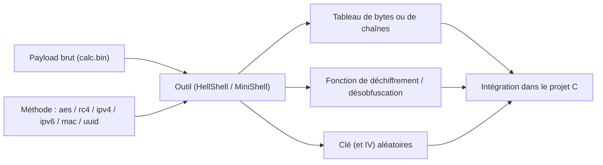

# Outils HellShell et MiniShell

Une fois maîtrisées les techniques d'évasion statique — chiffrement XOR/RC4/AES (voir [[Chiffrement du payload]]) et obfuscation IPv4/IPv6/MAC/UUID (voir [[Obfuscation du payload]]) — une difficulté pratique subsiste : les implémenter à la main pour chaque payload est long et répétitif. La solution consiste à déléguer l'encodage à un outil qui prend le payload brut en entrée et **génère à la fois les données transformées et la fonction de déchiffrement/désobfuscation correspondante**. Les deux outils de MalDev Academy qui remplissent ce rôle sont HellShell et MiniShell.

## Principe de fonctionnement

Les deux outils partagent le même principe : ils opèrent hors ligne, sur un payload brut (par exemple un fichier `calc.bin` produit par Msfvenom), et produisent du code C prêt à coller dans un projet.



L'atout majeur est la **clé aléatoire générée à chaque exécution** : elle n'est jamais réutilisée, ce qui réduit sensiblement l'intérêt des signatures basées sur des clés ou des empreintes d'octets connues. L'outil fournit aussi le padding nécessaire lorsque la taille du payload n'est pas alignée sur la taille de groupe requise par la technique.

## HellShell

HellShell est l'outil le plus complet : il couvre à la fois l'obfuscation et le chiffrement.

| Caractéristique | Détail |
|---|---|
| Obfuscation | IPv4, IPv6, MAC, UUID |
| Chiffrement | XOR, RC4, AES |
| Padding | Oui, pour aligner le payload |
| Code de désobfuscation | Fourni pour chaque technique sélectionnée |
| Clés | Générées aléatoirement à chaque exécution |

Le code source est à compiler manuellement, en configuration **Release**.

### Usage

```text
###########################################################
# HellShell - Designed By MalDevAcademy @NUL0x4C | @mrd0x #
###########################################################

[!] Usage: HellShell.exe <Input Payload FileName> <Enc/Obf Option>
[i] Options Can Be :
        1.>>> "mac"     ::: Output The Shellcode As A Array Of Mac Addresses  [FC-48-83-E4-F0-E8]
        2.>>> "ipv4"    ::: Output The Shellcode As A Array Of Ipv4 Addresses [252.72.131.228]
        3.>>> "ipv6"    ::: Output The Shellcode As A Array Of Ipv6 Addresses [FC48:83E4:F0E8:C000:0000:4151:4150:5251]
        4.>>> "uuid"    ::: Output The Shellcode As A Array Of UUid Strings   [FC4883E4-F0E8-C000-0000-415141505251]
        5.>>> "aes"     ::: Output The Shellcode As A Array Of Aes Encrypted Shellcode With Random Key And Iv
        6.>>> "rc4"     ::: Output The Shellcode As A Array Of Rc4 Encrypted Shellcode With Random Key
```

### Exemples de commandes

```text
HellShell.exe calc.bin aes          # chiffre le payload en AES et l'affiche
HellShell.exe calc.bin aes > AesPayload.c   # redirige la sortie vers un fichier .c
HellShell.exe calc.bin ipv6         # produit un payload obfusqué en IPv6
```

L'écriture vers un fichier (`>` redirection) est le mode le plus pratique : le tableau et le code de désobfuscation sont directement récupérables dans un fichier source.

## MiniShell

MiniShell est plus restreint : il ne traite que le chiffrement, en se concentrant sur RC4 et AES. Sa sortie diffère de celle de HellShell — au lieu d'un tableau C, il écrit les octets chiffrés dans un **fichier binaire** et imprime uniquement la fonction de déchiffrement.

| Caractéristique | Détail |
|---|---|
| Chiffrement | RC4 et AES seulement |
| Sortie des données | Fichier binaire (`.bin`) |
| Sortie du code | Fonction de déchiffrement sur la sortie standard |
| Clés | Générées aléatoirement |

### Usage

```text
###########################################################
# MiniShell - Designed By MalDevAcademy @NUL0x4C | @mrd0x #
###########################################################

[!] Usage: MiniShell.exe <Input Payload FileName> <Enc Option> <Output FileName>
[i] Encryption Options Can Be :
        1.>>> "aes"     ::: Output The File As A Encrypted File Using AES-256 Algorithm With Random Key And IV
        2.>>> "rc4"     ::: Output The File As A Encrypted File Using Rc4 Algorithm With Random Key
```

### Exemples de commandes

```text
MiniShell.exe .\calc.bin rc4 encpayload.bin        # chiffre en RC4, écrit les octets, imprime la fonction
MiniShell.exe .\calc.bin rc4 encpayload.bin > rc4.c # idem, mais sauvegarde la fonction dans rc4.c
MiniShell.exe .\calc.bin aes calcenc.bin           # chiffre en AES, écrit les octets, imprime la fonction
MiniShell.exe .\calc.bin aes calcenc.bin > aes.c    # idem, mais sauvegarde la fonction dans aes.c
```

## Comparaison

| Critère | HellShell | MiniShell |
|---|---|---|
| Obfuscation (IPv4/IPv6/MAC/UUID) | Oui | Non |
| Chiffrement XOR | Oui | Non |
| Chiffrement RC4 / AES | Oui | Oui |
| Format de sortie des données | Tableau C | Fichier binaire |
| Padding du payload | Oui | Non documenté |
| Usages | Générer tableaux + code pour obfuscation et chiffrement | Générer un fichier chiffré et sa fonction de déchiffrement |

En résumé, HellShell sert de **générateur de code polyvalent** couvrant obfuscation et chiffrement, tandis que MiniShell se spécialise dans le chiffrement avec écriture du blob dans un fichier séparé. Les deux s'inscrivent dans la même démarche : produire rapidement du matériel d'évasion statique à clé jetable, dans la continuité de [[Chiffrement du payload]] et [[Obfuscation du payload]].
