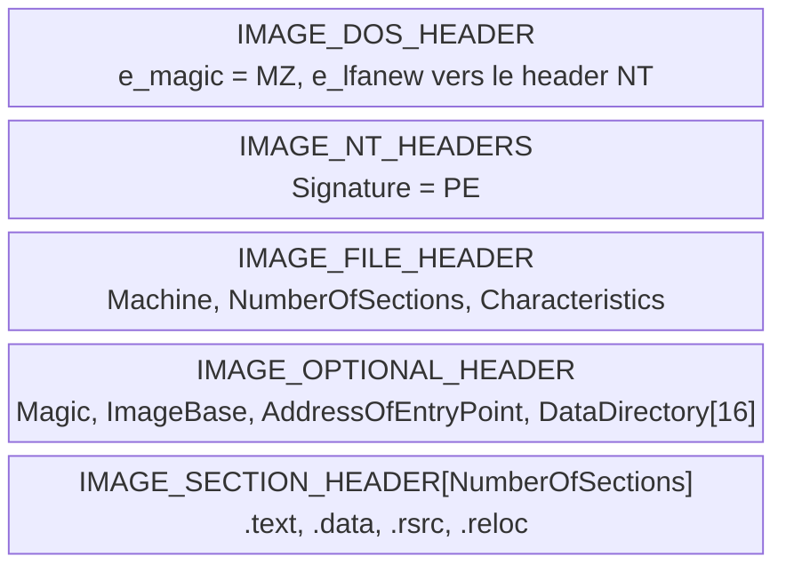
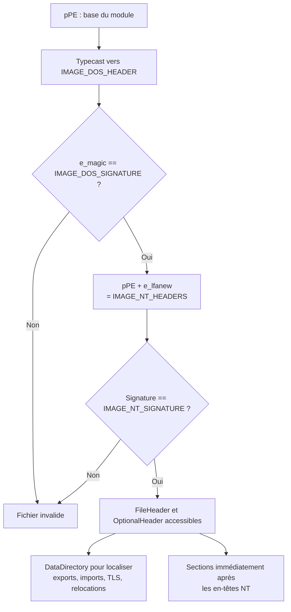
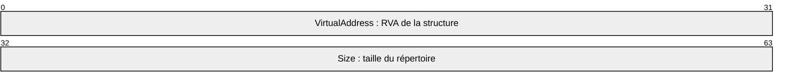

# Parsing des en-têtes PE

Le format PE ([[Format PE]]) n'est pas seulement un objet d'étude théorique : c'est une **structure de données en mémoire** que le malware doit savoir traverser par lui-même. Récupérer l'adresse de base d'un module, parcourir sa table d'export pour retrouver une fonction, inspecter ses imports ou ses sections : tout cela repose sur un même geste, le parsing manuel des en-têtes. C'est le prérequis technique de la résolution d'API sans imports, du hachage de noms de fonctions et de la plupart des techniques d'injection avancées.

## Vue d'ensemble de la structure



Chaque en-tête est une structure C. Le parsing consiste à typecaster le pointeur de base du fichier chargé vers la bonne structure, puis à valider les signatures avant d'aller plus loin — jamais l'inverse.

## Relative Virtual Addresses (RVA)

Une **RVA** est une adresse 32 bits exprimant le **décalage** d'une structure ou d'une section depuis le début du fichier PE. Elle est dite « relative » parce qu'elle ne dépend pas de l'endroit où le module sera chargé : le même fichier peut être chargé à des adresses différentes sans qu'aucune RVA interne n'ait à changer.

La conversion en adresse virtuelle absolue (VA) est donc élémentaire :

```text
VA = Adresse de base du module en mémoire + RVA
```

Les RVA sont partout dans le format : l'en-tête NT y recourt pour désigner les sections de code et de données, les tables d'import et d'export, et les autres structures de données. Un parser PE n'est finalement qu'une machine à convertir des RVA en pointeurs exploitables.

## En-tête DOS (IMAGE_DOS_HEADER)

Situé au tout début du fichier, il décrit le fichier (taille, caractéristiques) et surtout contient la RVA vers l'en-tête NT. Comme il est en tête, l'obtenir ne demande qu'un typecast du pointeur de base.

```c
// pPE : adresse de base du PE chargé en mémoire
PIMAGE_DOS_HEADER pImgDosHdr = (PIMAGE_DOS_HEADER)pPE;
if (pImgDosHdr->e_magic != IMAGE_DOS_SIGNATURE) {  // "MZ" = 0x5A4D
	return -1;
}
```

La vérification de `e_magic` confirme qu'il s'agit bien d'un en-tête DOS valide avant d'utiliser `e_lfanew`.

## En-tête NT (IMAGE_NT_HEADERS)

Le membre `e_lfanew` de l'en-tête DOS est la RVA de la structure `IMAGE_NT_HEADERS`. Il suffit donc d'ajouter ce décalage à l'adresse de base pour y accéder, puis de valider la signature `PE`.

```c
PIMAGE_NT_HEADERS pImgNtHdrs = (PIMAGE_NT_HEADERS)(pPE + pImgDosHdr->e_lfanew);
if (pImgNtHdrs->Signature != IMAGE_NT_SIGNATURE) {  // "PE\0\0" = 0x00004550
	return -1;
}
```



## File Header (IMAGE_FILE_HEADER)

Membre de `IMAGE_NT_HEADERS`, il est récupéré sans calcul supplémentaire.

```c
IMAGE_FILE_HEADER ImgFileHdr = pImgNtHdrs->FileHeader;
```

| Membre | Contenu |
|---|---|
| `Machine` | Type de machine cible (x86, x64, ARM...) |
| `NumberOfSections` | Nombre de sections — la taille du tableau `IMAGE_SECTION_HEADER` |
| `TimeDateStamp` | Date et heure de création du fichier |
| `PointerToSymbolTable` | Décalage de la table de symboles, si elle existe |
| `NumberOfSymbols` | Nombre d'entrées de la table de symboles |
| `SizeOfOptionalHeader` | Taille de l'en-tête optionnel |
| `Characteristics` | Type de fichier (.exe, .dll, .sys) via les constantes `IMAGE_FILE_*` |

## Optional Header (IMAGE_OPTIONAL_HEADER)

Également membre de `IMAGE_NT_HEADERS`, il contient les informations de chargement. Sa validation passe par `Magic`, dont la valeur dépend de l'architecture.

```c
IMAGE_OPTIONAL_HEADER ImgOptHdr = pImgNtHdrs->OptionalHeader;
if (ImgOptHdr.Magic != IMAGE_NT_OPTIONAL_HDR_MAGIC) {
	return -1;
}
```

`IMAGE_NT_OPTIONAL_HDR_MAGIC` se développe automatiquement vers la bonne constante selon l'architecture de compilation : `IMAGE_NT_OPTIONAL_HDR32_MAGIC` pour un binaire 32 bits, `IMAGE_NT_OPTIONAL_HDR64_MAGIC` pour un binaire 64 bits.

| Membre | Contenu |
|---|---|
| `Magic` | Type d'en-tête optionnel présent |
| `MajorLinkerVersion`, `MinorLinkerVersion` | Version de l'éditeur de liens utilisé |
| `SizeOfCode`, `SizeOfInitializedData`, `SizeOfUninitializedData` | Tailles des sections de code, de données initialisées et non initialisées |
| `AddressOfEntryPoint` | RVA du point d'entrée — cible classique pour reprendre l'exécution ([[Contrôle de l'exécution du payload]]) |
| `BaseOfCode`, `BaseOfData` | RVA de base des sections de code et de données |
| `ImageBase` | Adresse de base **préférée** de chargement |
| `MajorOperatingSystemVersion`, `MinorOperatingSystemVersion` | Version minimale du système requise |
| `MajorImageVersion`, `MinorImageVersion` | Version du fichier PE |
| `DataDirectory` | Tableau de `IMAGE_DATA_DIRECTORY` : point d'entrée de toutes les structures annexes |

## Data Directory (IMAGE_DATA_DIRECTORY)

Le `DataDirectory` est le **dernier membre** de l'en-tête optionnel : un tableau où chaque case référence un répertoire spécialisé. Sa structure est minimale.

```c
typedef struct _IMAGE_DATA_DIRECTORY {
    DWORD   VirtualAddress;  // RVA de la structure visée
    DWORD   Size;            // taille de ce répertoire
} IMAGE_DATA_DIRECTORY, *PIMAGE_DATA_DIRECTORY;
```



| Indice | Répertoire | Contenu |
|---|---|---|
| `IMAGE_DIRECTORY_ENTRY_EXPORT` | Table d'export | Fonctions et données exportées |
| `IMAGE_DIRECTORY_ENTRY_IMPORT` | Table d'import | Fonctions et données importées d'autres modules |
| `IMAGE_DIRECTORY_ENTRY_RESOURCE` | Ressources | Icônes, chaînes, bitmaps |
| `IMAGE_DIRECTORY_ENTRY_EXCEPTION` | Gestion des exceptions | Tables de gestion d'exceptions |
| `IMAGE_DIRECTORY_ENTRY_TLS` | TLS | Callbacks et données de Thread-Local Storage |
| `IMAGE_DIRECTORY_ENTRY_BASERELOC` | Relocations | Correctifs d'adresses au chargement |

L'accès suit toujours le même schéma.

```c
IMAGE_DATA_DIRECTORY ExpDataDir = ImgOptHdr.DataDirectory[IMAGE_DIRECTORY_ENTRY_EXPORT];
```

## Table d'export (IMAGE_EXPORT_DIRECTORY)

Structure non documentée officiellement par Microsoft, elle est décrite par la communauté. Elle répond à une question décisive pour un malware : **où se trouve, dans ce module, la fonction que je cherche ?**

```c
typedef struct _IMAGE_EXPORT_DIRECTORY {
    DWORD   Characteristics;
    DWORD   TimeDateStamp;
    WORD    MajorVersion;
    WORD    MinorVersion;
    DWORD   Name;
    DWORD   Base;
    DWORD   NumberOfFunctions;
    DWORD   NumberOfNames;
    DWORD   AddressOfFunctions;     // RVA depuis la base de l'image
    DWORD   AddressOfNames;         // RVA depuis la base de l'image
    DWORD   AddressOfNameOrdinals;  // RVA depuis la base de l'image
} IMAGE_EXPORT_DIRECTORY, *PIMAGE_EXPORT_DIRECTORY;
```

```c
PIMAGE_EXPORT_DIRECTORY pImgExportDir = (PIMAGE_EXPORT_DIRECTORY)
	(pPE + ImgOptHdr.DataDirectory[IMAGE_DIRECTORY_ENTRY_EXPORT].VirtualAddress);
```

| Membre | Contenu |
|---|---|
| `NumberOfFunctions` | Nombre de fonctions exportées |
| `NumberOfNames` | Nombre de noms exportés |
| `AddressOfFunctions` | RVA du tableau des adresses de fonctions |
| `AddressOfNames` | RVA du tableau des noms de fonctions |
| `AddressOfNameOrdinals` | RVA du tableau des ordinaux associés aux noms |

Le trio `AddressOfNames`, `AddressOfNameOrdinals`, `AddressOfFunctions` forme la chaîne de résolution classique : pour chaque nom, l'ordinal donne l'entrée correspondante dans le tableau des adresses. C'est exactement le mécanisme exploité par la résolution d'API par hachage de noms ([[Hachage de chaînes]]) et par la reconstruction de l'IAT ([[Dissimulation de l'IAT]]).

## Table d'import (IMAGE_IMPORT_DESCRIPTOR)

L'IAT est un **tableau** de `IMAGE_IMPORT_DESCRIPTOR`, une entrée par DLL dont des fonctions sont utilisées. La structure est définie dans `Winnt.h` sans être documentée officiellement.

```c
typedef struct _IMAGE_IMPORT_DESCRIPTOR {
    union {
        DWORD   Characteristics;
        DWORD   OriginalFirstThunk;
    } DUMMYUNIONNAME;
    DWORD   TimeDateStamp;
    DWORD   ForwarderChain;
    DWORD   Name;
    DWORD   FirstThunk;
} IMAGE_IMPORT_DESCRIPTOR;
```

```c
PIMAGE_IMPORT_DESCRIPTOR pImgImpDesc = (PIMAGE_IMPORT_DESCRIPTOR)
	(pPE + ImgOptHdr.DataDirectory[IMAGE_DIRECTORY_ENTRY_IMPORT].VirtualAddress);
```

`OriginalFirstThunk` pointe vers les noms d'origine, `FirstThunk` vers la table réellement corrigée par le chargeur, et `Name` vers le nom de la DLL. Le parcours s'arrête sur une entrée dont tous les champs sont nuls — c'est un tableau sans compteur explicite.

## Autres structures accessibles via les DataDirectories

Plusieurs structures présentes dans le tableau `DataDirectory` ne figurent pas dans `Winnt.h`. Elles se récupèrent exactement de la même façon, par addition de la RVA à la base.

| Structure | Indice de répertoire | Usage dans le contexte offensif |
|---|---|---|
| `IMAGE_TLS_DIRECTORY` | `IMAGE_DIRECTORY_ENTRY_TLS` | Repérer les TLS callbacks comme point d'exécution anticipé ([[Exécution par callbacks]]) |
| `IMAGE_RUNTIME_FUNCTION_ENTRY` | `IMAGE_DIRECTORY_ENTRY_EXCEPTION` | Décrire les fonctions appelées par la gestion d'exceptions |
| `IMAGE_BASE_RELOCATION` | `IMAGE_DIRECTORY_ENTRY_BASERELOC` | Corriger les adresses si le module est chargé ailleurs que prévu |

```c
PIMAGE_TLS_DIRECTORY pImgTlsDir = (PIMAGE_TLS_DIRECTORY)
	(pPE + ImgOptHdr.DataDirectory[IMAGE_DIRECTORY_ENTRY_TLS].VirtualAddress);

PIMAGE_RUNTIME_FUNCTION_ENTRY pImgRunFuncEntry = (PIMAGE_RUNTIME_FUNCTION_ENTRY)
	(pPE + ImgOptHdr.DataDirectory[IMAGE_DIRECTORY_ENTRY_EXCEPTION].VirtualAddress);

PIMAGE_BASE_RELOCATION pImgBaseReloc = (PIMAGE_BASE_RELOCATION)
	(pPE + ImgOptHdr.DataDirectory[IMAGE_DIRECTORY_ENTRY_BASERELOC].VirtualAddress);
```

## Sections PE

Les sections usuelles sont `.text` (code), `.data` (données), `.rsrc` (ressources) et `.reloc` (relocations) ; leur nombre et leur nommage dépendent du compilateur et de ses options. Chacune est décrite par un `IMAGE_SECTION_HEADER`.

```c
typedef struct _IMAGE_SECTION_HEADER {
  BYTE  Name[IMAGE_SIZEOF_SHORT_NAME];
  union {
    DWORD PhysicalAddress;
    DWORD VirtualSize;
  } Misc;
  DWORD VirtualAddress;
  DWORD SizeOfRawData;
  DWORD PointerToRawData;
  DWORD PointerToRelocations;
  DWORD PointerToLinenumbers;
  WORD  NumberOfRelocations;
  WORD  NumberOfLinenumbers;
  DWORD Characteristics;
} IMAGE_SECTION_HEADER, *PIMAGE_SECTION_HEADER;
```

| Membre | Contenu |
|---|---|
| `Name` | Nom de la section, chaîne ASCII terminée par un octet nul |
| `VirtualAddress` | RVA de la section en mémoire |
| `SizeOfRawData` | Taille de la section dans le fichier, en octets |
| `PointerToRelocations` | Décalage fichier des relocations de la section |
| `NumberOfRelocations` | Nombre de relocations |
| `Characteristics` | Drapeaux décrivant la section, notamment ses protections |

Le tableau des sections commence immédiatement après les en-têtes NT.

```c
PIMAGE_SECTION_HEADER pImgSectionHdr =
	(PIMAGE_SECTION_HEADER)(((PBYTE)pImgNtHdrs) + sizeof(IMAGE_NT_HEADERS));
```

Chaque élément suivant se trouve à un intervalle de `sizeof(IMAGE_SECTION_HEADER)`, et la borne est donnée par `FileHeader.NumberOfSections`.

```c
PIMAGE_SECTION_HEADER pImgSectionHdr =
	(PIMAGE_SECTION_HEADER)(((PBYTE)pImgNtHdrs) + sizeof(IMAGE_NT_HEADERS));

for (size_t i = 0; i < pImgNtHdrs->FileHeader.NumberOfSections; i++) {
	// pImgSectionHdr pointe sur la section courante
	pImgSectionHdr = (PIMAGE_SECTION_HEADER)((PBYTE)pImgSectionHdr + sizeof(IMAGE_SECTION_HEADER));
}
```

## Point de vigilance : l'architecture du parser

Un parseur PE doit être compilé pour l'architecture du binaire qu'il analyse : un exécutable 32 bits pour parser un binaire 32 bits, un exécutable 64 bits pour un binaire 64 bits. La raison est structurelle — `IMAGE_NT_HEADERS`, `IMAGE_OPTIONAL_HEADER` et les décalages qui en découlent diffèrent entre les deux modèles mémoire. C'est la même contrainte que pour les structures non documentées ([[Structures non documentées]]).

## Applications concrètes

| Objectif | En-tête mis à profit |
|---|---|
| Retrouver l'adresse d'une fonction exportée sans `GetProcAddress` | Table d'export et ses trois tableaux |
| Résoudre une API à partir du hachage de son nom | Table d'export, cas d'usage direct du [[Hachage de chaînes]] |
| Reconstruire l'IAT à la volée | `IMAGE_IMPORT_DESCRIPTOR` et `FirstThunk` ([[Dissimulation de l'IAT]]) |
| Localiser une section propice au stockage de la charge | `IMAGE_SECTION_HEADER` et `Characteristics` ([[Placement du payload]]) |
| Récupérer l'adresse de base de `ntdll.dll` de façon discrète | `PEB` et `InMemoryOrderModuleList` ([[Processus Windows]]) |
| Rediriger l'exécution vers une charge | `AddressOfEntryPoint` ([[Contrôle de l'exécution du payload]]) |

L'ensemble de ces techniques se combine : on obtient la base du module via le PEB, on parcourt la table d'export pour retrouver les fonctions souhaitées, et l'on ne conserve dans le binaire que des hashs et des valeurs calculées — réduisant d'autant la surface offerte à la détection statique ([[Mécanismes de détection]]).
