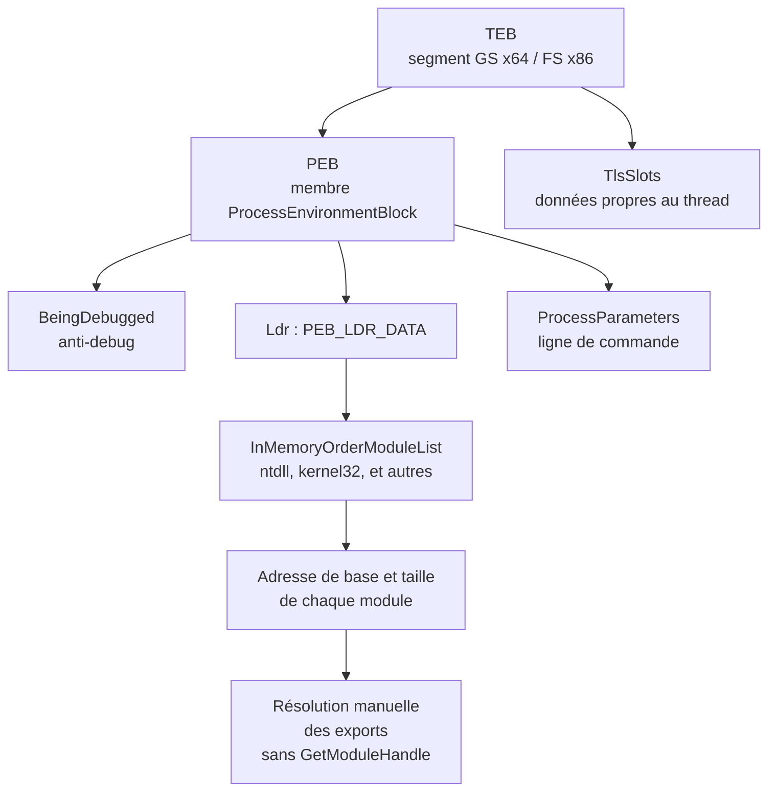

# Processus Windows

Un **processus** est un programme en cours d'exécution sur une machine Windows, lancé par un utilisateur ou par le système. Il consomme des ressources — mémoire, espace disque, temps processeur — pour accomplir sa tâche. Pour le développement de malware, le processus n'est pas un décor : c'est l'espace de travail où la charge vit, où elle est injectée, et l'objet dont les structures internes (PEB, TEB, handles) sont autant de leviers de discrétion.

## Threads

Un processus est composé d'**un ou plusieurs threads** s'exécutant concurremment. Un thread est un ensemble d'instructions exécutables indépendamment à l'intérieur du processus. Les threads d'un même processus peuvent communiquer et partager des données ; c'est l'ordonnanceur du système qui les planifie, chacun étant géré dans le contexte du processus auquel il appartient.

## Mémoire des processus

La mémoire est allouée au processus à sa création, et le processus peut lui-même en fixer la quantité. Le système gère conjointement la **mémoire virtuelle** et la **mémoire physique** : la mémoire virtuelle offre à chaque application un espace d'adressage pouvant dépasser la mémoire réellement installée. Cet espace est découpé en **pages**, allouées aux processus.

| Type | Partagée ? | Usage typique |
|---|---|---|
| **Private memory** | Non, exclusive à un processus | Données internes au processus, allocations dynamiques |
| **Mapped memory** | Oui, entre plusieurs processus | Bibliothèques partagées, segments de mémoire partagée, fichiers mappés ; lisible par les autres mais protégée en écriture |
| **Image memory** | Selon le module | Code et données d'un exécutable ou d'une DLL chargée dans l'espace d'adressage |

Pour l'injection, cette distinction est fondamentale : une région image présente un contenu et des protections plausibles, là où une allocation privée `PAGE_EXECUTE_READWRITE` en `MEM_PRIVATE` attire immédiatement l'œil d'un EDR ([[Injection de shellcode]], [[Injection par mapping]]).

## Process Environment Block (PEB)

Le **PEB** est une structure de données décrivant un processus : paramètres de démarrage, informations de heap, DLL chargées, identifiant, chemin de l'exécutable. Le système l'utilise pour suivre l'état des processus, et le chargeur Windows s'en sert pour amorcer l'application. **Chaque processus possède son propre PEB**, donc son propre jeu d'informations.

```c
typedef struct _PEB {
  BYTE                          Reserved1[2];
  BYTE                          BeingDebugged;
  BYTE                          Reserved2[1];
  PVOID                         Reserved3[2];
  PPEB_LDR_DATA                 Ldr;
  PRTL_USER_PROCESS_PARAMETERS  ProcessParameters;
  PVOID                         Reserved4[3];
  PVOID                         AtlThunkSListPtr;
  PVOID                         Reserved5;
  ULONG                         Reserved6;
  PVOID                         Reserved7;
  ULONG                         Reserved8;
  ULONG                         AtlThunkSListPtr32;
  PVOID                         Reserved9[45];
  BYTE                          Reserved10[96];
  PPS_POST_PROCESS_INIT_ROUTINE PostProcessInitRoutine;
  BYTE                          Reserved11[128];
  PVOID                         Reserved12[1];
  ULONG                         SessionId;
} PEB, *PPEB;
```

Les membres réservés peuvent être ignorés dans un premier temps ; leur signification réelle et les moyens de la retrouver sont traités dans [[Structures non documentées]].

### Membres non réservés

| Membre | Rôle | Intérêt offensif |
|---|---|---|
| `BeingDebugged` | Vaut 1 si le processus est débogué, 0 sinon | Vérification anti-debug triviale ([[Anti-debugging]]) |
| `Ldr` | Pointeur vers `PEB_LDR_DATA`, liste des DLL chargées | Retrouver l'adresse de base d'une DLL sans `GetModuleHandle` |
| `ProcessParameters` | Paramètres de ligne de commande et chemin de l'image | Source d'informations pour l'usurpation de ligne de commande |
| `AtlThunkSListPtr`, `AtlThunkSListPtr32` | Liste chaînée de fonctions de *thunking* gérée par ATL | Détails d'implémentation, peu exploités |
| `PostProcessInitRoutine` | Fonction appelée après l'initialisation TLS de tous les threads | Lié aux TLS callbacks, détournables |
| `SessionId` | Identifiant de session Windows | Contexte de session de l'utilisateur |

### Ldr et PEB_LDR_DATA

`Ldr` contient la liste des modules (DLL) chargés, avec l'adresse de base et la taille de chacun. C'est la source d'une réimplémentation discrète de `GetModuleHandleA/W`, sans passer par une API surveillée.

```c
typedef struct _PEB_LDR_DATA {
  BYTE       Reserved1[8];
  PVOID      Reserved2[3];
  LIST_ENTRY InMemoryOrderModuleList;
} PEB_LDR_DATA, *PPEB_LDR_DATA;
```

### ProcessParameters et RTL_USER_PROCESS_PARAMETERS

Le chargeur Windows y inscrit les arguments passés au processus à sa création. C'est le point d'appui des techniques d'usurpation de ligne de commande ([[Spoofing de processus]]).

```c
typedef struct _RTL_USER_PROCESS_PARAMETERS {
  BYTE           Reserved1[16];
  PVOID          Reserved2[10];
  UNICODE_STRING ImagePathName;
  UNICODE_STRING CommandLine;
} RTL_USER_PROCESS_PARAMETERS, *PRTL_USER_PROCESS_PARAMETERS;
```

## Thread Environment Block (TEB)

Le **TEB** décrit un thread : environnement, contexte de sécurité et informations associées. Il est stocké dans la pile du thread et sert au noyau à gérer les threads.

```c
typedef struct _TEB {
  PVOID Reserved1[12];
  PPEB  ProcessEnvironmentBlock;
  PVOID Reserved2[399];
  BYTE  Reserved3[1952];
  PVOID TlsSlots[64];
  BYTE  Reserved4[8];
  PVOID Reserved5[26];
  PVOID ReservedForOle;
  PVOID Reserved6[4];
  PVOID TlsExpansionSlots;
} TEB, *PTEB;
```

| Membre | Rôle |
|---|---|
| `ProcessEnvironmentBlock` | Pointeur vers le PEB du processus propriétaire : c'est le pont entre thread et processus |
| `TlsSlots` | 64 emplacements de données propres au thread (variables, handles, états) |
| `TlsExpansionSlots` | Ensemble de pointeurs réservés aux DLL système pour le stockage TLS étendu |

Le TEB est accessible sans appel d'API : sur x64 via le registre `GS`, sur x86 via `FS`. C'est l'un des chemins les plus discrets pour remonter au PEB, donc aux modules chargés et au drapeau `BeingDebugged`.

```asm
; x64 : récupérer le TEB sans WinAPI
mov rax, qword ptr gs:[0x30]   ; TEB
mov rax, qword ptr [rax+0x60]  ; TEB->ProcessEnvironmentBlock (PEB)
```

```asm
; x86 : équivalent via le segment FS
mov eax, dword ptr fs:[0x30]   ; TEB
mov eax, dword ptr [eax+0x30]  ; TEB->ProcessEnvironmentBlock (PEB)
```

## Articulation TEB, PEB et modules



## Identifiants et handles

Chaque processus reçoit à sa création un **PID** (Process ID) unique, qui le distingue des autres processus en cours. Le même principe s'applique aux threads, qui possèdent chacun un identifiant unique à l'échelle du système, tous processus confondus.

Ces identifiants servent à ouvrir un **handle** vers l'objet correspondant, c'est-à-dire une référence utilisable pour agir dessus.

| API | Objet | Exemple d'usage |
|---|---|---|
| `OpenProcess` | Processus existant, via son PID | Obtenir un handle pour lire la mémoire, suspendre ou injecter |
| `OpenThread` | Thread existant, via son TID | Suspendre ou détourner un thread ([[Détournement de threads]]) |
| `CloseHandle` | Handle ouvert | Libérer la référence |

```c
HANDLE hProcess = OpenProcess(PROCESS_ALL_ACCESS, FALSE, dwPid);
if (hProcess != NULL) {
	// lecture/écriture mémoire, création de thread distant, etc.
	CloseHandle(hProcess);
}
```

Un handle est une ressource : **il doit toujours être fermé** avec `CloseHandle` dès qu'il n'est plus utile, sous peine de fuite de handles. Une fuite est à la fois un défaut de qualité et un signal exploitable par un analyste, car un processus qui accumule des handles vers des cibles hétérogènes ne ressemble à aucun programme légitime. Les identifiants de processus s'obtiennent en amont par énumération ([[Énumération des processus]]).

## Ce qu'il faut retenir pour l'évasion

- Le PEB est une **source d'information locale** : DLL chargées, ligne de commande, état de debug — tout est lisible sans appeler d'API, donc hors de portée des hooks utilisateur ([[Dissimulation de l'IAT]]).
- `BeingDebugged` est la vérification anti-debug la plus simple et la plus facilement détournée ([[Anti-debugging]]).
- La nature de la mémoire (privée, mappée, image) est un **indicateur comportemental** : la choisir correctement est une décision d'évasion autant que de technique ([[Placement du payload]], [[Injection par mapping]]).
- Les handles ouverts sont **traçables** et peuvent être énumérés par les outils de défense ; les fermer fait partie de l'hygiène opérationnelle.
