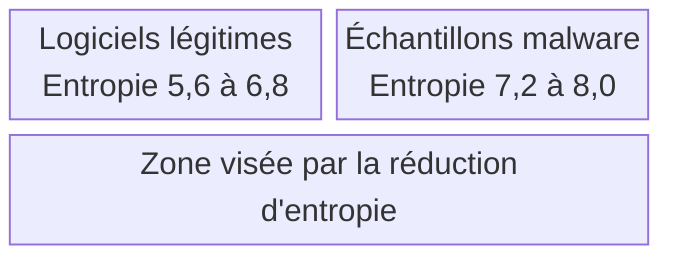
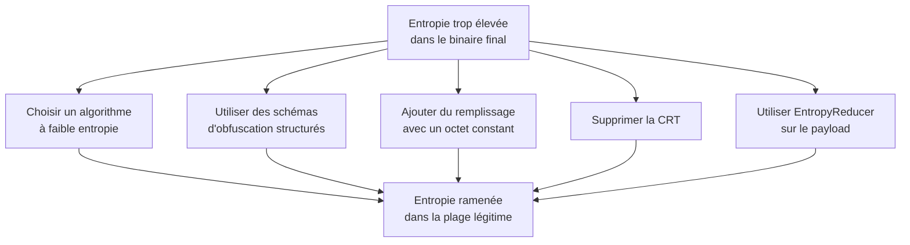

# Réduction de l'entropie binaire

L'entropie mesure le degré de désordre d'un ensemble de données. Plusieurs définitions existent (Gibbs, Boltzmann, Rényi), mais en cybersécurité c'est l'entropie de Shannon qui s'impose : elle produit une valeur entre 0 et 8, où 0 correspond à un flux parfaitement uniforme (un seul octet répété) et 8 à une distribution parfaitement aléatoire. Les outils de détection exploitent cette propriété depuis longtemps : un binaire dont les sections affichent une entropie élevée est probablement chiffré, compressé ou packé, trois signatures typiques d'un [[Chiffrement du payload]] ou d'une [[Obfuscation du payload]].

La cible est donc claire : ramener l'entropie du fichier final dans une plage comparable à celle d'un logiciel légitime, afin que l'échantillon ne se distingue plus statistiquement.



## Mesurer une entropie

Des outils graphiques comme pestudio ou Sigcheck donnent l'entropie d'un fichier et de ses sections. Le calcul repose sur la formule de Shannon, qu'un script d'une dizaine de lignes suffit à implémenter en s'appuyant sur la fréquence de chaque valeur d'octet.

```python
def calc_entropy(buffer):
    if isinstance(buffer, str):
        buffer = buffer.encode()
    entropy = 0
    for x in range(256):
        p = (float(buffer.count(bytes([x])))) / len(buffer)
        if p > 0:
            entropy += - p * math.log(p, 2)
    return entropy
```

Pour chaque valeur possible d'octet, on calcule sa probabilité d'apparition `p`, puis on somme `-p * log2(p)`. Une distribution concentrée sur peu de valeurs produit une somme faible ; une distribution étalée sur les 256 valeurs approche 8.

## Stratégies de réduction



### Choix de l'algorithme

Toutes les méthodes de transformation n'affectent pas l'entropie de la même façon. Un chiffrement XOR mono-octet, par exemple, ne modifie pas l'entropie globale de la sortie : chaque octet clair est simplement décalé, la distribution des fréquences reste identique. C'est favorable au plan statistique, mais l'algorithme est cryptographiquement faible.

| Méthode | Effet sur l'entropie | Compromis |
|---|---|---|
| XOR mono-octet | Neutre | Chiffrement très faible |
| Algorithmes de chiffrement modernes (RC4, AES) | Forte hausse | Solidité cryptographique contre discrétion |
| IPv4fuscation, IPv6fuscation | Baisse | Repose sur des formats structurés |
| Macfuscation, UUIDfuscation | Baisse | Idem, détaillés dans [[Outils HellShell et MiniShell]] |

Les schémas d'obfuscation par format (adresses IPv4, IPv6, adresses MAC, UUID) sont particulièrement intéressants : ils produisent des données organisées, dont les motifs se répètent. Or une donnée structurée, même longue, présente une distribution moins uniforme qu'un flux aléatoire, donc une entropie plus basse.

### Insertion de chaînes en anglais

Insérer des chaînes de texte anglais dans le binaire final abaisse l'entropie. La raison est arithmétique : l'anglais n'utilise que 26 lettres par casse, soit 52 valeurs possibles, là où un chiffrement peut produire les 256 valeurs d'octet. Chaque octet issu d'un texte anglais est donc fortement contraint.

Deux recommandations accompagnent la technique : n'employer qu'une seule casse (tout majuscule ou tout minuscule) pour réduire encore l'espace des valeurs, et éviter d'insérer des chaînes trop reconnaissables.

> [!warning] Compromis défavorable
> Les chaînes insérées deviennent elles-mêmes des signatures statiques. Un analyste qui repère ce bloc de texte caractéristique peut en faire une règle de détection. La technique n'est donc pas recommandée, malgré son efficacité statistique.

### Remplissage par un octet constant

La méthode la plus simple consiste à ajouter au chiffré un bloc de remplissage composé d'un seul octet répété. Ce bloc obtient une entropie de 0, ce qui tire la moyenne vers le bas. L'effet est immédiat : sur un shellcode Msfvenom, l'ajout de 285 octets de `0xEA` fait chuter l'entropie de `5,88325` à `3,77597`.

Le coût est direct : le fichier grossit. Et comme la technique est proportionnelle, un payload plus volumineux demande davantage d'octets de remplissage pour obtenir le même effet relatif, ce qui aggrave encore la taille.

### Indépendance vis-à-vis de la CRT

La bibliothèque d'exécution C (CRT) est un ensemble de fonctions et de macros liées à la gestion mémoire (`memcpy`, `malloc`), aux fichiers (`fopen`) et aux chaînes (`strcpy`). Elle ajoute au binaire des tableaux, du code d'initialisation et des chaînes d'erreur qui pèsent sur l'entropie globale. La retirer abaisse significativement l'entropie du fichier final : à code source identique, un programme « Hello World » compilé sans CRT obtient une entropie nettement inférieure à sa version CRT. La procédure complète est décrite dans [[Suppression de la CRT]].

### EntropyReducer

L'outil EntropyReducer, développé par MalDev Academy, applique un algorithme dédié : il construit une liste chaînée qui insère des octets nuls entre chaque bloc de `BUFF_SIZE` octets du payload. L'insertion d'octets nuls répétés abaisse l'entropie tout en préservant la possibilité de reconstruire le payload d'origine à l'exécution, puisqu'il suffit de retirer les octets intercalés pour retrouver les données utiles.

## Détection

L'entropie reste un signal utile pour la détection précisément parce que ces techniques laissent des traces propres :

- un bloc de remplissage homogène est immédiatement visible dans une vue hexadécimale ;
- un pic d'entropie localisé au milieu d'un fichier calme indique un payload chiffré embarqué ;
- les schémas d'obfuscation par format introduisent des motifs très reconnaissables (structure d'adresse IPv4, de GUID) qui deviennent eux-mêmes des signatures ;
- l'analyse de la distribution des octets section par section, et non du fichier entier, neutralise l'effet de moyenne obtenu par ajout de remplissage.

La lecture défensive de ces indicateurs est détaillée dans [[Mécanismes de détection]] et [[Signature des binaires malware]].
