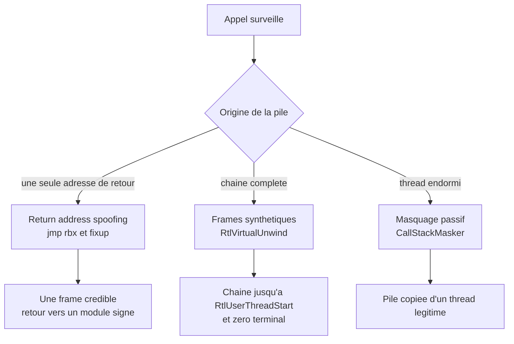

# Spoofing de pile d'appels

Quand un EDR hooke `NtAllocateVirtualMemory` ou `NtOpenProcess`, il ne se contente pas de lire les arguments : il déroule la pile du thread appelant pour savoir **d'où vient l'appel**. Une adresse de retour qui pointe vers une région privée, sans module associé, suffit à transformer un appel banal en alerte. C'est l'un des signaux les plus discriminants de la détection d'injection, parce qu'il est difficile à obtenir par accident : un programme légitime appelle ses API depuis le code d'un module chargé, avec une chaîne de frames qui remonte jusqu'à `BaseThreadInitThunk` et `RtlUserThreadStart`.

Le spoofing de pile d'appels consiste à produire une chaîne crédible — ou à masquer la chaîne réelle — pendant l'appel surveillé. Il ne s'agit pas de cacher le payload, mais de cacher **qui l'appelle**. La technique se décline en trois familles : la falsification d'une adresse de retour, la construction de frames synthétiques, et le masquage passif de la pile d'un thread endormi.

> [!abstract] Définition — Spoofing de pile d'appels
> Ensemble de techniques qui substituent à la pile réelle d'un thread une chaîne de frames plausible, composée d'adresses appartenant à des modules signés, afin qu'un déroulement de pile — par un hook userland, un callback noyau ou ETW — attribue l'appel à du code légitime.

## Pourquoi les EDR lisent les piles

Un hook userland voit les arguments, mais il voit aussi le contexte d'exécution. Un appel à `VirtualAllocEx` avec `PAGE_EXECUTE_READWRITE` est suspect en soi ; le même appel venant d'une adresse non mappée l'est encore plus. La pile fournit trois informations que les arguments ne donnent pas : l'origine du code, la profondeur de la chaîne, et la cohérence avec le module qui devrait appeler cette API.

Côté noyau, les callbacks et ETW TI (*Threat Intelligence*) enregistrent également une trace de pile pour les opérations sensibles : accès à `lsass.exe`, allocations mémoire, changements de protection, création de threads. Un EDR qui reçoit cet événement peut le corréler avec l'image du processus et repérer une frame hors module. C'est ce qui a motivé les travaux publics sur le sujet : `ThreadStackSpoofer`, `SilentMoonwalk`, `Vulcan Raven`, `CallStackMasker`, puis leur intégration dans des loaders comme BokuLoader ou AceLdr.

## Mécanique du déroulement x64

Sur x64, la pile est une suite de frames. Chaque appel pousse une adresse de retour ; chaque fonction réserve son espace local et, éventuellement, sauvegarde des registres non volatils. Windows ne se contente pas de cette convention : il fournit des **métadonnées de déroulement** dans la section `.pdata`, sous forme de `RUNTIME_FUNCTION` pointant vers une `UNWIND_INFO` et ses `UNWIND_CODE`.

| Structure | Rôle |
|---|---|
| `RUNTIME_FUNCTION` | Couple début/fin de fonction et pointeur vers `UNWIND_INFO` |
| `UNWIND_INFO` | Version, drapeaux, taille du prologue, nombre de codes |
| `UNWIND_CODE` | Opérations du prologue : `UWOP_PUSH_NONVOL`, `UWOP_ALLOC_SMALL`, `UWOP_ALLOC_LARGE`, `UWOP_SET_FPREG` |
| `CONTEXT` | Registres capturés, dont `Rip`, `Rsp`, `Rbp` |

Deux API font le travail : `RtlLookupFunctionEntry` retrouve les métadonnées d'une adresse, `RtlVirtualUnwind` déroule une frame et met à jour le `CONTEXT`. `StackWalk64` s'appuie sur les mêmes informations. C'est ce mécanisme que les techniques de spoofing doivent imiter, car un déroulement qui échoue est lui-même un signal.

```c
// Déroulement d'une frame : après l'appel, Ctx.Rsp pointe sur la frame de l'appelant.
PRUNTIME_FUNCTION pFunc = RtlLookupFunctionEntry(Ctx.Rip, &ImageBase, NULL);
if (pFunc) {
    PVOID HandlerData = NULL;
    DWORD64 EstablisherFrame = 0;
    RtlVirtualUnwind(UNW_FLAG_NHANDLER, ImageBase, Ctx.Rip, pFunc,
                     &Ctx, &HandlerData, &EstablisherFrame, NULL);
}
```

La différence entre `Ctx.Rsp` avant et après l'appel donne la taille de la frame, retour inclus. C'est cette valeur qui permet de construire des frames synthétiques cohérentes : chaque frame doit reculer `Rsp` de la taille exacte que le dérouleur calculera, sinon la chaîne se décale et finit par pointer n'importe où.

## Famille 1 : remplacer une adresse de retour

La forme la plus simple, popularisée par namazso, ne construit pas une pile complète : elle remplace **l'adresse de retour** de la fonction ciblée par l'adresse d'un gadget `jmp rbx` situé dans un module signé. Le registre `rbx` pointe vers une structure qui contient un handler, l'adresse de retour d'origine et la valeur d'origine de `rbx`.

```c
typedef struct _SPOOF_FRAME {
    PVOID Handler;         // première cible du gadget : le fixup
    PVOID OriginalReturn;  // où repartir après l'appel
    PVOID OriginalRbx;     // valeur à restaurer
} SPOOF_FRAME;
```

Le déroulement est le suivant : l'appelant sauvegarde `rbx`, place dans `rbx` l'adresse de sa structure, remplace l'adresse de retour par le gadget et saute vers la fonction visée. À son retour, la fonction trouve le gadget, qui exécute `jmp rbx` et saute donc sur le premier champ de la structure, le handler. Celui-ci restaure `rbx`, puis saute vers `OriginalReturn`. Pour un observateur qui déroule la pile pendant l'appel, la frame ressemble à un appel provenant du module qui contient le gadget.

La limite est nette : une seule frame est falsifiée, et le gadget doit exister dans un module signé. Un EDR qui vérifie que l'instruction précédant l'adresse de retour est bien un `call` repère immédiatement le `jmp`. C'est exactement la détection proposée par Eclipse.

## Famille 2 : frames synthétiques

Les frames synthétiques vont plus loin : elles reconstituent une chaîne complète, avec plusieurs appels plausibles et, surtout, une terminaison crédible. L'idée est de pousser un zéro sur la pile — ce qui arrête le déroulement — puis d'empiler des frames vers `BaseThreadInitThunk` et `RtlUserThreadStart`, avec les tailles calculées depuis les métadonnées de déroulement.

```text
Rsp -> [ adresse de retour de la fonction ciblée ]  (gadget jmp rbx)
       [ frame synthétique 1 : taille calculée ]
       [ frame synthétique 2 : taille calculée ]
       [ 0 ]                                        (fin du déroulement)
```

Vulcan Raven (WithSecureLabs) est la référence de cette approche pour les appels système : le PoC construit une pile qui imite une pile réelle observée dans Sysmon — par exemple un accès à `lsass.exe` venant de `lsm.dll` et `RPCRT4.dll` — puis appelle `NtOpenProcess` depuis un thread dont le contexte a été initialisé avec cette pile. Au retour, le thread ne peut pas revenir normalement dans une chaîne fabriquée : un `AddVectoredExceptionHandler` intercepte l'exception, redirige `Rip` vers `RtlExitUserThread` et laisse le thread se terminer proprement.

SilentMoonwalk (klezVirus) propose deux modes. Le mode synthétique construit des frames à partir de fonctions réelles et de leurs tailles de pile. Le mode *desync* utilise un gadget `jmp rbx` et un gadget `add rsp, X; ret` pour désynchroniser la pile, de sorte que le dérouleur voie une chaîne cohérente alors que l'exécution réelle se poursuit ailleurs. Un vecteur d'exception rattrape le retour dans la fausse chaîne. Le projet insiste sur un point essentiel : la pile doit rester **déroulable**, sinon l'exception handling lui-même échoue.

```c
// Construction simplifiée d'une frame : reculer Rsp de la taille calculée,
// puis écrire l'adresse de retour attendue par le dérouleur.
Rsp -= FrameSize;
*(PVOID *)Rsp = ReturnAddress;
```

Le coût de cette famille est la dépendance aux métadonnées de la version de Windows. Les tailles de frame de `BaseThreadInitThunk` et `RtlUserThreadStart` changent d'une build à l'autre ; un spoof codé en dur sur Windows 10 casse sur Windows 11. Les implémentations sérieuses calculent les tailles à l'exécution, par `RtlVirtualUnwind`, plutôt que de les embarquer.

## Famille 3 : masquage passif pendant le sommeil

Le masquage ne falsifie pas l'appel en cours : il réécrit la pile d'un thread **endormi**, puis la restaure avant le réveil. CallStackMasker (Cobalt Strike) en est l'illustration : avant que l'implant ne dorme, une file de timers sauvegarde la pile, la remplace par une copie de la pile d'un thread légitime — par exemple un thread de `spoolsv.exe` en attente sur `WaitForSingleObjectEx` — puis la restaure juste avant la reprise. Le mode statique embarque une pile fixe ; le mode dynamique énumère les threads du système, en choisit un dans l'état souhaité et copie sa pile et son adresse de début.

L'avantage est qu'aucun déroulement de pile n'est nécessaire : on copie des octets. L'inconvénient est que la technique ne couvre que l'attente. Dès que le thread se réveille et appelle une API, la pile réelle réapparaît. Elle se combine donc naturellement avec l'[[Obscurcissement du sommeil]], qui chiffre le contenu pendant la même fenêtre. ThreadStackSpoofer (mgeeky) relève de la même logique.

| Technique | Portée | Mécanisme | Dépendance |
|---|---|---|---|
| Return address spoofing | Un appel | Gadget `jmp rbx` + structure de fixup | Gadget dans un module signé |
| Frames synthétiques | Un appel | Frames construites, `RtlVirtualUnwind` | Métadonnées `.pdata` de la build |
| Desync (SilentMoonwalk) | Un appel | Gadget + désynchronisation + VEH | Unwind cohérent, gadgets |
| CallStackMasker | Thread endormi | Copie et remplacement de pile | Timing du sommeil |



Le spoofing de pile ne doit pas être confondu avec le [[Spoofing de processus]], qui falsifie les métadonnées de création d'un processus — parent, arguments — et non la chaîne d'appels d'un thread.

## Ce que les implémentations publiques apportent

SilentMoonwalk a montré qu'un spoof entièrement dynamique était possible : au lieu de coder en dur les adresses de `BaseThreadInitThunk`, le programme lit les exports, calcule les tailles de frame et choisit un gadget dans un module chargé. Il a aussi montré les limites : la présence d'un gadget `jmp rbx` exploitable se raréfie, et les frames doivent rester compatibles avec le dérouleur de la build cible.

Vulcan Raven a déplacé le problème vers la télémétrie noyau : en initialisant le contexte d'un thread avec une pile fabriquée, il obtient qu'un événement de type `ProcessAccess` enregistre une trace crédible, alors même que le code appelant est un binaire d'attaque. C'est la démonstration que le spoofing ne sert pas seulement à tromper un hook userland, mais aussi à polluer la télémétrie qui alimente la détection.

CallStackMasker a apporté une réponse au problème du repos : un thread qui dort ne modifie pas sa pile, donc sa pile peut être réécrite sans course. Le PoC calcule `Rsp` au moment du sommeil avec `_AddressOfReturnAddress` et soustrait la consommation des deux frames suivantes (`WaitForSingleObjectEx`, `NtWaitForSingleObject`). C'est fragile — la pile exacte dépend de la build — mais peu coûteux.

## Limites

### CET et la pile fantôme

Les processeurs récents et Windows 10/11 proposent la protection matérielle de pile (*Hardware-enforced Stack Protection*, CET). Une pile fantôme conserve les adresses de retour réelles ; un `ret` vers une adresse qui ne correspond pas à la pile fantôme déclenche une exception de contrôle. Les techniques qui remplacent une adresse de retour par un gadget sont donc directement visées. Les frames synthétiques qui ne font que **construire** une pile avant un appel, sans modifier d'adresse de retour existante, sont moins affectées, mais l'appel lui-même pousse une adresse réelle dans la pile fantôme.

### CFG et les cibles indirectes

Control Flow Guard valide les cibles des appels indirects. Un gadget `jmp rbx` n'est pas un appel indirect au sens de CFG, mais les handlers et les fixups peuvent l'être. Les implémentations doivent vérifier que leurs cibles sont des fonctions valides, ou utiliser des gadgets dont l'adresse est légitime.

### Métadonnées et build

Chaque version de Windows peut modifier la taille des frames de `BaseThreadInitThunk`, `RtlUserThreadStart` ou des fonctions utilisées comme modèles. Un spoof qui fonctionne sur la build 19045 peut échouer sur 22631. Les implémentations qui calculent les tailles à l'exécution sont plus robustes, mais elles doivent gérer les cas où `RtlLookupFunctionEntry` échoue — fonctions feuilles, code JIT, images sans `.pdata`.

### Le noyau voit ce que l'utilisateur cache

Un spoof userland ne change pas la pile fantôme du noyau, ni les registres sauvegardés dans le thread. Un EDR qui reçoit l'événement noyau peut comparer l'adresse de retour enregistrée avec la pile réelle du thread, ou vérifier que le thread a bien exécuté l'instruction `call` correspondante. Le spoofing complique la vie de l'analyste, il ne rend pas la trace impossible à qualifier.

## Détection

| Indicateur | Pourquoi il est discriminant | Faux positif possible |
|---|---|---|
| Adresse de retour non précédée d'un `call` | Un vrai retour suit toujours un appel | Retours générés par du code JIT ou des trampolines |
| Retour vers un gadget `jmp rbx` / `jmp [rbx]` | Signature directe du return address spoofing | Stubs de hooking légitimes |
| Frame dont la taille ne correspond pas à `.pdata` | Incohérence avec le dérouleur | Code sans métadonnées, JIT |
| Chaîne qui s'arrête avant `BaseThreadInitThunk` | Terminaison artificielle par un zéro | Fibres, coroutines, threads créés par `RtlCreateUserThread` |
| Pile identique à celle d'un autre thread | Copie de CallStackMasker | Threads clonés par un runtime |
| Adresse de début de thread copiée | Le thread ne correspond plus à son `TEB` | Duplication légitime de threads |

L'outil Eclipse (klezVirus) implémente la première vérification : pour chaque adresse de retour, il lit les octets précédents et vérifie qu'ils forment un `call` vers la fonction de la frame suivante. C'est une heuristique robuste contre les gadgets, mais elle demande un désassembleur et une bonne tolérance aux variantes de compilation.

Un EDR peut aussi comparer la pile userland avec la pile enregistrée par le noyau au moment du syscall. Si le thread a appelé `NtAllocateVirtualMemory` depuis une adresse A, mais que la pile enregistrée pointe vers une frame synthétique qui ne contient pas A, la contradiction est exploitable. Cette corrélation est plus coûteuse, mais elle résiste aux spoofs purement userland. Les principes généraux de ces capteurs sont détaillés dans [[Mécanismes de détection]].

Enfin, les frames synthétiques produisent souvent des combinaisons **improbables** : `NtAllocateVirtualMemory` qui retourne vers `SetDefaultCommConfigW`, `NtOpenProcess` qui vient de `RPCRT4` sans contexte RPC, ou une chaîne qui traverse un module sans que les arguments soient cohérents avec lui. L'analyste humain garde ici l'avantage : une pile peut être cohérente octet par octet et absurde sémantiquement.

### Mapping ATT&CK

| Technique | ID | Usage dans la note |
|---|---|---|
| Obfuscated Files or Information | T1027 | Falsification des métadonnées d'exécution |
| Process Injection | T1055 | Contexte d'application : appels injectés |
| Impair Defenses: Disable or Modify Tools | T1562.001 | Contournement de l'inspection EDR |
| Reflective Code Loading | T1620 | Code appelant sans module associé |

## Limites

Le spoofing de pile déplace la détection du contenu vers la **forme**. Il ne rend pas le payload indétectable : il rend l'attribution de l'appel ambiguë. Un EDR qui se contente de vérifier « l'adresse de retour appartient-elle à un module ? » est contourné ; un EDR qui vérifie la cohérence entre l'adresse de retour, l'instruction précédente, la taille de frame et le contexte noyau ne l'est pas.

La tendance est à la combinaison : spoofing userland pour les hooks, masquage passif pour le sommeil, chiffrement pour le contenu, et parfois appels directs pour éviter les hooks eux-mêmes. Chaque couche a ses artefacts, et c'est leur superposition qui rend l'ensemble détectable. Un thread dont la pile imite `spoolsv.exe`, dont l'adresse de début a été copiée et dont la région de code est chiffrée est, paradoxalement, plus suspect qu'un thread imparfait mais cohérent avec son processus.

> [!quiz] Pourquoi pousse-t-on un zéro à la base des frames synthétiques ?
> Pour arrêter le déroulement de pile. Le dérouleur s'arrête lorsqu'il rencontre une adresse de retour nulle, ce qui empêche la chaîne de continuer vers les frames réelles du payload. Les frames synthétiques situées au-dessus du zéro suffisent alors à donner une apparence légitime.

> [!quiz] Quelle est la différence entre le spoofing actif et le masquage passif ?
> Le spoofing actif falsifie la pile au moment d'un appel — par remplacement d'adresse de retour ou construction de frames — et trompe l'observateur pendant l'exécution. Le masquage passif réécrit la pile d'un thread endormi, puis la restaure au réveil : il ne couvre que la fenêtre d'attente et ne nécessite aucun déroulement de pile.
