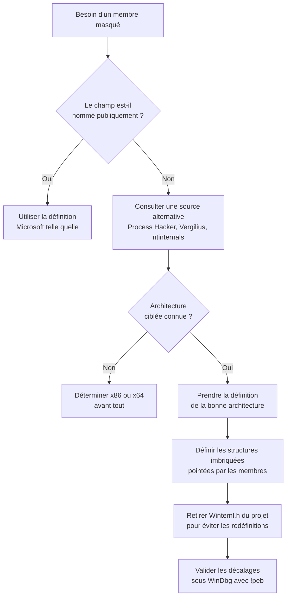

# Structures non documentées

Lorsqu'on consulte la documentation officielle Microsoft d'une structure Windows interne, on découvre fréquemment des membres nommés `Reserved1`, `Reserved2`, etc., typiquement déclarés comme des tableaux de `BYTE` ou de `PVOID`. Ces champs ne sont pas des trous sans signification : ce sont des **membres réels volontairement masqués**. Cette note explique pourquoi ce camouflage existe, comment retrouver la véritable définition d'une structure, et quels pièges guettent lorsqu'on la remplace.

## Pourquoi des membres réservés

Le motif invoqué par Microsoft est double : préserver la **confidentialité** des éléments internes du système d'exploitation et éviter que des développeurs ne s'appuient sur des champs qu'ils seraient ensuite obligés de maintenir compatibles au fil des versions de Windows. En pratique, un membre réservé est un membre vivant : il est lu et écrit par le noyau ou le chargeur, mais son usage n'est pas contractuel.

Le problème est immédiat pour un développeur de malware qui a besoin de **lire ou de positionner** un de ces champs. Une définition truffée de `Reserved` est inutilisable : sans nom, sans type et sans décalage fiable, on ne peut ni accéder au champ ni savoir ce qu'il contient.

## Exemple : le PEB

La définition publique du PEB est l'illustration parfaite du problème. Seuls quelques membres portent un nom ; tout le reste est noyé dans des tableaux réservés.

```c
typedef struct _PEB {
  BYTE                          Reserved1[2];
  BYTE                          BeingDebugged;
  BYTE                          Reserved2[1];
  PVOID                         Reserved3[2];
  PPEB_LDR_DATA                 Ldr;
  PRTL_USER_PROCESS_PARAMETERS  ProcessParameters;
  PVOID                         Reserved4[3];
  PVOID                         AtlThunkSListPtr;
  PVOID                         Reserved5;
  ULONG                         Reserved6;
  PVOID                         Reserved7;
  ULONG                         Reserved8;
  ULONG                         AtlThunkSListPtr32;
  PVOID                         Reserved9[45];
  BYTE                          Reserved10[96];
  PPS_POST_PROCESS_INIT_ROUTINE PostProcessInitRoutine;
  BYTE                          Reserved11[128];
  PVOID                         Reserved12[1];
  ULONG                         SessionId;
} PEB, *PPEB;
```

Deux conséquences pour le code offensif :

- les membres utiles accessibles publiquement (`BeingDebugged`, `Ldr`, `ProcessParameters`, `SessionId`) couvrent déjà une partie des besoins — voir [[Processus Windows]] ;
- tout le reste (`Reserved9[45]`, `Reserved11[128]`) doit être déplié à la main pour atteindre les champs qui s'y cachent, en respectant scrupuleusement les **décalages** et les **tailles**.

### Retrouver les membres réservés

WinDbg permet d'inspecter l'état réel de la structure sur un processus vivant ou sur un dump. La commande `!peb` affiche les valeurs effectives des champs du PEB pour le processus courant, ce qui donne à la fois le contenu et, par recoupement, la position des membres masqués. Pour une définition textuelle complète, on se tourne vers les en-têtes de Process Hacker.

## Sources de documentation alternatives

Puisque la documentation officielle est volontairement incomplète, il faut s'appuyer sur des définitions reconstruites par rétro-ingénierie. Chacune a ses forces et ses limites.

| Source | Nature | Réserve |
|---|---|---|
| Process Hacker (en-têtes) | Définitions complètes pour l'observabilité système | Communauté, pas de contrat de stabilité |
| undocumented.ntinternals.net | Base de structures kernel/user historiques | Certaines définitions sont obsolètes |
| ReactOS | Réimplémentation open source de Windows | Peut diverger des builds commerciales récentes |
| Vergilius Project | Structures par build de Windows | Orienté noyau, mais très précieux aussi pour l'utilisateur |

## Choisir et intégrer une définition

Intégrer une définition alternative dans un projet C/C++ obéit à trois règles.

**Vérifier l'architecture.** Beaucoup de définitions n'existent qu'en version x86 ou x64. Les tailles de pointeurs, les décalages et parfois l'ordre même des membres diffèrent : utiliser une définition x86 dans un binaire x64 produit une lecture silencieusement fausse, donc un comportement imprévisible.

**Déplier les structures imbriquées.** Une structure contient souvent des pointeurs vers d'autres structures. Pour que le compilateur interprète correctement le contenu, la structure pointée doit elle aussi être définie avec la même précision. Le PEB en est l'exemple type : `Ldr` pointe vers `PEB_LDR_DATA`, `ProcessParameters` vers `RTL_USER_PROCESS_PARAMETERS`.

**Ne jamais mélanger les définitions.** La définition officielle du PEB réside dans `Winternl.h`. Si l'on fournit sa propre définition et qu'on inclut en plus `Winternl.h`, Visual Studio signale une **redéfinition** et la compilation échoue.

```cpp
// Choix exclusif : soit Winternl.h, soit la définition maison, jamais les deux
// #include <Winternl.h>

typedef struct _PEB {
  BYTE           Reserved1[2];
  BYTE           BeingDebugged;
  BYTE           Reserved2[1];
  PVOID          Reserved3[2];
  PPEB_LDR_DATA  Ldr;
  PRTL_USER_PROCESS_PARAMETERS ProcessParameters;
  // ... définition complète issue de la rétro-ingénierie
} PEB, *PPEB;
```



## Pièges et bonnes pratiques

| Piège | Conséquence | Remède |
|---|---|---|
| Définition de mauvaise architecture | Décalages décalés, lecture de données corrompues | Sélectionner explicitement la version x86 ou x64 |
| Structure imbriquée non définie | Interprétation erronée du pointeur | Définir récursivement tous les types pointés |
| `#include <Winternl.h>` conservé | Erreur de redéfinition à la compilation | Choisir une seule source de vérité |
| Confiance aveugle dans une définition en ligne | Définition obsolète pour le build ciblé | Confronter à `!peb` et à plusieurs sources |
| Membres réservés jugés inutiles | Champs réels ignorés, logique incomplète | Les traiter comme des membres à part entière |

Manipuler des structures non documentées revient à écrire du code contre une interface privée : il fonctionne, mais il n'offre aucune garantie de stabilité entre versions de Windows. Le réflexe à cultiver est de **vérifier la structure sur le build réellement ciblé**, plutôt que de faire confiance à une définition figée.
