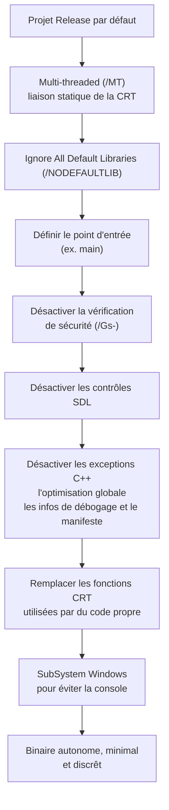

# Suppression de la CRT

Visual Studio compile par défaut en liant la bibliothèque d'exécution C (CRT) et en conservant de nombreuses métadonnées utiles au développement : informations de débogage, symboles, importations inutilisées, chaînes d'erreur. Pour un développeur de malware, ces réglages par défaut sont contre-productifs à trois titres : ils gonflent la taille du binaire, ajoutent des fonctions importées qui n'ont aucune raison d'être là et laissent des chaînes exploitables comme signatures statiques.

Supprimer la CRT consiste à se passer entièrement de cette bibliothèque, y compris de son code d'initialisation, pour obtenir un exécutable minimal, autonome et moins bavard. Cette opération complète naturellement la [[Réduction de l'entropie binaire]] et la [[Dissimulation de l'IAT]].

## Release contre Debug

Le choix de la configuration de compilation est le premier levier.

| Critère | Debug | Release |
|---|---|---|
| Performance | Optimisations désactivées, code lent | Optimisations activées, code rapide |
| Débogage | Facile, génère les symboles `.pdb` | Difficile, pas d'information de ligne |
| Déploiement | Dépend de DLL propres à Visual Studio | Autonome, compatible avec les postes cibles |
| Gestion des exceptions | Interruption et message détaillé | Peut se traduire par un plantage |

Le mode Release est donc le point de départ obligatoire : c'est le seul qui soit déployable sur une machine sans Visual Studio. Il reste néanmoins insuffisant.

## Ce que les réglages par défaut laissent traîner

| Problème | Manifestation | Conséquence |
|---|---|---|
| Compatibility | Erreurs de chargement si Visual Studio est absent | Le binaire ne démarre pas sur la cible |
| Importations CRT | IAT encombré de fonctions non appelées | Surface d'analyse élargie, impossible à masquer par hachage |
| Taille | Un « Hello World » pèse environ 11 ko | Empreinte anormale |
| Informations de débogage | Chaînes internes et métadonnées présentes | Signatures statiques exploitables |

Une simple comparaison illustre le problème : un programme qui n'appelle que `printf` importe en réalité des dizaines de fonctions issues de la CRT. La [[Format PE]] de son IAT est donc un document bavard sur le compilateur utilisé.

## La bibliothèque CRT

La CRT, ou Microsoft C Run-Time Library, regroupe les fonctions de base du C et du C++ : gestion mémoire (`malloc`, `memset`, `free`), manipulation de chaînes (`strcpy`, `strlen`) et entrées-sorties (`printf`, `wprintf`, `scanf`).

Deux familles de DLL sont concernées :

| Famille | Exemples | Rôle |
|---|---|---|
| Bibliothèques d'exécution versionnées | `vcruntimeXXX.dll` | Implémentation des fonctions CRT |
| Bibliothèques d'API Windows | `api-ms-win-crt-stdio-l1-1-0.dll`, `api-ms-win-crt-runtime-l1-1-0.dll`, `api-ms-win-crt-locale-l1-1-0.dll` | Façade d'API par domaine |

Le lien est défini à la compilation, ce qui explique que ces DLL apparaissent dans l'IAT du programme produit.

## Solution intermédiaire : liaison statique

Par défaut, l'option *Runtime Library* vaut « Multi-threaded DLL (/MD) » : la CRT est liée dynamiquement, d'où les problèmes de compatibilité sur une machine dépourvue de Visual Studio.

Basculer sur « Multi-threaded (/MT) » provoque une liaison statique. Les fonctions comme `printf` sont alors intégrées directement au binaire plutôt qu'importées. La compatibilité est réglée, mais deux effets secondaires apparaissent : le fichier grossit sensiblement et l'IAT s'enrichit d'un grand nombre d'APIs Windows appelées par le code CRT embarqué. C'est un demi-progrès.

> [!important] Point de non-retour
> Après suppression de la CRT, seul le mode Release reste compilable. Le développement et le débogage doivent donc être terminés **avant** de retirer la bibliothèque, sinon le code devient très difficile à mettre au point.

## Retirer complètement la CRT

L'objectif avancé est de n'avoir aucune dépendance, ni dynamique ni statique, à la bibliothèque d'exécution. Cela se traduit par une réduction de taille, la disparition des importations parasites et la suppression des informations de débogage.



### Options à modifier

| Option Visual Studio | Valeur cible | Raison |
|---|---|---|
| Enable C++ Exceptions | Désactivé | Sans CRT, la propagation d'exceptions n'a plus de support |
| Whole Program Optimization | Désactivé | Garde le contrôle total sur le code et la pile générés |
| Generate Debug Info | Désactivé | Retire les métadonnées de débogage |
| Generate Manifest | Désactivé | Retire le manifeste embarqué |
| Ignore All Default Libraries | Yes (/NODEFAULTLIB) | Empêche l'édition de liens des bibliothèques système par défaut |
| Entry Point Symbol | Nom de la fonction d'entrée | Remplace `mainCRTStartup`, fourni par la CRT |
| Security Check | Disable Security Check (/Gs-) | Supprime la dépendance à `__security_check_cookie` |
| SDL checks | Désactivé | Supprime l'avertissement `D9025` |

### Pourquoi ces erreurs apparaissent

Chaque erreur de l'éditeur de liens révèle une dépendance cachée à la CRT :

| Erreur | Symbole manquant | Origine | Correction |
|---|---|---|---|
| `LNK2001` | `mainCRTStartup` | Point d'entrée fourni par la CRT | Définir le point d'entrée sur `main` ou sur une fonction dédiée |
| `LNK2001` | `__security_check_cookie` | Vérification du cookie de pile | Option `/Gs-` |
| `D9025` | Avertissement d'option | Conflit `'/sdl'` contre `'/GS-'` | Désactiver les contrôles SDL |
| `LNK2019` | `printf` et consorts | Fonctions CRT encore appelées par le code | Les réimplémenter |

L'option `/NODEFAULTLIB` est le pivot de l'opération : elle coupe le lien automatique avec les bibliothèques par défaut, ce qui rend l'auteur du programme responsable de fournir tout ce dont il a besoin.

## Remplacer les fonctions CRT

Une fois la CRT retirée, il faut fournir sa propre version des fonctions utilisées : `printf`, `strlen`, `strcat`, `memcpy`, etc. La bibliothèque VX-API propose des implémentations prêtes à l'emploi (par exemple `StringCompare.cpp` pour remplacer `strcmp`).

### Remplacer printf

Pour l'exemple, `printf` est remplacé par une macro qui s'appuie uniquement sur les APIs Windows : allocation d'un tampon, formatage, écriture directe sur le handle de sortie standard.

```c
#define PRINTA( STR, ... )                                                                  \
    if (1) {                                                                                \
        LPSTR buf = (LPSTR)HeapAlloc( GetProcessHeap(), HEAP_ZERO_MEMORY, 1024 );           \
        if ( buf != NULL ) {                                                                \
            int len = wsprintfA( buf, STR, __VA_ARGS__ );                                   \
            WriteConsoleA( GetStdHandle( STD_OUTPUT_HANDLE ), buf, len, NULL, NULL );       \
            HeapFree( GetProcessHeap(), 0, buf );                                           \
        }                                                                                   \
    }
```

La macro reçoit la chaîne de format `STR` et les arguments variadiques `__VA_ARGS__`, alloue un tampon de 1024 octets sur le tas, le remplit avec `wsprintfA`, puis l'écrit sur la console via `WriteConsoleA` et `GetStdHandle`. Le programme devient indépendant de la CRT.

```c
#include <Windows.h>
#include <stdio.h>

int main() {
   PRINTA("Hello World ! \n");
   return 0;
}
```

### Le piège des fonctions intrinsèques

Certaines macros et fonctions du SDK reposent en interne sur la CRT. `ZeroMemory`, par exemple, se traduit par un appel à `memset`. Retirer la CRT casse donc aussi ces macros, ce qui est trompeur : le code semble n'utiliser que des APIs Windows alors qu'il dépend encore de la bibliothèque d'exécution.

Une première solution consiste à utiliser les remplacements fournis par VX-API, comme `CopyMemoryEx.cpp`. Une seconde, plus élégante, consiste à fournir sa propre implémentation et à forcer le compilateur à l'utiliser via les directives `intrinsic` et `function`. Les macros basées sur `memset`, comme `ZeroMemory`, utiliseront alors automatiquement cette version.

```c
#include <Windows.h>

// Déclaration en fonction externe
extern void* __cdecl memset(void*, int, size_t);

// Directives spécifiques à Microsoft : le compilateur génère un appel
// à notre implémentation plutôt qu'à celle de la CRT
#pragma intrinsic(memset)
#pragma function(memset)

void* __cdecl memset(void* Destination, int Value, size_t Size) {
  unsigned char* p = (unsigned char*)Destination;
  while (Size > 0) {
    *p = (unsigned char)Value;
    p++;
    Size--;
  }
  return Destination;
}

int main() {

  PVOID pBuff = HeapAlloc(GetProcessHeap(), 0, 0x100);
  if (pBuff == NULL)
    return -1;

  // Utilise notre version de 'memset', pas celle de la CRT
  ZeroMemory(pBuff, 0x100);

  HeapFree(GetProcessHeap(), 0, pBuff);

  return 0;
}
```

## Masquer la fenêtre de console

Un binaire qui ouvre une console au lancement est immédiatement repérable, et l'utilisateur peut le terminer d'un simple clic sur la croix de fermeture. L'appel à `ShowWindow(NULL, SW_HIDE)` en tête de point d'entrée fonctionne, mais prend quelques millisecondes, ce qui produit un bref clignotement de fenêtre.

La solution propre consiste à compiler le programme comme une application graphique, en réglant l'option *SubSystem* sur « Windows (/SUBSYSTEM:WINDOWS) ». Aucune console n'est alors créée.

## Résultats

L'effet cumulé de ces réglages est mesurable sur plusieurs axes :


- **Taille** : passage d'environ 112,5 ko à approximativement 3 ko.
- **IAT** : plus aucune fonction inutilisée n'est importée, ce qui supprime un signal d'analyse majeur et facilite la [[Dissimulation de l'IAT]].
- **Chaînes** : bien moins de chaînes lisibles dans le binaire, donc moins de matière pour des signatures statiques.
- **Évasion** : la comparaison sur VirusTotal entre une version liée statiquement en `/MT` et une version sans CRT montre un meilleur taux de non-détection pour la seconde.

## Détection

Ces optimisations laissent leurs propres empreintes, qu'un analyste peut retourner à son avantage :

- un binaire minuscule dépourvu de CRT et n'importe aucune fonction de la bibliothèque d'exécution est immédiatement atypique pour un logiciel commercial ;
- l'absence totale de chaînes et d'informations de débogage, combinée à un point d'entrée personnalisé, signale un binaire délibérément minimal ;
- un programme compilé en sous-système Windows qui n'utilise aucune API graphique est un motif suspect ;
- l'usage de directives `#pragma intrinsic` ou `#pragma function` sur des fonctions standard trahit une intention de contournement.

Ces signaux se combinent utilement avec ceux décrits dans [[Signature des binaires malware]], [[Contournement des antivirus]] et [[Mécanismes de détection]].
