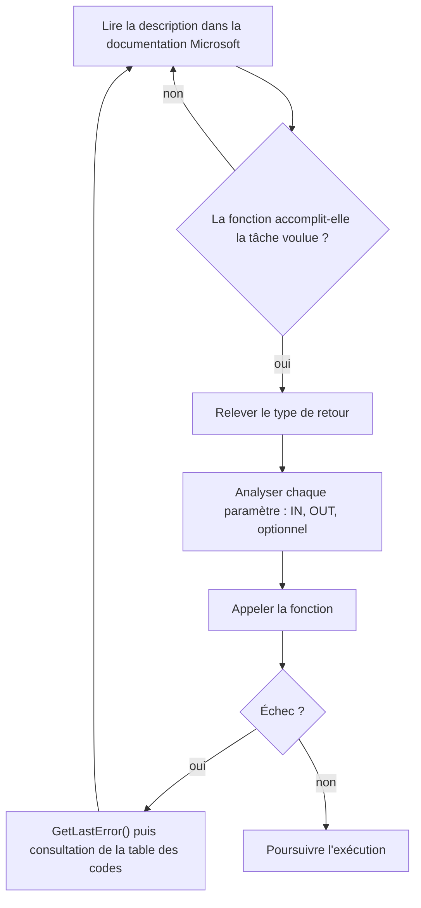

# Windows API

La Windows API (WinAPI) est la surface d'interaction entre une application et le système d'exploitation : afficher quelque chose à l'écran, lire ou modifier un fichier, interroger le registre. Elle est très bien documentée par Microsoft, ce qui contraste avec la Native API, non documentée et pourtant directement appelable — un point développé dans [[Architecture Windows]].

## Types de données Windows

La WinAPI définit ses propres types, qui masquent les types C pour garantir la taille et l'alignement sur les deux architectures.

| Type | Signification |
|---|---|
| `DWORD` | Entier non signé 32 bits, y compris sur système 64 bits, de 0 à 4 294 967 295 |
| `SIZE_T` | Taille d'un objet : 32 bits sur système 32 bits, 64 bits sur système 64 bits |
| `VOID` / `PVOID` | Absence de type / pointeur vers n'importe quel type |
| `HANDLE` | Référence à un objet géré par l'OS : fichier, processus, thread |
| `HMODULE` | Handle vers un module (DLL ou EXE), c'est-à-dire son adresse de base en mémoire |
| `LPCSTR` / `PCSTR` | Pointeur vers une chaîne ANSI constante terminée par un octet nul, soit `const char*` |
| `LPSTR` / `PSTR` | Pointeur vers une chaîne ANSI modifiable, soit `char*` |
| `LPCWSTR` / `PCWSTR` | Pointeur vers une chaîne Unicode constante, soit `const wchar_t*` |
| `LPWSTR` / `PWSTR` | Pointeur vers une chaîne Unicode modifiable, soit `wchar_t*` |
| `wchar_t` | Caractère large (16 bits sous Windows) |
| `ULONG_PTR` | Entier non signé de la taille d'un pointeur sur l'architecture cible |

Dans `LPCSTR`, le `L` signifie « long », héritage de l'époque 16 bits : il n'a aujourd'hui aucun effet. Le `C` signifie « constant ».

```c
DWORD  dwValue   = 42;
SIZE_T sSize     = sizeof(int);
PVOID  pValue    = &SomeData;
HANDLE hFile     = INVALID_HANDLE_VALUE;
HMODULE hModule  = GetModuleHandleW(NULL);

LPCSTR  lpcString = "Hello, world!";   // ANSI, constante
LPSTR   lpString  = "Hello, world!";   // ANSI, modifiable
LPCWSTR lpwString = L"Hello, world!";  // Unicode, constante
LPWSTR  lpwStr    = L"Hello, world!";  // Unicode, modifiable
wchar_t wChar     = L'A';
```

### Faire de l'arithmétique sur un pointeur

L'arithmétique directe sur un `PVOID` est refusée par le compilateur, car le type pointé n'a pas de taille définie. La convention du domaine consiste à transtyper le pointeur en `ULONG_PTR` avant tout calcul.

```c
PVOID Pointer = malloc(100);

// Pointer = Pointer + 10;              // refusé à la compilation
Pointer = (ULONG_PTR)Pointer + 10;      // autorisé
```

### Types pointeurs

Le préfixe `P` désigne un pointeur vers le type de base.

| Type pointeur | Équivalent |
|---|---|
| `PHANDLE` | `HANDLE*` |
| `PSIZE_T` | `SIZE_T*` |
| `PDWORD` | `DWORD*` |

## Fonctions ANSI (A) et Unicode (W)

La plupart des fonctions existent en deux variantes : suffixe `A` pour ANSI, suffixe `W` pour Wide (Unicode). `CreateFileA` prend un `LPCSTR` en premier paramètre, `CreateFileW` un `LPCWSTR`.

| Élément | ANSI | Unicode |
|---|---|---|
| Type de caractère | 8 bits (`char`) | 16 bits (`wchar_t`) |
| Préfixe de littéral | `"texte"` | `L"texte"` |
| Taille de `"maldev"` | 7 octets (6 + octet nul) | 14 octets (6 x 2 + 2) |

Le nombre d'octets manipulés change donc du simple au double : un point qui affecte la taille des buffers alloués et la lecture des chaînes en mémoire.

## Paramètres d'entrée et de sortie

Un paramètre `IN` est une entrée fournie par l'appelant ; un paramètre `OUT` sert à renvoyer une valeur, presque toujours par pointeur. Microsoft annote les prototypes avec `[in]`, `[out]` et `[optional]`, mais ces mots-clés sont purement indicatifs : leur absence ne change pas le comportement.

```c
BOOL HackTheWorld(OUT int* num) {
    *num = 123;       // renvoie la valeur à l'appelant
    return TRUE;
}

int main(void) {
    int a = 0;
    HackTheWorld(&a); // retourne TRUE et a vaut 123
    return 0;
}
```

## Méthode de travail avec une fonction inconnue



## Exemple : CreateFileW

Le prototype documenté :

```c
HANDLE CreateFileW(
  [in]           LPCWSTR               lpFileName,
  [in]           DWORD                 dwDesiredAccess,
  [in]           DWORD                 dwShareMode,
  [in, optional] LPSECURITY_ATTRIBUTES lpSecurityAttributes,
  [in]           DWORD                 dwCreationDisposition,
  [in]           DWORD                 dwFlagsAndAttributes,
  [in, optional] HANDLE                hTemplateFile
);
```

La documentation précise qu'en cas de succès la fonction renvoie un handle ouvert vers l'objet visé, donc un `HANDLE`. Tous les paramètres sont `in` : aucun ne sert à retourner une valeur. Utilisation typique :

```c
// INVALID_HANDLE_VALUE sert uniquement à initialiser la variable
HANDLE hFile = INVALID_HANDLE_VALUE;

// Double antislash obligatoire pour échapper le caractère backslash en C
LPCWSTR filePath = L"C:\\Users\\maldevacademy\\Desktop\\maldev.txt";

hFile = CreateFileW(filePath, GENERIC_ALL, 0, NULL, CREATE_ALWAYS, FILE_ATTRIBUTE_NORMAL, NULL);

if (hFile == INVALID_HANDLE_VALUE) {
    printf("[-] CreateFileW a échoué avec le code : %d\n", GetLastError());
    return -1;
}
```

## Gérer les erreurs

Les fonctions WinAPI renvoient un échec peu bavard : `INVALID_HANDLE_VALUE` indique seulement qu'aucun objet n'a été créé. Le motif réel se récupère avec `GetLastError`, puis se décode dans la liste des codes d'erreur système.

| Code | Constante | Signification |
|---|---|---|
| 2 | `ERROR_FILE_NOT_FOUND` | Le fichier n'existe pas |
| 5 | `ERROR_ACCESS_DENIED` | Accès refusé, souvent un problème de privilèges |
| 87 | `ERROR_INVALID_PARAMETER` | Paramètre invalide |

## Gérer les erreurs de la Native API

Les fonctions exportées par `ntdll.dll` ne passent pas par `GetLastError` : elles renvoient directement un `NTSTATUS`, entier non signé 32 bits. `STATUS_SUCCESS` vaut `0` ; toute autre valeur signale une erreur à rechercher dans la documentation Microsoft.

```c
NTSTATUS STATUS = NativeSyscallExample(...);
if (STATUS != STATUS_SUCCESS) {
    printf("[!] NativeSyscallExample a échoué avec le statut : 0x%0.8X\n", STATUS);
}
```

La macro `NT_SUCCESS` simplifie cette vérification :

```c
#define NT_SUCCESS(Status) (((NTSTATUS)(Status)) >= 0)

NTSTATUS STATUS = NativeSyscallExample(...);
if (!NT_SUCCESS(STATUS)) {
    printf("[!] NativeSyscallExample a échoué avec le statut : 0x%0.8X\n", STATUS);
}
```

Les chaînes comme « CreateFileW » sont des artefacts exploitables pour la détection : voir [[Hachage de chaînes]] pour les dissimuler et [[Dissimulation de l'IAT]] pour masquer leur provenance dans l'exécutable. Le chargement des DLL qui exportent ces fonctions est traité dans [[Dynamic-Link Library]], et [[Introduction aux syscalls]] couvre l'appel direct des fonctions de `ntdll.dll`.
