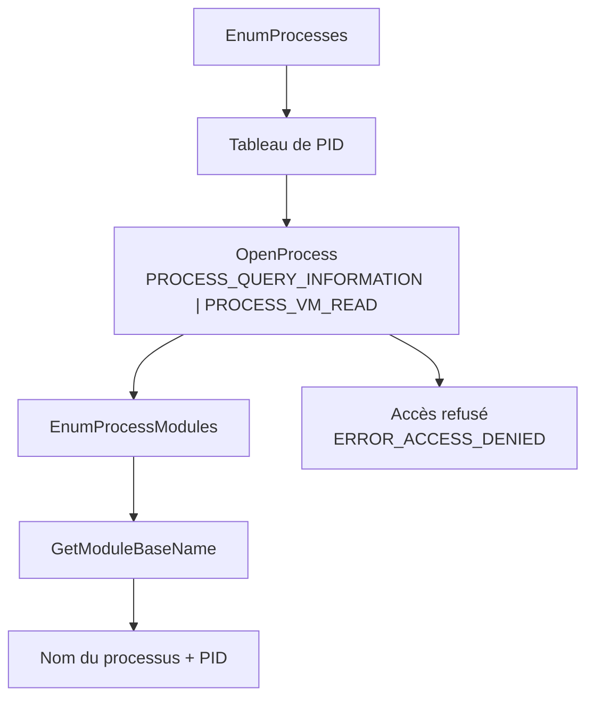
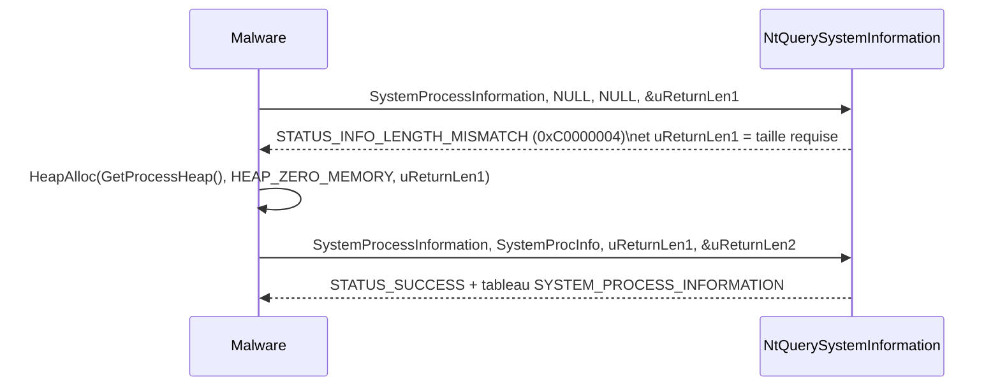

# Énumération des processus

L'énumération des processus est l'étape qui consiste à dresser la liste des processus en cours d'exécution afin d'en choisir un. Pour un code malveillant, elle sert presque toujours à trouver un **processus cible** dans lequel injecter un payload, mais aussi à repérer un environnement d'analyse ou à valider la présence d'un outil de sécurité. Comme les défenseurs surveillent étroitement les appels utilisés pour lister les processus, un développement soigné implémente la même fonctionnalité de plusieurs manières différentes afin de rester imprévisible.

## Objectifs de l'énumération

- Identifier un **processus porteur** (cheval de Troie d'injection) parmi une liste de candidats.
- Obtenir un **PID** puis un **handle** utilisable par les API d'injection.
- Distinguer les instances privilégiées des instances non privilégiées d'un même exécutable.
- Détecter la présence de processus d'analyse (sandbox, débogueur, EDR).

## Rappel de `CreateToolhelp32Snapshot`

Une première approche repose sur `CreateToolhelp32Snapshot` (`TH32CS_SNAPPROCESS`) puis l'itération `Process32First` / `Process32Next`. Elle fournit directement le **nom** du processus et son PID, mais la sélection de la cible se fait par comparaison de chaînes. Or plusieurs instances du même nom peuvent coexister avec des niveaux de privilèges différents : impossible de les distinguer à la seule lecture du nom. Le seul indice de privilège reste l'échec éventuel d'un `OpenProcess` ultérieur. Voir [[Processus Windows]] pour les notions de PID, handle et jeton de processus.

## Méthode `EnumProcesses`

`EnumProcesses` appartient aux API de type *process status*. Elle rempli un tableau de `DWORD` contenant les **PID uniquement**, sans les noms associés. Seuls des PID ne sont pas exploitables pour un humain (et pour la logique de ciblage) : il faut donc compléter l'appel avec trois API de la famille PSAPI.

1. `OpenProcess` ouvre un handle sur le PID avec les droits `PROCESS_QUERY_INFORMATION | PROCESS_VM_READ`.
2. `EnumProcessModules` énumère les modules chargés dans ce processus ; on récupère le handle du premier module.
3. `GetModuleBaseName` déduit le **nom** du processus à partir de ce module.



L'itération complète, sur le modèle de l'exemple Microsoft :

```c
BOOL PrintProcesses() {

    DWORD   adwProcesses[1024 * 2],
            dwReturnLen1 = NULL,
            dwReturnLen2 = NULL,
            dwNmbrOfPids = NULL;

    HANDLE  hProcess = NULL;
    HMODULE hModule  = NULL;
    WCHAR   szProc[MAX_PATH];

    // Tableau de PID
    if (!EnumProcesses(adwProcesses, sizeof(adwProcesses), &dwReturnLen1)) {
        printf("[!] EnumProcesses Failed With Error : %d \n", GetLastError());
        return FALSE;
    }

    // Nombre d'elements du tableau
    dwNmbrOfPids = dwReturnLen1 / sizeof(DWORD);

    for (int i = 0; i < dwNmbrOfPids; i++) {

        if (adwProcesses[i] != NULL) {

            if ((hProcess = OpenProcess(PROCESS_QUERY_INFORMATION | PROCESS_VM_READ, FALSE, adwProcesses[i])) != NULL) {

                // Handle du premier module, requis par GetModuleBaseName
                if (!EnumProcessModules(hProcess, &hModule, sizeof(HMODULE), &dwReturnLen2))
                    printf("[!] EnumProcessModules Failed [ At Pid: %d ] With Error : %d \n", adwProcesses[i], GetLastError());
                else
                    if (!GetModuleBaseName(hProcess, hModule, szProc, sizeof(szProc) / sizeof(WCHAR)))
                        printf("[!] GetModuleBaseName Failed [ At Pid: %d ] With Error : %d \n", adwProcesses[i], GetLastError());
                    else
                        wprintf(L"[%0.3d] Process \"%s\" - Of Pid : %d \n", i, szProc, adwProcesses[i]);

                CloseHandle(hProcess);
            }
        }
    }

    return TRUE;
}
```

### Avantage par rapport au snapshot

La grande force de cette méthode est qu'elle raisonne **par handle** et non par nom. Puisqu'un handle est déjà ouvert sur le processus, l'identité de la cible est certaine : la résolution du nom ne peut pas échouer. Mieux encore, lorsqu'un `OpenProcess` échoue avec `ERROR_ACCESS_DENIED`, on en déduit immédiatement que le processus est plus privilégié que le nôtre — information qu'une simple comparaison de chaînes ne fournit pas. C'est donc un excellent filtre pour choisir des cibles **accessibles** (voir [[Injection de shellcode]]).

### Variante `GetRemoteProcessHandle`

La fonction `PrintProcesses` se transforme facilement en utilitaire de recherche de cible : ajouter un paramètre `szProcName`, comparer avec `wcscmp`, et retourner par référence les valeurs utiles via des pointeurs de sortie.

```cpp
BOOL GetRemoteProcessHandle(LPCWSTR szProcName, DWORD* pdwPid, HANDLE* phProcess) {

    // ... meme enumeration que PrintProcesses ...

    // Comparaison du nom
    if (wcscmp(szProcName, szProc) == 0) {
        *pdwPid     = adwProcesses[i];
        *phProcess  = hProcess;     // handle ouvert avec PROCESS_ALL_ACCESS
        break;
    }

    // ...
}
```

Deux différences par rapport à la version d'affichage :

- Le contrôle d'accès passe de `PROCESS_QUERY_INFORMATION | PROCESS_VM_READ` à `PROCESS_ALL_ACCESS`, afin de retourner un handle suffisamment permissif pour les opérations suivantes (écriture mémoire, création de thread distant).
- La fonction ne ferme pas le handle de la cible et le transmet à l'appelant.

## Méthode `NtQuerySystemInformation`

`NtQuerySystemInformation` est une **syscall** exportée par `ntdll.dll`. Elle n'est donc pas liée statiquement : il faut résoudre son adresse avec `GetModuleHandle` et `GetProcAddress`, à la manière de ce qui est décrit dans [[Introduction aux syscalls]] et [[Dynamic-Link Library]].

```c
typedef NTSTATUS (NTAPI* fnNtQuerySystemInformation)(
    SYSTEM_INFORMATION_CLASS SystemInformationClass,
    PVOID                    SystemInformation,
    ULONG                    SystemInformationLength,
    PULONG                   ReturnLength
);

fnNtQuerySystemInformation pNtQuerySystemInformation = NULL;

pNtQuerySystemInformation = (fnNtQuerySystemInformation)GetProcAddress(
    GetModuleHandle(L"NTDLL.DLL"), "NtQuerySystemInformation");
```

### Paramètres

| Paramètre | Rôle |
|---|---|
| `SystemInformationClass` | Détermine le **type** d'information retournée (ici `SystemProcessInformation`) |
| `SystemInformation` | Pointeur vers le tampon recevant la structure demandée |
| `SystemInformationLength` | Taille du tampon en octets |
| `ReturnLength` | Reçoit la taille réellement écrite |

Avec le drapeau `SystemProcessInformation`, la fonction retourne un **tableau** de structures `SYSTEM_PROCESS_INFORMATION`, une par processus. Les champs utiles sont `ImageName` (le nom, sous forme d'`UNICODE_STRING`), `UniqueProcessId` (le PID) et `NextEntryOffset` (l'écart vers l'entrée suivante).

```c
typedef struct _SYSTEM_PROCESS_INFORMATION {
    ULONG           NextEntryOffset;   // ecart vers l'entree suivante
    ULONG           NumberOfThreads;
    BYTE            Reserved1[48];
    UNICODE_STRING  ImageName;         // nom du processus
    KPRIORITY       BasePriority;
    HANDLE          UniqueProcessId;   // PID
    // ... membres reserves / statistiques (VirtualSize, WorkingSetSize, ...)
} SYSTEM_PROCESS_INFORMATION;
```

### Le motif à deux appels

La taille du tableau retourné est inconnue à l'avance. La fonction est donc appelée **deux fois** : le premier appel, volontairement mal paramétré, échoue avec `STATUS_INFO_LENGTH_MISMATCH` (`0xC0000004`) mais renseigne la taille nécessaire dans `ReturnLength`. On alloue ensuite un tampon de cette taille, puis on relance l'appel pour obtenir les données réelles.



```c
ULONG                        uReturnLen1 = NULL, uReturnLen2 = NULL;
PSYSTEM_PROCESS_INFORMATION  SystemProcInfo = NULL;
NTSTATUS                     STATUS = NULL;
PVOID                        pValueToFree = NULL;

// 1er appel : echoue volontairement, fournit la taille a allouer
pNtQuerySystemInformation(SystemProcessInformation, NULL, NULL, &uReturnLen1);

SystemProcInfo = (PSYSTEM_PROCESS_INFORMATION)HeapAlloc(
    GetProcessHeap(), HEAP_ZERO_MEMORY, (SIZE_T)uReturnLen1);

// On memorise l'adresse initiale : le parcours va modifier SystemProcInfo
pValueToFree = SystemProcInfo;

// 2e appel : recuperation effective du tableau
STATUS = pNtQuerySystemInformation(SystemProcessInformation, SystemProcInfo, uReturnLen1, &uReturnLen2);
if (STATUS != 0x0) { /* echec */ }
```

### Parcours du tableau chaîné

Les entrées ne sont pas contiguës : le passage à l'entrée suivante se fait en ajoutant `NextEntryOffset` à l'adresse courante. Une valeur nulle signale la fin du tableau.

```c
while (TRUE) {

    // On compare uniquement si un nom est present (ImageName.Length != 0)
    if (SystemProcInfo->ImageName.Length && wcscmp(SystemProcInfo->ImageName.Buffer, szProcName) == 0) {
        *pdwPid    = (DWORD)SystemProcInfo->UniqueProcessId;
        *phProcess = OpenProcess(PROCESS_ALL_ACCESS, FALSE, (DWORD)SystemProcInfo->UniqueProcessId);
        break;
    }

    // Fin du tableau
    if (!SystemProcInfo->NextEntryOffset)
        break;

    // Entree suivante
    SystemProcInfo = (PSYSTEM_PROCESS_INFORMATION)((ULONG_PTR)SystemProcInfo + SystemProcInfo->NextEntryOffset);
}

// Liberation a partir de l'adresse initiale memorisee
HeapFree(GetProcessHeap(), 0, pValueToFree);
```

Comme l'adresse courante est incrémentée à chaque tour, il est indispensable de **sauvegarder le pointeur de base** avant la boucle, sinon la libération mémoire (`HeapFree`) devient impossible et fuit.

## Mécanisme non documenté

`NtQuerySystemInformation` reste en grande partie non documentée : la définition officielle de `SYSTEM_PROCESS_INFORMATION` contient de nombreux membres `Reserved` masquant des données exploitables. Les implémentations réelles s'appuient souvent sur une version enrichie de la structure (issue de ReactOS ou de System Informer) qui expose davantage de champs, ainsi que sur une variante plus documentée de `SYSTEM_INFORMATION_CLASS`. Les résultats produits sont identiques. Voir [[Structures non documentées]].

## Comparaison des méthodes

| Méthode | Source | Sortie | Avantage | Limite / exposition |
|---|---|---|---|---|
| `CreateToolhelp32Snapshot` | `kernel32` | Nom + PID immédiats | Simple, direct | Sélection par chaîne, pas de distinction de privilèges |
| `EnumProcesses` | `kernel32` / PSAPI | Tableau de PID | Handle obtenu tôt, filtre de privilège fiable | Nombre d'appels API élevé, handle par processus |
| `NtQuerySystemInformation` | `ntdll` (syscall) | Tableau de structures | Riche en métadonnées, un seul appel système | API non documentée, souvent hookée |

## Côté détection

- Les trois schémas produisent une signature d'appels caractéristique (`EnumProcesses` suivi de boucles `OpenProcess` / `EnumProcessModules`), visible dans l'ETW et les hooks utilisateur de [[Mécanismes de détection]].
- L'ouverture systématique de handles avec `PROCESS_ALL_ACCESS` sur de nombreux processus, en particulier des processus sensibles (`lsass.exe`), est un indicateur fort.
- `NtQuerySystemInformation` est fréquemment **hookée** ou surveillée par les EDR ; son usage combiné à une résolution dynamique via `GetProcAddress` (plutôt qu'un import statique) est à la fois une technique d'évasion et un signal d'alerte. Voir [[Dissimulation de l'IAT]].
- Les processus d'analyse sont souvent ciblés, mais certains noms (`vmtoolsd.exe`, `procmon.exe`) sont blacklistés par les malwares — signe inverse utilisé par les défenseurs.

La sélection finale de la cible (par nom, exclusivité, absence de handle) est décrite plus loin dans les notes d'injection, notamment [[Injection de shellcode]] et [[Injection par mapping]].
