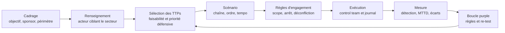
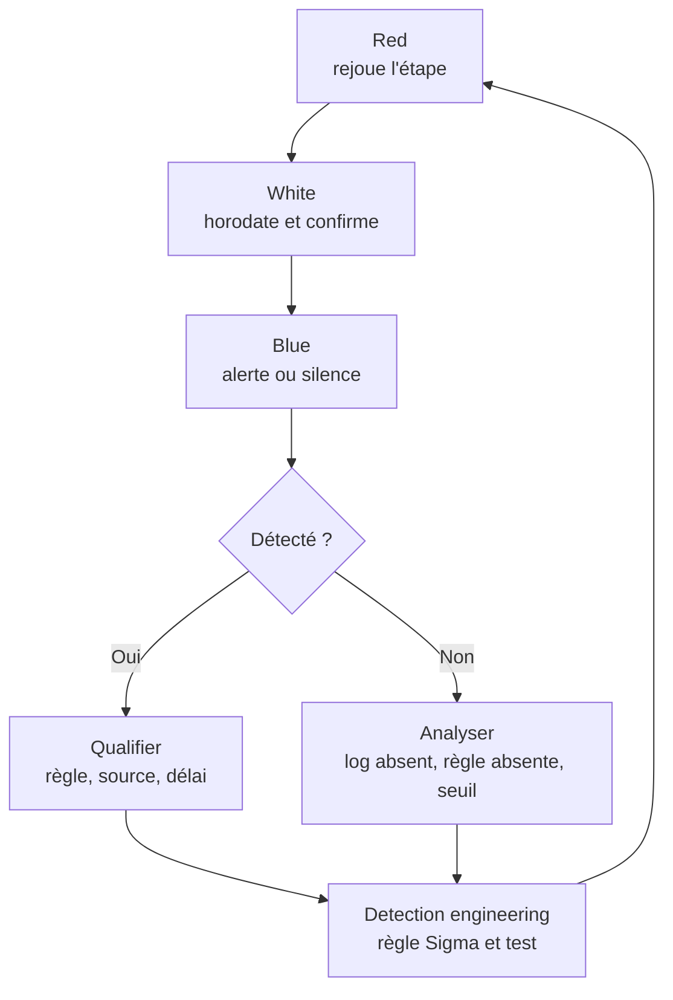

# Émulation d'adversaire

Un exercice Red Team répond à une question large : l'organisation peut-elle être compromise, et s'en apercevrait-elle ? L'émulation d'adversaire pose une question plus étroite et plus reproductible : si un acteur précis, avec les techniques documentées qu'on lui connaît, exécutait sa chaîne d'attaque chez nous, nos capteurs produiraient-ils la télémétrie attendue, et quand une alerte serait-elle levée ?

La différence n'est pas cosmétique : un Red Team optimise pour atteindre un objectif sans se faire voir, une émulation pour **reproduire fidèlement un comportement connu** et rendre chaque étape mesurable et rejouable. Elle accepte donc d'être bruyante, d'être détectée, parfois d'échouer techniquement : ce qui compte est l'écart entre ce que la défense aurait dû voir et ce qu'elle a réellement vu.

> [!abstract] Définition — Émulation d'adversaire
> Conduite planifiée, documentée et autorisée de techniques attribuées à un acteur identifié, dans un environnement contrôlé, dans le but de mesurer la capacité de détection et de réponse d'une organisation plutôt que de maximiser la compromission.

## Situer l'émulation parmi les exercices

Les termes sont souvent confondus alors qu'ils mesurent des choses différentes.

| Approche | Question posée | Périmètre | Furtivité | Livrable |
|---|---|---|---|---|
| Pentest | Quelles vulnérabilités exploitables ? | Précis, contractualisé | Secondaire | Vulnérabilités priorisées |
| Red Team | Compromission possible sans être vu ? | Large, parfois flou | Centrale | Récit d'attaque, lacunes |
| Émulation | Un acteur donné serait-il détecté, et où ? | Moyen, mappé sur des TTPs | Assumée, mesurée | Matrice de détection |
| Purple Team | Comment améliorer la détection en boucle courte ? | Technique par technique | Sans objet | Règles corrigées et re-testées |
| BAS | Les contrôles régressent-ils ? | Automatisé, large | Sans objet | Tableau de bord |

L'émulation se distingue aussi de la **simulation** générique, qui emploie des outils standards sans se soucier de ce que ferait l'attaquant réel. Une émulation part d'un profil d'acteur et impose des contraintes de fidélité : ordre des étapes, binaires, mode d'exécution, infrastructure, tempo, niveau de bruit. C'est cette contrainte qui rend les résultats interprétables.

## MITRE ATT&CK comme grammaire commune

ATT&CK n'est pas une méthodologie d'émulation, c'est le vocabulaire qui permet de décrire un plan et d'en discuter les résultats sans ambiguïté. Sa structure compte autant que son contenu :

| Élément | Rôle | Usage en émulation |
|---|---|---|
| Tactique | Objectif de l'attaquant (TA0001 à TA0040) | Structure le scénario en phases |
| Technique | Moyen d'atteindre l'objectif (Txxxx) | Unité de test et de mesure |
| Sous-technique | Variante précise (Txxxx.yyy) | Niveau de fidélité réellement utile |
| Procédure | Mise en œuvre observée chez un acteur | Ce que l'on exécute concrètement |
| Groupe | Ensemble de procédures attribuées | Source du profil d'acteur |
| Logiciel | Outil offensif utilisé | Contrainte de fidélité supplémentaire |
| Source de données | Télémétrie attendue | Critère de succès de la détection |

Les tactiques Enterprise, avec un exemple d'étape émulable et la note du vault qui détaille la mécanique :

| ID | Tactique | Exemple d'étape | Note liée |
|---|---|---|---|
| TA0001 | Initial Access | Hameçonnage avec pièce jointe ou lien | [[Red Team et Blue Team]] |
| TA0002 | Execution | PowerShell encodé, Rundll32, service | [[LOLBAS et GTFOBins]] |
| TA0003 | Persistence | Clé Run, tâche planifiée, service | [[Persistence]] |
| TA0004 | Privilege Escalation | Abus de token, élévation locale | [[Windows Privilege Escalation]] |
| TA0005 | Defense Evasion | Obfuscation, injection, désactivation d'outils | [[Contournement des antivirus]] |
| TA0006 | Credential Access | LSASS, Kerberoasting, DCSync | [[Mimikatz]] |
| TA0007 | Discovery | Énumération de comptes et de machines | [[BloodHound]] |
| TA0008 | Lateral Movement | Pass-the-Hash, RDP, partages admin | [[Lateral Movement]] |
| TA0009 | Collection | Archivage, capture d'écran | [[Data Exfiltration]] |
| TA0011 | Command and Control | HTTPS, DNS, canal applicatif | [[C2 Infrastructure]] |
| TA0010 | Exfiltration | Exfiltration sur le canal C2 | [[Data Exfiltration]] |
| TA0040 | Impact | Chiffrement, inhibition de la restauration | [[Ransomware]] |

La couverture se documente dans une **couche ATT&CK Navigator**, un fichier JSON qui colorie la matrice selon quatre états : non testé, télémétrie collectée sans règle, règle partielle, règle validée. Elle sert de tableau de bord et d'archive.

> [!important] Idée clé
> ATT&CK décrit des **comportements**, pas des outils. Une émulation fidèle au niveau de la technique (T1003.001) reste valide si l'acteur change d'implémentation ; une émulation fidèle à l'outil (un hash de Mimikatz) ne teste qu'une signature. La bonne fidélité se situe entre les deux : assez précise pour reproduire la télémétrie, assez abstraite pour ne pas dépendre d'un binaire daté.

## Cadres réglementaires et sectoriels

Plusieurs cadres transforment l'émulation en exigence de supervision, principalement dans la finance. Ils partagent une structure en quatre phases et un principe : l'exercice est **conduit par le renseignement**, pas par la liste des vulnérabilités connues.

| Cadre | Émetteur | Périmètre | Spécificité |
|---|---|---|---|
| TIBER-EU | Banque centrale européenne | Entités financières de l'UE | Cadre générique, décliné par pays |
| CBEST | Bank of England | Secteur financier britannique | Tests menés par des prestataires accrédités |
| iCAST | MAS (Singapour) | Finance à Singapour | Proche de TIBER, gouvernance locale |
| AASE | HKMA (Hong Kong) | Banques de Hong Kong | Intégré au cycle de supervision |
| TLPT (DORA) | Autorités européennes | Entités financières significatives | Impose un TLPT aligné sur TIBER-EU |

TIBER-EU s'organise en quatre phases : **préparation** (périmètre, prestataire de renseignement, équipe de contrôle), **renseignement** (profil d'acteur et scénarios ciblés, revus par une *white team*), **test Red Team** (exécution covert dans les limites légales), **clôture** (rapports, remédiation, attestation). Le point structurant est la **control team**, distincte de l'équipe offensive : elle connaît le plan, détient les autorisations, peut arrêter l'exercice et arbitre les incidents afin qu'un test ne soit jamais confondu avec une vraie attaque.

## Outils : du test unitaire au scénario

### Atomic Red Team

Atomic Red Team fournit, pour chaque technique ATT&CK, un ou plusieurs tests atomiques avec commande, prérequis, nettoyage et artefacts attendus. C'est l'outil de la **validation unitaire** de détection.

```powershell
# Installation du module d'orchestration
Install-Module -Name invoke-atomicredteam -Scope CurrentUser -Force

# Inventaire des tests disponibles pour une technique
Invoke-AtomicTest T1059.001 -ShowDetailsBrief

# Vérifier les prérequis avant exécution
Invoke-AtomicTest T1059.001 -TestNumbers 1 -GetPrereqs

# Exécuter puis nettoyer
Invoke-AtomicTest T1059.001 -TestNumbers 1
Invoke-AtomicTest T1059.001 -TestNumbers 1 -Cleanup
```

Un test atomique ne raconte pas une intrusion : il prouve qu'une technique produit (ou non) une alerte. Enchaîner dix tests ne constitue pas un scénario, car l'ordre, le contexte de privilèges et le tempo sont justement ce que l'adversaire exploite.

### CALDERA

Un agent (*Sandcat*) s'exécute sur la cible, un *planner* ordonne les *abilities* selon un *adversary*, et une *operation* suit l'avancement. CALDERA apporte ce qui manque à Atomic : l'enchaînement, l'état de la cible et l'adaptation.

```bash
# Serveur de laboratoire, isolé du réseau de production
python3 server.py --insecure --port 8888

# Lancement d'une opération à partir d'un profil d'adversaire existant
curl -s -X POST http://127.0.0.1:8888/api/v2/operations \
  -H "KEY: ADMIN123" -H "Content-Type: application/json" \
  -d '{
        "name": "emulation-acteur-a-lab",
        "adversary": {"adversary_id": "uuid-du-profil"},
        "group": "red",
        "obfuscator": "base64",
        "jitter": "2/8",
        "auto_close": false
      }'
```

| Critère | Atomic Red Team | CALDERA |
|---|---|---|
| Granularité | Test unitaire par technique | Chaîne d'abilities |
| Fidélité | Faible sur l'ordre et le contexte | Moyenne, dépend du profil |
| Coût de mise en place | Très faible | Élevé (agent, serveur, réseau) |
| Usage typique | Validation de règles, régression | Exercice de bout en bout, autonomie |
| Risque opérationnel | Contenu, nettoyage fourni | Plus élevé, à encadrer strictement |

## Construire un plan d'émulation



### 1. Choisir l'acteur

Le choix n'est pas une préférence technique mais une question de pertinence :

- **Pertinence sectorielle** : l'acteur cible réellement le secteur, la région ou le type d'activité.
- **Actualité** : campagne récente documentée, donc TTPs encore en usage.
- **Faisabilité** : les techniques sont reproductibles dans le laboratoire et le périmètre.
- **Valeur défensive** : les TTPs touchent des actifs mal couverts par la détection actuelle.

Les sources sont le renseignement sur les menaces ([[Threat Intelligence]], [[APT et Acteurs de la Menace]]), les fiches de groupe ATT&CK et les alertes des CERT. La *MITRE Adversary Emulation Library* propose des plans déjà rédigés (APT3, APT29, FIN6, menuPass) utiles comme modèle.

### 2. Extraire les procédures, pas seulement les identifiants

Un plan sérieux cite, pour chaque étape, la source qui justifie la procédure observée. La fidélité se dégrade en trois niveaux :

| Niveau | Description | Valeur pour la détection |
|---|---|---|
| Identification | « T1059.001 » sans détail | Faible : ne dit pas quelle télémétrie attendre |
| Technique | PowerShell avec argument encodé | Moyenne : télémétrie prévisible |
| Procédure | Commande précise, binaire, ordre des étapes | Élevée : reproductible et comparable |

### 3. Écrire le scénario

Le scénario est un récit technique : point d'entrée crédible, progression cohérente avec les privilèges acquis, objectif final. Chaque étape doit annoncer sa télémétrie attendue **avant** l'exécution, sinon la mesure se transforme en observation rétrospective.

| Phase | Technique | Action planifiée | Télémétrie attendue |
|---|---|---|---|
| Accès initial | T1566.001 | Pièce jointe leurre exécutant un script | Courriel, passerelle, Event ID 1 |
| Exécution | T1059.001 | PowerShell encodé, téléchargement | Script Block Logging 4104 |
| Persistance | T1053.005 | Tâche planifiée au logon | 4698, Sysmon 1 et 11 |
| Credential Access | T1003.001 | Accès au handle LSASS | Sysmon 10, EDR |
| Latéralisation | T1021.002 | Copie et exécution distante | 4624 type 3, 5140, 7045 |
| Exfiltration | T1041 | Envoi de fichiers leurres vers le C2 | Proxy, DNS, volume sortant |

### 4. Rédiger une fiche par étape

| Champ | Contenu |
|---|---|
| Identifiant | Étape, technique, sous-technique |
| Procédure | Commande exacte, binaire, arguments |
| Prérequis | Compte, hôte, privilèges, connectivité |
| Source | Rapport ou fiche ATT&CK justifiant la procédure |
| Télémétrie attendue | Source de données, événement, champ |
| Hypothèse de détection | Règle supposée se déclencher |
| Nettoyage | Suppression des artefacts, restauration |
| Garde-fou | Interdiction explicite (chiffrement réel, exfiltration réelle) |
| Critère de sortie | Détecté, partiellement détecté, non détecté, non concluant |

### 5. Règles d'engagement, sécurité et arrêt d'urgence

Une émulation manipule de vraies techniques sur de vrais systèmes : le document d'engagement doit donc être plus précis qu'un contrat de pentest, pas moins.

- **Périmètre positif et négatif** : hôtes, comptes, plages réseau, applications autorisées, et surtout les exclusions (contrôleurs de domaine de production, sauvegardes, systèmes industriels).
- **Interdictions absolues** : chiffrement réel, suppression de données, déni de service, exfiltration au-delà d'un fichier marqueur, persistance hors fenêtre.
- **Fenêtres et tempo** : heures autorisées, durée maximale, nombre d'étapes simultanées.
- **Déconfliction** : identifiants d'exercice connus du SOC, canal dédié, journal horodaté partagé avec la control team.
- **Arrêt d'urgence** : un mot d'ordre unique, un contact joignable en permanence, une commande de nettoyage testée avant le début, et une autorité d'arrêt claire.

| Condition d'arrêt | Décisionneur | Action |
|---|---|---|
| Propagation hors périmètre | Control team | Gel immédiat, isolation réseau |
| Impact sur un service de production | Control team | Arrêt, restauration, notification |
| Incident réel concomitant | RSSI | Suspension, bascule en réponse à incident |
| Perte de contrôle du C2 | Opérateur | Coupure de l'infrastructure |
| Demande du sponsor | Sponsor | Arrêt sans justification technique |

> [!warning] Piège
> L'arrêt d'urgence n'est crédible que s'il a été **répété**. Une commande de nettoyage jamais exécutée avant l'exercice échoue souvent au pire moment (agent non déployé, chemin différent, droits insuffisants). La répétition générale à blanc, sur le même périmètre, fait partie de la préparation et conditionne le feu vert.

### 6. Rôles pendant l'exécution

Le sponsor autorise et porte le risque ; la white team connaît le plan et valide les scénarios ; la control team autorise chaque étape sensible et peut arrêter ; la red team exécute et documente ; la blue team détecte et répond sans connaître le plan.

### 7. Mesurer

Une émulation sans chiffres ne produit qu'une anecdote ; les métriques se définissent avant l'exercice et se calculent sur le même périmètre.

| Métrique | Définition | Lecture |
|---|---|---|
| Taux de détection | Étapes détectées / étapes exécutées | Mesure principale, à pondérer par phase |
| MTTD | Médiane entre exécution et alerte | Révèle les angles morts temporels |
| Couverture ATT&CK | Techniques avec règle validée / techniques du profil | Vision stratégique |
| Fidélité du scénario | Étapes exécutées / étapes planifiées | Validité du résultat |
| Taux de faux positifs | Alertes non liées à l'exercice / alertes | Coût opérationnel de la règle |
| Temps de confinement | Entre alerte et isolation | Mesure la réponse, pas seulement la détection |
| Régression | Détections perdues depuis le dernier cycle | Santé du parc de règles |

Un taux global de 70 % peut cacher une couverture correcte en exécution et nulle en credential access ; la lecture par tactique, et surtout par étape du scénario, est plus utile qu'une moyenne.

### 8. Boucler avec le Purple Team



La boucle est celle décrite dans [[Purple Teaming]] : chaque étape non détectée devient une hypothèse, traitée en [[Detection Engineering]], écrite en [[Sigma]], puis rejouée. Le re-test distingue une émulation d'un audit : sans lui, on mesure une intention, pas une capacité.

## Détection

**Les traces de l'instrumentation.** Atomic Red Team dépose des fichiers reconnaissables, CALDERA laisse un agent et des requêtes vers son serveur, les modules PowerShell laissent des commandes explicites. Ces traces servent à la **déconfliction** : le SOC doit pouvoir identifier un test légitime. Elles ne comptent jamais comme une détection de la technique. Si l'unique alerte d'un exercice porte sur le nom du fichier de test, la conclusion correcte est « non détecté ».

**Les traces de la technique.** Elles sont celles qu'un attaquant réel produirait, et ce sont les seules qui comptent :

| Source | Exemple d'artefact | Techniques couvertes |
|---|---|---|
| Sysmon 1 et 4688 | Ligne de commande, parent, hash | Exécution, découverte, latéralisation |
| Sysmon 10 | Accès au processus LSASS | T1003.001 |
| Sysmon 11 et 13 | Dépôt de fichier, clé Run | Persistance |
| Journaux de sécurité | 4624, 4648, 4768, 4769, 5140 | Authentification, Kerberos, partages |
| DNS et proxy | Requêtes périodiques, volume sortant | C2, exfiltration |
| EDR | Chaînes d'appels, injection, tampering | Defense Evasion |

Chaque étape doit aussi être **horodatée** : sans horodatage précis côté red team et côté SIEM, le MTTD n'est qu'une estimation. Un journal partagé, avec un identifiant par étape, règle ce problème.

## Limites

- **La fidélité est une approximation.** Un acteur réel adapte ses procédures et change d'outil ; un plan exécute ce qui a été écrit. Une technique non détectée a peut-être été exécutée dans une variante que l'acteur n'emploie pas.
- **L'outillage biaise la mesure.** Les outils d'émulation sont connus des EDR ; une détection peut porter sur l'outil plutôt que sur le comportement. Le score se confirme en variant l'implémentation à fidélité constante.
- **Le périmètre biaise la sélection.** Les techniques faciles à reproduire sont sur-représentées ; les techniques destructrices ou exigeant une ingénierie sociale lourde sont sous-testées.
- **La connaissance du plan invalide l'exercice.** Dès qu'un analyste connaît l'heure ou la cible, le MTTD mesuré n'a plus de sens.
- **Le risque opérationnel est réel.** Une émulation mal encadrée peut saturer un SIEM, déclencher un confinement automatique ou provoquer un incident.

> [!quiz] Quelle différence entre un Red Team et une émulation d'adversaire ?
> Le Red Team cherche à atteindre un objectif en restant furtif et mesure la compromission possible ; l'émulation reproduit les TTPs d'un acteur identifié et mesure, étape par étape, la détection et la réponse.

> [!quiz] Pourquoi une émulation doit-elle être « intelligence-led » ?
> Parce que la valeur du résultat dépend de la pertinence des techniques : reproduire les procédures d'un acteur qui cible réellement le secteur produit une mesure utile, un catalogue générique mesure surtout la couverture des outils.

> [!quiz] Que mesure le MTTD, et que ne mesure-t-il pas ?
> Le délai médian entre l'exécution d'une étape et l'alerte. Il ne dit rien de la qualité de l'alerte, du temps de confinement, ni de la détection d'une autre variante.

> [!quiz] Pourquoi les traces laissées par l'outil d'émulation ne comptent-elles pas comme une détection ?
> Parce qu'elles n'existent pas chez un attaquant réel : elles prouvent que le SOC reconnaît l'outil de test, pas qu'il détecte le comportement.
