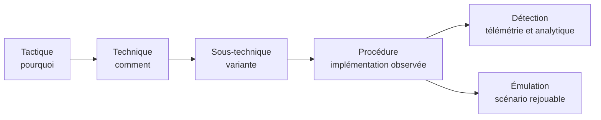

# MITRE ATT&CK

MITRE ATT&CK (Adversarial Tactics, Techniques and Common Knowledge) est une base de connaissances publique qui décrit les comportements observés des attaquants, du premier accès jusqu'à l'impact. Elle ne fournit ni exploits ni outils : elle fournit un vocabulaire commun pour nommer ce que fait un adversaire, comparer des détections et construire des scénarios d'émulation.

ATT&CK est souvent confondu avec une checklist de sécurité. C'est une erreur de cadrage. La base décrit des **procédures observées**, pas des exigences de conformité, et sa couverture n'est pas une mesure directe de la sécurité. Bien utilisée, elle sert de colonne vertébrale entre le renseignement, la détection, la chasse et l'évaluation.

## Le modèle : tactiques, techniques, procédures

ATT&CK organise les comportements sur trois niveaux.

| Niveau | Question | Exemple |
|---|---|---|
| Tactique | Pourquoi l'attaquant agit | Credential Access (TA0006) |
| Technique | Comment il agit | OS Credential Dumping (T1003) |
| Sous-technique | Variante précise | LSASS Memory (T1003.001) |
| Procédure | Implémentation observée | `comsvcs.dll` chargé via `rundll32` pour vider LSASS |



Les tactiques sont les objectifs tactiques de l'adversaire. Les techniques décrivent les moyens. Les procédures sont les implémentations concrètes, propres à un groupe, un outil ou une campagne. Deux organisations peuvent être touchées par la même technique avec des procédures très différentes : c'est la procédure qui produit les artefacts les plus exploitables.

> [!abstract] Définition — TTP
> TTP signifie Tactics, Techniques and Procedures. Le terme désigne l'ensemble des comportements d'un adversaire : ses objectifs (tactiques), ses méthodes (techniques) et ses implémentations concrètes (procédures).

## Les matrices

ATT&CK publie plusieurs matrices, car les plateformes ont des surfaces différentes :

- **Enterprise** : Windows, Linux, macOS, cloud (AWS, Azure, GCP), conteneurs, SaaS, réseau.
- **Mobile** : Android et iOS.
- **ICS** : systèmes de contrôle industriels.

Une technique peut exister dans plusieurs matrices avec des identifiants et des portées différents. Quand on cartographie une détection, il faut préciser la matrice et la plateforme. Un mapping « T1055 » sans plateforme est ambigu dès qu'on sort de Windows.

## Les quatorze tactiques Enterprise

| Tactique | ID | Objectif | Notes du vault |
|---|---|---|---|
| Reconnaissance | TA0043 | Collecter des informations avant l'attaque | [[Recon Automation]], [[Méthodologie OSINT]], [[nmap]], [[Shodan]] |
| Resource Development | TA0042 | Acquérir ou préparer l'infrastructure et les capacités | [[C2 Infrastructure]], [[C2 avancé]], [[Initial Access]] |
| Initial Access | TA0001 | Entrer dans le périmètre | [[Initial Access]], [[Phishing Analysis]], [[SMTP et Email Attacks]], [[Supply Chain Attacks]] |
| Execution | TA0002 | Exécuter du code | [[00 - Index Malware Development]], [[LOLBAS et GTFOBins]], [[PowerShell Pentest]] |
| Persistence | TA0003 | Maintenir l'accès | [[Persistence]], [[AD Persistence Avancée]], [[Malware Linux]], [[Malware macOS]] |
| Privilege Escalation | TA0004 | Obtenir des droits supérieurs | [[Windows Privilege Escalation]], [[Linux Privilege Escalation]], [[ACL Abuse]], [[ADCS]] |
| Defense Evasion | TA0005 | Éviter la détection | [[AV-EDR Evasion]], [[AMSI et ETW bypass]], [[Obscurcissement du sommeil]], [[Spoofing de pile d'appels]] |
| Credential Access | TA0006 | Voler des identifiants | [[Credential Access]], [[Mimikatz]], [[Kerberos Attacks]], [[NTLM Relay]] |
| Discovery | TA0007 | Cartographier l'environnement | [[BloodHound]], [[Énumération des processus]], [[Recon Automation]] |
| Lateral Movement | TA0008 | Se déplacer dans le réseau | [[Lateral Movement]], [[Pivoting et Tunneling]], [[CrackMapExec]] |
| Collection | TA0009 | Rassembler les données utiles | [[Data Exfiltration]], [[Windows Forensics]] |
| Command and Control | TA0011 | Piloter les agents | [[C2 Infrastructure]], [[C2 avancé]], [[Pivoting et Tunneling]] |
| Exfiltration | TA0010 | Sortir les données | [[Data Exfiltration]], [[Pivoting et Tunneling]] |
| Impact | TA0040 | Détruire, chiffrer, perturber | [[Ransomware]], [[Business Continuity et Disaster Recovery]] |

Les tactiques ne décrivent pas une séquence obligatoire. Un attaquant peut revenir en arrière, sauter une étape, ou combiner plusieurs objectifs dans une seule action. La séquence linéaire « Recon → Initial Access → … → Impact » est une commodité pédagogique, pas un modèle d'exécution.

## Utilisations légitimes

### Renseignement et priorisation

ATT&CK permet de décrire un groupe ou une campagne avec un vocabulaire stable. Une note de threat intelligence qui dit « le groupe utilise des courriels de spearphishing avec pièce jointe, puis du PowerShell et du vol de tickets Kerberos » se traduit en techniques : T1566.001, T1059.001, T1558. La comparaison entre acteurs devient possible, et les détections peuvent être priorisées par pertinence pour l'organisation.

La priorisation ne doit pas se limiter à la fréquence. Il faut croiser :

- la pertinence de l'acteur pour le secteur ;
- la surface exposée de l'organisation ;
- la criticité des actifs ;
- la qualité des télémétries disponibles ;
- le coût de la détection et de la réponse.

### Détection et chasse

ATT&CK relie une technique à des **sources de données** et à des **composants de détection**. Une règle Sigma, une requête Splunk ou une analytique EDR peut être annotée avec les techniques qu'elle couvre. Cela permet de répondre à des questions comme :

- quelles techniques de l'acteur prioritaire sont couvertes par nos journaux ?
- quelle technique n'a aucune télémétrie exploitable ?
- quelle règle produit trop de faux positifs pour être conservée ?

Le mapping doit rester honnête. Une règle qui détecte une **procédure** ne couvre pas forcément toute la technique. Écrire « T1055 couvert » parce qu'une règle détecte `CreateRemoteThread` est trompeur : la technique compte de nombreuses variantes (APC, mapping, hollowing, thread hijacking) qui ne produisent pas les mêmes artefacts.

### Émulation et purple team

L'émulation d'adversaire utilise ATT&CK pour construire un plan de test : choisir un acteur, extraire ses techniques, les traduire en actions sûres et mesurer la détection. Atomic Red Team fournit des tests atomiques par technique ; CALDERA fournit des chaînes d'actions automatisées. Le lien avec la détection se fait dans un atelier purple : l'équipe rouge exécute, l'équipe bleue observe, les deux comparent ce qui était attendu et ce qui a été vu.

### Évaluation de la couverture

ATT&CK Navigator est l'outil de référence pour visualiser une couverture. Il accepte des calques JSON qui colorient les techniques selon un score, une priorité ou un statut. Un calque peut représenter :

- les techniques d'un acteur ;
- les techniques détectées par une règle ;
- les techniques couvertes par une télémétrie ;
- les techniques testées lors d'un exercice ;
- les écarts entre la théorie et la pratique.

Un exemple minimal de calque :

```json
{
  "name": "Couverture detection — SOC",
  "versions": { "attack": "16", "navigator": "5.1", "layer": "4.5" },
  "domain": "enterprise-attack",
  "techniques": [
    { "techniqueID": "T1055.012", "score": 80, "color": "#2e7d32", "comment": "Sysmon 1/8/10/25 + scan memoire" },
    { "techniqueID": "T1003.001", "score": 40, "color": "#f9a825", "comment": "Acces LSASS partiellement couvert" },
    { "techniqueID": "T1566.001", "score": 90, "color": "#2e7d32", "comment": "Passerelle mail + detonation" }
  ]
}
```

Le score est déclaratif. Il ne vaut que si le calque documente la source, la date, le propriétaire et la méthode d'évaluation. Un calque sans commentaires devient rapidement un indicateur de vanity metrics.

## Construire un mapping utile

Une méthode simple en cinq étapes :

1. **Choisir l'unité d'analyse** : une règle, une télémétrie, un scénario ou un acteur.
2. **Partir de la procédure observée**, pas de l'intitulé de la technique. Noter la commande, le processus, le fichier, la connexion, l'identité impliquée.
3. **Descendre à la sous-technique** quand elle existe et qu'elle est pertinente. T1055.012 est plus précis que T1055.
4. **Associer les sources de données** réellement disponibles : création de processus, chargement d'image, accès processus, connexion réseau, registre, authentification, ETW, capteur EDR.
5. **Décrire la limite** : ce que la détection ne voit pas, les contournements connus, les faux positifs attendus.

Exemple de fiche de mapping :

| Champ | Valeur |
|---|---|
| Technique | T1055.012 — Process Hollowing |
| Procédure | `CreateProcess` suspendu, `NtUnmapViewOfSection`, écriture d'une image, `SetThreadContext`, `ResumeThread` |
| Sources | Sysmon 1, 8, 10, 25 ; ETW TI ; télémétrie EDR |
| Analytique | image non mappée, thread dont l'entrée n'appartient à aucun module, région `MEM_PRIVATE` exécutable |
| Limites | hollowing avec image légitime, injection dans un processus protégé, contournement par syscalls directs |
| Notes | [[Process hollowing]], [[Détection mémoire des injections]] |

## ATT&CK et les autres référentiels

ATT&CK n'est pas le seul référentiel. Il faut savoir quand utiliser quoi.

| Référentiel | Question à laquelle il répond | Complémentarité |
|---|---|---|
| ATT&CK | Que fait l'attaquant ? | Comportements, détection, émulation |
| Cyber Kill Chain | À quelle étape du cycle ? | Vision linéaire, utile pour la pédagogie |
| Diamond Model | Qui attaque quoi, comment, avec quelle infrastructure ? | Analyse d'événement et attribution |
| TIBER-EU / CBEST | Comment tester une organisation de façon contrôlée ? | Cadre d'émulation et de gouvernance |
| NIST CSF | Comment organiser la sécurité ? | Gouvernance et maturité |
| MITRE D3FEND | Comment se défendre techniquement ? | Contre-mesures, complément d'ATT&CK |

ATT&CK décrit l'offensif ; D3FEND décrit les contre-mesures. Les deux peuvent être reliés, mais le mapping n'est pas bijectif : une contre-mesure peut couvrir plusieurs techniques, et une technique peut être atténuée par plusieurs mesures.

## Limites et pièges

- **La couverture n'est pas la sécurité.** Détecter une technique ne signifie pas détecter toutes ses procédures, ni répondre correctement.
- **Les techniques se recouvrent.** Une action peut relever de plusieurs techniques ; forcer un mapping unique produit des angles morts.
- **ATT&CK n'ordonne pas les actions.** La matrice n'indique ni la probabilité, ni la séquence, ni le coût pour l'attaquant.
- **Les procédures évoluent.** Une technique stable peut être mise en œuvre par des outils qui changent complètement les artefacts.
- **Le mapping est déclaratif.** Sans méthode, sans date et sans relecture, il derive vers une collection de cases cochées.
- **Les plateformes ne sont pas équivalentes.** Une technique Windows n'a pas toujours d'équivalent Linux, macOS ou cloud.
- **ATT&CK ne remplace pas l'analyse d'incident.** Il aide à nommer, pas à reconstruire la chronologie ni à établir la causalité.

> [!quiz] Quelle est la différence entre une tactique et une technique ?
> La tactique est l'objectif de l'attaquant (pourquoi), la technique est le moyen employé (comment). Une technique peut servir plusieurs tactiques.

> [!quiz] Pourquoi un score de couverture ATT&CK à 100 % est-il trompeur ?
> Parce qu'une règle couvre une procédure, pas nécessairement toutes les variantes d'une technique, et que la matrice ne mesure ni la qualité de la détection, ni la réponse, ni les angles morts de télémétrie.

> [!quiz] À quoi sert ATT&CK Navigator ?
> À visualiser et comparer des calques de techniques : couverture de détection, techniques d'un acteur, résultats d'émulation, écarts de télémétrie.

## Intégration dans le vault

- [[Threat Intelligence]] — cycle de renseignement et sources.
- [[Adversary Emulation]] — construction d'un plan d'émulation à partir d'ATT&CK.
- [[Purple Teaming]] — atelier de validation entre l'exécution et la détection.
- [[Detection Engineering]] — rédaction et cycle de vie des règles.
- [[Sigma]] — règles de détection portables, annotables avec des techniques.
- [[YARA et CAPA]] — CAPA mappe déjà les capacités aux techniques et à MBC.
- [[Détection mémoire des injections]] — application concrète sur T1055.
- [[C2 Infrastructure]] et [[C2 avancé]] — tactique Command and Control.
- [[Credential Access]] — tactique TA0006.
- [[Initial Access]] — tactique TA0001.
- [[00 - Index Malware Development]] — tactiques Execution et Defense Evasion.

## Sources

- MITRE ATT&CK : <https://attack.mitre.org/>
- ATT&CK Navigator : <https://mitre-attack.github.io/attack-navigator/>
- MITRE D3FEND : <https://d3fend.mitre.org/>
- Atomic Red Team : <https://github.com/redcanaryco/atomic-red-team>
- CALDERA : <https://caldera.mitre.org/>
