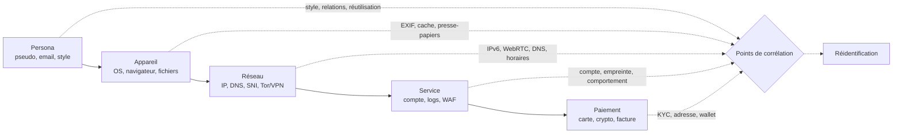

# OPSEC et anonymat — modèle de menace

L'anonymat n'est pas un logiciel que l'on installe, ni un réglage que l'on active. C'est une propriété relative : une action est anonyme si elle ne peut pas être reliée de manière fiable à une identité, compte tenu de l'adversaire, de ses moyens et du temps dont il dispose. La bonne question n'est donc pas « comment devenir anonyme ? » mais « qui cherche à me relier à quoi, avec quels moyens, et quel est le coût acceptable d'un échec ? ».

Cette note traite de l'anonymat personnel et de la non-attribution. L'OPSEC d'un engagement red team, avec son infrastructure, ses domaines, ses certificats et sa coordination client, est traitée dans [[OPSEC Red Team]]. Les deux sujets se recoupent, mais ne se confondent pas : un opérateur peut être anonyme vis-à-vis d'un site et parfaitement identifiable par son client, ou l'inverse.

> [!abstract] Définition — Anonymat
> Propriété d'une action ou d'un ensemble d'actions qui ne peuvent pas être rattachés de manière fiable à une identité, dans un contexte et face à un adversaire donnés. L'anonymat n'est ni binaire ni absolu : il dépend des observations disponibles, de la durée de l'enquête, des recoupements et de la qualité de l'hygiène opérationnelle. La non-attribution est l'objectif opérationnel consistant à rendre l'attribution plus coûteuse que l'information obtenue.

## Privacy, pseudonymat, anonymat, non-attribution

Les termes sont souvent employés comme des synonymes. Ils ne le sont pas.

| Notion | Ce qu'elle protège | Ce qu'elle ne protège pas |
|---|---|---|
| Vie privée | Le contrôle sur ses données personnelles et leur diffusion | L'identification par recoupement ou par un compte |
| Pseudonymat | Une identité stable sous un alias, séparée de l'identité réelle | La liaison entre plusieurs alias ou avec l'identité réelle |
| Anonymat | L'absence de lien fiable entre une action et une identité | Les actions ultérieures, le comportement, l'endpoint |
| Non-attribution | La capacité à mener une action sans preuve attribuable | La compromission de l'endpoint, la trahison, l'erreur humaine |
| Unlinkability | L'impossibilité de relier deux actions ou deux identités | La corrélation globale par un adversaire qui voit tout |

Un VPN améliore la vie privée face au FAI et peut rendre un site moins capable de voir l'IP réelle. Il ne rend pas anonyme face à un site qui voit un compte connecté, un paiement, un numéro de téléphone ou une empreinte de navigateur. Un alias email protège l'adresse principale, pas le fournisseur d'alias qui voit le transfert. Une VM compartimente, pas l'hôte compromis.

## Le modèle de menace

Un modèle de menace utile tient sur une page. Il ne cherche pas à couvrir tous les scénarios, mais à rendre explicites les choix et les renoncements.

| Élément | Questions à poser |
|---|---|
| Actifs | Qu'est-ce que je protège : identité, sécurité physique, source, client, famille, réputation, données ? |
| Adversaire | Qui cherche : régie publicitaire, site, employeur, FAI, enquêteur, État, concurrent, harceleur ? |
| Capacités | Que peut-il voir : réseau, endpoint, logs fournisseur, paiement, images, témoignages, données judiciaires ? |
| Durée | Combien de temps peut-il observer : quelques jours, quelques mois, plusieurs années ? |
| Conséquences | Que se passe-t-il si l'action est reliée à moi : perte d'emploi, poursuites, violence, réputation, divulgation ? |
| Contraintes | Quel niveau de commodité, de vitesse, de budget et d'accès aux services puis-je sacrifier ? |
| Juridiction | Quelles lois, obligations de rétention, coopérations internationales et sanctions s'appliquent ? |
| Critère d'arrêt | À quel signal est-ce que j'arrête, je change d'infrastructure ou je demande de l'aide ? |

Le niveau de protection doit être proportionné. Utiliser Tails, Qubes et Monero pour éviter les publicités est excessif ; utiliser un VPN et un mode navigation privée pour protéger un lanceur d'alerte est insuffisant.

| Niveau visé | Adversaire | Protection réaliste | Limite principale |
|---|---|---|---|
| Vie privée | Régies, data brokers, sites grand public | Navigateur durci, uBlock Origin, aliases, DNS chiffré, VPN | Ne cache pas l'identité si un compte ou un paiement relie |
| Pseudonymat | Site, WAF, anti-fraude, plateforme | Alias dédié, anti-fingerprint, aucun compte réel, paiement séparé | Comportement, téléphone, email de récupération, style |
| Anonymat réseau | FAI, employeur, réseau local | Tor, ou VPN avant Tor si Tor est bloqué | Endpoint, corrélation entrée/sortie, logs fournisseur |
| Non-attribution | Enquêteur motivé, forces de l'ordre | Matériel dédié, Tails/Whonix/Qubes, paiement en espèces ou Monero, compartimentation stricte | Erreur humaine, métadonnées, pression légale, physique |
| Adversaire étatique | Services de renseignement | Aucune garantie | Endpoint, supply chain, surveillance physique, SIGINT, droit |

## Ce que l'adversaire observe

L'attribution combine des indices techniques et non techniques. Les indices techniques sont l'IP, le DNS, le SNI, les en-têtes, les certificats, les domaines, les ASN, les outils, les binaires, les horaires et les artefacts. Les indices non techniques sont le pseudonyme, l'email, le téléphone, le paiement, le style d'écriture, la langue, le fuseau horaire, les relations sociales, les déplacements et les témoins.

La carte suivante résume les couches à examiner et les points où une fuite peut relier deux identités.

### Couche réseau

- **Adresse IP** : logs serveur, WebRTC, fuite DNS, IPv6, requêtes hors proxy, SMTP, P2P, mises à jour, téléchargements d'applications, notifications push.
- **DNS et SNI** : le FAI voit les résolutions et, sans ECH, le nom du site dans TLS. DoH/DoT déplace la confiance vers le résolveur, il ne cache ni l'IP de destination ni le SNI.
- **Corrélation temporelle** : un adversaire qui observe l'entrée et la sortie de Tor peut corréler les timings. Un VPN ajouté mécaniquement ne corrige pas l'endpoint ni la corrélation globale.
- **Fuite hors tunnel** : kill switch absent, split tunneling, IPv6, reconnexion VPN, portail captif, mise à jour, application qui contourne le proxy, DNS système, torrents.
- **Empreintes réseau** : TLS (JA3/JA4), HTTP/2, TCP/IP, ordre des extensions, MTU, comportement de retransmission.

### Couche navigateur

- **Fingerprinting** : résolution, polices, timezone, langue, user-agent, canvas, WebGL, AudioContext, nombre de cœurs, mémoire, extensions, taille de fenêtre, media queries, permissions, quota de stockage.
- **État persistant** : cookies, localStorage, IndexedDB, cache, service workers, favicon cache, HSTS, ETag.
- **Session connectée** : un compte Google, Microsoft, Apple ou Facebook relie immédiatement l'activité à une identité, même si l'IP est masquée.
- **JavaScript** : lecture de l'environnement, requêtes tierces, fingerprinting, fuites WebRTC. Tor Browser normalise une partie de ces signaux ; un navigateur ordinaire non.
- **Réglages** : changer les préférences de Tor Browser ou installer des extensions peut rendre l'empreinte plus unique. Il vaut mieux utiliser les niveaux de sécurité prévus que bricoler site par site.

### Couche identité

- **Pseudonyme réutilisé** : un pseudo, un avatar, une biographie, une signature ou une adresse email réutilisés relient les comptes.
- **Email et téléphone** : l'alias protège l'adresse principale, pas le fournisseur d'alias. Le numéro de téléphone est lié à une identité dans de nombreux pays et corrélé aux métadonnées télécom.
- **Comptes et fuites** : anciens forums, bases compromises, mots de passe réutilisés, questions de sécurité, appareils liés, OAuth, email de récupération, numéro de secours.
- **Infrastructure** : domaines, certificats, WHOIS, clés SSH, dépôts Git, clés PGP, analytics, favicon hash, identifiants publicitaires.
- **Style** : vocabulaire, fautes, ponctuation, langue maternelle, humour, références, formatage, code, unités, dates, devises.

### Couche humaine

- **Stylométrie** : la manière d'écrire est un signal probabiliste. Elle ne prouve pas seule une identité, mais elle peut réduire un ensemble de suspects.
- **Habitudes** : horaires, jours fériés, météo locale, actualités, sport, délais de réponse, statut en ligne, fuseau horaire.
- **Métadonnées** : EXIF, GPS, appareil, logiciel, auteur Office/PDF, révisions, commentaires, texte masqué, chemins, noms d'utilisateur, captures d'écran, notifications, barre des tâches.
- **Erreurs de compartimentation** : un like depuis le mauvais compte, un compte personnel ouvert dans la session anonyme, un même VPN ou téléphone pour deux personas, un même dossier de travail.
- **Physique et social** : caméras, badges, démarche, voix, plaques, livraisons, courrier, témoins, ingénierie sociale, proches, support client, SIM swap.

### Couche paiement et infrastructure

- **Cartes bancaires** : chaque achat relie l'identité au service, même un VPN. Les adresses de facturation, le 3-D Secure, la banque et le processeur conservent des traces.
- **Cryptomonnaies** : Bitcoin et Ethereum sont pseudonymes, pas anonymes. Les on-ramps/off-ramps KYC, les heuristiques de clusterisation, les adresses de dépôt et les logs d'exchange peuvent relier une chaîne.
- **Monero** : conçu pour la confidentialité, mais l'achat KYC, le wallet, le nœud, les montants et les timing restent des points faibles.
- **Hébergement et domaines** : WHOIS, registrar, email, paiement, certificats Certificate Transparency, ASN, factures, TVA, comptabilité.
- **Livraison** : adresse, nom, téléphone, email, transporteur, caméras, point relais, boîte aux lettres.

## Les modèles de confiance réseau

Il n'existe pas de « meilleur ordre » universel entre VPN et Tor. Chaque combinaison déplace la confiance et crée des observateurs différents.

| Modèle | Ce qu'il cache | Ce qu'il expose | Usage typique | Limite |
|---|---|---|---|---|
| Tor seul | L'IP réelle au site ; le FAI voit Tor | Le FAI voit l'usage de Tor ; le nœud d'entrée voit l'IP ; la sortie voit le trafic non chiffré | Anonymat réseau par défaut | Corrélation entrée/sortie, endpoint, sites bloquant Tor |
| VPN seul | L'IP réelle au site ; le FAI voit le VPN | Le VPN voit l'IP et les métadonnées ; le site voit le VPN | Vie privée face au FAI, accès à un service | Le fournisseur VPN devient la confiance |
| VPN avant Tor | L'usage de Tor au FAI ; l'IP réelle au nœud d'entrée | Le VPN voit l'usage de Tor ; le nœud d'entrée voit le VPN | Tor bloqué, besoin de masquer Tor au FAI | Confiance dans le VPN, compte, paiement, latence, corrélation |
| Tor avant VPN | L'IP réelle au VPN ; la sortie Tor voit le VPN | Le VPN voit le trafic final ; la sortie Tor voit le VPN | Protéger d'une sortie Tor curieuse si le VPN est de confiance | Configuration fragile, fuites, VPN devient la sortie |
| Tails | Session amnésique, trafic applicatif via Tor | Matériel, firmware, persistence mal utilisée | Opération ponctuelle à haut risque | Pas de protection contre un firmware compromis |
| Whonix / Qubes | Isolation et forçage Tor par VM | Hôte, dom0, périphériques, mauvaise configuration | Compartimentation durable | Complexité, host compromise, fuites de bureau |
| Mullvad Browser + VPN | Empreinte navigateur normalisée, IP masquée par le VPN | Le VPN voit l'IP ; le site voit le VPN | Pseudonymat web sans Tor | Ne masque pas l'IP à lui seul, pas de garantie face à l'État |
| GrapheneOS + SIM dédiée | Durcissement mobile, permissions, profils | Opérateur, localisation, baseband, paiement | Téléphone à risque | Les métadonnées télécom restent |

Pour la plupart des usages, **Tor seul** est le choix le plus simple et celui qui a la plus petite surface de confiance. **VPN avant Tor** est un outil pour un besoin précis : masquer l'usage de Tor au FAI ou contourner un blocage. **Tor avant VPN** n'est pas une recommandation par défaut : il est difficile à configurer sans fuite, et le VPN voit le trafic final.

## Stacks par objectif

### A. Vie privée quotidienne

Navigateur durci, uBlock Origin, aliases email, gestionnaire de mots de passe, mises à jour, DNS chiffré, VPN de confiance. Cette stack réduit le pistage et les fuites ordinaires. Elle ne rend pas anonyme et ne doit pas être présentée comme telle.

### B. Pseudonymat face à un site

Mullvad Browser avec VPN, ou Tor Browser. Alias email dédié, aucun compte réel, aucun paiement personnel, aucune photo réutilisée, aucun téléphone personnel. Nettoyage des métadonnées avant toute publication. Tests de fuite à chaque session. Cette stack protège contre un site isolé, pas contre un adversaire qui recoupe plusieurs sites.

### C. Non-attribution forte

Matériel dédié ou neuf, OS propre, Tails ou Whonix/Qubes, Tor avec bridges si nécessaire, persona complet séparé, paiement en espèces ou Monero, messagerie SimpleX/Session/Briar, téléphone absent ou en faraday, journal chiffré hors ligne, tests à froid. Cette stack réduit la surface, mais ne garantit rien contre un endpoint compromis, une erreur humaine ou un adversaire étatique.

### D. Téléphone

GrapheneOS ou appareil durci, SIM ou eSIM séparée, aucun compte personnel, permissions minimales, pas de synchronisation cloud, désactivation des radios inutilisées, chiffrement, attention aux métadonnées de localisation. Un téléphone, même durci, reste un traceur de localisation et un point d'attribution.

### E. Red team autorisé

L'objectif n'est pas de disparaître, mais d'être **attribuable au contrat** sans l'être à l'opérateur. Infrastructure dédiée, IP de source approuvées par le client, comptes de test, coordination avec le SOC, journalisation, nettoyage. Tor ou VPN seulement si le client l'autorise et si cela ne l'empêche pas de corréler le test. Voir [[OPSEC Red Team]] et [[Test d'intrusion web — cadre et ROE]].

## Compartimentation

Une persona n'est pas un pseudo. C'est un ensemble cohérent et étanche : un pseudo, une adresse email, un alias, un téléphone, un appareil ou une VM, un profil de navigateur, un réseau, un moyen de paiement, un wallet, un style d'écriture, un fuseau horaire, une infrastructure et un graphe social.

Les règles qui tiennent dans le temps :

- Un profil de navigateur ou une VM par persona, pas une simple fenêtre.
- Aucun compte personnel dans une session pseudonyme.
- Aucun téléphone personnel à proximité pendant une opération sensible.
- Aucun clone de VM d'un engagement à l'autre : une VM contient l'historique, les favoris, les fichiers temporaires et parfois des secrets oubliés.
- Aucun domaine, certificat, analytics ID, favicon hash, clé SSH, wallet ou alias partagé entre deux personas.
- Un gestionnaire de secrets par périmètre, avec des mots de passe uniques et des codes de récupération hors ligne.
- Aucun transfert de fichier par cloud personnel, presse-papiers partagé ou dossier synchronisé.
- Aucune réutilisation de photo, bio, bannière, signature, emoji ou formulation rare.
- Aucun croisement de contacts, de réseaux sociaux ou de moyens de paiement.

## Discipline opérationnelle

La technique ne compense pas l'indiscipline. Les points suivants sont plus importants que le choix d'un outil.

1. **Écrire le modèle de menace** avant l'opération, avec les critères d'arrêt.
2. **Vérifier le cadre légal et contractuel** : autorisation, périmètre, données, juridiction.
3. **Dédier le matériel** : machine ou VM séparée, OS propre, disque chiffré, secure boot, mot de passe BIOS, radios inutilisées désactivées.
4. **Vérifier les téléchargements** : signatures, checksums, versions pinnées, dépôts officiels.
5. **Tester les fuites** avant et après chaque changement : IP, DNS, WebRTC, IPv6, kill switch, Tor, email, torrent.
6. **Utiliser un gestionnaire de mots de passe** et une authentification forte, avec des codes de récupération hors ligne.
7. **Créer des aliases uniques**, sans domaine personnel, et vérifier les en-têtes des messages.
8. **Nettoyer les métadonnées** avec `mat2` ou `exiftool`, puis vérifier le résultat avant publication.
9. **Éloigner le téléphone personnel** : autre pièce, faraday, ou extinction contrôlée. Un téléphone allumé à côté peut suffire à corréler.
10. **Éviter les synchronisations** : cloud, presse-papiers, captures d'écran, notifications, historique de navigation.
11. **Tenir un journal minimal** chiffré et hors ligne, séparé de la machine d'opération, puis le détruire.
12. **Faire une rotation basée sur le risque**, pas sur un calendrier. Changer de persona ou de nœud sans raison crée des anomalies et des points de corrélation.
13. **Garder un style cohérent** sans traits rares. Les outils de traduction ou les LLM peuvent introduire leurs propres artefacts.
14. **Faire un dry run** et une revue par un pair avant l'opération réelle.
15. **Préparer un plan de compromission** : arrêt, préservation, rotation, notification, assistance juridique.

## Cas documentés et limites

Les affaires célèbres sont utiles à condition de ne pas les réduire à une morale simple. Les détails exacts doivent être vérifiés dans les sources primaires et les documents judiciaires.

- **Ross Ulbricht (Silk Road)** : l'enquête a combiné des traces publiques, un pseudonyme réutilisé, des erreurs de compartimentation et la saisie de son ordinateur en cours de session. La leçon robuste est que la contamination entre identités est plus dangereuse que Tor.
- **Sabu / LulzSec** : l'arrestation a reposé sur un faisceau de traces de connexion, d'erreurs OPSEC et de coopération. La réduire à « le FAI l'a identifié » appauvrit l'analyse.
- **Corrélation Tor** : des travaux et des affaires ont montré qu'un adversaire qui observe l'entrée et la sortie peut corréler le trafic. Un VPN ajouté mécaniquement ne corrige ni l'endpoint ni la corrélation globale.
- **VPN « no-logs »** : plusieurs affaires ont montré qu'un fournisseur peut détenir ou fournir des données malgré ses promesses. Un audit indépendant est une photo à un instant donné, pas une garantie perpétuelle.
- **Métadonnées** : des photos, PDF, captures d'écran et documents ont révélé des identités, des lieux ou des logiciels. Le nettoyage doit être vérifié, pas supposé.
- **Chaîne d'analyse** : les on-ramps/off-ramps KYC, les adresses de dépôt et les heuristiques de clusterisation relient souvent les transactions. Monero réduit la surface, il ne garantit pas l'anonymat.
- **Stylométrie** : l'affaire Unabomber est souvent citée, mais la reconnaissance par un proche et l'analyse linguistique ont joué un rôle. La stylométrie est un indice, pas une preuve déterministe.

## Cadre juridique et éthique

Ce document n'est pas un avis juridique. En France, l'anonymat n'est pas interdit en soi, mais il n'est pas un droit absolu et il ne crée aucune immunité. Les infractions sont définies par les actes, pas par l'outil utilisé.

Les atteintes aux systèmes de traitement automatisé de données sont réprimées par les articles 323-1 et suivants du Code pénal. Les circonstances aggravantes et les peines applicables doivent être vérifiées article par article avec un juriste : il ne faut pas publier une formule générale sur l'« usage de moyens d'anonymisation » sans cette vérification. Pour les lanceurs d'alerte, les textes pertinents incluent la loi Waserman (2022) et la directive (UE) 2019/1937, ainsi que le rôle du Défenseur des droits ; la loi Sapin II ne suffit pas à fonder une analyse générale.

Le RGPD, les obligations sectorielles, le droit du travail, le secret professionnel, les sanctions, le droit fiscal et le contrat s'appliquent indépendamment de l'anonymat. Dans un red team, l'autorisation écrite, le périmètre, les règles d'engagement et la coordination avec le client priment sur toute considération d'anonymat. L'anonymat peut protéger un journaliste, un lanceur d'alerte ou une victime ; il ne protège pas un acte illégal.

## Limites

Aucune stack ne protège contre un endpoint compromis, un firmware malveillant, une supply chain d'outils, une pression légale, une surveillance physique, une erreur humaine ou un adversaire qui observe le réseau assez longtemps. Un adversaire qui contrôle la machine voit tout, même Tor. Un adversaire qui contrôle le fournisseur voit les métadonnées, même sans logs de contenu. Un adversaire qui contrôle le temps et le style peut réduire un ensemble de suspects sans jamais casser un chiffrement.

La bonne attitude est de supposer que quelque chose fuit, de réduire la gravité de cette fuite, et de préparer une réponse. L'anonymat est une discipline de gestion du risque, pas une promesse d'invisibilité.

## Checklist

- [ ] Modèle de menace écrit, avec adversaire, actifs, conséquences et critère d'arrêt.
- [ ] Cadre légal et contractuel vérifié.
- [ ] Matériel ou VM dédié, OS propre, disque chiffré.
- [ ] Tor ou VPN choisi en fonction du modèle de menace, pas par défaut.
- [ ] Tests de fuite IP, DNS, WebRTC, IPv6, kill switch, Tor.
- [ ] Alias email unique, sans lien avec l'identité réelle.
- [ ] Gestionnaire de mots de passe, mots de passe uniques, 2FA forte.
- [ ] Aucun compte personnel dans la session pseudonyme.
- [ ] Métadonnées nettoyées et vérifiées.
- [ ] Paiement séparé, sans carte nominative.
- [ ] Téléphone personnel éloigné ou en faraday.
- [ ] Journal chiffré, hors ligne, séparé.
- [ ] Dry run et revue par un pair.
- [ ] Plan de compromission et de sortie.
- [ ] Nettoyage et destruction des données après l'opération.

## Questions de révision

> [!quiz] Un VPN suffit-il à rendre une action anonyme ?
> Non. Il déplace la confiance vers le fournisseur et masque l'IP réelle au site, mais le site peut encore relier l'action à un compte, un paiement, un téléphone, une empreinte de navigateur ou un comportement. Le VPN est un outil de vie privée ou de réduction de surface, pas une garantie d'anonymat.

> [!quiz] Pourquoi Tor seul est-il souvent préférable à VPN avant Tor ?
> Parce qu'il réduit le nombre de parties de confiance : pas de compte VPN, pas de paiement, pas de fournisseur supplémentaire à croire ou à compromettre. Le VPN avant Tor peut être utile pour masquer l'usage de Tor au FAI ou contourner un blocage, mais il ajoute une relation de confiance et des métadonnées.

> [!quiz] Pourquoi changer de persona régulièrement peut-il être contre-productif ?
> Parce que la rotation crée de nouvelles infrastructures, de nouveaux paiements et de nouveaux comportements qui peuvent être corrélés, tout en détruisant l'historique qui rend une persona crédible. La rotation doit être basée sur le risque et documentée, pas appliquée comme un calendrier.

> [!quiz] Pourquoi un audit « no-logs » ne garantit-il pas l'anonymat ?
> Parce qu'un audit est une photographie à un instant donné, que la juridiction et les obligations légales peuvent contraindre le fournisseur, et que les logs peuvent exister ailleurs : paiement, email, support, CDN, endpoint. La confiance dans un fournisseur ne remplace pas la compartimentation.

> [!quiz] Quel est le risque d'un téléphone personnel allumé à côté de la machine d'opération ?
> Il peut corréler l'opération par la cellule, le Wi-Fi, le Bluetooth, les notifications, les métadonnées de localisation ou les interactions avec d'autres appareils. Le téléphone doit être éloigné, éteint ou placé dans une poche faraday, et jamais utilisé pour un compte de la persona.
