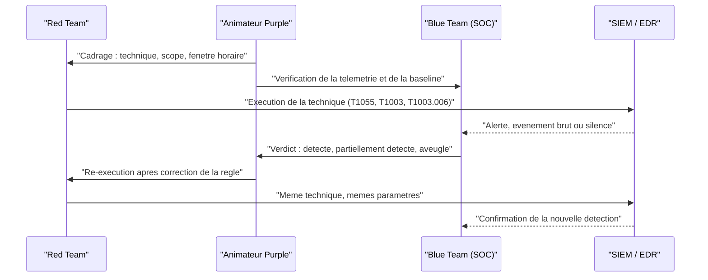

# Purple Teaming

Le Purple Teaming est une approche collaborative de la sécurité offensive et défensive. Contrairement au modèle classique où la Red Team attaque en secret et la Blue Team défend sans savoir, le Purple Teaming fait travailler les deux équipes **ensemble** pour maximiser l'amélioration des défenses.

## Red, Blue, Purple

| Equipe | Role | Objectif |
|---|---|---|
| **Red Team** | Simuler un adversaire réaliste | Trouver des chemins d'attaque exploitables |
| **Blue Team** | Détecter, contenir, répondre | Protéger l'organisation contre les menaces |
| **Purple Team** | Coordination Red + Blue | Maximiser la couverture de détection |

Le Purple Team n'est pas une troisième équipe permanente : c'est un **mode de fonctionnement** où Red et Blue collaborent en temps réel. La Red Team exécute une technique, la Blue Team vérifie si elle la détecte, et les deux ajustent ensemble.

## Pourquoi le Purple Teaming existe

Le modèle traditionnel Red vs Blue souffre de plusieurs problèmes :

- La Red Team trouve des vulnérabilités, rédige un rapport, puis passe à autre chose. La Blue Team reçoit le rapport des semaines plus tard et doit deviner comment reproduire les attaques.
- Les résultats du pentest ne se traduisent pas toujours en **améliorations de détection concrètes**.
- La Red Team optimise pour "réussir l'attaque", pas pour "améliorer la défense". Elle évite les techniques bruyantes, alors que la Blue Team a justement besoin de les voir pour calibrer ses alertes.
- Sans feedback loop, les mêmes failles réapparaissent d'un exercice à l'autre.

Le Purple Teaming résout ces problèmes en créant une **boucle de feedback immédiate** : attaque, observation, correction, re-test.

> [!important] Idée clé
> Le vrai changement n'est pas la collaboration en elle-même mais l'inversion de l'objectif de la Red Team : en mode Purple, elle n'essaie plus de rester furtive pour "gagner", elle cherche activement les techniques bruyantes et documentées — c'est justement ce que la Blue Team a besoin de voir pour calibrer ses règles. Un Red Team classique qui évite le bruit optimise pour le mauvais objectif du point de vue de la détection.

## Déroulement d'un exercice Purple Team

### 1. Planification

Choisir les techniques à tester, typiquement à partir de :

- **MITRE ATT&CK** : sélectionner des techniques par tactique (Initial Access, Execution, Persistence, etc.)
- **Threat intelligence** : quelles techniques utilisent les groupes qui ciblent notre secteur ?
- **Résultats du dernier pentest** : les techniques qui ont fonctionné sans être détectées
- **Nouveaux outils déployés** : valider qu'un nouvel EDR détecte bien ce qu'il promet

### 2. Exécution (cycle par technique)

Pour chaque technique MITRE ATT&CK sélectionnée :

```
Red Team exécute la technique
        |
        v
Blue Team observe en temps réel (SIEM, EDR, logs)
        |
        v
   Détecté ?
   /        \
  OUI        NON
  |           |
  v           v
Valider    Analyser pourquoi :
la règle   - Logs absents ?
           - Règle manquante ?
           - Seuil trop haut ?
           |
           v
        Créer ou corriger
        la détection
           |
           v
        Red Team re-exécute
        pour valider
```

### 3. Documentation

Chaque technique testée produit une fiche :

| Champ | Contenu |
|---|---|
| Technique MITRE | ID + nom (ex: T1059.001 — PowerShell) |
| Outil utilisé | Atomic Red Team, Cobalt Strike, manuel |
| Commande exécutée | Commande exacte ou procédure |
| Résultat initial | Détecté / Partiellement / Non détecté |
| Source de logs | Sysmon Event ID, EDR, etc. |
| Règle créée/modifiée | Sigma rule, requête SIEM |
| Résultat après correction | Détecté avec la nouvelle règle |

## Frameworks et outils

### MITRE ATT&CK comme base

ATT&CK est le langage commun du Purple Teaming. La matrice permet de :

- **Cartographier la couverture** : pour chaque technique, est-ce qu'on a une détection ?
- **Prioriser** : couvrir d'abord les techniques les plus utilisées par les adversaires de notre secteur
- **Mesurer la progression** : comparer la couverture avant/après l'exercice

L'outil **ATT&CK Navigator** permet de visualiser la couverture sous forme de heatmap colorée.

### Atomic Red Team

Framework open-source de Red Canary. Fournit des **tests unitaires d'attaque** pour chaque technique MITRE ATT&CK :

```bash
# Installer
git clone https://github.com/redcanaryco/atomic-red-team.git

# Avec le module PowerShell Invoke-AtomicRedTeam
Install-Module -Name invoke-atomicredteam

# Lister les tests pour une technique
Invoke-AtomicTest T1059.001 -ShowDetailsBrief

# Exécuter un test spécifique
Invoke-AtomicTest T1059.001 -TestNumbers 1

# Nettoyer après le test
Invoke-AtomicTest T1059.001 -TestNumbers 1 -Cleanup
```

Chaque test atomique contient : la commande d'attaque, les prérequis, la procédure de nettoyage, et les IOCs attendus.

### Autres outils de simulation

| Outil | Type | Usage |
|---|---|---|
| **Atomic Red Team** | Open-source | Tests unitaires par technique ATT&CK |
| **Caldera** (MITRE) | Open-source | Plateforme d'émulation d'adversaire automatisée |
| **Infection Monkey** (Akamai) | Open-source | Simulation de mouvement latéral automatique |
| **Cobalt Strike** | Commercial | C2 framework complet (utilisé aussi par les vrais attaquants) |
| **Sliver** | Open-source | C2 framework alternatif à Cobalt Strike |
| **SafeBreach** | Commercial (BAS) | Breach and Attack Simulation continue |
| **AttackIQ** | Commercial (BAS) | Validation de sécurité automatisée |

### Du côté défensif

| Outil | Role |
|---|---|
| **Sigma** | Règles de détection portables (SIEM-agnostic) |
| **Elastic Detection Rules** | Règles prêtes à l'emploi pour Elastic SIEM |
| **Splunk Security Content** | Détections pour Splunk |
| **ATT&CK Navigator** | Visualisation de la couverture |
| **DeTT&CT** | Framework pour mapper données + détections sur ATT&CK |

## Detection Engineering dans le Purple Team

Le résultat principal d'un exercice Purple Team est la **création ou amélioration de règles de détection**. C'est le pont entre l'attaque observée et la défense opérationnelle.

### Processus par technique

1. **Identifier les artefacts** : quels logs, événements, ou traces l'attaque produit-elle ?
2. **Vérifier la collecte** : ces logs sont-ils collectés dans le SIEM ? Avec le bon niveau de détail ?
3. **Ecrire la règle** : en Sigma (portable) ou directement dans le SIEM
4. **Tester** : la Red Team re-exécute, la règle se déclenche-t-elle ?
5. **Réduire les faux positifs** : ajuster les seuils et exclusions sur l'environnement réel

### Exemple : détecter un DCSync

La Red Team exécute un DCSync (T1003.006) avec Mimikatz :

```
mimikatz # lsadump::dcsync /domain:corp.local /user:krbtgt
```

Artefacts générés :
- Event ID 4662 : accès à l'objet AD avec droits de réplication (DS-Replication-Get-Changes)
- Trafic DRS (Directory Replication Service) depuis une machine qui n'est pas un DC

Règle Sigma :

```yaml
title: DCSync Activity
logsource:
    product: windows
    service: security
detection:
    selection:
        EventID: 4662
        Properties|contains:
            - '1131f6aa-9c07-11d1-f79f-00c04fc2dcd2'  # DS-Replication-Get-Changes
            - '1131f6ad-9c07-11d1-f79f-00c04fc2dcd2'  # DS-Replication-Get-Changes-All
    filter:
        SubjectUserName|endswith: '$'
        SubjectUserName|contains: 'DC'
    condition: selection and not filter
level: critical
```

> [!warning] Piège
> Le `filter` qui exclut les comptes machine des DC (`endswith '$'` + `contains 'DC'`) est indispensable pour éviter le bruit de la réplication légitime, mais c'est aussi le point exact qu'un attaquant peut viser pour passer inaperçu — un compte machine compromis avec un nom contenant "DC" contournerait cette règle. Tester spécifiquement ce cas lors du cycle Purple Team (Red Team simule depuis un compte nommé pour matcher le filtre) fait partie de la validation, pas seulement le test du cas nominal.

## Mesurer la couverture

### Métriques utiles

| Métrique | Description |
|---|---|
| **Couverture ATT&CK** | % de techniques avec au moins une détection |
| **Taux de détection initial** | % de techniques détectées avant correction |
| **Taux de détection final** | % de techniques détectées après correction |
| **MTTD** (Mean Time To Detect) | Temps moyen entre l'exécution et l'alerte |
| **Visibilité par data source** | Quelles sources de logs couvrent quelles techniques |
| **Gap analysis** | Techniques sans aucune visibilité (pas de log collecté) |

### Niveaux de maturité de détection

Pour chaque technique, évaluer le niveau :

| Niveau | Description |
|---|---|
| 0 — Aucun | Pas de visibilité, pas de log |
| 1 — Minimal | Logs collectés mais pas de règle |
| 2 — Procédural | Règle qui détecte un outil spécifique (ex: Mimikatz par hash) |
| 3 — Comportemental | Règle qui détecte le comportement sous-jacent (ex: DRS request depuis un non-DC) |
| 4 — Avancé | Détection résistante à l'évasion, corrélation multi-sources, ML |

L'objectif est de monter au niveau 3 minimum sur les techniques prioritaires. Le niveau 2 (signature d'outil) est fragile : l'attaquant change d'outil et la détection saute.

## Fréquence et intégration

Le Purple Teaming est plus efficace en **continu** qu'en exercice ponctuel :

- **Mensuel** : tester 5-10 techniques ciblées (rotation par tactique ATT&CK)
- **Après chaque changement** : nouveau SIEM, nouvel EDR, migration cloud — re-valider les détections
- **Après chaque incident** : les techniques utilisées par l'attaquant réel deviennent prioritaires
- **BAS continu** : les plateformes comme SafeBreach ou AttackIQ exécutent des simulations en permanence et alertent si une détection régresse

## Atelier de validation

Un **atelier de validation** est le format opérationnel du Purple Teaming : une session courte, préparée, pendant laquelle une liste finie de techniques est exécutée, observée et instrumentée, technique par technique. Il se distingue de l'exercice ponctuel par sa répétabilité : mêmes prérequis, même grille de résultat, mêmes métriques, pour pouvoir comparer deux sessions. Il s'inscrit en aval d'un plan structuré comme celui décrit dans [[Adversary Emulation]], qui définit l'acteur émulé, les TTPs prioritaires et les règles d'engagement ; l'atelier n'est que la phase d'exécution contrôlée de ce plan.

L'objectif n'est jamais de « voir si l'équipe bleue se fait avoir ». Chaque technique est annoncée à l'équipe bleue, exécutée avec des paramètres connus, et le résultat attendu est une preuve de détection ou une preuve d'absence de visibilité. Un atelier qui ne produit aucune règle créée ou corrigée est un atelier raté, quelle que soit la qualité des attaques.

### Préparation

| Prérequis | Détail | Responsable |
|---|---|---|
| Périmètre écrit | Hôtes, comptes, segments réseau concernés et exclus | Animateur |
| Règles d'engagement | Techniques autorisées, horaires, procédure d'arrêt | Direction et animateur |
| Fenêtre horaire | Créneau où la charge de tests ne perturbe pas la production | SOC |
| Environnement de test | Réplique de la production, snapshots, restauration testée | Équipe infrastructure |
| Télémétrie vérifiée | Chaque source attendue émet réellement avant l'atelier | Blue Team |
| Payloads préparés | Artefacts catalogués, hashés, nettoyage documenté | Red Team |
| Canal hors bande | Communication vocale ou messagerie hors de l'infrastructure testée | Tous |

La vérification préalable de la télémétrie est le point le plus souvent négligé. Tester une technique sur une source de logs éteinte produit une conclusion fausse : « non détecté » alors que la vraie conclusion est « non observé ». La baseline doit être établie avant l'exécution, avec une technique bénigne témoin.

### Déroulé



| Phase | Contenu | Sortie attendue |
|---|---|---|
| 0 — Cadrage | Choix des techniques, ordre, critères de succès | Liste ordonnée et chronométrée |
| 1 — Baseline | Technique témoin, vérification des sources | Preuve que chaque capteur fonctionne |
| 2 — Exécution | Technique réelle avec paramètres documentés | Horodatage précis de chaque action |
| 3 — Observation | Lecture en temps réel par le SOC, sans indice | Verdict initial et délai de détection |
| 4 — Analyse | Cause de l'échec : pas de log, pas de règle, règle inefficace | Diagnostic écrit |
| 5 — Correction | Écriture ou ajustement de la règle | Règle versionnée, testée |
| 6 — Re-test | Réexécution à l'identique | Détection confirmée et horodatée |
| 7 — Restitution | Fiche technique, métriques, backlog | Rapport et tickets de remédiation |

### Mapping ATT&CK et couverture par capteur

Le choix des techniques ne doit pas se limiter à celles qui sont faciles à détecter. Un bon atelier couvre au moins une technique par famille de capteur, pour éprouver chaque couche séparément.

| Famille | Technique type | Capteur sollicité | Détail dans le vault |
|---|---|---|---|
| Injection mémoire | T1055, T1055.012 | Télémétrie mémoire, scan de régions | [[Détection mémoire des injections]] |
| Évasion EDR | T1562.001, T1014 | Intégrité de l'agent, pilotes | [[EDR internals]] |
| Exécution de fichiers | T1204.002, T1059.001 | Motifs statiques, capacités | [[YARA et CAPA]] |
| Accès aux identifiants | T1003.001, T1003.006 | Handles, journaux annuaire | [[Mimikatz]], [[Kerberos Attacks]] |
| Persistance | T1547.001, T1053.005 | Registre, tâches planifiées | [[Detection Engineering]] |
| Mouvement latéral | T1021.002, T1047 | Journaux d'authentification, services | [[Lateral Movement]] |
| Exécution détournée | T1218, T1105 | Lignée de processus, ligne de commande | [[LOLBAS et GTFOBins]] |

Deux techniques méritent un traitement particulier parce qu'elles attaquent la capacité d'observation elle-même. T1562.001 (désactivation d'outils de sécurité) doit être testée avec un pilote ou une tentative d'arrêt de service, et la conclusion attendue est une alerte de tampering, pas une alerte d'exécution. T1014 (rootkit) doit être testée en vérifiant que l'agent détecte encore quelque chose après l'installation d'un pilote noyau.

### Métriques

| Métrique | Définition | Lecture |
|---|---|---|
| Taux de détection initial | Techniques détectées avant toute correction | Mesure l'état réel, pas l'intention |
| Taux de détection final | Techniques détectées après correction | Mesure la capacité de progression |
| MTTD | Délai entre exécution et alerte | Mesure l'exploitabilité de la détection |
| Faux positifs induits | Alertes générées sur le parc pendant la fenêtre | Mesure le coût opérationnel |
| Règles créées ou corrigées | Nombre de règles versionnées en sortie | Mesure la productivité de l'atelier |
| Techniques aveugles | Techniques sans aucune source de log | Mesure la dette de collecte |
| Temps par technique | Durée moyenne d'un cycle complet | Mesure la scalabilité du format |

Ces métriques complètent celles de la section « Mesurer la couverture ». La distinction essentielle est entre une détection existante mais jamais éprouvée et une détection validée par un test horodaté : seule la seconde compte comme couverture réelle.

> [!abstract] Définition — Atelier de validation
> Session planifiée et chronométrée au cours de laquelle une liste finie de techniques ATT&CK est exécutée par une équipe offensive avec l'accord de l'équipe défensive, celle-ci observant en temps réel pour produire un verdict de détection, puis corriger les règles et re-tester. La sortie mesurable est un ensemble de règles créées ou corrigées et un délai de détection, pas un score d'attaque.

### Sécurité de l'atelier

Un atelier de validation exécute du code offensif réel : les précautions ne sont pas optionnelles.

- **Isolation par défaut.** Les techniques destructrices (chiffrement, suppression de comptes, altération de l'annuaire) s'exécutent sur un environnement dédié ou une réplique, jamais sur la production sans validation explicite.
- **Point d'arrêt explicite.** Une personne désignée, extérieure à l'exécution, peut ordonner l'arrêt immédiat ; le mot de passe d'arrêt est connu de tous les participants avant la première technique.
- **Nettoyage documenté.** Chaque artefact — fichier déposé, clé de registre, compte créé, service installé, tâche planifiée — fait l'objet d'une commande de suppression vérifiée.
- **Pas de secrets réels.** Les techniques d'accès aux identifiants utilisent des comptes de test ; aucun mot de passe de production n'est manipulé ni capturé.
- **Journalisation conservée.** Les preuves produites pendant l'atelier sont conservées pour la non-régression ; elles servent de corpus de test pour [[YARA et CAPA]] et pour les règles Sigma.
- **Exclusions cadrées.** Si l'agent de sécurité doit être partiellement mis en retrait pour tester une technique, l'exclusion est limitée dans le temps, documentée, et retirée à la fin de la fenêtre.

> [!quiz] Pourquoi un atelier de validation commence-t-il par une technique témoin bénigne ?
> Pour prouver que la télémétrie fonctionne avant de conclure sur une technique offensive. Sans cette baseline, un résultat « non détecté » ne distingue pas une absence de règle d'une absence de collecte. La technique témoin transforme un silence ambigu en information exploitable.

> [!quiz] Quelle est la différence entre le taux de détection initial et le taux de détection final ?
> Le taux initial mesure les techniques détectées avant toute correction : c'est l'état réel des défenses au moment du test. Le taux final mesure celles détectées après ajustement des règles. Un grand écart entre les deux indique une capacité de réaction défensive forte mais un niveau de départ faible — souvent le signe d'une couverture non validée.

> [!quiz] Pourquoi une technique qui « ne produit rien » dans le SIEM n'est-elle pas nécessairement une technique mal choisie ?
> Parce que l'absence de résultat peut venir d'une source de logs non collectée, d'une rétention trop courte, d'un filtre d'ingestion ou d'un agent sain mais aveugle sur cette couche. Le diagnostic doit distinguer l'absence de visibilité de l'absence de règle : ce sont deux dettes différentes, avec deux remédiations différentes.

> [!quiz] En quoi T1562.001 change-t-elle la nature de la validation par rapport à une technique d'exécution classique ?
> Elle ne cherche pas à produire un effet métier mais à supprimer la capacité d'observation de la défense. Le critère de succès de l'atelier s'inverse : une alerte d'exécution est peu informative, l'absence d'alerte de tampering est un échec critique.

## Références

- **MITRE ATT&CK** (`attack.mitre.org`) — matrice des techniques adverses
- **Atomic Red Team** (`github.com/redcanaryco/atomic-red-team`) — tests d'attaque par technique
- **MITRE Caldera** (`caldera.mitre.org`) — émulation d'adversaire automatisée
- **Sigma** (`github.com/SigmaHQ/sigma`) — règles de détection portables
- **DeTT&CT** (`github.com/rabobank-cdc/DeTTECT`) — cartographie données/détections sur ATT&CK
