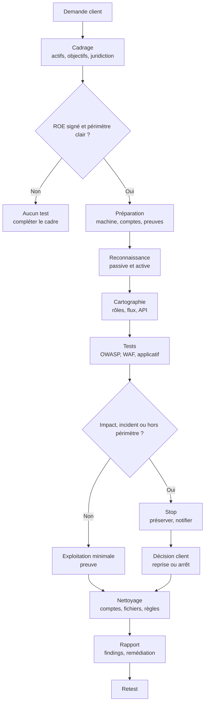

# Test d'intrusion web — cadre et ROE

Un test d'intrusion web n'est pas une campagne de scans lancée contre un domaine. C'est une opération autorisée, bornée et documentée, dont l'objectif est de produire des preuves exploitables et des recommandations proportionnées. La technique vient après le cadre : sans règles d'engagement écrites, une requête HTTP un peu agressive est juridiquement indiscernable d'une attaque, même si l'intention est bonne.

Cette note décrit le cadre générique d'un test web et les règles d'engagement (Rules of Engagement, ROE). Le plan opérationnel pour une cible Nginx/Alpine/Tailwind est dans [[Audit Nginx et front-end — plan actif]]. La démarche générale, du cadrage au rapport, reste [[Pentest Methodology]] ; le format de restitution est détaillé dans [[Rapport de Pentest]].

> [!abstract] Définition — Rules of Engagement
> Document signé qui définit qui autorise le test, ce qui est dans le périmètre, ce qui est interdit, quand et comment les tests peuvent être menés, quelles données peuvent être manipulées, qui contacter en cas d'incident et ce qui doit être livré. Le ROE n'est pas une annexe contractuelle : c'est la condition d'existence légale et opérationnelle de l'engagement.

Le flux de décision suivant place les deux gates qui ne doivent jamais être sautés : le ROE signé et l'arrêt sur impact ou découverte hors périmètre.

## Pentest, audit, red team, bug bounty

Les activités sont souvent confondues parce qu'elles utilisent des outils similaires. Leur cadre et leur profondeur diffèrent.

| Activité | Objectif | Profondeur | Cadre typique |
|---|---|---|---|
| Audit de configuration | Vérifier une baseline | Ponctuel, souvent automatisé | Revue de référentiel, sans exploitation |
| Test de vulnérabilités | Identifier et prioriser des faiblesses | Large, peu profond | Scan authentifié ou non, validation limitée |
| Test d'intrusion | Prouver l'exploitabilité et l'impact | Large et profond, avec exploitation contrôlée | ROE, fenêtre, comptes de test, rapport |
| Red team | Mesurer la détection et la réponse | Scénario adversarial, parfois furtif | ROE spécifique, coordination SOC, règles d'arrêt |
| Bug bounty | Trouver des vulnérabilités dans un programme public | Variable, dépend du chercheur | Politique du programme, safe harbor, hors scope |

Un test web peut inclure des éléments de red team, mais il ne doit pas devenir furtif sans coordination : un SOC qui n'est pas prévenu peut prendre une intrusion simulée pour un incident réel, isoler un serveur ou déclencher une crise. La furtivité est une décision du client, pas une préférence de l'opérateur.

## Les blocs d'un ROE

Un ROE utile est court, précis et testable. Les formulations vagues comme « ne pas impacter la production » sont inutilisables : presque toute requête impacte la production.

| Bloc | Contenu attendu | Question à trancher |
|---|---|---|
| Parties | Entités juridiques, signataires, rôles, suppléants | Qui peut autoriser, arrêter ou élargir le périmètre ? |
| Autorisation | Lettre d'engagement, contrat, NDA, assurance | Quelle preuve l'opérateur peut-il montrer à un administrateur ? |
| Périmètre | Domaines, sous-domaines, IP, applications, API, environnements | Qu'est-ce qui est explicitement exclu ? |
| Objectifs | Questions de sécurité, scénarios, criticité | Qu'est-ce qui compte comme succès ? |
| Fenêtre | Dates, heures, fuseau horaire, blackouts | Quand le test est-il autorisé ? |
| Limites techniques | Débit, concurrence, taille de payload, nombre de requêtes | Quel volume maximal est accepté ? |
| Comptes | Comptes de test, rôles, données synthétiques | Peut-on créer des comptes ou élever des privilèges ? |
| Techniques interdites | DoS, phishing, malware, persistance, exfiltration | Quelles techniques nécessitent un avenant ? |
| Données | PII, secrets, production, rétention, chiffrement, destruction | Que fait-on des données trouvées par accident ? |
| Communication | Contacts, canal, fréquence, alertes critiques | Qui prévenir, quand, et par quel canal ? |
| Arrêt | Conditions d'arrêt immédiat, procédure d'urgence | Qui peut dire stop, et comment ? |
| Livrables | Rapport, preuves, débrief, retest | Quel format, quelle langue, quelle échéance ? |

Le ROE doit être daté et versionné. Un élargissement de périmètre par email doit être explicite, attribuable à un signataire autorisé, et annexé au document principal.

## Délimiter le périmètre

Le périmètre web est plus difficile à délimiter qu'une plage d'IP. Un domaine peut pointer vers un CDN, un WAF, un origine cloud, un SaaS ou un sous-traitant. Un sous-domaine peut appartenir à une autre entité juridique. Une API peut être consommée par des partenaires.

| Dans le périmètre | Hors périmètre par défaut | À clarifier par écrit |
|---|---|---|
| Domaines et sous-domaines listés | Autres clients du même hébergeur | CDN, WAF, origine, buckets cloud |
| IP et plages listées | SaaS tiers, fournisseurs, partenaires | Applications mobiles, API partenaires |
| Applications et API listées | Comptes personnels, employés | Environnements de staging et de production |
| Comptes de test fournis | Données réelles de production | Accès physique, social engineering, phishing |
| Cloud et ressources possédées par le client | Autres tenants, infrastructure partagée | Tests de déni de service, charge, concurrence |
| Fenêtre et source IP approuvées | Toute action hors fenêtre | Retest, reprise, extension de dates |

Trois règles évitent les malentendus :

1. **Le domaine ne suffit pas.** `www.exemple.fr` et `api.exemple.fr` peuvent être deux équipes, deux clouds, deux contrats.
2. **Le CDN n'est pas la cible.** Tester le CDN d'un fournisseur peut affecter d'autres clients. L'origine doit être explicitement autorisée.
3. **Le sous-traitant n'est pas le client.** Un SaaS intégré peut interdire les tests dans ses propres conditions. Le client doit obtenir l'accord du fournisseur ou exclure l'intégration.

## Les gates techniques

Certaines techniques ne sont pas « plus intrusives » : elles changent la nature du risque. Elles doivent être des gates explicites, avec précondition, limite et procédure d'arrêt.

| Technique | Risque principal | Précondition | Limite typique |
|---|---|---|---|
| `masscan` / scan à grande échelle | Saturation, alertes, blocage réseau | Autorisation réseau, source IP connue | Débit plafonné, plage limitée, heures creuses |
| `sqlmap` | Modification de données, déni de service, bruit | Données de test, accord sur `--risk`/`--level` | Pas de `--dump` massif, pas de `--os-shell` sans avenant |
| Force brute / password spraying | Verrouillage de comptes, indisponibilité | Comptes de test, coordination IAM | Nombre d'essais plafonné, fenêtre, arrêt sur lockout |
| Phishing | Collecte de credentials, impact humain | Autorisation distincte, liste de cibles | Pas de vrais mots de passe, pas de charge malveillante |
| C2 / persistance | Confusion avec un incident réel, nettoyage difficile | Accord red team, coordination SOC | Pas de persistance durable, kill switch, inventaire |
| Responder / empoisonnement | Rupture de résolution de noms | VLAN de test ou lab | Jamais sur le réseau de production sans accord |
| HTTP request smuggling | Impact sur d'autres utilisateurs, caches | Environnement de test, accord explicite | Pas de test sur un proxy partagé |
| Race conditions | Doublons, transactions réelles | Comptes de test, montants fictifs | Nombre d'itérations limité, arrêt si impact |
| Upload de webshell | Exécution de code, persistance | Accord explicite, preuve bénigne | Fichier de test identifiable, suppression immédiate |
| Exfiltration de données | Violation de vie privée, perte réelle | Preuve minimale, données synthétiques | Pas de données réelles, pas de transfert externe |

Une gate n'est pas une interdiction définitive. C'est un point de décision documenté : la technique peut être autorisée si le client comprend le risque, si l'environnement le permet et si une procédure d'arrêt existe.

## Préparation

La préparation conditionne la qualité des preuves et la sécurité de l'opération.

- **Machine dédiée** ou VM isolée, sans données personnelles, avec snapshot initial.
- **Compte non privilégié** pour les outils, et élévation seulement si nécessaire.
- **Versions pinnées** et checksums des outils ; pas de mise à jour au milieu de l'engagement.
- **Source IP approuvée** par le client, avec un canal de communication permettant de la reconnaître.
- **Horloge synchronisée** pour corréler les logs client et les preuves.
- **Comptes de test** fournis par le client, avec rôles et données synthétiques.
- **Sauvegarde** des configurations et des données avant toute modification autorisée.
- **Journal de test** : heure, outil, cible, requête, résultat, impact observé.
- **Canal d'urgence** testé avant le premier scan.

Les preuves doivent être exploitables par un tiers : horodatage, requête et réponse complètes, hash du fichier, capture lisible, contexte, compte utilisé, et lien avec le finding. Les secrets, tokens, cookies et données personnelles sont masqués dans le rapport, mais conservés de manière chiffrée si le client en a besoin pour reproduire.

## Méthode

La méthode suit les phases classiques, avec des points de contrôle.

### 1. Reconnaissance passive

Cartographier l'organisation sans la toucher : domaines, certificats, DNS, technologies, offres d'emploi, dépôts publics, fuites, rapports de bug bounty, réseaux sociaux, ASN, fournisseurs. L'objectif est de produire des hypothèses, pas d'attaquer. Une fuite de credentials doit être signalée sans être utilisée hors périmètre.

### 2. Reconnaissance active

Identifier les services exposés, les en-têtes, les certificats, les CDN/WAF, les origines, les technologies et les points d'entrée. Un scan doit rester dans la limite de débit convenue. La découverte d'une origine non protégée peut changer l'architecture du test : elle doit être documentée, pas exploitée hors cadre.

### 3. Cartographie applicative

Comprendre l'application avant de la tester : rôles, parcours, données, sessions, API, WebSocket, uploads, fonctions administratives, intégrations, erreurs. Cette phase produit une carte des endpoints et des flux, avec les actifs et les contrôles attendus. Sans cartographie, les tests se réduisent à des payloads sans contexte.

### 4. Tests

Les tests couvrent au minimum les catégories OWASP WSTG pertinentes :

- authentification, sessions, MFA, récupération de compte ;
- autorisation horizontale et verticale, IDOR, multi-tenant ;
- injection SQL, NoSQL, commande, template, LDAP, XPath ;
- XSS, CSRF, clickjacking, postMessage, DOM clobbering ;
- upload, path traversal, inclusion de fichiers, désérialisation ;
- logique métier, race conditions, contournement de paiement ;
- API REST/GraphQL, WebSocket, CORS, rate limiting ;
- configuration TLS, en-têtes, cookies, cache, proxy ;
- erreurs, logs, fuites d'information, secrets exposés.

Les liens utiles sont [[SQL Injections]], [[Command Injection]], [[Path Traversal]], [[File Upload Vulnerabilities]], [[HTTP Request Smuggling]], [[Web Cache Poisoning]], [[Race Conditions]], [[Business Logic Vulnerabilities]], [[Same-Origin Policy et CORS]], [[WebSocket Security]], [[API Security]] et [[GraphQL Security]].

### 5. WAF

Si un WAF est présent, le test doit mesurer sa couverture et ses faux positifs, pas seulement tenter un bypass. La démarche est décrite dans [[IDS-IPS-WAF]] et, pour Apache/ModSecurity, dans l'annexe de [[Audit Nginx et front-end — plan actif]]. Si aucun WAF n'est visible, il ne faut pas inventer un test de bypass : il faut vérifier le CDN, le reverse proxy, l'origine et les règles applicatives, puis concentrer l'effort sur la validation d'entrée, les en-têtes, le rate limiting et la configuration Nginx.

### 6. Exploitation contrôlée

Une exploitation doit prouver l'impact avec le minimum nécessaire : un fichier de test, une requête lisible, un compte de test, une capture. Pas de persistance, pas de mouvement latéral, pas d'exfiltration réelle sans avenant. Si l'exploitation révèle un impact plus large que prévu, l'opérateur s'arrête et notifie.

### 7. Détection et coordination SOC

Si le client dispose d'un SOC, préciser ce qui doit être détecté, ce qui peut être bruité et qui prévenir. Un test non coordonné peut déclencher une isolation, une rotation de credentials ou une communication de crise. Le débrief peut inclure une matrice « action → détection → délai → qualité de l'alerte ».

### 8. Nettoyage

Inventorier et supprimer les comptes, fichiers, uploads, tâches, clés, tokens, règles, ressources cloud et modifications de configuration. Vérifier que l'état initial est restauré, ou documenter ce qui ne peut pas l'être. Le nettoyage fait partie du livrable : un test laissé en place est une dette de sécurité.

### 9. Rapport et retest

Le rapport contient un résumé exécutif, la méthodologie, le périmètre, les findings avec preuves, la criticité, les recommandations, les limites et le plan de retest. Les findings doivent être actionnables : cause racine, impact, reproduction, remédiation, référence. Le retest vérifie la correction, pas seulement la présence d'un patch.

## Cadre légal et éthique

Ce document n'est pas un avis juridique. En France, l'accès ou le maintien frauduleux dans un système de traitement automatisé de données est réprimé par les articles 323-1 et suivants du Code pénal. Une autorisation écrite, un périmètre précis et un ROE signé sont indispensables, mais ils ne suffisent pas à eux seuls : le contrat, le NDA, les obligations sectorielles, le RGPD, le droit du travail et les règles du fournisseur s'appliquent aussi.

Trois principes opérationnels :

1. **Ne pas dépasser le mandat.** Une découverte intéressante hors périmètre se signale, elle ne s'exploite pas.
2. **Ne pas exposer les données.** Une preuve minimale suffit ; les données réelles sont masquées, chiffrées et détruites selon le ROE.
3. **Arrêter en cas de compromission réelle.** Si le test révèle une intrusion tierce, un malware actif ou une fuite en cours, l'opérateur s'arrête, préserve les preuves et alerte le contact d'urgence.

La clause de protection (safe harbor) d'un programme de bug bounty ne couvre que le périmètre et les règles du programme. Elle ne couvre ni les systèmes des partenaires, ni les tests physiques, ni les techniques explicitement interdites.

## Checklist avant le premier paquet

- [ ] ROE signé, daté, versionné, avec signataires autorisés.
- [ ] Périmètre et hors-périmètre écrits, y compris CDN, cloud et sous-traitants.
- [ ] Fenêtre, fuseau horaire, débit et limites techniques acceptés.
- [ ] Comptes de test et données synthétiques disponibles.
- [ ] Techniques interdites et gates documentées.
- [ ] Contacts d'urgence et procédure d'arrêt testés.
- [ ] Source IP approuvée et connue du client.
- [ ] Machine isolée, outils pinnés, journal de test prêt.
- [ ] Canal de preuves et politique de rétention définis.
- [ ] Coordination SOC ou helpdesk confirmée.
- [ ] Procédure de nettoyage et de retest prévue.

## Questions de révision

> [!quiz] Pourquoi le ROE doit-il être signé avant le premier scan ?
> Parce que sans autorisation écrite, les requêtes envoyées sont juridiquement comparables à une intrusion, même avec de bonnes intentions. Le ROE prouve le mandat, délimite le périmètre, organise la coordination et protège à la fois le client et l'opérateur.

> [!quiz] Pourquoi `masscan` et `sqlmap --risk 3` sont-ils des gates ?
> Parce qu'ils peuvent saturer un réseau, verrouiller des comptes, modifier des données ou provoquer un déni de service. Ils exigent une autorisation explicite, des données de test, des limites de débit et une procédure d'arrêt.

> [!quiz] Que faire si le test révèle une compromission réelle ?
> S'arrêter, préserver les preuves, ne pas enquêter au-delà du mandat, alerter immédiatement le contact d'urgence et attendre les instructions du client. Une compromission réelle n'est pas un finding de pentest : c'est un incident.

> [!quiz] Pourquoi un test de bypass WAF n'a-t-il pas de sens si aucun WAF n'est présent ?
> Parce qu'il n'y a pas de règle à contourner. Il faut d'abord vérifier qu'aucun CDN, reverse proxy ou WAF caché n'est en place, puis tester les contrôles réellement présents : validation d'entrée, en-têtes, rate limiting, configuration Nginx et logique applicative.

> [!quiz] Pourquoi le nettoyage est-il un livrable ?
> Parce qu'un compte de test, un fichier uploadé, une clé ou une règle laissés en place constituent une dette de sécurité et peuvent être exploités après l'engagement. Le nettoyage doit être inventorié, vérifié et documenté.
