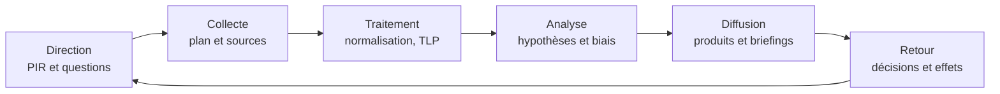
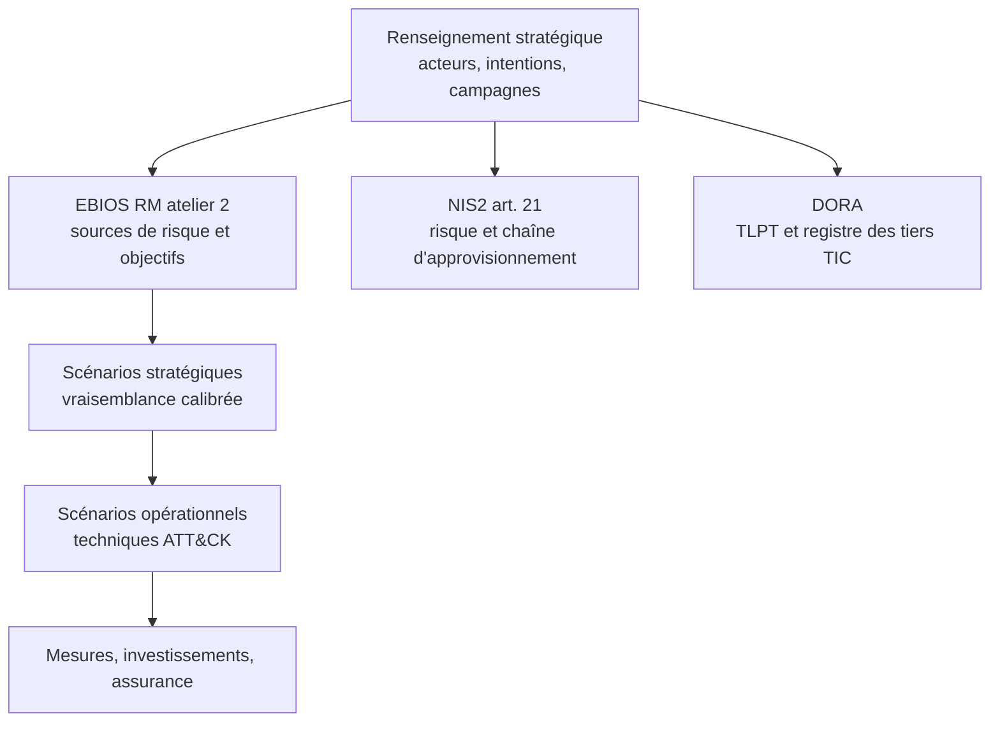

# Threat Intelligence stratégique

La threat intelligence produit beaucoup de matière et peu de décisions. Un SOC reçoit des milliers d'indicateurs par jour, un RSSI des dizaines de rapports, et le conseil d'administration une présentation annuelle sur « la cybercriminalité en hausse ». Le problème n'est pas le manque d'information : c'est l'absence de traduction entre l'observation technique et la question d'un décideur — faut-il investir dans la détection de l'exfiltration ou dans la segmentation, accepter le risque d'un fournisseur critique, déclencher une notification réglementaire.

Le renseignement stratégique est cette traduction : il décrit des intentions, des capacités, des cibles probables et des évolutions sur six mois à plusieurs années, pour éclairer une décision qui engage des ressources ou une posture. [[Threat Intelligence]] couvre les niveaux, les IOC et les formats ; cette note traite le niveau stratégique : consommateurs, méthode, produits, intégration au risque et limites.

> [!abstract] Définition — Renseignement stratégique
> Analyse de l'environnement adverse destinée à réduire l'incertitude d'une décision de direction : budget, priorisation des risques, architecture, posture face à un fournisseur, préparation de crise. Il se définit par la décision qu'il éclaire et l'horizon qu'il couvre, non par sa source ou son format.

## Niveaux, consommateurs et décisions

Les quatre niveaux ne forment pas une hiérarchie de valeur mais d'abstraction et de délai. Un même événement — la compromission d'un logiciel de transfert de fichiers — produit un hash pour le SOC, une règle pour l'ingénierie, un avertissement de campagne pour l'opérationnel et une question de dépendance fournisseur pour le comité des risques.

| Niveau | Question | Horizon | Consommateur | Produit | Cadence |
|---|---|---|---|---|---|
| Stratégique | Que signifie la menace pour nos priorités et nos moyens ? | 6 mois à 3 ans | Conseil, comex, RSSI, risk manager | Panorama, estimation, note exécutive | Trimestriel à annuel |
| Opérationnel | Quelles campagnes nous visent, et comment ? | 1 semaine à 6 mois | Responsable SOC, DFIR, achats | Profil d'acteur, alerte de campagne | Hebdomadaire à mensuel |
| Tactique | Quelles techniques détecter ? | 1 jour à 3 mois | Detection engineering, hunting | Mapping ATT&CK, cas d'usage | Continu |
| Technique | Quels artefacts bloquer ? | Heures à jours | SIEM, EDR, passerelle | Feed d'IOC, règle YARA | Automatisé |

Le glissement le plus fréquent consiste à répondre à une question stratégique avec une donnée tactique. Dire au conseil qu'« un acteur utilise le Living-off-the-Land » n'a de sens que si l'on précise pourquoi cela change la détection et quel arbitrage budgétaire il implique. Une note stratégique ne contient donc pas d'indicateurs, mais des jugements, des hypothèses et des conséquences.

Chaque consommateur attend un registre différent. Le conseil veut une comparaison sectorielle et une proportionnalité du budget ; le comité exécutif, des impacts métier ; le RSSI, des priorités argumentées et le coût de l'inaction ; le risk manager, une vraisemblance calibrée ; le SOC, des profils et des TTP ; le juridique, une qualification, pas une spéculation sur l'attaquant.

> [!important] Idée clé
> Un produit de renseignement se juge à la décision qu'il rend possible. Si personne ne peut citer la décision qui a changé après lecture, c'est de la veille habillée en renseignement.

## Le cycle du renseignement au niveau stratégique

Le cycle — direction, collecte, traitement, analyse, diffusion, retour — s'applique ici avec une contrainte forte : la direction détermine presque tout. Sans exigences écrites, la collecte devient opportuniste, l'analyse suit l'actualité et la diffusion produit des rapports que personne n'a demandés.



### Direction

La direction décompose les décisions à venir — lesquelles, par qui, dans quel délai — et identifie les sujets où l'incertitude coûte assez cher pour justifier une collecte. On en déduit les *Priority Intelligence Requirements* (PIR), découpés en *Specific Intelligence Requirements* (SIR) puis en *Essential Elements of Information* (EEI). Un PIR correctement formulé est daté et falsifiable : « d'ici juin, un acteur étatique peut-il obtenir un accès persistant à notre chaîne logistique sous-traitée ? », et non « la menace est-elle élevée ? ». La direction produit aussi la liste des lacunes assumées : un renseignement honnête dit ce qu'il ne sait pas.

### Collecte et évaluation des sources

Collecter ne signifie pas agréger des flux, mais choisir des sources en fonction des questions et évaluer chaque information. Le code de l'amirauté reste la convention la plus utile : une lettre pour la fiabilité de la source, un chiffre pour la crédibilité de l'information.

| Source | Fiabilité | Information | Crédibilité |
|---|---|---|---|
| A | Totalement fiable | 1 | Confirmée par d'autres sources |
| B | Généralement fiable | 2 | Probablement vraie |
| C | Assez fiable | 3 | Possiblement vraie |
| D | Peu fiable | 4 | Douteuse |
| E | Non fiable | 5 | Improbable |
| F | Non évaluable | 6 | Non évaluable |

Une information B2 vaut mieux qu'une information A6 : la première est probable et recoupée, la seconde vient d'une source réputée mais n'est pas vérifiable. Les rapports de fournisseurs sont souvent B2 ou B3, les revendications d'acteurs A6 tant qu'elles ne sont pas corroborées.

### Traitement, diffusion, retour

Le traitement stratégique est surtout un travail de déduplication et de datation. Les fournisseurs se citent mutuellement ; une campagne peut apparaître dans cinq rapports qui remontent tous à la publication initiale d'un éditeur. Confondre ce volume avec une corroboration est l'erreur de méthode la plus répandue en CTI. La diffusion s'adapte à la décision : une page pour un comité, cinq pour un profil, vingt pour un panorama. Le retour doit être instrumenté : qui a lu, quelle décision a été prise, quel indicateur a été surveillé.

## Sources et plan de collecte

| Famille | Apport stratégique | Délai | Coût | Biais principal |
|---|---|---|---|---|
| OSINT et presse | Contexte, tendances, incidents publics | Immédiat | Faible | Amplification, reprise circulaire |
| Fournisseurs | Profils, campagnes, données d'incident | Jours à semaines | Moyen à élevé | Intérêt commercial, biais clients |
| CERT et autorités | Alertes qualifiées, contexte national | Jours | Faible | Langage prudent, périmètre national |
| ISAC | Partage entre pairs, incidents non publics | Heures à jours | Adhésion | Rétention, qualité hétérogène |
| Dark web | Intentions, ventes d'accès, fuites, outils | Heures à semaines | Élevé | Manipulation, risque juridique |
| HUMINT | Intentions, contexte interne | Semaines à mois | Très élevé | Fiabilité faible, risque éthique |
| SIGINT et partage étatique | Capacités et infrastructures d'États | Variable | Accès restreint | Classification, diffusion limitée |
| Études sectorielles | Tendances longues, données de pertes | Mois | Faible | Retard, agrégation grossière |

Un plan de collecte ressemble à un portefeuille : quelques sources primaires payantes pour la profondeur, des ISAC pour l'anticipation sectorielle, des CERT pour la qualité, de l'OSINT pour le contexte, et une capacité d'analyse interne qui ne dépende d'aucun fournisseur. La dépendance à un seul éditeur crée un angle mort : ses clients voient la même chose que vous, et ses concurrents peuvent ignorer votre secteur.

> [!warning] Piège de source
> Un rapport qui ne cite pas ses preuves n'est pas une source, c'est une opinion. La réputation de l'éditeur ne rend pas vraie une affirmation non étayée, et une attribution étatique sans élément technique reste une hypothèse politique.

## Les cadres et leur usage stratégique

| Cadre | Question | Usage stratégique | Limite |
|---|---|---|---|
| MITRE ATT&CK | Que fait l'attaquant ? | Profils, priorités de détection, écarts de couverture | Ni probabilité ni impact ; couverture déclarative |
| Cyber Kill Chain | À quelle étape ? | Pédagogie, positionnement des contrôles, récit au comité | Linéaire, adapté ni au cloud ni à la supply chain |
| Diamond Model | Qui, contre quoi, avec quelle infrastructure ? | Analyse d'événement, pivot, attribution | Statique, sans dimension temporelle |
| VERIS | Comment décrire et compter les incidents ? | Statistiques, comparaison sectorielle | Dépend des déclarations, sous-représente le non-détecté |
| STIX 2.1 et TAXII | Comment échanger ? | Automatisation, partage, traçabilité | Modèle riche, coût d'implémentation |
| MISP | Comment partager et corréler ? | Événements, taxonomies, corrélations, TLP | Discipline de partage, dette de normalisation |

ATT&CK s'utilise au niveau stratégique par ses objets *Groups*, *Campaigns* et *Software*, et par les calques Navigator qui comparent la couverture aux techniques réellement employées dans le secteur. Il ne faut pas en attendre une probabilité : ATT&CK décrit des comportements, pas des fréquences. La vraisemblance se construit avec les données d'incident, le contexte sectoriel et l'analyse des intentions. [[MITRE ATT&CK]] détaille les calques et les pièges de scoring.

La Kill Chain explique au conseil qu'un investissement ne couvre qu'une partie du chemin adverse : bloquer le phishing ne protège pas d'un VPN non corrigé. Le Diamond Model relie adversaire, victime, infrastructure et capacité ; pivoter sur un sommet révèle les autres. VERIS impose la discipline du dénombrement : sans taxonomie commune, les incidents d'un secteur ne sont pas comparables et l'argument de risque repose sur des anecdotes.

## Analyse structurée : hypothèses, biais, attribution

### Analyse d'hypothèses concurrentes

L'*Analysis of Competing Hypotheses* (ACH), formalisée par Richards Heuer, énumère les hypothèses, liste les preuves, puis cherche à réfuter chaque hypothèse plutôt qu'à confirmer la préférée.

1. Formuler des hypothèses mutuellement exclusives, y compris « nous ne savons pas ».
2. Lister les preuves avec source et date, puis coter leur cohérence avec chaque hypothèse.
3. Chercher les preuves qui départagent réellement, et non celles qui confortent la thèse initiale.
4. Tester la sensibilité aux preuves douteuses, formuler le jugement avec un niveau de confiance.
5. Identifier les indicateurs qui feraient basculer le jugement.

Exemple, pour une intrusion dans un opérateur d'infrastructure, sans revendication ni chiffrement :

| Preuve | Espionnage étatique | Préparation criminelle | Faux drapeau |
|---|---|---|---|
| Outils natifs exclusifs, aucun implant dédié | Cohérent | Incohérent | Cohérent |
| Ciblage des fonctions critiques et de la télémétrie | Cohérent | Neutre | Cohérent |
| Absence de revendication et de fuite | Cohérent | Incohérent | Neutre |
| Infrastructure résidentielle et VPN commerciaux | Cohérent | Cohérent | Cohérent |
| Horaires corrélés à un fuseau | Faiblement cohérent | Neutre | Faiblement cohérent |

La colonne « faux drapeau » illustre la difficulté : une hypothèse de manipulation est presque toujours cohérente, parce qu'elle est unfalsifiable par construction. Elle ne doit être retenue que si des éléments positifs la soutiennent — artefacts plantés trop visiblement, divulgation simultanée.

> [!abstract] Définition — Analyse d'hypothèses concurrentes
> Méthode d'analyse structurée qui évalue plusieurs explications rivales d'un même ensemble de faits en cherchant à les réfuter. Elle produit un jugement probabiliste et une liste d'indicateurs de bascule, pas une certitude.

### Biais et garde-fous

| Biais | Manifestation | Garde-fou |
|---|---|---|
| Confirmation | Ne retenir que les rapports favorables | ACH, recherche de preuves contraires |
| Ancrage | Rester fixé sur la première attribution | Relecture indépendante, datation |
| Disponibilité | Surestimer les menaces médiatisées | Taux de base sectoriels |
| Imagerie en miroir | Prêter à l'adversaire nos priorités | Analyse politique, avis externe |
| Pensée de groupe | Aligner sur le consensus | Avocat du diable, revue par les pairs |
| Biais d'attribution | Confondre outil partagé et acteur commun | Séparer capacité, infrastructure, intention |

Les techniques complémentaires — vérification des hypothèses clés, scénarios au pire cas, avocat du diable — coûtent peu au regard d'une attribution erronée publiée au conseil.

### Indicateurs d'avertissement et scénarios

Le renseignement stratégique ne prédit pas, il prépare. Un dispositif *Indicators and Warning* associe à chaque scénario des signaux observables, un seuil et une réponse. Pour un pré-positionnement dans les infrastructures critiques : comptes de service sollicités hors procédure, créations de comptes hors processus, scans internes depuis des postes d'administration, modification de la télémétrie. Chaque indicateur a un propriétaire, une source et un seuil ; sans seuil, ce n'est qu'une observation.

Trois scénarios contrastés — référence, dégradé, rupture — valent mieux que douze variantes. Chacun précise hypothèses, signaux précoces, impact métier et décisions conditionnelles déjà arbitrées.

### Attribution et désinformation

L'attribution est un spectre. On distingue l'attribution technique (artefact, infrastructure), l'attribution d'acteur (groupe suivi par un éditeur) et l'attribution politique (État, avec conséquences diplomatiques et juridiques). La première peut être solide et la troisième contestée, avec les mêmes preuves.

| Confiance | Formulation | Conditions |
|---|---|---|
| Élevée | « Nous estimons avec un niveau de confiance élevé que… » | Preuves convergentes, corroboration indépendante, intentions cohérentes |
| Modérée | « Il est probable que… » | Faisceau d'indices, une ou deux sources, lacunes identifiées |
| Faible | « Une hypothèse plausible est que… » | Indices indirects, source unique, alternative non exclue |

La désinformation complique l'exercice : faux drapeaux, fuites fabriquées, documents falsifiés, contenus synthétiques. La défense est méthodologique avant d'être technique : vérifier la provenance, dater les artefacts, corroborer indépendamment, distinguer l'observé du raconté. Une campagne réussie n'a pas besoin de convaincre les analystes : discréditer une attribution légitime suffit.

## Les produits

| Produit | Longueur | Cadence | Contenu | Critère de succès |
|---|---|---|---|---|
| Panorama de la menace | 10 à 25 pages | Annuel ou semestriel | Acteurs, campagnes, tendances, implications | Utilisé dans la revue de risque |
| Profil d'acteur | 2 à 5 pages | Révision semestrielle | Motivation, capacités, TTP, cibles, bascules | Cité dans une priorisation |
| Rapport sectoriel | 5 à 15 pages | Trimestriel | Incidents du secteur, dépendances communes | Partagé en ISAC |
| Note exécutive | 1 page | Ad hoc | Jugement, impact, options, recommandation | Une décision est prise |
| Estimation | 2 à 4 pages | Ad hoc | Question, hypothèses, probabilité, indicateurs | Le destinataire agit |
| Réponse à RFI | 1 à 3 pages | 24 à 72 heures | Réponse ciblée, sources, confiance | Délai tenu |

Une note exécutive tient en quatre paragraphes : le jugement, ce qui le soutient, ce que cela change, ce qu'il faut décider.

```text
JUGEMENT
Un acteur étatique pré-positionne des accès dans les opérateurs
d'infrastructure du secteur depuis 18 mois. Confiance modérée.

CE QUI LE SOUTIENT
Trois incidents convergents, usage exclusif d'outils natifs, ciblage
de la télémétrie, absence de revendication. Lacune : filiales.

CE QUE CELA CHANGE
La détection repose sur des signatures de malware, inopérantes face
au LOTL. Le scénario de continuité ne couvre pas une persistance longue.

CE QU'IL FAUT DÉCIDER
1. Journaliser les comptes de service (3 mois).
2. Tester la segmentation de l'administration (6 mois).
3. Réviser et tester le scénario de crise (9 mois).
```

Un profil d'acteur n'est pas un catalogue de TTP : il répond à trois questions — que veut l'acteur, que peut-il contre nous, qu'est-ce qui nous permettrait de le voir venir. La partie « indicators of change » est la plus utile et la plus absente des rapports commerciaux.

## Intégration à la gestion des risques et à la conformité



Dans [[EBIOS RM]], l'atelier 2 identifie les sources de risque et leurs objectifs visés : c'est le terrain du renseignement, qui fournit motivation, capacités, cibles historiques et modes opératoires. L'atelier 3 évalue la vraisemblance des scénarios stratégiques ; le renseignement la calibre par des données d'incident et des intentions documentées. L'atelier 4 descend aux techniques, où ATT&CK fournit le vocabulaire. Sans renseignement, la vraisemblance est une opinion d'expert ; avec lui, elle devient une estimation sourcée et révisable.

Pour [[NIS2 et DORA]], l'apport est triple. NIS2 exige une analyse des risques et la sécurité de la chaîne d'approvisionnement : le renseignement identifie les fournisseurs ciblés et les dépendances critiques. La gouvernance de l'article 20 suppose un organe de direction formé et informé : une note trimestrielle de menace sectorielle en est une preuve tangible. DORA impose des tests pilotés par la menace (TLPT) et un registre des prestataires TIC : le TLPT se construit à partir d'un profil d'acteur pertinent, non d'un scénario générique.

| Livrable | Artefact de risque ou de conformité | Décision |
|---|---|---|
| Profil d'acteur prioritaire | Atelier 2 EBIOS RM | Priorisation des contrôles |
| Estimation de campagne | Atelier 3, vraisemblance | Révision du plan de traitement |
| Fournisseurs ciblés | Registre DORA, analyse NIS2 | Due diligence, plan de sortie |
| Indicateurs d'avertissement | Plan de crise, exercices | Seuils de déclenchement |
| Panorama sectoriel | Revue de direction | Allocation de moyens |

Les exercices de crise sont le meilleur test du dispositif : un tabletop construit sur un scénario documenté révèle les dépendances oubliées et les délais de décision. Le renseignement fournit le scénario, l'exercice prouve que l'organisation sait réagir, les deux alimentent la revue de direction.

## Mesurer la valeur du renseignement

Les indicateurs de volume — IOC ingérés, rapports produits, sources — mesurent l'activité, pas la valeur.

| Dimension | Indicateur | Piège |
|---|---|---|
| Pertinence | Produits cités dans une décision / produits diffusés | Déclaratif, donc surestimable |
| Actionnabilité | Recommandations avec propriétaire et échéance / émises | Favorise les recommandations faciles |
| Couverture | Acteurs prioritaires dont le profil a moins de six mois | Incite aux profils superficiels |
| Délai | Temps médian entre observation et diffusion | Pousse à diffuser sans validation |

On y ajoute la précision des avertissements : parmi les indicateurs déclenchés, combien correspondaient à un événement réel, et parmi les événements survenus, combien avaient été anticipés. Difficile à tenir, mais seul indicateur de qualité prédictive. Un taux de fausses alertes élevé est acceptable : un dispositif qui n'alerte jamais ne détecte rien. La mesure doit rester honnête sur la causalité : une baisse d'incidents peut venir d'une meilleure détection, d'un changement d'attaquant ou du hasard.

## Limites et pièges

- **L'attribution reste incertaine.** Les preuves sont falsifiables, les infrastructures partagées, les intentions opaques. Publier une attribution politique sur des preuves fragiles expose l'organisation et peut servir l'adversaire.
- **Les sources se contaminent et le marché biaise.** Les fournisseurs se citent, les médias les reprennent : une information unique peut sembler corroborée par cinq canaux. Un éditeur couvre mieux ses clients et les menaces que ses produits détectent ; un panorama n'est jamais neutre.
- **La surcharge détruit la priorisation.** Trop de rapports produisent de l'inquiétude sans hiérarchie ; un flux non filtré est un coût.
- **Le secret limite la diffusion.** Un renseignement TLP:RED ne se discute pas au conseil sans précaution, et le respect du TLP conditionne l'accès aux partages futurs.
- **Le droit et l'éthique encadrent la collecte.** Achat d'accès sur le dark web, manipulation d'une source humaine, conservation de données personnelles engagent la responsabilité de l'organisation, quel que soit le but défensif.
- **Le décalage avec la détection est fréquent.** Le stratégique produit des priorités, pas des règles. Sans traduction vers [[Detection Engineering]] et [[Threat Hunting]], il reste un PDF annuel.

Un profil d'acteur doit se conclure par des techniques prioritaires, des sources de télémétrie nécessaires et des scénarios de chasse. Si le profil dit que l'acteur cible utilise le LOTL et que le SOC ne journalise que les signatures, l'écart est une décision de gouvernance, pas un détail technique. [[Purple Teaming]] et [[Adversary Emulation]] ferment la boucle en testant les scénarios issus du renseignement.

Enfin, la fonction doit résister à la prophétie : annoncer une menace pour justifier un budget déjà décidé, ou la minimiser pour ne pas inquiéter, détruit sa crédibilité plus sûrement qu'une erreur d'analyse. La valeur d'un analyste se mesure autant à ce qu'il refuse d'affirmer qu'à ce qu'il affirme.

> [!quiz] Pourquoi un panorama de la menace n'est-il pas la somme des rapports tactiques du SOC ?
> Parce qu'il répond à une question de décision et d'horizon, pas de détection. Il agrège des jugements sur les intentions, les capacités et les conséquences, avec une incertitude explicite ; la somme des rapports tactiques produit du volume et des IOC, pas une priorisation.

> [!quiz] Quel est l'intérêt de l'ACH par rapport à une analyse intuitive ?
> L'ACH oblige à formuler des hypothèses rivales et à chercher les preuves qui les réfutent, au lieu de confirmer l'hypothèse préférée. Elle réduit le biais de confirmation et laisse une trace auditable des raisonnements et des lacunes.

> [!quiz] Comment le renseignement stratégique alimente-t-il EBIOS RM ?
> Il fournit les sources de risque et leurs objectifs visés à l'atelier 2, calibre la vraisemblance des scénarios stratégiques à l'atelier 3 et permet de descendre aux techniques ATT&CK à l'atelier 4. Il transforme une appréciation d'expert en estimation sourcée et révisable.

> [!quiz] Un TLPT DORA peut-il être conçu sans renseignement ?
> Techniquement oui, mais il perdrait sa caractéristique « threat-led ». Il doit s'appuyer sur un profil d'acteur pertinent pour l'entité et son secteur, avec des scénarios et des TTP documentés, puis être validé par l'autorité compétente.
