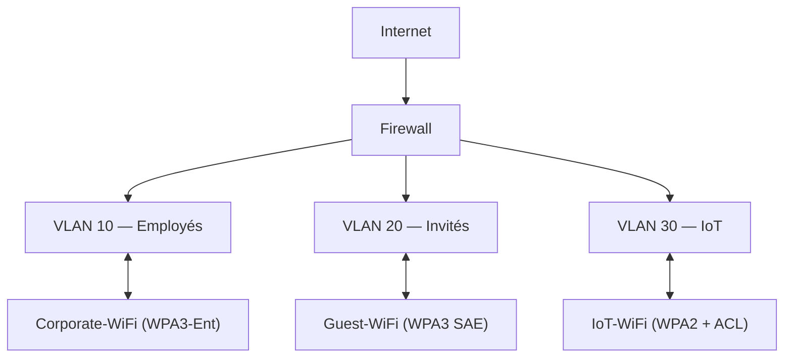
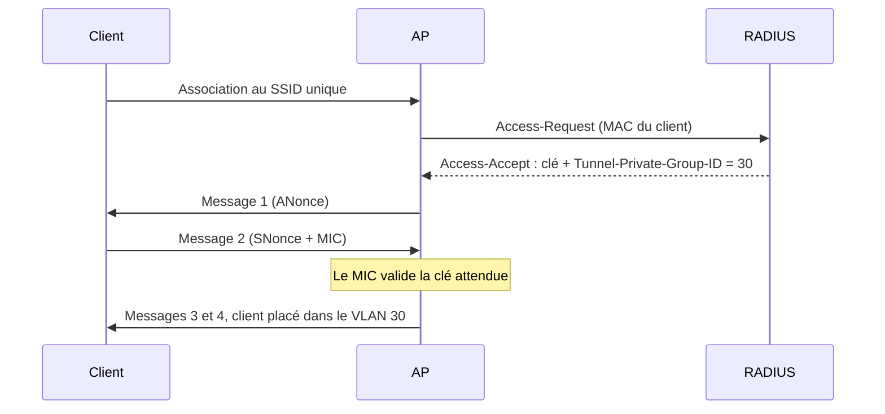

# Defense WiFi et Détection

Tout ce qui rend les attaques [[03 - Attaques WPA2-PSK]], [[05 - Evil Twin et Phishing]], [[07 - DoS et MDK4]] inopérantes ou détectables.

> [!abstract] Définition — PMF (802.11w)
> Protection qui ajoute un code d'intégrité (MIC) aux trames management — deauth, disassoc, action — afin que le client vérifie leur authenticité avant de les appliquer. Elle authentifie ces trames sans les chiffrer : leur existence reste observable, mais plus leur falsification sans la clé de session. WPA3 l'impose en mode `Required`.

## Hardening — configuration AP

### Choix du protocole

```
WPA3-Personal (SAE)            ← Domestique idéal
WPA3-Enterprise + EAP-TLS      ← Entreprise idéal
WPA2-Personal + PMF activé     ← Compromis si parc mixte
WPA2-Enterprise + EAP-TLS      ← Entreprise legacy

À bannir : WEP, WPA-TKIP, WPS, OWE en zone sensible
```

### Checklist AP domestique

- WPA3-Personal (ou WPA2 + WPA3 transition si parc mixte)
- PSK ≥ 20 caractères aléatoires (gestionnaire de mdp)
- **WPS désactivé** (souvent activé d'usine sur les box ISP)
- Réseau invité isolé (VLAN ou SSID séparé)
- Bande 5 GHz privilégiée (portée plus courte → moins de surface)
- Firmware AP à jour (patches KRACK / FragAttacks)
- Admin web : mot de passe modifié, accès LAN uniquement
- UPnP désactivé
- SSID modifié (pas `Livebox-XXXX` par défaut → moins prédictible)

### Checklist AP entreprise

- WPA3-Enterprise ou WPA2-Enterprise + **PMF obligatoire**
- **EAP-TLS** avec certificats clients (AC interne)
- Désactiver PEAP / EAP-TTLS / EAP-FAST si possible
- Si PEAP nécessaire : validation cert serveur **obligatoire côté client** (GPO)
- SSID Enterprise différent du SSID guest
- RADIUS sur réseau d'admin isolé
- Logs RADIUS centralisés (SIEM) — détection brute-force
- Rotation régulière des certificats serveur
- Segmentation : VLAN par groupe d'utilisateurs

## Management Frame Protection (PMF / 802.11w)

Signe cryptographiquement les trames management (deauth, disassoc, action).

```
Sans PMF :  attaquant injecte deauth → client se déconnecte
Avec PMF :  client vérifie le MIC → deauth non signée rejetée
```

> [!important] Idée clé
> PMF ne chiffre pas les trames management, il les **authentifie** — un attaquant peut toujours voir qu'une trame deauth existe, mais ne peut plus en forger une valide sans connaître la clé de session. C'est la même logique que la signature SMB contre le relais NTLM : empêcher la falsification, pas l'observation.

| Mode | Comportement |
|------|--------------|
| Disabled | Aucune protection (par défaut WPA2 ancien) |
| Optional | Client peut négocier PMF (rétro-compat) |
| Required | PMF obligatoire (refuse clients sans support) |

```bash
# hostapd.conf
ieee80211w=2                  # 0=disabled, 1=optional, 2=required

# wpa_supplicant (client)
network={
    ssid="MaisonBox"
    psk="..."
    ieee80211w=2              # exiger PMF côté client
}
```

WPA3 exige `ieee80211w=2` par défaut.

### Limites PMF

- N'empêche pas Evil Twin **avec nouvel ESSID** (juste l'usurpation par deauth)
- Beacon frames non protégées (beacon flood reste possible)
- Authentification initiale (Open/SAE Commit) non protégée → DoS par auth flood toujours faisable

## Validation certificat serveur côté client (Enterprise)

**Critique** : c'est la mesure qui bloque la quasi-totalité des attaques WPA2/WPA3-Enterprise.

### Windows (GPO)

```
Computer Configuration → Policies → Windows Settings
→ Security Settings → Wireless Network (IEEE 802.11) Policies
→ New Policy → Properties → Security
   [x] Validate server certificate
   [x] Connect to these servers : "radius.corp.local"
   [x] Trusted Root Certification Authorities : [AC interne uniquement]
   [x] Don't prompt user to authorize new servers
```

### Android

`Wi-Fi → réseau → Modifier → CA certificate` → choisir le certificat de l'AC interne (pas "Use system certificates" — trop permissif).

### Linux (wpa_supplicant)

```
network={
    ssid="Corporate-WiFi"
    key_mgmt=WPA-EAP
    eap=PEAP
    identity="alice"
    password="..."
    ca_cert="/etc/ssl/corp-ca.pem"
    altsubject_match="DNS:radius.corp.local"
    phase2="auth=MSCHAPV2"
}
```

`altsubject_match` interdit qu'un autre CN soit accepté → mate eaphammer.

## Wireless Intrusion Detection System (WIDS)

Détecte deauth massives, beacon flood, rogue APs, SSID dupliqués.

> [!warning] Piège
> Un WIDS détecte et alerte, il ne bloque rien par nature (contrairement à PMF qui empêche activement l'attaque) — sans quelqu'un ou une automatisation pour agir sur l'alerte (isoler le rogue, notifier les utilisateurs), la détection seule ne réduit pas le risque. La valeur d'un WIDS dépend entièrement du processus de réponse à incident qui le suit.

### Kismet (open-source)

```bash
# Lancer en mode IDS
kismet -c wlan0

# Alertes utiles
# - DEAUTHFLOOD     : >10 deauth/s sur un AP
# - DISCONFLOOD     : disassoc flood
# - APSPOOF         : SSID connu mais nouveau BSSID
# - PROBENOJOIN     : probes massives sans association
# - BEACONFLOOD     : >100 beacons/s
# - CHANCHANGE      : AP change de canal en boucle

# Config alertes dans kismet_alerts.conf
alert=DEAUTHFLOOD,5/min,10/min
```

Interface web : `http://localhost:2501` → Alerts → vue temps réel.

### Solutions entreprise

| Produit | Approche |
|---------|----------|
| **Aruba RFProtect** | Sensors WiFi dédiés + analytics centralisé |
| **Cisco wIPS** | APs Cisco en mode monitor partiel |
| **Mojo AirTight** | Cloud, focus rogue AP / Evil Twin |
| **WatchGuard WIPS** | Sensors séparés des APs production |

Bonnes pratiques :
- **APs dédiés en mode monitor** (≠ APs production) — sinon perte de capacité
- Alimenter le SIEM (Splunk, Elastic) avec les events
- Cartographie : croiser BSSID détectés avec inventaire officiel → rogue détection automatique
- Géolocalisation triangulée (3 sensors min) pour situer un rogue

## Détection manuelle de rogue AP

```bash
# Lister tous les APs actuellement présents
airodump-ng wlan0mon --write scan --output-format csv

# Comparer avec inventaire (whitelist BSSID)
awk -F',' 'NR>1 {print $1}' scan-01.csv | sort -u > seen.txt
diff whitelist.txt seen.txt | grep '^>'   # BSSID inconnus

# Détecter des SSID dupliqués (signe d'Evil Twin)
awk -F',' 'NR>1 {print $14}' scan-01.csv | sort | uniq -c | awk '$1 > 1'
```

## Détection deauth flood

```bash
# Comptage en temps réel des deauth
tshark -i wlan0mon -Y "wlan.fc.type_subtype == 0x0c" \
  -T fields -e wlan.bssid \
  | sort | uniq -c | sort -rn

# Alerter si >50/min
tshark -i wlan0mon -Y "wlan.fc.type_subtype == 0x0c" \
  -a duration:60 -q -z io,stat,60
```

## Segmentation réseau



- Aucun trafic latéral entre VLANs (sauf flux contrôlés via firewall)
- IoT en VLAN dédié (caméras, ampoules, thermostats) — souvent vulnérables, à isoler
- DHCP options 43/60 pour push de config sécurité
- Captive portal sur Guest pour accept des CGU

### Un seul SSID, une clé par groupe : le PPSK

Le schéma ci-dessus multiplie les SSID, et chaque SSID a un coût : une balise de plus émise toutes les ~100 ms sur chaque canal, du temps d'antenne perdu, et une liste de réseaux qui s'allonge pour les utilisateurs. Le **PPSK** (*Private Pre-Shared Key*) obtient la même segmentation avec un seul SSID en WPA2-Personal : au lieu d'une passphrase commune, le réseau en connaît plusieurs, et c'est la passphrase saisie qui décide du VLAN où atterrit l'appareil. Une box de bureau peut ainsi distribuer `Employes-2026` (VLAN 10), `Invites-nov` (VLAN 20) et une clé par caméra (VLAN 30), le tout sous le nom unique `Bureau-WiFi`.

> [!abstract] Définition — PPSK
> Mode WPA2-Personal où un même SSID accepte plusieurs clés pré-partagées, chacune rattachée à un utilisateur, un groupe ou un appareil, et à un VLAN. Les constructeurs lui donnent chacun leur nom : PPSK chez Extreme (ex-Aerohive), iPSK (*Identity PSK*) chez Cisco et Meraki, DPSK (*Dynamic PSK*) chez Ruckus, MPSK chez Aruba, « Private Pre-Shared Keys » chez Ubiquiti.

Le mécanisme tient dans le handshake 4-way. Le client n'annonce jamais quelle passphrase il utilise : il envoie seulement, au message 2, son SNonce accompagné d'un MIC calculé avec sa PMK. L'AP, qui connaît déjà les deux nonces et les deux adresses MAC, essaie donc ses PMK candidates une à une jusqu'à trouver celle qui reproduit ce MIC ; c'est exactement le calcul qu'un attaquant fait hors ligne, mais sur une liste courte et connue. Pour éviter de tout essayer, les déploiements d'entreprise interrogent plutôt un serveur RADIUS sur l'adresse MAC du client (authentification MAB) : la réponse `Access-Accept` porte la clé attendue pour cet appareil et le VLAN où le placer.



Le VLAN voyage dans trois attributs RADIUS standard (RFC 3580), les mêmes que pour un VLAN dynamique en 802.1X : `Tunnel-Type = VLAN`, `Tunnel-Medium-Type = IEEE-802` et `Tunnel-Private-Group-ID = 30`. Sans RADIUS, hostapd fait la même chose à partir d'un fichier local, une ligne par clé :

```bash
# hostapd.conf
wpa_psk_file=/etc/hostapd/hostapd.wpa_psk
dynamic_vlan=1
vlan_file=/etc/hostapd/hostapd.vlan

# /etc/hostapd/hostapd.wpa_psk — vlanid, MAC (00:00... = n'importe laquelle), passphrase
vlanid=10 00:00:00:00:00:00 Employes-2026-correct-horse
vlanid=20 00:00:00:00:00:00 Invites-novembre-tulipe
vlanid=30 a4:cf:12:3b:9e:01 camera-entree-7Fq2xL9pW
```

La dernière ligne lie la clé de la caméra à son adresse MAC : la recopier sur un autre appareil ne suffit pas. Sans liaison, une clé reste partageable comme n'importe quelle PSK.

Le gain le plus concret est la **révocation**. Avec une PSK unique, le départ d'un stagiaire ou le vol d'une ampoule connectée impose de changer la passphrase sur tous les appareils ; en PPSK, on supprime une ligne et les autres clés continuent de fonctionner. Chaque clé laisse aussi une trace propre dans les journaux, ce qui permet de savoir quel appareil était connecté à quel moment.

> [!warning] Piège
> Le PPSK segmente et permet de révoquer, il ne rend pas la PSK plus solide. Chaque clé reste cassable hors ligne à partir d'un handshake capturé (voir [[03 - Attaques WPA2-PSK]]), et la clé cassée donne directement le VLAN qui lui est associé. Pour des comptes nominatifs avec authentification mutuelle, WPA2/WPA3-Enterprise reste la référence ; le PPSK sert les appareils qui ne savent pas faire de 802.1X (IoT, consoles, imprimantes) et les invités.

Le passage à WPA3 complique les choses. Avec SAE, l'AP doit choisir le mot de passe dès l'échange *Commit*, avant toute preuve qu'il pourrait tester contre plusieurs clés. La norme prévoit pour cela un identifiant de mot de passe que le client envoie avec son Commit (hostapd : `sae_password=...|vlanid=30|id=camera`), mais peu de clients le gèrent encore. La plupart des déploiements PPSK restent donc en WPA2 avec PMF, ou en mode de transition.

> [!quiz] Comment un AP en PPSK sait-il quelle passphrase un client a utilisée, alors que celui-ci ne l'annonce jamais ?
> Il la retrouve à partir du message 2 du handshake : avec les deux nonces et les deux adresses MAC, il recalcule le MIC pour chacune de ses PMK candidates et garde celle qui correspond. En entreprise, un serveur RADIUS interrogé sur l'adresse MAC du client renvoie directement la clé attendue et le VLAN (`Tunnel-Private-Group-ID`), ce qui évite d'essayer toute la liste.

## Monitoring continu

| Métrique | Outil | Alerte si |
|----------|-------|-----------|
| BSSID inconnus | Kismet + diff whitelist | Nouveau BSSID stable >5 min |
| SSID dupliqués | Kismet APSPOOF | Match SSID + BSSID différent |
| Deauth /s/AP | tshark / kismet | >10/s pendant >30s |
| Échecs RADIUS | logs freeradius / NPS | >20 échecs/IP/min |
| Tentatives EAP avec faux supplicant | RADIUS detailed log | Identity inconnue répétée |
| Clients sur Guest | DHCP leases | Anormalité (heure, volume) |

## Réponse à incident

Si rogue AP détecté :
1. **Géolocaliser** (RSSI sur plusieurs sensors, ou recherche physique avec antenne directive)
2. **Isoler** (port switch correspondant si l'AP rogue est branché filaire)
3. **Identifier** (MAC vendor, ESSID, canal, durée)
4. **Logger** dans le ticket d'incident
5. **Communiquer** aux utilisateurs si phishing actif (rappel : ne jamais ressaisir la PSK)

Si Evil Twin avec captive portal détecté :
1. Diffuser une notification interne immédiate
2. Forcer reset des PSK / mdp Wi-Fi compromis si saisis
3. Si Enterprise : invalider et regénérer les comptes touchés

> [!quiz] Pourquoi PMF ne bloque-t-il pas un Evil Twin diffusant un ESSID différent ?
> PMF signe les trames d'une session déjà établie : le client rejette une deauth forgée parce que le MIC ne correspond pas à sa clé de session. Un AP rogue portant un autre SSID ne détourne pas cette session, il en propose une nouvelle que le client peut rejoindre volontairement. S'y ajoutent les beacons non protégées et l'authentification initiale non couverte, qui laissent le auth flood possible.
