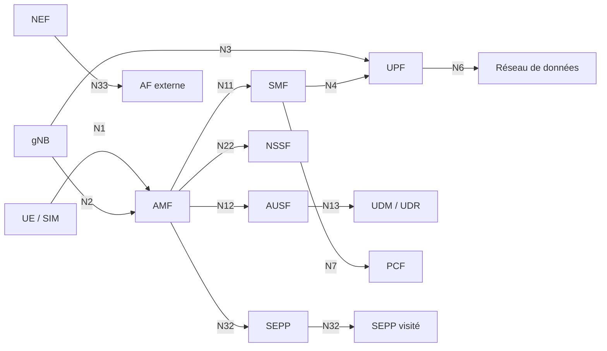

# Télécom et 5G Security

Un réseau mobile n'est pas un simple fournisseur d'accès : c'est une infrastructure critique qui transporte la voix, les messages, l'authentification, les paiements et une partie des communications d'urgence. La 5G ajoute la virtualisation, les APIs, le découpage en tranches et l'informatique en périphérie, ce qui rapproche le réseau des architectures cloud et élargit la surface d'attaque. Dans le même temps, l'interconnexion avec la 4G, le roaming et les protocoles historiques SS7, Diameter et GTP maintient des chemins d'attaque que la 5G seule ne ferme pas.

La sécurité télécom se joue donc sur trois plans : l'identité de l'abonné et la signalisation, la séparation entre réseau public et fonctions internes, et la sécurité de la chaîne d'approvisionnement. Un attaquant qui obtient un accès au cœur de réseau ne se contente pas d'intercepter du trafic : il peut localiser des abonnés, détourner des sessions, provoquer des fraudes ou perturber un service entier.

> [!abstract] Définition — SEPP
> SEPP (Security Edge Protection Proxy) est la passerelle de sécurité qui protège les échanges entre réseaux 5G lors du roaming. Elle applique une politique de filtrage sur la signalisation, termine le TLS et empêche un réseau visité de manipuler directement les fonctions du réseau domestique.

## Architecture : de la 4G à la 5G

La 4G repose sur un EPC (Evolved Packet Core) composé du MME, du SGW, du PGW, du HSS et du PCRF. La 5G non autonome (NSA) réutilise l'EPC comme ancrage et ajoute un gNB relié à la fois à la 4G et à la 5G. La 5G autonome (SA) introduit un cœur entièrement nouveau, orienté services et virtualisé.

Le cœur 5G SA comprend notamment :

| Fonction | Rôle | Surface de sécurité |
|---|---|---|
| AMF | Gestion de l'accès et de la mobilité | N1, N2, N11, N14, N15, N22 |
| SMF | Gestion des sessions PDU | N4, N7, N10, N11 |
| UPF | Plan utilisateur, ancrage des sessions | N3, N6, N9, N4 |
| AUSF | Authentification de l'abonné | N12, N13 |
| UDM / UDR | Données d'abonnement et de politique | N8, N10, N13, N35 |
| NRF | Annuaire des fonctions réseau | N27, SBI |
| NSSF | Sélection de tranche | N22, N31 |
| NEF | Exposition d'APIs réseau | N33, APIs externes |
| PCF | Politiques et facturation | N5, N7, N15 |
| SEPP | Sécurité du roaming | N32, TLS, filtrage |

Les interfaces de signalisation du cœur 5G utilisent HTTP/2, JSON et TLS, avec OAuth2 et JWS pour l'autorisation entre fonctions réseau. Le plan utilisateur utilise GTP-U, et l'interface N4 entre SMF et UPF utilise PFCP. Cette convergence vers des protocoles web classiques facilite l'intégration mais expose les fonctions réseau à des vulnérabilités HTTP, TLS, OAuth et de configuration.

## Identité, authenticité et confidentialité

En 4G, l'abonné est identifié par l'IMSI. En 5G, l'identité permanente est le SUPI, et le SUCI est une version chiffrée ou masquée du SUPI destinée à protéger la vie privée sur l'interface radio. Le SUCI peut utiliser un schéma nul, une cryptographie asymétrique ECIES ou un schéma spécifique au réseau.

L'authentification 5G-AKA s'appuie sur une clé partagée K, une fonction Milenage avec OP/OPc, un compteur SQN et un défi RAND/AUTN. L'UE vérifie AUTN, calcule RES*, et le réseau compare avec XRES*. EAP-AKA' est utilisé pour certains accès, notamment le Wi-Fi et les architectures non-3GPP. Les clés dérivées (KAUSF, KSEAF, KAMF) protègent ensuite la signalisation et le plan utilisateur.

La sécurité est spécifiée par la 3GPP TS 33.501. Elle couvre l'authentification mutuelle, la confidentialité et l'intégrité de la signalisation, la protection du plan utilisateur, la sécurité du roaming et la sécurité des interfaces entre fonctions réseau. La mise en œuvre réelle dépend toutefois des opérateurs, des équipementiers et des accords de roaming.

## Héritage : SS7, Diameter, GTP et SIP

La 5G ne supprime pas les réseaux historiques. Les interconnexions 2G/3G/4G, le roaming et certains services continuent d'utiliser SS7, Diameter, GTP et SIP. Ces protocoles ont été conçus pour un monde de confiance entre opérateurs, sans authentification forte ni filtrage systématique.

| Protocole | Usage | Risque principal |
|---|---|---|
| SS7 / MAP | Localisation, routage d'appels, SMS | Interception, suivi de localisation, détournement de SMS |
| Diameter | Authentification, politique, facturation en 4G | Modification d'abonnement, annulation de localisation, fraude |
| GTP-C / GTP-U | Sessions de données, plan utilisateur | Détournement de session, injection de trafic, épuisement de ressources |
| SIP | Voix sur IP, IMS | Usurpation, détournement d'appel, déni de service |
| PFCP | Session entre SMF et UPF | Modification de session, redirection de trafic |
| DNS / ENUM | Résolution des services | Empoisonnement, redirection vers un faux service |

Les attaques SS7 classiques exploitent des messages comme `SendRoutingInfo`, `AnyTimeInterrogation`, `ProvideRoamingNumber` ou `MT-ForwardSM` pour localiser un abonné ou intercepter des messages. Les attaques Diameter peuvent modifier les données d'abonnement ou annuler une localisation. Les attaques GTP peuvent créer, modifier ou supprimer des sessions si les filtres d'interconnexion sont insuffisants.

## Menaces sur la 5G et les réseaux virtualisés

La 5G élargit la surface d'attaque à plusieurs niveaux.

**Réseau d'accès radio (RAN).** Les interfaces O-RAN (E2, A1, O1, R1) et la virtualisation des fonctions CU/DU exposent des APIs de gestion. Un attaquant qui compromet un contrôleur O-RAN peut modifier des politiques radio, perturber une cellule ou collecter des métriques sensibles.

**Cœur de réseau virtualisé.** Les fonctions réseau s'exécutent souvent dans des conteneurs ou des machines virtuelles. Une image compromise, un orchestrateur mal configuré ou un accès non autorisé à l'infrastructure peut permettre de modifier une fonction AMF, SMF ou UPF, donc la signalisation et le plan utilisateur.

**Roaming.** Le SEPP protège la signalisation entre réseaux, mais les accords de roaming, les configurations de pare-feu et les interconnexions historiques restent critiques. Un réseau visité compromis peut tenter de manipuler les messages N32 ou d'exploiter une interconnexion moins protégée.

**Tranches réseau.** Le découpage en tranches (slicing) isole logiquement des services sur une infrastructure partagée. Une mauvaise configuration peut permettre à une tranche de dépasser ses limites, d'accéder aux ressources d'une autre tranche ou de contourner les politiques de qualité de service.

**MEC et périphérie.** Le Multi-access Edge Computing rapproche les applications des utilisateurs. Les APIs, les fonctions exposées et les conteneurs en périphérie augmentent la surface d'attaque et compliquent la supervision.

**NEF et APIs.** Le NEF expose des capacités réseau à des applications tierces. Une API mal authentifiée ou mal autorisée peut révéler des informations sur les abonnés, déclencher des actions réseau ou permettre une fraude.

**SIM et eSIM.** Le swap de SIM, la compromission d'un profil eSIM ou l'abus du provisionnement peuvent donner à un attaquant l'identité mobile d'une victime. Les procédures de vérification d'identité et la protection des plateformes de provisionnement sont essentielles.

**Chaîne d'approvisionnement.** Les équipements radio, les routeurs, les fonctions virtualisées et les outils d'orchestration proviennent de nombreux fournisseurs. La compromission d'un firmware, d'une image ou d'un pipeline de build peut affecter des milliers de sites.

**Déni de service et tempêtes de signalisation.** Une surcharge de signalisation peut saturer l'AMF, le SMF ou le NRF et rendre le réseau indisponible. Les attaques par SMS, les tentatives d'authentification massives et les boucles de roaming en sont des vecteurs classiques.

## Détection

La détection télécom s'appuie sur les CDR (Call Detail Records), les journaux de signalisation, les sondes réseau et les plateformes de surveillance du cœur. Les sources principales sont les journaux AMF, SMF, UPF, AUSF, UDM, NRF, NSSF et SEPP, les journaux SS7/Diameter, les captures GTP, les journaux DNS et les alarmes des équipements.

| Signal | Source | Interprétation |
|---|---|---|
| Localisations anormales | UDM, HSS, SS7 | Suivi d'abonné, tentative d'interception |
| Créations de session massives | SMF, UPF, GTP | Déni de service, fraude, botnet |
| Modifications d'abonnement | UDM, Diameter | Prise de contrôle, fraude |
| Échecs d'authentification répétés | AMF, AUSF | Attaque par force brute, SIM swap |
| Trafic de roaming inhabituel | SEPP, IPX | Détournement, accès non autorisé |
| Anomalies de tranche | NSSF, SMF, orchestration | Défaut d'isolation, fuite de ressources |
| Appels API anormaux | NEF, passerelle API | Abus d'API, énumération |
| Alarmes O-RAN | O1, RIC | Compromission d'équipement, modification de politique |

Les opérateurs combinent souvent une sonde de signalisation, un système de détection d'intrusion réseau, une plateforme de gestion de la fraude et un SIEM. La corrélation entre l'identité de l'abonné, la cellule, la session et l'équipement est indispensable pour distinguer une anomalie légitime d'une attaque.

## Durcissement

Les mesures prioritaires sont les suivantes :

- chiffrer et authentifier les interfaces de signalisation et le plan utilisateur ;
- déployer des pare-feu SS7 et Diameter, avec filtrage par type de message et par partenaire ;
- filtrer GTP-C et GTP-U, et surveiller les sessions anormales ;
- utiliser le SEPP pour le roaming et vérifier les accords d'interconnexion ;
- segmenter le cœur, le RAN, l'orchestration et la périphérie ;
- isoler les tranches réseau et tester les frontières ;
- appliquer le moindre privilège aux APIs NEF et aux fonctions réseau ;
- sécuriser O-RAN : authentification des composants, intégrité des images, supervision du RIC ;
- protéger les plateformes SIM/eSIM et les procédures de changement de ligne ;
- maintenir les équipements, les firmwares et les images de fonctions réseau ;
- appliquer les référentiels 3GPP, GSMA NESAS, O-RAN Alliance et ENISA ;
- intégrer les télécoms au périmètre NIS2 et aux exercices de crise.

La sécurité de la chaîne d'approvisionnement mérite un traitement à part : inventaire des fournisseurs, vérification des composants, signatures des images, contrôle des accès distants des équipementiers et clauses contractuelles. Un équipement radio ou une fonction virtuelle compromis peut rester invisible pendant des mois.

## Cadres et conformité

La 3GPP définit les spécifications techniques (33.501 pour la 5G, 33.401 pour la 4G, 33.102 pour la 3G). La GSMA publie des référentiels de sécurité et le programme NESAS pour l'évaluation des équipements. L'O-RAN Alliance définit les interfaces et les exigences de sécurité de la RAN ouverte. L'ENISA produit des guides sur la sécurité 5G et la résilience des infrastructures.

NIS2 classe les opérateurs de réseaux mobiles parmi les entités essentielles ou importantes selon leur taille et leur rôle. Les obligations portent sur la gestion des risques, la notification des incidents, la sécurité de la chaîne d'approvisionnement et la gouvernance. DORA concerne les prestataires TIC du secteur financier, y compris les opérateurs qui fournissent des services critiques.

### Évaluation et assurance

L'évaluation de la sécurité d'un réseau mobile combine plusieurs approches : analyse de conformité 3GPP, évaluation des produits via GSMA NESAS ou 3GPP SCAS, tests d'intrusion des interfaces exposées, revue de configuration du cœur et de la RAN, exercices de crise et simulation d'incidents de roaming. Les tests doivent couvrir la signalisation autant que le plan utilisateur, car une interface de gestion oubliée peut compromettre l'ensemble.

Le threat modeling doit partir des actifs réels : abonnés, identités, sessions, tranches, APIs, équipements radio et plateformes de provisionnement. Les scénarios prioritaires sont l'interception de signalisation, la fraude à l'abonnement, le détournement de session, l'abus d'API et la compromission d'un fournisseur. Les résultats alimentent un plan de remédiation suivi par la direction, et non un rapport ponctuel.

## Limites et angles morts

La visibilité est le principal angle mort. Le trafic chiffré, les interconnexions opaques, les équipements propriétaires et les APIs internes rendent la détection difficile. Les réseaux historiques restent nécessaires et souvent moins surveillés que la 5G. Les équipes sécurité connaissent parfois mal les protocoles télécom, et les équipes télécom connaissent parfois mal les méthodes d'attaque. La convergence des compétences est un prérequis.

La conformité ne suffit pas : un réseau certifié peut être mal configuré, et un équipement conforme peut être compromis. Les exercices de crise, la cartographie des dépendances et la surveillance continue sont plus utiles qu'une certification unique.

> [!quiz] Quel est le rôle du SUCI en 5G ?
> Le SUCI est une forme masquée ou chiffrée du SUPI, l'identité permanente de l'abonné. Il limite l'exposition de l'IMSI/SUPI sur l'interface radio et réduit les risques de suivi et de corrélation.

> [!quiz] Pourquoi le SEPP ne suffit-il pas à sécuriser le roaming ?
> Le SEPP protège la signalisation N32 entre réseaux, mais il ne couvre pas les interconnexions historiques SS7/Diameter, les accords de roaming mal configurés, les équipements compromis ni les flux du plan utilisateur. La sécurité du roaming dépend aussi des pare-feu, des filtres et de la surveillance de chaque partenaire.

> [!quiz] Quelle différence entre GTP-C et GTP-U ?
> GTP-C transporte la signalisation de contrôle des sessions (création, modification, suppression), tandis que GTP-U transporte les paquets utilisateur encapsulés. Une attaque sur GTP-C peut détourner ou supprimer une session ; une attaque sur GTP-U peut injecter ou intercepter du trafic.

> [!abstract] Définition — SUCI
> SUCI (Subscription Concealed Identifier) est l'identifiant d'abonné protégé utilisé en 5G. Il est dérivé du SUPI par un schéma cryptographique et permet à l'UE de s'authentifier sans transmettre son identité permanente en clair.
