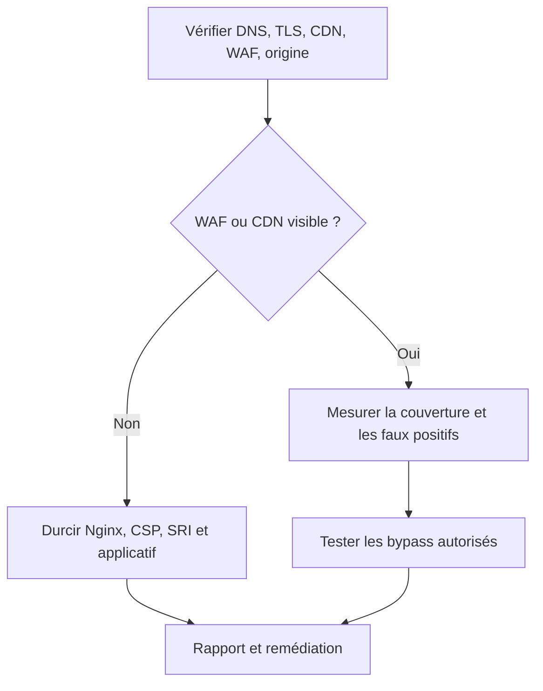
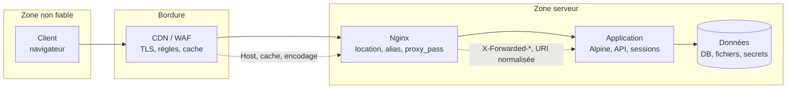

# Audit Nginx et front-end — plan actif

Ce document est le plan de test d'une cible web dont la stack observée est Nginx, Alpine.js, Tailwind CSS, jsDelivr, Google Fonts et Lucide, sans WAF visible. Il ne remplace pas les règles d'engagement : il suppose un ROE signé, un périmètre écrit et une fenêtre autorisée, décrits dans [[Test d'intrusion web — cadre et ROE]].

« Pas de WAF visible » est une hypothèse de travail, pas une conclusion. Un WAF peut être présent derrière un CDN, en mode détection seule, avec une page d'erreur personnalisée ou une couverture partielle. La première étape consiste donc à vérifier l'architecture réelle avant de choisir les tests.



## Hypothèses et priorités

| Composant | Rôle observé | Surface d'attaque | Priorité |
|---|---|---|---|
| Nginx | Serveur web, reverse proxy, TLS, en-têtes, cache | Configuration, normalisation, proxy, rate limiting, fichiers exposés | Haute |
| Alpine.js | Réactivité côté client, attributs `x-*` | XSS DOM, `x-html`, `x-init`, `x-bind`, CSP, eval | Haute |
| Tailwind CSS | Styles utilitaires, build ou CDN | Injection de classes, CSP, build de production | Moyenne |
| jsDelivr | CDN de bibliothèques JavaScript | SRI, version pinning, compromission CDN, CSP | Haute |
| Google Fonts | Polices et CSS externes | RGPD, CSP, disponibilité, fuite d'IP | Moyenne |
| Lucide | Icônes SVG côté client | Injection SVG, noms d'icônes contrôlés, `innerHTML` | Moyenne |
| WAF | Non visible | Faux négatif d'architecture, couverture, bypass | À vérifier |
| Applicatif | Authentification, autorisation, logique métier | IDOR, injection, upload, race, API | Haute |

L'ordre de travail recommandé est : architecture, Nginx, CSP et dépendances front-end, Alpine, applicatif, puis WAF si présent. Un test Alpine sans CSP ni SRI donne une vision incomplète : la même faille peut être bloquée ou aggravée par les contrôles du navigateur.

## Vérifier l'architecture réelle

Avant tout scan applicatif, confirmer :

- les enregistrements DNS, les sous-domaines et les certificats dans Certificate Transparency ;
- la présence d'un CDN, d'un reverse proxy, d'un load balancer ou d'un WAF ;
- l'origine réelle et sa reachabilité depuis la source IP autorisée ;
- les en-têtes de réponse, les cookies, les redirections et les pages d'erreur ;
- les technologies front-end et leurs versions ;
- les points d'entrée API, WebSocket, upload et administration.

Commandes de base, à utiliser avec les limites de débit du ROE :

```bash
curl -sSI https://cible.example/
curl -sS https://cible.example/ | head -80
nmap -Pn -p 80,443 --script http-headers,http-methods,ssl-enum-ciphers cible.example
testssl.sh --quiet https://cible.example/
whatweb -a 1 https://cible.example/
wafw00f https://cible.example/
```

`wafw00f` et `nmap --script http-waf-detect` ne prouvent pas l'absence de WAF. Ils détectent des signatures connues. Une absence de blocage sur un payload ne signifie pas absence de WAF : le WAF peut être en détection, en apprentissage, ou ne pas couvrir cette route.

## Nginx

Nginx concentre trois risques : la configuration, la normalisation des URI et le comportement du proxy. Une erreur de `location` ou d'`alias` peut exposer des fichiers ; une confiance excessive dans `X-Forwarded-*` peut fausser l'audit ; une mauvaise normalisation peut permettre de contourner un contrôle applicatif.

Le chemin de requête suivant montre les frontières de confiance à tester séparément.



### Revue de configuration

| Point | À vérifier | Risque |
|---|---|---|
| `server_tokens` | `off` | Divulgation de version |
| `autoindex` | `off` | Listing de répertoires |
| `stub_status` | Restreint par IP/auth | Fuite de métriques |
| `location` / `alias` | Slash final, correspondance, `try_files` | Path traversal, exposition de fichiers |
| `merge_slashes` | Cohérent avec l'application | Contournement de règles |
| `proxy_pass` | URI avec ou sans slash, normalisation | Différence entre le chemin vu par Nginx et par l'app |
| `X-Accel-Redirect` | En-tête contrôlable par l'utilisateur | Accès à des fichiers internes |
| `X-Forwarded-*` | Confiance limitée aux proxys connus | Usurpation d'IP, de schéma, de host |
| `set_real_ip_from` / `real_ip_header` | Plages de confiance | Logs et rate limiting faussés |
| `limit_req` / `limit_conn` | Zones, burst, `nodelay` | Absence de protection anti-bruteforce |
| `client_max_body_size` | Cohérent avec les uploads | Déni de service, upload massif |
| `proxy_cache` | Clé de cache, `Vary`, cookies | Cache poisoning, fuite entre utilisateurs |
| `try_files` / `internal` | Fichiers réellement servis | Exposition de backups, `.git`, configs |
| `auth_request` | Échec fermé, timeouts | Contournement d'authentification |
| En-têtes | HSTS, CSP, `nosniff`, `Referrer-Policy` | Clickjacking, sniffing, fuite de référent |
| TLS | Protocoles, ciphers, OCSP, HSTS | Faiblesses de transport |
| Permissions | Lecture des configs, secrets, logs | Élévation locale ou fuite |

`nginx -T` affiche la configuration effective, y compris les includes. Il faut le faire sur une copie ou avec l'accord du client, et éviter d'exposer des secrets dans les preuves.

### Tests spécifiques

- **Alias traversal** : vérifier les chemins avec slash final, double slash, encodage, `..`, `%2e%2e`, `%252e%252e`.
- **Normalisation** : comparer ce que Nginx transmet et ce que l'application interprète. Un WAF ou un `location` qui voit `/api/../admin` différemment de l'application est une faille de chaîne.
- **Proxy** : tester `X-Forwarded-For`, `X-Forwarded-Host`, `X-Forwarded-Proto`, `X-Real-IP` si l'application les utilise pour l'authentification, les liens de réinitialisation ou le rate limiting.
- **Host header** : vérifier la génération de liens, les redirections et les caches avec un `Host` non prévu. Voir [[Host Header Injection]].
- **Cache** : tester les variations d'en-têtes, de cookies, de paramètres et de méthode. Voir [[Web Cache Poisoning]].
- **Smuggling** : uniquement si autorisé et si un proxy intermédiaire est présent. Voir [[HTTP Request Smuggling]].
- **HTTP/2** : vérifier les limites d'en-têtes, les conversions HTTP/1.1 et les comportements de réinitialisation.
- **TLS** : `testssl.sh`, `sslyze` ou `nmap --script ssl-enum-ciphers`, avec attention aux protocoles obsolètes, aux ciphers faibles et à la chaîne de certificats.
- **Fichiers sensibles** : `.git/`, `.env`, backups, `nginx.conf`, fichiers de déploiement, sources maps. Tester avec des requêtes limitées, sans bruteforce massif.

Les en-têtes ajoutés dans un `location` ne sont pas hérités du `server` si ce `location` contient un autre `add_header`. Utiliser `always` et vérifier chaque route, ou centraliser les en-têtes dans un include.

## Alpine.js

Alpine.js est un framework réactif qui repose sur des attributs HTML `x-*`. Il ne crée pas de faille en soi, mais il transforme des données serveur ou URL en expressions exécutées dans le navigateur. Les risques dépendent de la façon dont l'application construit ces attributs.

| Directive | Usage | Risque principal |
|---|---|---|
| `x-data` | État local, souvent sérialisé depuis le serveur | Injection de JSON, propriétés inattendues, prototype pollution |
| `x-init` | Exécution à l'initialisation | Exécution d'expression, `eval`, CSP |
| `x-on` | Gestionnaires d'événements | Exécution inline, `$event`, contournement de validation |
| `x-bind` | Liaison d'attributs | `href="javascript:"`, `src`, `style`, `on*` |
| `x-model` | Liaison de formulaire | Données non validées, pollution d'état |
| `x-for` | Listes | Injection de template, clés, DOM clobbering |
| `x-if` / `x-show` | Affichage conditionnel | Fuite d'état, différence entre DOM et visibilité |
| `x-text` | Texte | Généralement sûr, mais peut divulguer des données |
| `x-html` | HTML brut | XSS direct si la donnée n'est pas fiable |
| `x-effect` | Effet réactif | Effets de bord, appels réseau, fuites |
| `x-teleport` | Déplacement de DOM | Contournement de conteneur, sanitization |
| `x-cloak` | Masquage avant init | Fuite visuelle, pas de sécurité |

Le point critique est `x-html` : il correspond à `innerHTML`. Si une donnée utilisateur, un paramètre d'URL, un champ de profil ou une réponse API y arrive, c'est une XSS DOM. `x-bind` est également sensible lorsqu'il contrôle `href`, `src`, `style` ou un gestionnaire d'événement.

### Matrice de test

| Contexte | Payload à tester | Contrôle attendu |
|---|---|---|
| `x-data` | Guillemets, `</script>`, JSON malformé | Échappement serveur, parsing strict |
| `x-init` | Expression, appel de fonction, `alert` | Pas de donnée utilisateur, CSP |
| `x-bind:href` | `javascript:`, `data:`, URL externe | Allowlist de schémas |
| `x-bind:style` | `url()`, `expression()`, propriétés | Allowlist ou absence de contrôle utilisateur |
| `x-on` | Nom d'événement, modificateur, expression | Pas de donnée utilisateur |
| `x-html` | ``, SVG, `iframe` | Sanitization DOMPurify, CSP |
| `x-text` | HTML, caractères spéciaux | Encodage correct, pas d'interprétation |
| `x-for` | Template, clés, HTML imbriqué | Échappement, pas de `x-html` |
| `x-model` | Valeurs, types, objets | Validation serveur, schéma |
| `x-teleport` | Sélecteur, contenu | Sélecteur fixe, sanitization |

Tester aussi la version d'Alpine, les plugins, le mode CSP build, la présence de `unsafe-eval` dans la CSP, le rendu serveur et l'hydratation. Une page qui semble sûre sans JavaScript peut devenir vulnérable après l'initialisation.

### Remédiation

- Remplacer `x-html` par `x-text` chaque fois que possible.
- Si le HTML est indispensable, assainir avec DOMPurify ou une politique serveur, puis vérifier le résultat.
- Ne jamais construire `x-init`, `x-on` ou `x-bind` avec des données utilisateur.
- Utiliser le build CSP d'Alpine et éviter `unsafe-eval`.
- Mettre en place une CSP stricte, Trusted Types si disponible, et des tests de non-régression.
- Valider et encoder côté serveur, pas seulement dans le navigateur.
- Auditer les plugins et les composants qui utilisent `innerHTML`.

## Tailwind CSS

Tailwind est une couche de styling. Il n'a pas de modèle de sécurité propre, mais son mode de déploiement compte.

- **Build de production** : préférer un build local, avec purge du CSS, plutôt que le CDN Tailwind en production. Le CDN ajoute une dépendance, du JavaScript et une surface de disponibilité.
- **Classes dynamiques** : si l'utilisateur contrôle des classes, il peut modifier l'interface, masquer des éléments, fausser un bouton ou injecter des valeurs arbitraires. Ce n'est pas une XSS en soi, mais cela peut faciliter le clickjacking ou la fuite visuelle.
- **Valeurs arbitraires** : `bg-[url(...)]` et les valeurs arbitraires doivent être interdites sur des entrées non fiables. Une CSS injection peut provoquer des requêtes ou des effets visuels.
- **CSP** : un build Tailwind peut nécessiter des styles inline. Préférer des fichiers CSS servis par le site, des hashes ou des nonces, et éviter `unsafe-inline` si possible.
- **Plugins** : vérifier les plugins, les versions et les dépendances avant de les ajouter au build.

Tailwind ne doit pas être présenté comme un contrôle de sécurité. La validation des entrées, l'encodage et la CSP restent nécessaires.

## Chaîne d'approvisionnement front-end

Les bibliothèques chargées depuis un CDN sont du code exécuté dans l'origine. Un CDN compromis, une version malveillante ou un paquet détourné peut entraîner une compromission complète du front-end.

> [!abstract] Définition — Subresource Integrity
> Mécanisme qui permet au navigateur de vérifier qu'un fichier chargé depuis un CDN correspond à un hash connu. L'attribut `integrity` contient un hash cryptographique, et `crossorigin="anonymous"` est nécessaire pour les ressources cross-origin. SRI protège contre la modification du fichier, pas contre une version vulnérable ou un paquet malveillant publié par le fournisseur.

### jsDelivr

- Épingler une version exacte, pas `latest` ni une plage flottante.
- Ajouter `integrity` et `crossorigin` sur chaque script et feuille de style compatible.
- Vérifier le contenu réellement servi et calculer le hash soi-même :

```bash
curl -sS https://cdn.jsdelivr.net/npm/alpinejs@3.14.1/dist/cdn.min.js \
  | openssl dgst -sha384 -binary \
  | openssl base64 -A
```

- Préférer l'auto-hébergement pour les bibliothèques critiques.
- Surveiller les avis de sécurité et les changements de mainteneur.
- Ne pas charger de script depuis un domaine contrôlé par un utilisateur.

Un exemple de balise, avec un hash réel et non un placeholder :

```html
<script
  src="https://cdn.jsdelivr.net/npm/alpinejs@3.14.1/dist/cdn.min.js"
  integrity="sha384-REMPLACER_PAR_LE_HASH_CALCULE"
  crossorigin="anonymous"
  defer></script>
```

### Google Fonts

Google Fonts est pratique mais pose deux questions : la dépendance externe et la confidentialité. Le chargement direct transmet l'IP et l'en-tête `Referer` à Google. Pour un site à exigences RGPD ou pour réduire la surface, auto-héberger les polices et servir le CSS localement. Vérifier aussi la CSP `font-src` et `style-src`.

### Lucide

Lucide génère des icônes SVG. Les risques apparaissent lorsque le nom de l'icône, la couleur, la taille ou le contenu SVG vient de l'utilisateur.

- Ne pas passer de HTML utilisateur à `createIcons` ou à `innerHTML`.
- Utiliser une allowlist de noms d'icônes.
- Éviter les attributs SVG contrôlés par l'utilisateur (`onload`, `href`, `xlink:href`).
- Vérifier la version et les dépendances.
- Si les icônes sont injectées côté serveur, assainir le SVG avec une bibliothèque dédiée.

## CSP et en-têtes

Une CSP utile part d'un principe simple : tout ce qui n'est pas nécessaire est refusé. Elle doit être testée en `Report-Only` avant d'être appliquée, puis surveillée.

Exemple de base, à adapter à l'application et à la présence ou non du build CSP d'Alpine :

```http
Content-Security-Policy:
  default-src 'none';
  script-src 'self';
  style-src 'self';
  img-src 'self' data:;
  font-src 'self';
  connect-src 'self';
  frame-ancestors 'none';
  base-uri 'none';
  form-action 'self';
  object-src 'none';
  upgrade-insecure-requests
```

Points d'attention :

- Alpine standard nécessite souvent `unsafe-eval` ; le build CSP évite cette exception.
- Les styles inline de Tailwind ou d'Alpine peuvent nécessiter `unsafe-inline` ; préférer les hashes, les nonces ou des fichiers CSS.
- `frame-ancestors` remplace `X-Frame-Options` pour le clickjacking moderne.
- `report-uri` ou `report-to` permet de détecter les violations, mais collecte des données : vérifier la confidentialité.
- Une CSP n'empêche pas une injection serveur ; elle réduit l'impact de certaines XSS.

En-têtes complémentaires :

```http
Strict-Transport-Security: max-age=31536000; includeSubDomains
X-Content-Type-Options: nosniff
Referrer-Policy: strict-origin-when-cross-origin
Permissions-Policy: camera=(), microphone=(), geolocation=()
Cross-Origin-Opener-Policy: same-origin
Cross-Origin-Resource-Policy: same-origin
```

HSTS avec `preload` ne doit être déployé qu'après vérification de tous les sous-domaines. Une erreur HSTS peut rendre un service inaccessible pendant la durée du `max-age`.

## Tests applicatifs

Le front-end ne doit pas masquer les tests applicatifs classiques :

- **Authentification et session** : MFA, fixation de session, cookies, logout, récupération de compte.
- **Autorisation** : IDOR, accès horizontal, multi-tenant, fonctions admin.
- **Injection** : SQL, NoSQL, commande, template, LDAP, XPath.
- **XSS** : réfléchie, stockée, DOM, mutation, contexte attribut/URL/JS.
- **CSRF et CORS** : actions sensibles, `Origin`, preflight, credentials.
- **SSRF** : URLs fournies par l'utilisateur, webhooks, imports.
- **Upload** : type, extension, contenu, stockage, accès direct, exécution.
- **Logique métier** : prix, quantités, coupons, workflows, race conditions.
- **API** : REST, GraphQL, WebSocket, rate limiting, erreurs, versions.
- **Configuration** : TLS, en-têtes, cookies, cache, erreurs détaillées, secrets.

Les notes de référence sont [[SQL Injections]], [[Command Injection]], [[Path Traversal]], [[File Upload Vulnerabilities]], [[DOM-based Vulnerabilities]], [[Race Conditions]], [[Business Logic Vulnerabilities]], [[Same-Origin Policy et CORS]], [[WebSocket Security]], [[API Security]] et [[GraphQL Security]].

## Absence de WAF

Si l'architecture confirme qu'aucun WAF n'est présent, ce n'est pas un finding en soi : c'est une décision de risque. Il faut alors renforcer les contrôles qui compensent :

- validation et encodage côté application ;
- limitation de débit Nginx (`limit_req`, `limit_conn`) et au niveau applicatif ;
- `fail2ban` ou équivalent pour les tentatives répétées ;
- ModSecurity/CRS si le client peut l'ajouter, avec une phase de détection avant blocage ;
- CDN ou reverse proxy managé si le client accepte la dépendance ;
- CSP, SRI, auto-hébergement des dépendances ;
- journalisation, alerting et revue des erreurs ;
- sauvegardes et plan de restauration.

Un WAF mal réglé peut donner une fausse assurance et bloquer des utilisateurs légitimes. Un WAF absent peut être acceptable si l'application est simple, bien codée, derrière un reverse proxy durci et surveillée. La recommandation doit être contextuelle.

## Détection et coordination SOC

Prévenir le SOC avant les tests et convenir de ce qui doit être détecté :

- pics de 403/404/500 et de requêtes anormales ;
- motifs SQLi, XSS, traversal, commande, upload ;
- changements de user-agent, de méthode, de content-type ;
- requêtes vers des chemins sensibles (`.git`, `.env`, admin, backups) ;
- déclenchements de `limit_req`, de `fail2ban` ou du WAF ;
- erreurs Nginx, timeouts, saturation.

Le débrief peut mesurer le délai de détection, la qualité de l'alerte, la couverture des logs et la capacité à distinguer un test d'une attaque réelle. C'est un livrable de valeur, même si le test est technique.

## Nettoyage et rapport

Avant de clôturer :

- supprimer les comptes de test, fichiers uploadés, tâches, clés, tokens et ressources cloud ;
- restaurer les configurations modifiées et vérifier l'état initial ;
- vérifier qu'aucun webshell, fichier de test ou règle temporaire ne reste ;
- documenter ce qui n'a pas pu être nettoyé ;
- produire le rapport avec preuves, criticité, remédiation et matrice de couverture WAF si applicable ;
- planifier le retest.

Le rapport doit distinguer les faits observés des hypothèses. « Aucun WAF détecté » n'est pas « aucun WAF présent ». « Aucune exploitation réussie » n'est pas « aucune vulnérabilité ».

## Annexe — WAF Apache (conditionnel)

Cette annexe ne s'applique que si un WAF Apache/ModSecurity est présent, ou si le client demande une évaluation de cette brique. Elle ne doit pas être utilisée pour affirmer un bypass sur une cible qui n'a pas de WAF.

### Revue de configuration

| Paramètre | À vérifier | Risque |
|---|---|---|
| `SecRuleEngine` | `On` ou `DetectionOnly` | Détection sans blocage, faux sentiment de sécurité |
| `SecRequestBodyLimit` | Cohérent avec les uploads | Contournement par gros corps, déni de service |
| `SecRequestBodyNoFilesLimit` | Limite des champs | XML/JSON massif, parsing coûteux |
| `SecPcreMatchLimit` | Valeur assez haute mais bornée | ReDoS, saturation CPU |
| `SecAuditEngine` | `RelevantOnly` ou `On` | Absence de preuves, fuite de logs |
| `SecAuditLogParts` | Contenu utile sans secrets | Fuite de données sensibles |
| `SecDefaultAction` | `phase:1,log,pass` ou `deny` | Comportement incohérent |
| CRS `paranoia_level` | 1 à 4 selon le risque | Faux positifs ou couverture insuffisante |
| `anomaly_score_threshold` | Cohérent avec le paranoia level | Blocage trop tôt ou trop tard |
| Exclusions | Documentées et justifiées | Angle mort permanent |
| `SecRuleRemoveById` | ID précis, pas de plage large | Désactivation involontaire de familles de règles |

### Tests

1. **Baseline** : requêtes légitimes, formulaires, uploads, API JSON, cookies, langues, encodages. Mesurer les faux positifs avant de tester les attaques.
2. **Couverture** : SQLi, XSS, LFI/RFI, RCE, injection de commande, PHP injection, traversal, protocol violations, scan de chemins.
3. **Encodages** : URL, double URL, Unicode, entités HTML, overlong UTF-8, null byte, casse, commentaires SQL, espaces, chunked, multipart.
4. **Formats** : JSON, XML, multipart, formulaires, cookies, en-têtes, query string, path.
5. **Transport** : HTTP/1.1 et HTTP/2, keep-alive, pipelining, WebSocket si autorisé.
6. **Faux positifs** : vérifier que les règles ne bloquent pas les noms, les accents, les pièces jointes ou les champs légitimes.
7. **Logs** : vérifier que les requêtes bloquées sont tracées avec un ID de règle exploitable.

Outils : `curl`, `nikto`, `wafw00f`, `nmap --script http-waf-detect`, `ffuf`, `wfuzz`, Burp Suite ou ZAP, avec débit limité et autorisation. Les payloads doivent être choisis pour tester une règle, pas pour saturer le service.

### Matrice de couverture

Cette matrice est un modèle à remplir pendant le test. Les IDs de règles sont indicatifs : ils varient selon la version du CRS et les personnalisations locales.

| Classe | Test de référence | Règles CRS à vérifier | Résultat observé | Faux positifs | Décision |
|---|---|---|---|---|---|
| SQLi | `' OR 1=1--`, `UNION SELECT`, `SLEEP(5)` | `942100`, `942110`, `942120`, `942160` | Bloqué / détecté / ignoré | Recherche, apostrophes, formulaires | À remplir |
| XSS | `<script>alert(1)</script>`, `">`, SVG | `941100`, `941110`, `941120`, `941160` | Bloqué / détecté / ignoré | Commentaires, éditeurs, HTML légitime | À remplir |
| LFI/RFI, traversal | `../../etc/passwd`, `php://filter`, URL distante | `930100`, `930110`, `931100`, `931110` | Bloqué / détecté / ignoré | Noms de fichiers, templates | À remplir |
| RCE, command injection | `; id`, `$(id)`, backticks, `whoami` | `932100`, `932110`, `932160` | Bloqué / détecté / ignoré | Champs de formulaire, noms | À remplir |
| PHP injection | `<?php ... ?>`, `php://input` | `933100`, `933110`, `933160` | Bloqué / détecté / ignoré | Uploads, code affiché | À remplir |
| Protocol violation | méthode invalide, `Content-Length` incohérent, double `Content-Type` | `920100`, `920270`, `920300` | Bloqué / détecté / ignoré | Clients mobiles, proxies | À remplir |
| Scanner, brute force | `nikto`, `ffuf`, user-agents, rafale de 404 | `913100`, `913110`, `913120` | Bloqué / détecté / ignoré | Monitoring, crawlers | À remplir |
| JSON, XML, multipart | corps profond, entités, boundary, champs massifs | `920xxx`, limites `SecRequestBody*` | Bloqué / détecté / ignoré | Uploads, API | À remplir |
| HTTP/2, smuggling | `Transfer-Encoding`, `Content-Length`, `TE: trailers` | `920xxx` et architecture proxy | Bloqué / détecté / ignoré | Proxies, load balancers | À remplir |

Une ligne n'est validée que si la requête a été tracée, le code HTTP et l'ID de règle relevés, et les logs vérifiés. « Bloqué » sans ID de règle n'est pas une preuve.

### Rapport WAF

Pour chaque test, documenter : règle attendue, requête, réponse, code HTTP, ID de règle, faux positif éventuel, recommandation. La matrice ci-dessus sert de synthèse : elle montre quelles classes d'attaques sont bloquées, détectées ou ignorées, et à quel coût pour les utilisateurs légitimes.

## Questions de révision

> [!quiz] Pourquoi « aucun WAF visible » n'est-il pas une conclusion ?
> Parce qu'un WAF peut être derrière un CDN, en mode détection, avec une couverture partielle ou une page d'erreur personnalisée. Il faut vérifier l'architecture, les en-têtes, le comportement et l'origine avant de conclure à son absence.

> [!quiz] Pourquoi `x-html` est-il plus dangereux que `x-text` dans Alpine.js ?
> Parce que `x-html` injecte du HTML via `innerHTML`, ce qui exécute des gestionnaires d'événements et des balises actives. `x-text` traite la donnée comme du texte et l'encode, ce qui réduit fortement le risque de XSS.

> [!quiz] À quoi sert l'attribut `integrity` sur un script chargé depuis jsDelivr ?
> Il permet au navigateur de vérifier que le fichier servi correspond à un hash connu. Il protège contre la modification du fichier par le CDN ou le réseau, mais pas contre une version vulnérable ou un paquet malveillant publié en amont.

> [!quiz] Pourquoi un build Tailwind est-il préférable au CDN en production ?
> Parce qu'il réduit les dépendances, le JavaScript chargé et la surface de disponibilité, et permet de servir un CSS maîtrisé. Le CDN reste utile pour un prototype, pas pour une production critique.

> [!quiz] Que doit contenir un rapport de test WAF pour être utile ?
> Une matrice de couverture par classe d'attaque, les requêtes et réponses, les IDs de règles, les faux positifs, les logs et des recommandations de réglage. Une simple liste de payloads ne permet pas de décider.
