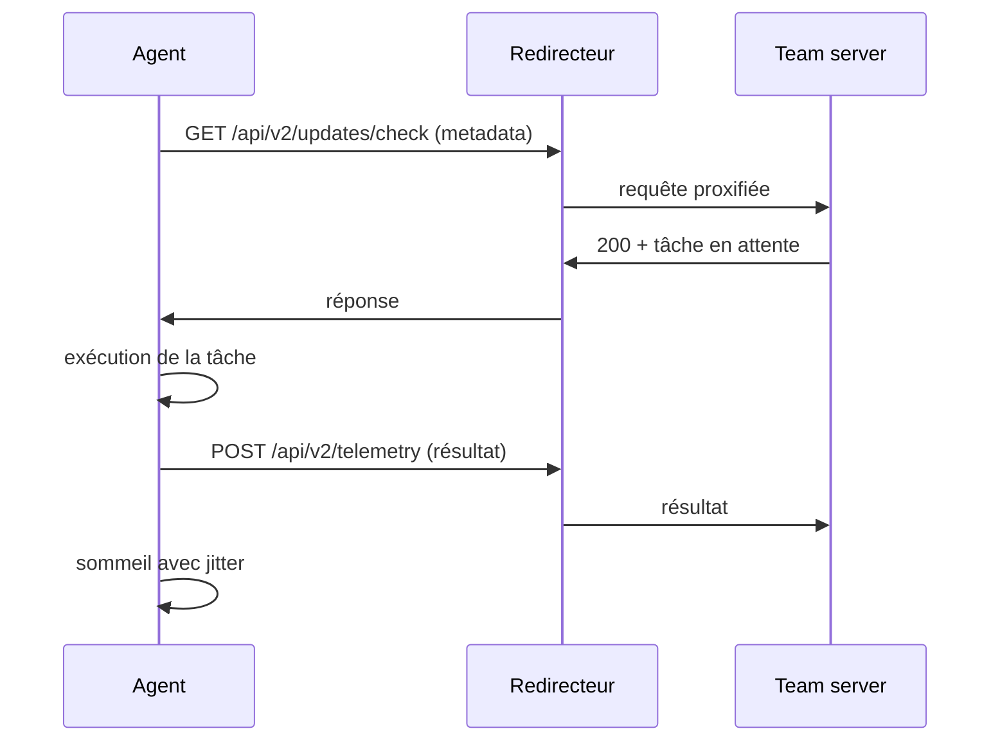

# C2 avancé

[[C2 Infrastructure]] couvre l'architecture de base : team server, redirecteur, agent, et les protocoles usuels. Cette note traite ce qui fait la différence entre une infrastructure qui fonctionne en laboratoire et une infrastructure qui survit à quelques semaines de production : la forme exacte du trafic, la sémantique temporelle des balises, le choix du canal, la façade réseau et le durcissement opérationnel. Le problème n'est plus « comment joindre l'agent » mais « pourquoi ce trafic précisément ressemble-t-il à un implant ».

Un C2 se juge sur trois couches. La couche transport (TLS, DNS, SMB) détermine ce que le réseau voit. La couche protocole (URI, en-têtes, encodage, tailles) détermine ce que le proxy et l'inspection TLS voient. La couche sémantique (périodicité, volume, séquence des requêtes) détermine ce que la corrélation et la chasse voient. Un profil malleable soigné qui beaconne toutes les soixante secondes avec une gigue de 5 % échoue sur la troisième couche, quelle que soit la qualité des deux premières.

> [!abstract] Définition — Profil malleable
> Description déclarative de la manière dont un implant encode et transporte ses messages : URI, verbes HTTP, en-têtes, transformation des données, ordre des blocs, taille des fragments, ainsi que les paramètres temporels du beacon. Le profil ne change pas le protocole de transport ; il change l'empreinte applicative observée par un proxy, un IDS ou un analyste.

## Profils malléables : anatomie et pièges

Un profil Cobalt Strike s'organise en blocs globaux, puis en blocs de transaction (`http-get`, `http-post`, `http-stager`, `dns-beacon`). Les options globales les plus utiles sont `sleeptime`, `jitter`, `useragent`, `host_stage`, `killdate`, `certificate` et les paramètres DNS. `host_stage "false"` supprime le serveur de staging intégré, ce qui réduit fortement la surface d'analyse : un analyste qui retrouve l'URI de staging peut télécharger le payload et extraire la configuration.

```text
set sleeptime "47000";
set jitter "34";
set useragent "Mozilla/5.0 (Windows NT 10.0; Win64; x64) AppleWebKit/537.36 (KHTML, like Gecko) Chrome/128.0.0.0 Safari/537.36";
set host_stage "false";
set killdate "2026-12-31";

http-get {
    set uri "/api/v2/updates/check";

    client {
        header "Accept" "application/json, text/plain, */*";
        header "Accept-Language" "fr-FR,fr;q=0.9";
        metadata {
            base64url;
            prepend "sid=";
            header "Cookie";
        }
    }

    server {
        header "Content-Type" "application/json; charset=utf-8";
        header "Cache-Control" "no-store";
        output {
            mask;
            base64url;
            print;
        }
    }
}

http-post {
    set uri "/api/v2/telemetry";

    client {
        header "Content-Type" "application/json";
        id {
            parameter "client_id";
        }
        output {
            base64url;
            print;
        }
    }

    server {
        header "Content-Type" "application/json";
        output {
            print;
        }
    }
}
```

Trois erreurs reviennent systématiquement. La première est l'incohérence entre le profil et la pile TLS : un User-Agent Chrome servi par une bibliothèque Go ou OpenSSL produit un JA3/JA4 qui ne correspond à aucun navigateur. La deuxième est l'oubli des en-têtes de contexte : un profil qui envoie `Accept-Language: fr-FR` mais dont la page de leurre est en anglais, ou qui n'envoie ni `Sec-Fetch-*` ni `Sec-CH-UA` là où un vrai Chrome les enverrait, se distingue par absence. La troisième est la réutilisation d'un profil public sans modification : les profils « amazon.profile » et autres exemples de dépôts sont connus des règles de détection et des extracteurs de configuration.

```bash
# Validation syntaxique avant déploiement
./c2lint profil.profile

# Comparer le trafic produit à celui d'une application réelle
# (capture côté client, puis analyse des en-têtes et des tailles)
tshark -r beacon.pcap -Y "http.request" -T fields \
  -e http.request.method -e http.request.uri -e http.user_agent -e http.content_length
```

Les frameworks open source suivent la même logique avec d'autres formats. Sliver expose des profils JSON qui décrivent l'URL de C2, la période de polling, la gigue et les options HTTP ; Mythic sépare le profil de transport (plugin `http`, `websocket`, `smb`) de l'agent (Apollo, Poseidon, Medusa). Le principe reste identique : la configuration de transport doit être traitée comme du code, versionnée, testée et propre à chaque engagement.

## Sémantique du beacon

Un beacon n'est pas un tunnel permanent. C'est une boucle : réveil, vérification de la file de tâches, envoi éventuel de résultat, sommeil. La période et la gigue définissent la distribution des réveils ; la file de tâches définit ce qui est envoyé à chaque cycle. Un opérateur qui passe en mode interactif toutes les cinq minutes crée une rupture statistique détectable, même si le profil HTTP est parfait.



La gigue de Cobalt Strike réduit le sommeil d'une fraction aléatoire : la période effective est uniforme entre `sleep × (1 − jitter/100)` et `sleep`. Une gigue de 30 % sur 60 secondes donne donc des intervalles de 42 à 60 secondes, jamais plus de 60. Cette borne supérieure dure est un signal : un trafic humain ou applicatif possède une queue longue, avec des pauses de plusieurs heures et des rafales. Les profils modernes tentent d'imiter cette queue en programmant des fenêtres d'activité, des pauses nocturnes et des variations de volume.

```python
import numpy as np

def profil(intervalles):
    d = np.asarray(intervalles, dtype=float)
    cv = d.std() / d.mean()
    return {
        "moyenne": d.mean(),
        "ecart_type": d.std(),
        "coefficient_variation": cv,
        "min": d.min(),
        "max": d.max(),
        "ratio_max_moyenne": d.max() / d.mean(),
    }

# Un beacon à gigue uniforme garde un CV faible et un ratio max/moyenne proche de 1.
# Du trafic utilisateur produit un CV supérieur à 1 et des pauses longues.
```

Trois paramètres méritent une décision explicite avant le déploiement. Le premier est le sommeil initial : un sommeil long (heures) protège l'infrastructure mais rend l'opération lente ; un sommeil court (secondes) donne de la réactivité et un signal net. Le deuxième est le comportement en cas d'échec : un agent qui réessaie immédiatement après une erreur crée une rafale caractéristique ; il doit reculer exponentiellement avec une gigue. Le troisième est la durée de vie : `killdate` et un mécanisme d'auto-suppression évitent qu'un agent oublié continue de beaconner après la fin de l'engagement.

## Canaux de communication

| Canal | IDs ATT&CK | Avantages | Contraintes | Détection |
|---|---|---|---|---|
| HTTPS | T1071.001, T1573.002 | passe partout, TLS valide | inspection TLS, JA3/JA4 | empreinte TLS, périodicité |
| HTTP/2 | T1071.001 | multiplexage, moins de connexions | empreinte de réglages HTTP/2 | fingerprint Akamai |
| DNS | T1071.004, T1572 | très tolérant, sort souvent | latence, taille des labels | entropie, volume, NXDOMAIN |
| DoH / DoT | T1071.004, T1573 | contourne le DNS interne | résolveur connu, TLS | connexions directes au résolveur |
| SMB / named pipes | T1071.002, T1090.001 | pivot interne, pas de sortie | segmenté, nom de pipe | Sysmon 17/18, partages |
| TCP brut | T1095 | simple, faible surcharge | ports non standards bloqués | connexions longues |
| ICMP | T1095 | traverse certains filtres | payload limité, très visible | taille et fréquence des echo |
| SaaS légitime | T1102.002 | réputation élevée, chiffré | quotas, conditions d'usage | API et user-agent |
| WebSocket | T1071.001 | bidirectionnel, faible latence | connexion longue atypique | durée, volume, handshake |

Le canal DNS reste le plus intéressant pour la sortie contrainte, à condition d'accepter ses limites : un label fait au maximum 63 octets, un nom complet 255, et le débit utile dépend du résolveur récursif et du cache. Les profils DNS modernes utilisent des enregistrements TXT, des sous-domaines délégués à un serveur autoritaire contrôlé par l'attaquant, et des techniques de fragmentation pour reconstituer les messages. Le point faible est statistique : les requêtes DNS légitimes ont des labels courts et une faible entropie ; un tunnel produit des labels longs, aléatoires, et un volume de requêtes par domaine très supérieur à la normale.

DoH déplace le problème : le contenu DNS est chiffré dans TLS vers un résolveur public, donc les journaux DNS internes ne voient plus les noms. Mais la connexion vers le résolveur reste visible, et l'endpoint voit souvent l'agent résoudre ou se connecter directement. Un canal DoH sans nom de domaine contrôlé passe par un résolveur public, ce qui limite le contrôle du serveur autoritaire et introduit une dépendance à un tiers.

Le C2 via services SaaS (T1102) exploite la réputation d'un domaine légitime : messages déposés dans une file, un dépôt, un canal de messagerie ou une API de productivité. Le canal est souvent bidirectionnel par polling, ou unidirectionnel avec un « dead drop resolver » (T1102.001) qui publie l'adresse du serveur réel dans un contenu public. La détection repose moins sur le domaine que sur le comportement : un processus métier qui interroge une API qu'il n'utilise jamais, avec une périodicité de polling, ou un compte de service qui lit un canal auquel il n'a aucune raison d'accéder.

Le C2 interne par named pipes (T1071.002) sert au contraire à la latéralisation : l'agent expose un pipe, un autre agent s'y connecte, et le trafic ne sort jamais du réseau. Le nom du pipe est un artefact : `\\.\pipe\msagent_1234`, `\\.\pipe\win_svc`, ou un nom imitant les pipes SMB légitimes. Sysmon 17 et 18, et l'énumération des pipes, permettent de le repérer.

## Redirecteurs et façade

Un redirecteur n'est utile que s'il ne révèle pas ce qu'il protège. Trois propriétés doivent être vérifiées : aucune fuite d'en-tête (`X-Forwarded-For`, `Via`, `Server` trop bavard), aucune réponse par défaut qui trahisse le framework, et aucune correspondance entre l'adresse IP publique et le team server.

```nginx
# Redirecteur Nginx à liste blanche applicative
map $http_user_agent $backend {
    default                       "";
    "~*Mozilla/5.0.*Chrome/12[0-9]" "c2_backend";
}

upstream c2_backend {
    server 10.0.0.5:443;
}

server {
    listen 443 ssl http2;
    server_name cdn.exemple.com;

    ssl_certificate     /etc/letsencrypt/live/cdn.exemple.com/fullchain.pem;
    ssl_certificate_key /etc/letsencrypt/live/cdn.exemple.com/privkey.pem;

    location /api/v2/updates/check {
        if ($backend = "") { return 404; }
        proxy_pass https://c2_backend;
        proxy_ssl_server_name on;
        proxy_set_header Host $host;
        proxy_set_header X-Forwarded-For "";
        proxy_hide_header X-Powered-By;
    }

    location / {
        root /var/www/leurre;
        try_files $uri $uri/ /index.html;
    }
}
```

La liste blanche par User-Agent est un compromis : elle arrête les scanners naïfs, mais un analyste qui rejoue la requête avec le bon User-Agent obtient le backend. Une variante plus robuste ajoute un secret applicatif dans un en-tête ou un cookie, vérifié par le redirecteur ; le beacon doit alors le présenter, ce qui lie l'accès au profil. La faiblesse est qu'un secret embarqué dans un implant peut être extrait d'un binaire capturé.

Les CDN et les reverse proxies managés (Cloudflare, Fastly, CloudFront) ajoutent une couche de réputation et absorbent le DDoS, au prix d'une journalisation chez le fournisseur et d'une catégorisation parfois défavorable. Le domain fronting classique est largement bloqué, mais l'asymétrie SNI/Host qu'il exploitait reste pertinente : tout contrôle qui ne compare pas le SNI TLS, l'en-tête `Host` et la destination réelle laisse passer une variante. Les certificats sont un point de fuite majeur : Certificate Transparency journalise chaque certificat émis, ce qui permet à un défenseur de découvrir un domaine de campagne avant son premier usage. Un certificat wildcard obtenu sur un domaine ancien réduit cette exposition, sans la supprimer.

La catégorisation des domaines conditionne le filtrage : un domaine classé « informatique » ou « finance » passe plus facilement qu'un domaine « non classé » ou « nouvellement enregistré ». Les fournisseurs de catégorisation acceptent des soumissions ; un domaine correctement catégorisé et âgé est un actif, pas un détail.

## Durcissement du team server et des opérateurs

Le team server est le composant le plus coûteux à perdre : il contient les agents, l'historique des commandes, les identifiants des opérateurs et souvent des données sensibles. Il ne doit jamais être exposé directement à Internet. Les pratiques minimales sont : accès par VPN ou tunnel SSH, interface d'administration liée à une adresse privée, authentification forte, comptes opérateurs nominatifs, journalisation des connexions, chiffrement du disque, sauvegardes chiffrées et procédure de destruction.

```bash
# Tunnel SSH vers l'interface du team server (aucune exposition publique)
ssh -L 50050:127.0.0.1:50050 ops@bastion.exemple.net -N

# Vérifier ce que voit Internet depuis l'extérieur
nmap -Pn -p- --min-rate 200 203.0.113.10
curl -skI https://203.0.113.10/ | head

# rotation : reconstruire plutôt que réparer
terraform apply -var "engagement=client-a" -var "phase=recon"
```

La séparation d'infrastructure est un principe, pas une précaution : phishing, C2, exfiltration et serveur de leurres doivent vivre sur des domaines, des adresses et idéalement des fournisseurs différents. Un domaine brûlé lors du phishing ne doit pas entraîner la perte du C2. La rotation doit être préparée avant d'être nécessaire : profil de secours, domaine de secours, redirecteur de secours, procédure de bascule testée. Le « burn control » — décider quand abandonner une infrastructure — est traité dans [[OPSEC Red Team]].

## Détection

La détection d'un C2 avancé ne repose sur aucun indicateur unique. Elle combine empreinte, statistique et contexte.

**Empreinte réseau.** JA3 et JA4 identifient la pile TLS cliente ; JA4S la réponse serveur ; JARM le serveur. Un agent compilé en Go, en Rust ou avec OpenSSL ne présente pas la même empreinte qu'un navigateur, même avec un User-Agent parfait. Les réglages HTTP/2 (taille de fenêtre, ordre des paramètres, priorité) forment une empreinte complémentaire. L'ordre des en-têtes, la présence de `Sec-Fetch-Site`, la cohérence entre `User-Agent` et `Sec-CH-UA` sont des signaux à corréler avec l'empreinte TLS.

**Statistique temporelle.** RITA, AC-Hunter ou une règle SIEM calculent la dispersion des intervalles par couple source/destination. Un coefficient de variation inférieur à 0,2 sur plusieurs dizaines de connexions, avec une borne haute stable, est anormal pour du trafic utilisateur. La même analyse s'applique au volume par requête : les tailles de metadata et de résultats d'un beacon sont souvent dans une plage étroite.

**DNS et proxy.** Les signaux sont l'entropie des labels, la longueur moyenne des noms, le ratio NXDOMAIN, la répétition d'un même sous-domaine, les requêtes TXT inhabituelles, les connexions directes à des résolveurs DoH publics et les domaines vus pour la première fois. Les journaux de proxy ajoutent l'URI, la méthode, le User-Agent, le code de retour et le volume ; une séquence `GET` régulière suivie d'un `POST` de taille variable est typique.

```yaml
title: Requête DNS à label long et entropie élevée
id: 7d2b1f6e-3a4c-4b8e-9f10-6c5d2a1b8e33
status: experimental
logsource:
  category: dns_query
detection:
  selection:
    QueryName|re: '^[a-z0-9]{40,}\.'
  filter:
    QueryName|endswith:
      - '.microsoft.com'
      - '.windowsupdate.com'
  condition: selection and not filter
falsepositives:
  - CDN à identifiants longs
  - Services de télémétrie
level: medium
```

**Hôte.** Sysmon 3 (connexions réseau) et 22 (requêtes DNS) relient un processus à une destination ; Sysmon 17/18 couvre les named pipes. Les connexions sortantes depuis `rundll32.exe`, `regsvr32.exe`, `mshta.exe` ou un processus bureautique sont déjà couvertes par [[AV-EDR Evasion]]. La mémoire complète le tableau : un beacon qui ne touche jamais le disque mais dont les chaînes de configuration (URI, User-Agent, clé) sont en clair dans une région privée reste détectable par scan mémoire et par extraction de configuration.

```yaml
title: Création de named pipe au nom générique de C2
id: 2a9c4e77-5b1d-4c3a-8e6f-0f7d9b2c4a55
status: experimental
logsource:
  product: windows
  category: pipe_created
detection:
  selection:
    PipeName|startswith:
      - '\msagent_'
      - '\win_svc_'
      - '\svcctl_'
  condition: selection
falsepositives:
  - Logiciels de gestion
level: medium
```

La limite est connue : un attaquant qui accepte un beacon lent, un profil cohérent avec une application réelle observée sur le réseau, un certificat valide et un domaine catégorisé ne sera détecté que par une analyse statistique ou par une anomalie d'identité. C'est pourquoi les programmes de C2 mature investissent autant dans la forme du trafic que dans l'implant : la partie la plus visible de l'opération est souvent la seule qui reste observable.

> [!quiz] Pourquoi une gigue de 30 % ne suffit-elle pas à masquer un beacon ?
> Parce que la gigue de Cobalt Strike réduit le sommeil sans jamais le dépasser : la distribution garde une borne haute stable et un coefficient de variation faible. Un détecteur qui mesure la dispersion et la régularité de la borne haute retrouve la périodicité malgré la gigue.

> [!quiz] Quel est le risque principal d'un profil qui imite parfaitement Chrome mais utilise OpenSSL ?
> L'incohérence entre l'empreinte TLS (JA3/JA4) et l'empreinte annoncée par le User-Agent et les en-têtes HTTP/2. Le profil applicatif est crédible, mais la pile qui l'émet ne correspond pas au client qu'il prétend être.

> [!quiz] Pourquoi `host_stage "false"` réduit-il la surface d'analyse ?
> Parce que le staging intégré expose une URI supplémentaire depuis laquelle un analyste peut télécharger le payload et en extraire la configuration (URI de C2, User-Agent, clés). Sans staging, cette prise directe disparaît et l'analyse doit passer par la capture d'un binaire déjà livré.
