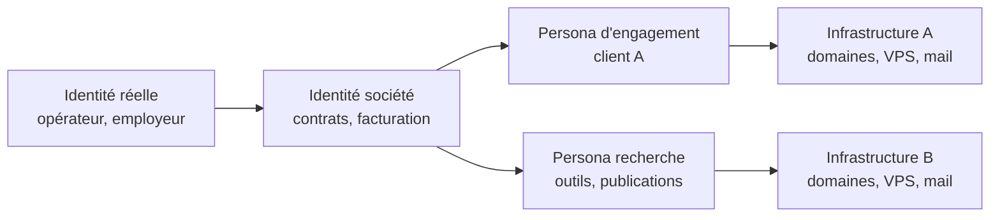
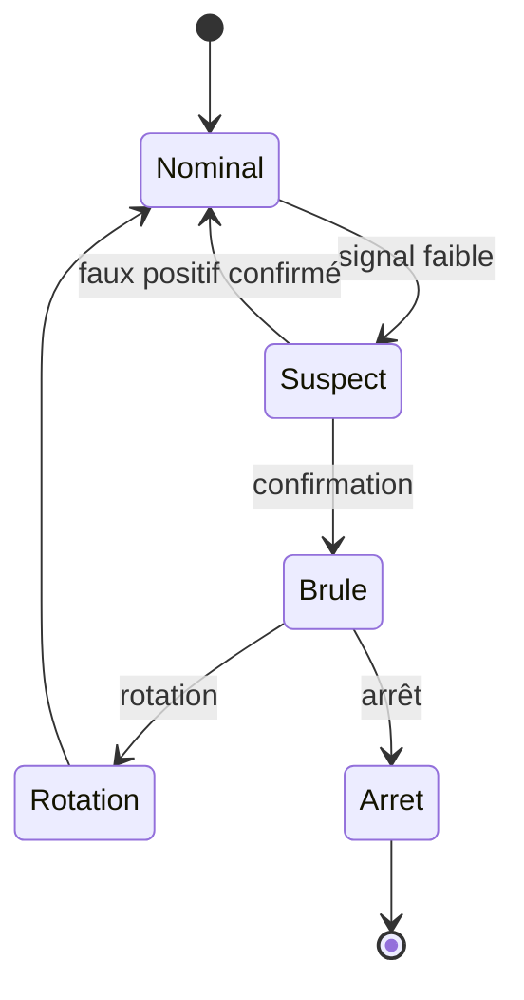

# OPSEC Red Team

L'OPSEC (operational security) d'un red team n'est pas une collection d'astuces pour rester invisible. C'est une discipline de gestion du risque : identifier ce que l'opérateur révèle, à qui, à quel coût, et décider consciemment ce qui peut être sacrifié. Une opération peut être techniquement réussie et stratégiquement ratée si elle attribue l'équipe, expose le client, ou contamine l'infrastructure d'un autre engagement.

Pour l'anonymat personnel, le pseudonymat et la non-attribution en dehors d'un engagement, voir [[OPSEC et anonymat]]. Les deux notes partagent la même logique de modèle de menace, mais les actifs, les adversaires et les contraintes juridiques diffèrent.

Le modèle de menace de l'opérateur est plus large que celui du défenseur. Le blue team cherche l'intrusion ; l'équipe forensique cherche l'origine ; l'éditeur EDR cherche une signature ; le régulateur cherche une faute ; le journaliste cherche une histoire ; l'attaquant tiers cherche une infrastructure à réutiliser. Chacun observe des artefacts différents, et l'OPSEC consiste à réduire l'intersection de ces observations, pas à disparaître.

> [!abstract] Définition — OPSEC
> Ensemble des pratiques qui consistent à identifier les informations exploitables laissées par une opération — identité, infrastructure, outils, horaires, artefacts — puis à les supprimer, les cloisonner ou les rendre non concluantes, en acceptant un coût opérationnel explicite. L'objectif n'est pas l'anonymat absolu, qui n'existe pas, mais de rendre l'attribution plus coûteuse que la valeur de l'information obtenue.

## Le modèle de menace de l'opérateur

Un red team honnête part du principe que tout sera vu un jour : les journaux sont conservés, les captures réseau sont rejouables, les binaires sont analysés. La question n'est donc pas « comment ne pas être vu ? » mais « que verra-t-on, et qu'est-ce que cela prouvera ? ».

| Acteur | Ce qu'il cherche | Ce qu'il voit | Coût pour l'opérateur |
|---|---|---|---|
| SOC / blue team | alerte, anomalie, intrusion | télémétrie EDR, proxy, DNS, authentification | détection, arrêt de la phase |
| DFIR | chronologie, origine, ampleur | disques, mémoire, journaux, artefacts de persistance | attribution, preuve exploitable |
| Éditeur EDR / AV | signature, comportement | binaires, chaînes, configurations | blocage, détection générique |
| Threat intelligence | campagne, infrastructure | domaines, certificats, ASN, échantillons | fusion avec d'autres campagnes |
| Autorité / justice | infraction, responsabilité | contrats, logs fournisseur, données | qualification pénale |
| Journaliste / chercheur | histoire, vulnérabilité | fuites, dépôts publics, réseaux sociaux | réputation, divulgation |
| Autre attaquant | accès, infrastructure | services exposés, fuites de credentials | réutilisation, faux drapeau |

L'attribution combine des indices techniques et non techniques. Les indices techniques sont l'infrastructure (domaines, adresses, certificats, ASN), les outils (même loader, même profil, même clé), les TTP (séquence de techniques, horaires, cibles), le code (compilateur, erreurs, chaînes) et les artefacts (noms de fichiers, chemins, PDB). Les indices non techniques sont la persona, le moyen de paiement, le style de rédaction, les horaires de travail, la langue, les déplacements et les relations sociales.

> [!abstract] Définition — Attribution
> Processus consistant à rattacher une action à un acteur, une organisation ou un État, avec un degré de confiance explicite. En pratique, l'attribution est toujours probabiliste : elle repose sur des faisceaux d'indices, dont certains peuvent être imités. Un attaquant qui veut brouiller l'attribution ajoute des indices contradictoires ; un opérateur qui veut protéger son client supprime les indices concluants et documente ce qui reste.

## Séparation des identités

La faute la plus fréquente n'est pas technique. C'est le mélange : un domaine de recherche enregistré avec la carte bancaire personnelle, un navigateur d'engagement utilisé pour consulter un compte personnel, un même pseudonyme sur un forum et sur un dépôt GitHub, une VM clonée d'un engagement précédent.



Les règles qui tiennent dans le temps sont simples à énoncer et difficiles à appliquer : une identité par engagement, une infrastructure par identité, aucun compte personnel sur les machines d'engagement, un gestionnaire de secrets par périmètre, des clés SSH et des certificats distincts, des profils de navigateur distincts, et une machine ou une VM dédiée par client. Le clonage d'une VM d'un engagement à l'autre est un piège classique : elle contient l'historique, les domaines, les favoris, les fichiers temporaires et parfois des credentials oubliés.

La cohérence de la persona compte autant que sa séparation. Un opérateur qui se présente comme un prestataire français, travaille aux heures françaises, écrit en français et héberge son infrastructure en France est cohérent. Le même opérateur qui envoie depuis un VPS roumain à 3 heures du matin, avec un texte traduit automatiquement et un domaine en `.top`, produit un faisceau d'indices qui n'a pas besoin d'être technique pour être exploitable. La communication interne reste, elle aussi, hors bande et cloisonnée.

## Infrastructure

L'infrastructure se pense avant l'achat. Chaque élément — domaine, adresse, certificat, boîte mail — est un point d'observation potentiel et un actif à abandonner. Les principes de séparation entre façade, redirecteur et team server sont décrits dans [[C2 Infrastructure]] et approfondis dans [[C2 avancé]].

| Élément | Bonne pratique | Risque |
|---|---|---|
| Domaine | ancien, catégorisé, court, TLD courant | domaine neuf, TLD exotique, historique spam |
| Enregistrement | registrar distinct du fournisseur C2, privacy | WHOIS révélant l'opérateur |
| Paiement | entité de facturation dédiée | carte personnelle, adresse réelle |
| Hébergement | fournisseur réputé, ASN cohérent avec la cible | ASN connu pour du bulletproof |
| Certificat | wildcard, émis avant la campagne | émission au dernier moment, visible en CT |
| Mail | SPF/DKIM/DMARC, rDNS, IP chauffée | IP neuve, réputation nulle |
| Horaires | cohérents avec la persona et la cible | activité nocturne systématique |
| Journalisation | minimale chez le fournisseur | logs conservés et saisissables |

Les certificats sont un piège sous-estimé : Certificate Transparency publie chaque certificat émis, avec un horodatage. Un défenseur qui surveille les nouveaux certificats contenant le nom de son organisation peut découvrir une campagne avant le premier mail. Les certificats wildcard, obtenus sur un domaine ancien et utilisés pour plusieurs sous-domaines, réduisent le nombre de noms exposés : ils restent journalisés, mais le nom révélé est celui du domaine de campagne, pas celui de la cible.

Les domaines et adresses IP doivent être testés depuis l'extérieur : résolution, catégorisation, réputation, listes de blocage, ports, bannière, certificat. Un domaine déjà utilisé, ou une IP déjà signalée, contamine l'opération avant son début.

```bash
# Contrôles avant mise en service
dig +short A cdn.exemple.com
dig +short MX exemple.com
whois exemple.com | grep -iE "creation|registrar|expiry"
curl -s "https://crt.sh/?q=exemple.com&output=json" | jq -r '.[].name_value' | sort -u
nmap -Pn -p 25,80,443,8443 cdn.exemple.com
```

L'ASN et la géographie doivent être cohérents avec le scénario. Une cible européenne qui voit des connexions depuis un hébergeur connu pour du scanning, dans un pays sans lien avec son activité, produit un signal immédiat. À l'inverse, un hébergeur grand public dans le pays de la cible se fond dans le bruit — au prix d'une coopération judiciaire plus facile en cas d'incident. Ces acquisitions relèvent de T1583 (infrastructure), T1585 (comptes) et T1608 (staging) dans ATT&CK.

## Hygiène des artefacts

Un binaire est un témoin. Il porte l'environnement de compilation, les chemins, les chaînes, les ressources, parfois l'identité de l'opérateur.

| Artefact | Ce qu'il révèle | Contre-mesure |
|---|---|---|
| Chemin PDB | nom d'utilisateur, arborescence, projet | compilation sans PDB, `PDBALTPATH`, build isolé |
| Horodatage de compilation | fuseau, date, chaîne d'outils | build reproductible, horodatage contrôlé |
| Chaînes | commentaires, URLs internes, noms | revue des chaînes, pas de données réelles |
| Ressources | icône, version, description | ressources cohérentes avec le prétexte |
| Signature | éditeur, certificat, chaîne | certificat dédié, jamais réutilisé |
| Nom et chemin | vocabulaire de l'opérateur | nom conforme aux conventions du client |
| Charge utile | configuration C2, clés | profil dédié, rotation après engagement |

La chaîne de build doit être isolée : une VM ou un conteneur dédié, sans identifiants personnels, avec un nom d'hôte neutre, un fuseau horaire cohérent et un compilateur configuré pour ne pas embarquer de chemins absolus. MSVC inscrit le chemin du PDB dans l'exécutable ; `/PDBALTPATH` permet de le remplacer, et une compilation sans débogage supprime une partie du problème sans le résoudre complètement. Les chaînes Unicode, les noms de fonctions et les messages d'erreur sont relus avant livraison : un `C:\Users\alice\Documents\payload\` dans un binaire est une signature.

La signature de code est ambivalente. Un certificat valide réduit les alertes SmartScreen et les blocages de confiance ; un certificat volé ou réutilisé crée un lien direct entre plusieurs campagnes et permet à l'autorité de certification de révoquer le certificat, donc tous les binaires signés avec lui. Un certificat dédié, acheté par l'entité de facturation, avec une durée de vie limitée à l'engagement, est la seule option raisonnable.

Les noms et les chemins doivent appartenir au client, pas à l'opérateur. `C:\ProgramData\Contoso\Agent\svc.exe` est plus crédible que `C:\Temp\beacon.exe`, et `Facture_2026-1042.pdf` est plus crédible que `document_final_v3.pdf`. Le nom du binaire, celui du service, la description et l'icône doivent raconter la même histoire. Un fichier nommé « mise à jour » qui s'exécute depuis `Downloads` et ouvre une connexion vers un domaine inconnu reste suspect quel que soit son nom, mais l'incohérence entre le nom et le comportement est un signal supplémentaire.

Le test des binaires est un point de fuite majeur. L'envoi d'un échantillon sur un service public de multi-analyse transmet le binaire, sa configuration, ses chaînes et parfois l'URL du C2 à un tiers qui peut les publier. Les plateformes de sandbox publiques font de même. La règle est simple : jamais d'échantillon réel sur un service public, jamais de domaine réel dans un binaire envoyé à un service tiers, et validation sur une infrastructure de test dédiée.

## Ce que l'opérateur laisse

Chaque action produit une trace chez quelqu'un. La liste ci-dessous sert à la fois à l'opérateur qui veut réduire son empreinte et au défenseur qui veut la reconstituer.

| Source | Trace | Durée typique |
|---|---|---|
| DNS récursif | nom, heure, client, réponse | jours à mois |
| Proxy | URL, SNI, User-Agent, volumes | semaines à mois |
| Pare-feu | IP source, IP destination, ports, octets | semaines à mois |
| EDR | arbre de processus, ligne de commande, réseau | semaines à mois |
| Windows | 4624, 4625, 4648, 4688, 4104, 7045, 4698 | selon politique |
| Messagerie | en-têtes, SPF/DKIM, Message-ID, IP d'envoi | mois à années |
| Certificate Transparency | nom, date, émetteur | permanent |
| WHOIS / passive DNS | enregistrement, historique | années |
| Dépôts publics | outils, configurations, clés | permanent |
| Fournisseur cloud | logs d'API, facturation, adresse IP | mois |

Les journaux Windows sont surestimés par les attaquants et sous-exploités par les défenseurs. La ligne de commande (4688 avec audit activé, ou Sysmon 1) est l'artefact le plus rentable : elle contient le nom du binaire, les arguments, les chemins et parfois des secrets. PowerShell 4104 donne le script déobfusqué. Les journaux de tâches planifiées (4698, 4702) et de services (7045) sont peu volumineux et très discriminants.

Les journaux de messagerie conservent les en-têtes `Received`, qui révèlent la chaîne de serveurs, l'IP d'envoi et parfois le logiciel utilisé. Un `Message-ID` généré par un outil de phishing, un `X-Mailer` incohérent ou un `Received` qui ne correspond pas au domaine annoncé sont des indices durables.

## Gestion du bruit

Le bruit est une ressource. Une opération doit définir, phase par phase, le niveau de bruit acceptable : discret pendant l'accès initial et la reconnaissance, plus tolérant pendant la validation d'un objectif, jamais gratuit. Un scan massif, une énumération AD complète ou dix dumps de secrets produisent des alertes qui n'ont pas besoin d'être corrélées.

La bonne pratique est de privilégier les actions qui ressemblent à de l'administration légitime : utiliser les outils déjà présents, les chemins déjà utilisés, les comptes de service déjà actifs, les horaires de maintenance, les noms de tâches existants. Cela ne rend pas l'action invisible, mais cela la place dans une distribution normale. À l'inverse, une action « furtive » techniquement (un binaire renommé, un port non standard) mais inhabituelle pour l'environnement attire l'attention par son anomalie statistique.

Le bruit doit être réparti dans le temps. Une rafale de connexions vers dix machines en cinq minutes est un signal ; les mêmes connexions étalées sur deux jours, pendant les heures d'administration, se confondent avec l'activité normale. La contrainte est opérationnelle : une opération lente coûte plus cher et laisse plus de temps au défenseur.

## Burn control

Une infrastructure est « brûlée » quand un défenseur l'a identifiée, bloquée ou associée à l'opération. Le burn control est la procédure qui décide quoi faire : continuer, suspendre, remplacer, ou arrêter.



Les signaux à surveiller sont : l'arrêt brutal des callbacks, des réponses 403 ou 404 systématiques sur le redirecteur, un blocage par l'EDR ou la passerelle, un message du client, une notification de l'hébergeur, un domaine ajouté à une liste de blocage, un certificat révoqué, ou une activité inhabituelle sur les serveurs (scan, brute force, requêtes d'analyse). Un signal isolé ne suffit pas ; la décision doit être prise sur un faisceau.

La procédure doit être écrite avant le début de l'engagement, avec le client : qui décide, à quel numéro, dans quel délai, quelles preuves conserver, comment les agents sont désactivés, et comment l'infrastructure est détruite. La destruction doit être vérifiée (instantanés, sauvegardes, DNS, certificats, boîtes mail), pas supposée. Les données collectées pendant l'engagement suivent la même procédure : conservation minimale, chiffrement, restitution ou destruction documentée.

## Cadre juridique

Un red team opère sous autorisation écrite. Le document de règles d'engagement définit le périmètre, les exclusions, les objectifs, les fenêtres horaires, les contacts d'urgence, les techniques interdites, la gestion des données et les conditions d'arrêt. Sans ce document, les mêmes actions relèvent du code pénal.

En France, les atteintes aux systèmes de traitement automatisé de données sont réprimées par les articles 323-1 et suivants du Code pénal ; l'accès ou le maintien frauduleux, l'entrave et la modification de données sont distincts et n'ont pas les mêmes peines. Au Royaume-Uni, le Computer Misuse Act 1990 couvre l'accès non autorisé et la modification ; aux États-Unis, le Computer Fraud and Abuse Act (18 U.S.C. § 1030) est la base habituelle. Ces qualifications ne dépendent pas de l'intention de bien faire : seule l'autorisation du titulaire du système compte.

Le RGPD ajoute une couche : les données personnelles collectées pendant un test (boîtes mail, documents, journaux) doivent être minimisées, protégées et supprimées selon une durée convenue. Un dump de base de données contenant des données clients réelles, conservé sur une machine personnelle, est un incident de sécurité, même s'il a été obtenu dans le périmètre. Les clauses de confidentialité, l'assurance responsabilité civile et la lettre de mission sont aussi importantes que le contrat.

La « get-out-of-jail letter » est le document que l'opérateur peut présenter aux forces de l'ordre en cas d'interpellation. Elle doit être à jour, signée, contenir un contact joignable et ne pas révéler plus que nécessaire. Elle ne protège pas contre une action hors périmètre.

## Détection

Côté défenseur, l'OPSEC d'un attaquant se lit dans la corrélation. Un domaine seul, un certificat seul ou un User-Agent seul ne prouvent rien ; leur combinaison avec un horaire, une cible et une technique crée un faisceau.

Les chasses utiles portent sur les artefacts durables : domaines enregistrés récemment et résolus par des postes internes, certificats émis pour des noms proches de l'organisation, ASN rarement vus dans le trafic sortant, chaînes de processus inhabituelles, tâches planifiées créées hors fenêtre de maintenance, et binaires dont les métadonnées ne correspondent pas à l'éditeur annoncé. Les règles Sigma et les journaux nécessaires sont décrits dans [[Sigma]] et [[Detection Engineering]] ; la chasse aux artefacts est le cœur de [[Threat Hunting]].

L'analyse des échantillons est tout aussi rentable : un binaire récupéré sur un poste contient souvent la configuration C2, les URI, le User-Agent et parfois l'identité de l'opérateur. Les extracteurs de configuration, les règles YARA sur les chaînes et l'analyse des métadonnées PE sont décrits dans [[Malware Analysis]]. La limite est symétrique : un attaquant qui nettoie ses artefacts ne laisse que du comportement, et le comportement est plus difficile à attribuer qu'un nom de fichier.

> [!quiz] Pourquoi un domaine correctement catégorisé et âgé est-il un actif OPSEC ?
> Parce que le filtrage et la réputation reposent largement sur l'âge, l'historique et la catégorie. Un domaine ancien, classé dans une catégorie banale et sans historique d'abus passe plus facilement qu'un domaine neuf, même si le contenu et le certificat sont identiques.

> [!quiz] Pourquoi la séparation des identités est-elle plus importante que l'obfuscation des binaires ?
> Parce qu'un binaire obfusqué peut être analysé et attribué par ses chaînes, sa configuration ou son comportement, tandis qu'un mélange d'identités relie immédiatement plusieurs engagements, plusieurs clients et la personne réelle. L'obfuscation retarde l'analyse ; la séparation empêche la mise en relation.

> [!quiz] Que doit contenir une procédure de burn control écrite avant l'engagement ?
> Les signaux déclencheurs, le décideur, les contacts, les délais, les actions de rotation ou d'arrêt, la désactivation des agents, la conservation des preuves et la destruction vérifiée de l'infrastructure et des données. Une procédure décidée dans l'urgence, sans le client, transforme un incident technique en incident contractuel.
